# C++ 完整知识体系

> 基于笔记整理，涵盖从基础到进阶的核心知识点，含大量代码示例

---

# 第一部分：基础篇

---

## 一、程序编译过程

C++ 源码到可执行文件经历四个阶段：


| 阶段       | 输入      | 处理                                                  | 输出            |
| ---------- | --------- | ----------------------------------------------------- | --------------- |
| **预处理** | `.cpp`    | 宏展开、`#include` 展开、条件编译(`#ifdef`)、去除注释 | `.i`            |
| **编译**   | `.i`      | 词法分析→语法分析→语义分析→中间代码生成→代码优化      | `.s` (汇编)     |
| **汇编**   | `.s`      | 汇编代码→机器指令                                     | `.o` (目标文件) |
| **链接**   | `.o` + 库 | 符号解析、地址重定位、合并段                          | 可执行文件      |

---

## 二、变量作用域

### 2.1 五种作用域

| 作用域         | 声明位置               | 可见范围                                    | 生命周期               |
| -------------- | ---------------------- | ------------------------------------------- | ---------------------- |
| 全局作用域     | 函数外部               | 整个程序（其他文件用`extern` 声明后也可见） | 程序运行期             |
| 局部作用域     | 函数/代码块内部        | 声明所在代码块内                            | 进入块创建，离开块销毁 |
| 命名空间作用域 | `namespace { }` 内     | 该命名空间内（外部用`::` 访问）             | 同全局                 |
| 类作用域       | `class { }` 内         | 通过对象`.` 或类名 `::` 访问                | 随对象生命期           |
| 块作用域       | `{}` 内（不含函数/类） | 仅该花括号块内                              | 离开`}` 销毁           |

### 2.2 代码示例

```cpp
#include <iostream>
using namespace std;

int globalVar = 42;                         // 全局作用域

namespace MySpace {
    int nsVar = 100;                        // 命名空间作用域
    void nsFunc() { cout << "ns\n"; }
}

class MyClass {
public:
    int classVar = 77;                      // 类作用域
    void show() { cout << classVar; }       // 类内成员函数可访问成员变量
};

void testFunc() {
    int localVar = 10;                      // 局部作用域
    cout << globalVar;                      // ✅ 可访问全局变量
    cout << MySpace::nsVar;                 // ✅ 通过限定名访问命名空间

    MyClass obj;
    obj.classVar = 99;
    obj.show();

    // 临时块作用域
    if (true) {
        int blockVar = 5;                   // 块作用域
        cout << blockVar;                   // ✅ 块内可见
    }
    // cout << blockVar;                    // ❌ 不可见
}
```

---

## 三、内存分配与变量存储

### 3.1 内存五分区

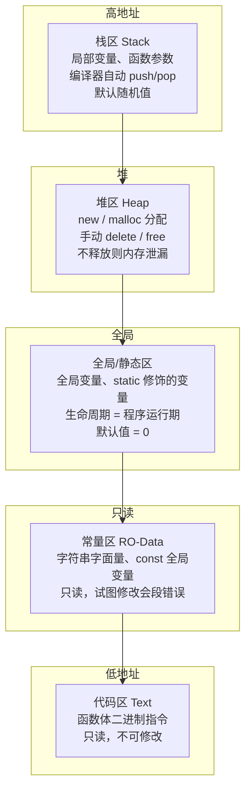

### 3.2 各类变量详解

```cpp
#include <iostream>
using namespace std;

int g_var = 10;                 // 普通全局变量：程序任何位置可用
static int g_static = 20;       // 静态全局变量：仅本文件内可用

void foo(int param) {           // param 也是局部变量（在栈上）
    int local = 30;             // 普通局部变量：栈区，默认随机值
    static int s_local = 40;    // 静态局部变量：全局/静态区，只初始化一次，值为0

    cout << "local: " << local << endl;       // 每次调用都可能不同（未初始化）
    cout << "s_local: " << ++s_local << endl;  // 调用次数累加（1→2→3...）
}

int main() {
    foo(0);   // local: 随机,  s_local: 1
    foo(0);   // local: 随机,  s_local: 2
    foo(0);   // local: 随机,  s_local: 3
}
```

| 变量类型     | 存储位置    | 生命周期       | 作用域   | 默认值   |
| ------------ | ----------- | -------------- | -------- | -------- |
| 普通局部变量 | 栈          | 所在块执行期间 | 块内     | ⚠️ 随机值 |
| 静态局部变量 | 全局/静态区 | 程序运行期间   | 块内     | 0        |
| 普通全局变量 | 全局/静态区 | 程序运行期间   | 整个程序 | 0        |
| 静态全局变量 | 全局/静态区 | 程序运行期间   | 当前文件 | 0        |
| 静态函数     | 代码区      | 程序运行期间   | 当前文件 | —        |

**全局函数 vs 静态函数**：`static` 修饰的函数隐藏了链接属性，只在当前 `.cpp` 文件中可见，其它文件即使声明了 `extern` 也无法链接到。

---

## 四、宏与预处理

### 4.1 无参宏

```cpp
#define PI 3.1415926535
#define MAX_SIZE 1024
```

预处理时直接文本替换，不占用内存。

### 4.2 带参宏（宏函数）

```cpp
#define MAX(a, b)    ((a) > (b) ? (a) : (b))
#define SQUARE(x)    ((x) * (x))
#define ABS(x)       ((x) >= 0 ? (x) : (-(x)))
```

⚠️ **必须给每个参数和整体加括号**，否则运算符优先级会导致错误：

```cpp
#define BAD_SQUARE(x)   x * x

int a = BAD_SQUARE(1 + 2);   // 展开为 1 + 2 * 1 + 2 = 1 + 2 + 2 = 5  ❌
int b = SQUARE(1 + 2);       // 展开为 ((1 + 2) * (1 + 2)) = 9        ✅
```

### 4.3 宏函数 vs 普通函数

| 对比项     | 宏函数                 | 普通函数               |
| ---------- | ---------------------- | ---------------------- |
| 处理时机   | 预处理阶段（文本替换） | 编译阶段               |
| 类型检查   | 无                     | 有                     |
| 调用开销   | 无（内联展开）         | 有（压栈、跳转、返回） |
| 代码膨胀   | 大（每次调用都展开）   | 小（只有一份）         |
| 调试       | 困难                   | 容易                   |
| 副作用风险 | 高（多参可能计算多次） | 低                     |
| 适用场景   | 极简单逻辑、条件编译   | 绝大多数场景           |

> ⚠️ 副作用示例：`MAX(a++, b)` → `((a++) > (b) ? (a++) : (b))` → a 可能自增两次！

### 4.4 `#pragma once` vs 传统守卫

```cpp
// 方式一：#pragma once（绝大多数编译器支持，简洁）
#pragma once
// 文件内容...

// 方式二：传统宏守卫（C++ 标准，100% 兼容）
#ifndef MY_HEADER_H
#define MY_HEADER_H
// 文件内容...
#endif
```

---

## 五、指针 ★★★

### 5.1 指针基础

```cpp
int a = 10;
int *p = &a;       // p 存 a 的地址，类型 int*

*p = 20;           // 解引用：通过 p 修改 a → a == 20
cout << p;         // 打印地址（0x7fff...）
cout << *p;        // 打印值 20
```

指针类型决定**步长**（指针 +1 移动的字节数）：

```cpp
int a = 100;
int *pi = &a;        // pi + 1 → 地址 + sizeof(int) = 4 字节
char *pc = (char*)&a; // pc + 1 → 地址 + sizeof(char) = 1 字节
double *pd;           // pd + 1 → 地址 + sizeof(double) = 8 字节
```

### 5.2 数组与指针

```cpp
int arr[5] = {10, 20, 30, 40, 50};

// 数组名 arr 就是首元素地址（在表达式中隐式转换为 &arr[0]）
int *p = arr;               // p 指向 arr[0]

// 三种等价的访问方式
cout << arr[2] << endl;     // 30，下标方式
cout << *(arr + 2) << endl; // 30，指针偏移
cout << *(p + 2) << endl;   // 30，p + 2 偏移到 arr[2]

// arr[2] 等价于 *(arr + 2)，本质是一样的
```

**指向同一数组的两个指针可以做减法**，结果是元素个数：

```cpp
int arr[] = {1, 2, 3, 4, 5};
int *p1 = &arr[1];   // 指向 2
int *p2 = &arr[4];   // 指向 5
cout << p2 - p1;     // 3（两个指针之间相差 3 个元素）
```

### 5.3 字符数组 vs 字符串指针 vs 二维字符数组

```cpp
// 1. 字符数组（栈区，可修改）
char arr[] = "hello";           // 等价于 {'h','e','l','l','o','\0'}
arr[0] = 'H';                   // ✅ 可修改
cout << sizeof(arr);            // 6（5+1个\0）

// 2. 字符串指针（指向常量区，不可修改）
const char *str = "hello";      // str 指向只读区
// str[0] = 'H';                // ❌ 段错误！
str = "world";                  // ✅ 可以改变指针指向

// 3. 二维字符数组（每行有独立副本）
char names[3][20] = {"Alice", "Bob", "Charlie"};
cout << names[0];               // "Alice"
cout << names[1][0];            // 'B'
```

### 5.4 指针数组 vs 数组指针（易混淆！）

```cpp
// ===== 指针数组：[] 优先级 > *，先 [] 后 * =====
// 含义：一个有 10 个元素的数组，每个元素是 int*
int *pArr[10];          // arr → [] → *：数组贮存指针
// 用法类比：(int*) arr[10]

// 数值的指针数组
int a = 1, b = 2, c = 3;
int *numPtrs[3] = {&a, &b, &c};
cout << *numPtrs[0];    // 1

// 字符的指针数组（常用于字符串数组）
const char *names[] = {"Alice", "Bob", "Charlie"};  // 每个元素是指向字面量的指针
cout << names[1];       // "Bob"
// 内存结构：存的是指针，不是数组副本，高效

// ===== 数组指针：() 强行让 * 先结合 =====
// 含义：一个指针，指向"包含 10 个 int 的数组"
int arr[10];
int (*ptr)[10] = &arr;  // ptr 指向整个数组
cout << (*ptr)[3];      // 访问 arr[3]
// ptr + 1 偏移整个数组大小(10*4=40字节)
```

### 5.5 函数指针

```cpp
// 声明：返回类型 (*指针名)(参数类型列表)
int (*funcPtr)(int, int);       // 指向返回 int、接受两个 int 的函数

int add(int a, int b) { return a + b; }
int sub(int a, int b) { return a - b; }

funcPtr = add;                  // 或 funcPtr = &add;
cout << funcPtr(10, 20);        // 30

funcPtr = sub;
cout << funcPtr(10, 20);        // -10
```

### 5.6 多级指针

```cpp
int a = 10;
int *p = &a;          // 一级：指向 int
int **pp = &p;        // 二级：指向 int*（存 p 的地址）
int ***ppp = &pp;     // 三级：指向 int**

cout << a;            // 10
cout << *p;           // 10
cout << **pp;         // 10
cout << ***ppp;       // 10
```

---

## 六、引用

### 6.1 基本特性

```cpp
int a = 10;
int &ref = a;         // ref 是 a 的别名，此后 ref 和 a 是同一个东西

ref = 20;             // 修改 ref 即修改 a
cout << a;            // 20

// 三大特性
// 1. 必须初始化
// 2. 一旦绑定不可改变引用对象
// 3. 没有空引用
```

底层实现：引用在汇编层面**通过指针实现**，但语法上更安全简洁。

### 6.2 作为函数参数的神奇效果

```cpp
// 传值：拷贝，不会影响实参
void swapByVal(int a, int b) {
    int t = a; a = b; b = t;          // ❌ x, y 不变
}

// 传指针
void swapByPtr(int *a, int *b) {
    int t = *a; *a = *b; *b = t;
}

// 传引用：语法简洁，效果同指针
void swapByRef(int &a, int &b) {
    int t = a; a = b; b = t;          // ✅ 直接操作 x, y
}

int main() {
    int x = 10, y = 20;
    swapByRef(x, y);
    cout << x << " " << y;            // 20 10
}
```

### 6.3 const 引用

```cpp
int a = 10;
const int &ref = a;   // 不能通过 ref 修改 a
// ref = 20;          // ❌ 编译错误

// const 引用可以绑定右值（普通引用不可以）
const int &r1 = 100;  // ✅ 临时对象
// int &r2 = 100;     // ❌ 必须 const
```

### 6.4 左值引用 vs 右值引用

```cpp
// === 左值引用 (T&) === C++98，绑定左值
int a = 100;
int &b = a;            // ✅ a 是左值
// int &c = 100;       // ❌ 100 是右值，左值引用不能绑右值
                        // 原因：左值引用要修改，但 100 是字面量不可改

// === 右值引用 (T&&) === C++11，绑定右值
int &&d = 100;         // ✅ 100 是右值
// int &&e = a;        // ❌ a 是左值，右值引用不能直接绑左值

string foo() { return string("hello"); }
string &&s = foo();    // ✅ 接管临时对象的资源，避免深拷贝
```

> **左值**：可被取地址的、有名字的持久对象
> **右值**：临时对象、字面量（100）、`a+b` 表达式结果、不具名对象

### 6.5 引用 vs 指针

| 特性     | 引用               | 指针          |
| -------- | ------------------ | ------------- |
| 初始化   | 必须初始化         | 可选          |
| 重新绑定 | 不可换绑           | 可指向别处    |
| 可空性   | 不可能空           | 可为`nullptr` |
| 解引用   | 自动               | 手动`*`       |
| 多级     | 无（无引用的引用） | 有`**`/`***`  |

---

## 七、结构体

### 7.1 基础定义

```cpp
struct Student {
    char name[64];
    int age;
    float score;
};

// 直接初始化
Student s1 = {"Alice", 20, 95.5};

// 通过 . 访问
s1.age = 21;

// 结构体指针 ->
Student *ps = &s1;
ps->age = 22;
```

### 7.2 结构体数组

```cpp
Student arr[3] = {
    {"Alice", 20, 95.5},
    {"Bob",   21, 88.0},
    {"Tom",   19, 91.0}
};

arr[0].age = 21;           // 修改第一个学生的年龄
```

### 7.3 结构体指向堆区

```cpp
Student *p = new Student;   // 在堆上分配
strcpy(p->name, "Alice");
p->age = 20;
delete p;                   // 记得释放

// 批量
Student *arr = new Student[10];
delete[] arr;
```

### 7.4 内存对齐 ★

```cpp
struct Demo {
    char a;    // 1 字节, 偏移 0
    int b;     // 4 字节, 偏移 4（对齐到 4 的倍数，a 后填充 3 字节）
    short c;   // 2 字节, 偏移 8
};             // 总大小 12（对齐到最大成员 4 的倍数，c 后填充 2 字节）

// 内存布局：
// [a][pad][pad][pad][b0][b1][b2][b3][c0][c1][pad][pad]
//  ↑0   ↑1   ↑2   ↑3   ↑4   ↑5   ↑6   ↑7   ↑8   ↑9  ↑10  ↑11
```

**对齐三原则**：

1. 成员偏移量 = `sizeof(成员)` 的整数倍
2. 结构体总大小 = `max(sizeof(成员))` 的整数倍
3. 嵌套结构体对齐到内部最大成员大小的整数倍

### 7.5 位域

```cpp
struct Flag {
    unsigned int a : 1;    // 1位（0/1）
    unsigned int b : 3;    // 3位（0~7）
    unsigned int c : 4;    // 4位（0~15）
};                          // 总大小：4 字节（unsigned int 大小）

// 另起存储单元：零宽度位域
struct Test {
    unsigned int a : 4;
    unsigned int : 0;      // 强制后续成员跳到下一个 int
    unsigned int b : 4;
};

// 地址最小单位是 1 字节
// 位域不能跨字节边界
```

### 7.6 共用体 (Union)

```cpp
union Data {
    int i;         // 4 字节
    float f;       // 4 字节
    char c[4];     // 4 字节
};                  // 共用体大小 = max(成员大小) = 4 字节

// 所有成员共享一块内存，同时只有一个是有效的
Data d;
d.i = 10;
cout << d.i;       // 10
d.f = 3.14f;       // 覆盖了 d.i
cout << d.i;       // 不确定值（被 f 的二进制覆盖了）

// 经典用法：用不同视图看同一块内存
d.i = 65;          // 65 的二进制
cout << d.c[0];    // 打印 'A'，ASCII 码 65 对应 A
```

### 7.7 浅拷贝 vs 深拷贝

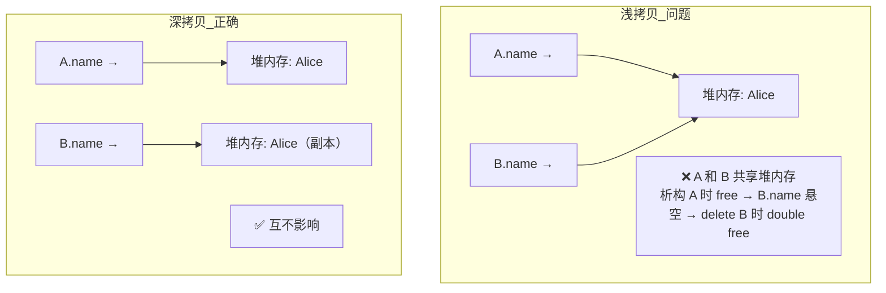

```cpp
struct Person {
    char *name;   // ⚠️ 指针成员
    int age;
};

// ❌ 默认浅拷贝：只拷贝指针值
Person p1; p1.name = new char[10]; strcpy(p1.name, "Alice");
Person p2 = p1;              // p2.name == p1.name，指向同一块内存！

// ✅ 手动深拷贝
Person deepCopy(const Person &src) {
    Person dst;
    dst.age = src.age;
    dst.name = new char[strlen(src.name) + 1];  // 分配新内存
    strcpy(dst.name, src.name);                  // 拷贝内容
    return dst;
}
```

---

## 八、命名空间

```cpp
namespace MySpace {
    int value = 100;
    void func() { cout << "MySpace\n"; }

    namespace Inner {              // 嵌套命名空间
        int x = 42;
    }
}

// C++17 简化嵌套写法：
namespace A::B::C { int val = 10; }

// 访问
MySpace::value = 200;
MySpace::func();
A::B::C::val;

// using 声明（引入单个名字）
using MySpace::value;
cout << value;                    // 100

// using 指令（引入整个命名空间）
using namespace MySpace;
func();                           // 直接调用
```

---

## 九、函数重载

### 9.1 规则

```cpp
// 同名、不同参数 → 重载
void print(int i)    { cout << "int: " << i << endl; }
void print(double d) { cout << "double: " << d << endl; }
void print(int i, int j) { cout << "two ints: " << i << ", " << j << endl; }

print(10);           // 调用 int 版本
print(3.14);         // 调用 double 版本
print(10, 20);       // 调用两参数版本
```

⚠️ **返回值类型不能区分重载**。

### 9.2 const 重载

```cpp
class Test {
public:
    void foo()       { cout << "non-const\n"; }
    void foo() const { cout << "const\n"; }          // const 可以作为重载
};

Test t1;
const Test t2;
t1.foo();            // non-const
t2.foo();            // const
```

---

## 十、类与对象 ★★★

### 10.1 类的定义与访问控制

```cpp
class Person {
public:                     // 公有：外部可访问
    Person();               // 构造函数
    ~Person();              // 析构函数
    void show();            // 公有方法

private:                    // 私有：仅类内部访问
    int m_age;
    string m_name;

protected:                  // 保护：类内部 + 子类可访问
    int m_id;
};
```

### 10.2 构造函数

```cpp
class Test {
public:
    // 默认构造函数
    Test() : m_val(0) { cout << "default\n"; }

    // 有参构造函数 + 初始化列表
    Test(int val) : m_val(val) { cout << "param\n"; }

    // 拷贝构造函数（常量引用）
    Test(const Test &other) : m_val(other.m_val) { cout << "copy\n"; }

    // 析构函数
    ~Test() { cout << "~Test\n"; }

private:
    int m_val;
};

// 调用
Test t1;              // 默认构造
Test t2(42);          // 有参构造
Test t3 = t2;         // 拷贝构造
Test t4 = Test(100);  // 有参（临时对象 + 复制消除优化）
```

⚠️ **构造/析构顺序**：

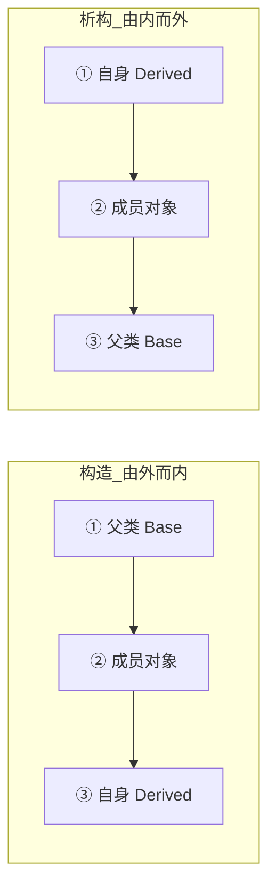

### 10.3 explicit 关键字

```cpp
class MyInt {
public:
    explicit MyInt(int v) : val(v) {}   // 禁止隐式转换
    int val;
};

// MyInt m = 10;        // ❌ explicit 禁止隐式转换
MyInt m(10);            // ✅ 必须显式
```

### 10.4 类的对象数组

```cpp
class Point {
public:
    Point() : x(0), y(0) {}                  // 必须有默认构造
    Point(int a, int b) : x(a), y(b) {}
private:
    int x, y;
};

Point arr[10];                               // 10 次默认构造
Point arr2[] = {Point(1,2), Point(3,4)};     // 2 次有参构造
```

### 10.5 new vs malloc

```cpp
// C 风格：不调用构造/析构
Person *p1 = (Person*)malloc(sizeof(Person));
free(p1);

// C++ 风格：调用构造/析构
Person *p2 = new Person;        // 分配 + 构造
delete p2;                      // 析构 + 释放

Person *p3 = new Person(42);    // 有参
delete p3;

// 动态数组
Person *arr = new Person[10];   // 10 次默认构造 + 数组分配
delete[] arr;                   // 必须带 [] ！

// 初始化
int *iArr = new int[5]{1,2,3,4,5};
string *sArr = new string[3]{"a","b","c"};
delete[] iArr;
delete[] sArr;
```

### 10.6 静态成员

```cpp
class Account {
public:
    static double s_rate;            // 声明（类内不能初始化，除非 const）
    static void showRate() {          // 静态成员函数
        cout << s_rate << endl;       // 只能访问静态成员（无 this 指针）
    }

private:
    static int s_count;               // 属于类，所有对象共享
    double m_balance;                 // 属于每个对象
};

// 必须在类外定义
double Account::s_rate = 0.02;
int Account::s_count = 0;

// 通过类名访问
Account::s_rate = 0.03;
Account::showRate();
```

### 10.7 单例模式

```cpp
class Singleton {
public:
    static Singleton& getInstance() {
        static Singleton instance;       // C++11 线程安全
        return instance;
    }

private:
    Singleton() {}
    ~Singleton() {}
    Singleton(const Singleton&) = delete;
    Singleton& operator=(const Singleton&) = delete;
};
```

### 10.8 this 指针

```cpp
class Test {
public:
    Test& setA(int v) { a = v; return *this; }   // 返回 *this 实现链式调用
    Test& setB(int v) { b = v; return *this; }

private:
    int a = 0, b = 0;
};

Test t;
t.setA(10).setB(20);    // 链式调用
```

### 10.9 友元

```cpp
class A {
    friend class B;             // B 是 A 的友元类 → B 可访问 A 私有成员
    friend void func(A &a);     // func 是 A 的友元函数

private:
    int secret = 42;
};

class B {
public:
    void peep(A &a) { cout << a.secret; }   // ✅ 友元可访问
};

void func(A &a) {
    cout << a.secret;           // ✅ 友元可访问
}
```

> 友元破坏封装，谨慎使用。

### 10.10 C++ 对象模型

- **成员变量**：每个对象有自己的存储空间
- **成员函数**：代码只有一份，所有对象共享，通过 `this` 指针区分当前对象
- **空类占 1 字节**：确保不同对象有不同地址

### 10.11 动态数组类设计

```cpp
template <typename T>
class Array {
private:
    T* m_data;
    int m_size;
public:
    Array(int size) : m_size(size), m_data(new T[size]) {}
    ~Array() { delete[] m_data; }

    T& operator[](int idx) { return m_data[idx]; }
    int size() const { return m_size; }
};
```

---

## 十一、运算符重载

### 11.1 算术运算符

```cpp
class Complex {
public:
    double real, imag;
    Complex(double r = 0, double i = 0) : real(r), imag(i) {}

    // 成员函数重载 +（只需要一个参数）
    Complex operator+(const Complex &other) const {
        return Complex(real + other.real, imag + other.imag);
    }

    // 全局函数重载 +（需要两个参数，通常是 friend）
    friend Complex operator+(const Complex &a, const Complex &b) {
        return Complex(a.real + b.real, a.imag + b.imag);
    }
};

Complex c1(1, 2), c2(3, 4);
Complex c3 = c1 + c2;       // 等价于 c1.operator+(c2)
```

### 11.2 流运算符（必须是友元）

```cpp
class Point {
public:
    int x, y;
    Point(int a = 0, int b = 0) : x(a), y(b) {}

    // << 输出：必须是 friend（左操作数是 ostream，不是本类对象）
    friend ostream& operator<<(ostream &os, const Point &p) {
        os << "(" << p.x << ", " << p.y << ")";
        return os;
    }

    // >> 输入：必须是 friend
    friend istream& operator>>(istream &is, Point &p) {
        is >> p.x >> p.y;
        return is;
    }
};

Point p;
cin >> p;                // 读入 x y
cout << p << endl;       // 输出 (x, y)
```

### 11.3 前置/后置 ++

```cpp
class Counter {
    int cnt;
public:
    Counter(int n = 0) : cnt(n) {}

    // 前置 ++（返回引用，无开销）
    Counter& operator++() {
        ++cnt;
        return *this;
    }

    // 后置 ++（返回旧值，有拷贝开销；int 参数是占位符）
    Counter operator++(int) {
        Counter tmp = *this;
        ++cnt;
        return tmp;
    }
};
```

### 11.4 相等运算符 ==

```cpp
class Person {
public:
    int id;
    Person(int i = 0) : id(i) {}

    bool operator==(const Person &other) const {
        return id == other.id;
    }
};
```

### 11.5 函数调用运算符（仿函数）

```cpp
class Adder {
public:
    int operator()(int a, int b) const {
        return a + b;
    }
};

Adder add;
cout << add(3, 5);        // 8，像函数一样使用
// 广泛用于 STL：sort 的自定义比较，for_each 的操作函数等
```

### 11.6 智能指针运算符重载示例

```cpp
template <typename T>
class SmartPtr {
    T* m_ptr;
public:
    SmartPtr(T* p = nullptr) : m_ptr(p) {}
    ~SmartPtr() { delete m_ptr; }

    T& operator*()  { return *m_ptr; }    // 解引用
    T* operator->() { return m_ptr; }     // 成员访问
};
```

### 11.7 可重载 vs 不可重载

| 可重载                      | 不可重载          |
| --------------------------- | ----------------- |
| `+ - * / % ^ & \| ~ !`      | `.` `.*` `::`     |
| `= < > += -= *= /=`         | `sizeof` `typeid` |
| `<< >> == != <= >=`         | `?:` 条件运算符   |
| `++ -- -> () []`            | `#` `##` 预处理   |
| `new new[] delete delete[]` |                   |

### 11.8 ⚠️ 不要重载 && 和 ||

```cpp
// 重载后的 && 和 || 失去了短路求值特性！
// if(p && p->valid) 原本：p 为空则不执行 p->valid
// 重载后：两个操作数都会被求值，可能崩溃
```

---

## 十二、继承

### 12.1 继承与访问权限

```cpp
class Base {
public:    int pub = 1;
protected: int pro = 2;
private:   int pri = 3;
};

class DerivedPublic : public Base { ... };     // pub→pub, pro→pro, pri→不可见
class DerivedProtected : protected Base { ... }; // pub→pro, pro→pro, pri→不可见
class DerivedPrivate : private Base { ... };     // pub→pri, pro→pri, pri→不可见（默认）
```

### 12.2 子类构造与析构顺序

```cpp
#include <iostream>
using namespace std;

class Base {
public:
    Base()  { cout << "Base 构造\n"; }
    ~Base() { cout << "Base 析构\n"; }
};

class Member {
public:
    Member()  { cout << "Member 构造\n"; }
    ~Member() { cout << "Member 析构\n"; }
};

class Derived : public Base {
    Member m;                     // 成员对象
public:
    Derived() { cout << "Derived 构造\n"; }
    ~Derived() { cout << "Derived 析构\n"; }
};

int main() {
    Derived d;
}
// 输出：
// Base 构造
// Member 构造
// Derived 构造
// Derived 析构
// Member 析构
// Base 析构
```

### 12.3 子类调用父类有参构造

```cpp
class Base {
    int x;
public:
    Base(int val) : x(val) { cout << "Base(" << x << ")\n"; }
};

class Derived : public Base {
    int y;
public:
    // 必须在初始化列表中调用父类有参构造
    Derived(int a, int b) : Base(a), y(b) {
        cout << "Derived\n";
    }
};
```

### 12.4 同名成员处理

```cpp
class Base {
public:
    int val = 10;
    void func() { cout << "Base::func\n"; }
    void func(int x) { cout << "Base::func(int)\n"; }
};

class Derived : public Base {
public:
    int val = 20;                       // 隐藏 Base::val
    void func() { cout << "Derived::func\n"; }   // 隐藏所有 Base::func

    void show() {
        cout << val;                    // 20（自己的）
        cout << Base::val;              // 10（用作用域运算符访问父类）
        func();                         // 自己的
        Base::func();                   // 父类的
    }
};
```

### 12.5 子类不能继承的有

- **构造函数**
- **析构函数**
- **`operator=`**
- **友元关系**

### 12.6 多继承与同名冲突

```cpp
class A { public: void func() { cout << "A\n"; } };
class B { public: void func() { cout << "B\n"; } };

class C : public A, public B { ... };

C obj;
// obj.func();       // ❌ 二义性错误
obj.A::func();       // ✅ 指定调用 A 的
obj.B::func();       // ✅ 指定调用 B 的
```

### 12.7 菱形继承与虚继承

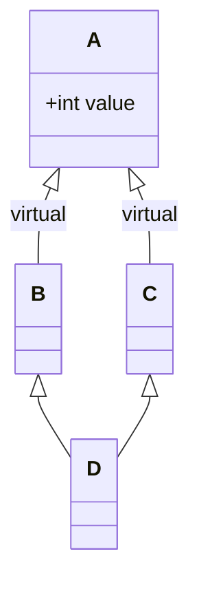

```cpp
// 问题：不加 virtual，D 有两份 A（一份来自 B，一份来自 C），访问 value 时二义性
class A { public: int value = 10; };
class B : virtual public A { };
class C : virtual public A { };
class D : public B, public C { };

D d;
cout << d.value;      // ✅ 正确，只有一份 value
```

---

## 十三、多态 ★★★

### 13.1 问题引入

```cpp
class Animal {
public:
    void speak() { cout << "Animal\n"; }     // 非虚函数
};

class Dog : public Animal {
public:
    void speak() { cout << "Dog\n"; }
};

// ❌ 父类指针调父类版本
Animal *ptr = new Dog();
ptr->speak();        // "Animal" — 不是想要的多态行为！
delete ptr;
```

### 13.2 虚函数解决 + 虚析构

```cpp
class Animal {
public:
    virtual void speak() { cout << "Animal\n"; }   // 虚函数
    virtual ~Animal() { cout << "~Animal\n"; }      // ⚠️ 虚析构（极其重要！）
};

class Dog : public Animal {
public:
    char *data = new char[1024];          // 假设子类有自己的堆内存

    void speak() override { cout << "Dog bark!\n"; }

    ~Dog() override {
        cout << "~Dog\n";
        delete[] data;
    }
};

Animal *ptr = new Dog();
ptr->speak();  // "Dog bark!" — ✅ 动态绑定
delete ptr;    // 先 ~Dog() 再 ~Animal() — ✅ 虚析构保证子类析构被调用
```

> ⚠️ **没有虚析构的后果**：`delete` 父类指针时只调用父类析构，子类的 `data` 永远泄漏！
> 任何可能作为基类的类，析构函数都应该声明为 virtual。

### 13.3 纯虚函数（抽象类）

```cpp
class Shape {                              // 抽象类，不能实例化
public:
    virtual double area() = 0;             // 纯虚函数 = 接口
    virtual void draw() = 0;
    virtual ~Shape() {}
};

class Circle : public Shape {
    double r;
public:
    Circle(double radius) : r(radius) {}
    double area() override { return 3.14159 * r * r; }
    void draw() override { cout << "画一个圆\n"; }
};

class Rectangle : public Shape {
    double w, h;
public:
    Rectangle(double w_, double h_) : w(w_), h(h_) {}
    double area() override { return w * h; }
    void draw() override { cout << "画一个矩形\n"; }
};

// 使用多态
Shape *s1 = new Circle(5);
Shape *s2 = new Rectangle(4, 6);
cout << s1->area() << ", " << s2->area() << endl;  // 78.5, 24
```

### 13.4 纯虚析构

```cpp
class Base {
public:
    virtual ~Base() = 0;       // 纯虚析构 → 类成为抽象类
};

Base::~Base() {}               // 纯虚析构也必须有函数体！
```

### 13.5 重载 / 重定义 / 重写 对比

| 概念                     | 作用域         | 函数签名   | virtual      | 效果         |
| ------------------------ | -------------- | ---------- | ------------ | ------------ |
| **重载 Overload**        | 同一作用域     | 参数不同   | 无关         | 编译时多态   |
| **重定义/隐藏 Redefine** | 基类 vs 派生类 | 可同可不同 | 无 virtual   | 隐藏基类版本 |
| **重写/覆盖 Override**   | 基类 vs 派生类 | 完全相同   | 必须 virtual | 运行时多态   |

### 13.6 虚析构 vs 纯虚析构

|                | 虚析构`virtual ~Base(){}` | 纯虚析构`virtual ~Base()=0;`    |
| -------------- | ------------------------- | ------------------------------- |
| 基类能否实例化 | ✅ 能                      | ❌ 不能（抽象类）                |
| 是否需要函数体 | 需要                      | 也需要在类外写`Base::~Base(){}` |

---

## 十四、模板

### 14.1 函数模板

```cpp
// 单类型模板
template <typename T>
int compare(const T &v1, const T &v2) {
    if (v1 < v2) return -1;
    if (v2 < v1) return 1;
    return 0;
}

int    res1 = compare(3, 4);          // T = int
double res2 = compare(3.14, 2.71);    // T = double
string s1="abc", s2="xyz";
int    res3 = compare(s1, s2);        // T = string（需要 < 已被重载）

// 多类型模板
template <typename T, typename U>
void print(const T &t, const U &u) {
    cout << t << " | " << u << endl;
}
print(3.14, "hello");                // T=double, U=const char*
```

> **函数模板编译两次**：一次编译模板自身（语法检查），一次在调用处实例化（对具体 T 做代码生成）。

### 14.2 函数模板 vs 普通函数同名

```cpp
// 普通函数
void f(int a, int b)   { cout << "普通函数\n"; }

// 函数模板
template <typename T>
void f(T a, T b)       { cout << "函数模板\n"; }

f(10, 20);             // 输出："普通函数" — 优先匹配普通函数
f<>(10, 20);           // 输出："函数模板" — 强制用模板
f<int>(10, 20);        // 输出："函数模板" — 显式指定类型

// 注意：如果普通函数参数是 int&，则匹配度不同
void f(int &a, int &b) { cout << "普通(int&)\n"; }

int x = 10, y = 20;
f(x, y);               // "普通(int&)" — 更匹配
f(10, 20);             // "函数模板" — 10 和 20 是右值，不能绑 int&
```

**调用优先级**：完全匹配的普通函数 > 模板实例化 > 需要隐式转换的普通函数

### 14.3 函数模板局限性

```cpp
template <typename T>
bool equal(const T &a, const T &b) {
    return a == b;
}
// ❌ 当 T 是 char* 时，比较的是指针地址而不是字符串内容！

// 解决：为特定类型提供特化版本
template <>
bool equal(const char *const &a, const char *const &b) {
    return strcmp(a, b) == 0;
}
```

### 14.4 非类型模板参数

```cpp
template <typename T, int SIZE>
class Buffer {
    T data[SIZE];
public:
    int size() const { return SIZE; }
};

Buffer<char, 1024> buf;
cout << buf.size();    // 1024
```

### 14.5 类模板

```cpp
template <typename T>
class Stack {
    T *data;
    int top, capacity;
public:
    Stack(int cap = 10) : capacity(cap), top(0), data(new T[cap]) {}
    ~Stack() { delete[] data; }

    void push(const T &val);
    T pop();
};

// 类外实现成员函数
template <typename T>
void Stack<T>::push(const T &val) {
    if (top < capacity) data[top++] = val;
}

template <typename T>
T Stack<T>::pop() {
    return data[--top];
}

Stack<int>    intStack;      // T = int
Stack<string> strStack;      // T = string
```

### 14.6 类模板继承

```cpp
// 类模板 → 普通类（必须指定类型参数）
template <typename T>
class Base { ... };

class Derived : public Base<int> { ... };    // 必须指定 T = int

// 类模板 → 类模板
template <typename T>
class Derived2 : public Base<T> { ... };
```

### 14.7 类模板友元

```cpp
// 普通函数作为类模板的友元
template <typename T>
class MyClass {
    friend void func(MyClass<T> &obj);   // 固定的友元
};

// 函数模板作为类模板的友元
template <typename T>
class MyClass {
    template <typename U>
    friend void func2(MyClass<U> &obj);  // func2 的每次实例化都是友元
};
```

### 14.8 模板头文件分离问题

> 模板的**声明和定义**都要放在 `.h` 文件中。模板在实例化时必须有完整定义，编译器无法仅凭声明生成代码。分离到 `.cpp` 会导致链接错误（undefined reference）。

---

## 十五、类型转换

```cpp
#include <iostream>
using namespace std;

// 1. static_cast — 编译时转换，安全（不检查运行时的多态兼容性）
int a = 10;
double b = static_cast<double>(a);    // int → double

// 2. dynamic_cast — 运行时多态类型检查，用于安全的向下转型
class Base { public: virtual ~Base(){} };
class Derived : public Base {};

Base *bp = new Derived();
Derived *dp = dynamic_cast<Derived*>(bp);   // 安全转换，失败返回 nullptr
if (dp) { cout << "转换成功\n"; }

Base *bp2 = new Base();
Derived *dp2 = dynamic_cast<Derived*>(bp2); // 返回 nullptr

// 3. const_cast — 移除 const（⚠️ 慎用！只有明知不是 const 时才用）
void printStr(const char *str) {
    char *p = const_cast<char*>(str);       // 去掉 const
    // 不要用 p 修改只读区数据！
}

// 4. reinterpret_cast — 重新解释比特位（最危险）
int x = 65;
char *c = reinterpret_cast<char*>(&x);      // 把 int* 当 char*
cout << *c;  // 'A'（ASCII 65）
```

### 上行 vs 下行转换

| 方向         | 含义          | 安全性 | 是否需强转         |
| ------------ | ------------- | ------ | ------------------ |
| **上行转换** | 派生类 → 基类 | 安全   | 隐式即可           |
| **下行转换** | 基类 → 派生类 | 不安全 | 必须`dynamic_cast` |

---

## 十六、异常处理

### 16.1 基础用法

```cpp
#include <stdexcept>
#include <iostream>
using namespace std;

int divide(int a, int b) {
    if (b == 0) {
        throw runtime_error("除数不能为 0");  // 抛出异常
    }
    return a / b;
}

int main() {
    try {
        int res = divide(10, 0);              // 这里抛出异常
        cout << res << endl;
    } catch (const runtime_error &e) {        // 引用捕获（推荐）
        cout << "错误: " << e.what() << endl;
    } catch (const exception &e) {            // 捕获更泛型异常
        cout << "通用异常: " << e.what() << endl;
    } catch (...) {                           // 捕获一切
        cout << "未知异常" << endl;
        throw;                                // 重新抛出
    }
}
```

### 16.2 栈解旋 (Stack Unwinding)

```cpp
class Resource {
public:
    Resource()  { cout << "获得资源\n"; }
    ~Resource() { cout << "释放资源\n"; }
};

void risky() {
    Resource r;               // 栈对象
    throw runtime_error("出错!");  // r 的析构被自动调用, 资源被释放
}

int main() {
    try {
        risky();
    } catch (...) {
        cout << "捕获到异常\n";
    }
}
// 输出：
// 获得资源
// 释放资源     ← 自动栈解旋
// 捕获到异常
```

### 16.3 异常接口声明

```cpp
void f1();                         // 默认：可抛任何类型
void f2() throw(int, logic_error); // ✗ (C++17 废弃) 只能抛 int 和 logic_error
void f3() noexcept;                // C++11: 不抛异常
void f4() noexcept(false);         // C++11: 可抛异常
```

### 16.4 捕获方式的差异

```cpp
class MyEx : public exception {
public:
    const char* what() const noexcept override { return "MyEx"; }
};

try {
    throw MyEx();
} catch (MyEx e) {     // 值捕获：发生拷贝构造，基础异常信息可能丢失
} catch (MyEx *e) {    // 指针捕获：需 new，有内存管理负担
} catch (MyEx &e) {    // 引用捕获 ✅ 推荐：无拷贝，支持多态
}
```

### 16.5 自定义异常类

```cpp
class FileError : public runtime_error {
    string filename;
public:
    FileError(const string &msg, const string &file)
        : runtime_error(msg), filename(file) {}
    string getFile() const { return filename; }
};
```

### 16.6 异常多态

```cpp
class BaseEx : public exception { ... };
class DerivedEx : public BaseEx { ... };

try {
    throw DerivedEx();
} catch (const BaseEx &e) {       // ✅ 引用捕获，支持多态
    cout << e.what() << endl;     // 调用 DerivedEx::what()
}
```

### 16.7 标准异常继承体系

```
exception
├── logic_error
│   ├── invalid_argument
│   ├── out_of_range
│   └── length_error
├── runtime_error
│   ├── overflow_error
│   ├── range_error
│   └── system_error
└── bad_alloc
```

---

## 十七、STL 容器 ★★★

### 17.1 容器全景图

| 容器             | 底层结构        | 头文件     | 特点                             |
| ---------------- | --------------- | ---------- | -------------------------------- |
| `vector`         | 动态数组        | `<vector>` | O(1)随机访问，尾部增删快         |
| `deque`          | 分段数组+中控器 | `<deque>`  | O(1)头尾增删                     |
| `list`           | 双向链表        | `<list>`   | O(1)任意位置增删，不支持随机访问 |
| `stack`          | deque适配       | `<stack>`  | 后进先出 LIFO                    |
| `queue`          | deque适配       | `<queue>`  | 先进先出 FIFO                    |
| `set`            | 红黑树          | `<set>`    | 自动排序，元素唯一               |
| `multiset`       | 红黑树          | `<set>`    | 自动排序，元素可重复             |
| `map`            | 红黑树          | `<map>`    | key-value，key唯一，key排序      |
| `multimap`       | 红黑树          | `<map>`    | key-value，key可重复             |
| `priority_queue` | vector+堆       | `<queue>`  | 最大/小值优先出队                |

### 17.2 string

```cpp
string s1 = "hello";
string s2("world");
string s3 = s1 + " " + s2;       // "hello world"

s1.size();                       // 5
s1.length();                     // 5
s1.empty();                      // false
s1[0] = 'H';                     // "Hello"
s1.at(1);                        // 'e' (带边界检查)
s1.front();                      // 'H'
s1.back();                       // 'o'

s1 += " C++";                    // 追加
s1.append("!!");
s1.find("ll");                   // 2（找不到返回 string::npos）
s1.substr(0, 5);                 // "Hello"
s1.insert(2, "x");               // 在位置 2 插入 "x"
s1.erase(2, 1);                  // 从位置 2 删 1 个字符
s1.replace(0, 5, "Hi");          // 替换前 5 个字符为 "Hi"

// 比较
s1.compare(s2);                  // <0 =0 >0
// 数值转换
int x = stoi("42");
string num = to_string(3.14);

// C 风格互转
const char *cstr = s1.c_str();   // string → C string
string s4(cstr);                 // C string → string
```

### 17.3 vector

```cpp
vector<int> v = {1, 2, 3};

v.push_back(4);                  // 尾部添加
v.pop_back();                    // 尾部删除
v.size();                        // 元素个数
v.capacity();                    // 分配容量（可能 > size）
v.reserve(100);                  // 预分配容量，避免频繁扩容
v.resize(10, 0);                 // 改为 10 个元素，多出的填 0

v.front();                       // 首
v.back();                        // 尾
v[2];                            // 不检查边界
v.at(2);                         // 检查边界

v.insert(v.begin()+1, 10);       // 在位置 1 插入 10
v.erase(v.begin());              // 删除首元素
v.clear();                       // 清空

// 遍历
for (size_t i = 0; i < v.size(); i++) cout << v[i] << " ";
for (auto it = v.begin(); it != v.end(); ++it) cout << *it << " ";
for (int x : v) cout << x << " ";                        // C++11

// 容量增长：VS 下每次 1.5 倍扩容，GCC 下每次 2 倍扩容
// 用 swap 收缩容量：
vector<int>(v).swap(v);          // 创建匿名对象 v 的拷贝，再 swap 来收缩
```

### 17.4 deque

```cpp
deque<int> dq;

dq.push_back(1);                 // 尾入
dq.push_front(2);                // 头入
dq.pop_back();                   // 尾出
dq.pop_front();                  // 头出
dq.front(); dq.back();

// 也支持 [] 随机访问（但不如 vector 连续），也有 begin/end
```

### 17.5 stack / queue

```cpp
stack<int> st;
st.push(1); st.push(2); st.push(3);
while (!st.empty()) {
    cout << st.top() << " ";     // 3 2 1
    st.pop();
}

queue<int> q;
q.push(1); q.push(2); q.push(3);
while (!q.empty()) {
    cout << q.front() << " ";    // 1 2 3
    q.pop();
}
```

### 17.6 list

```cpp
list<int> lst = {1, 2, 3, 4, 5};

lst.push_back(6);                // 尾插
lst.push_front(0);               // 头插
lst.pop_back();
lst.pop_front();

lst.remove(3);                   // 删除所有值为 3 的元素
lst.sort();                      // 排序（list 特有，不能用 std::sort）
lst.reverse();                   // 反转
lst.unique();                    // 去重相邻重复项（需先 sort）
lst.splice(lst.begin(), lst2);   // 把 lst2 所有元素移到 lst 开头

// 不支持 [] 和 at()！要用迭代器访问
for (auto it = lst.begin(); it != lst.end(); ++it) cout << *it << " ";
```

### 17.7 set / multiset

```cpp
set<int> s;
s.insert(3); s.insert(1); s.insert(4); s.insert(1);
cout << s.size();                // 3（自动去重）
// s = {1, 3, 4}

s.erase(3);                      // 删除 3
s.find(2);                       // 找不到返回 s.end()
cout << s.count(1);              // 1（set 中就是 0/1）

multiset<int> ms = {3, 1, 4, 1, 5};
cout << ms.count(1);             // 2（multiset 允许多个）
```

### 17.8 map / multimap / pair

```cpp
// --- pair ---
pair<string, int> p1("Alice", 95);
pair<string, int> p2 = make_pair("Bob", 88);
cout << p1.first << ": " << p1.second << endl;

// --- map ---
map<string, int> scores;
scores["Alice"] = 95;            // 通过 [] 插入（key 不存在则创建）
scores["Bob"] = 87;
scores.insert(make_pair("Tom", 90));

// 遍历（多种方式）
for (const auto &kv : scores) {
    cout << kv.first << ": " << kv.second << endl;
}
// C++17 结构化绑定
for (const auto &[name, score] : scores) {
    cout << name << ": " << score << endl;
}

// 查找
auto it = scores.find("Alice");
if (it != scores.end()) {
    cout << it->second;          // 95
}
cout << scores.count("Bob");     // 1（0/1）

// multimap 不可用 []，必须用 insert
multimap<string, int> mm;
mm.insert({"Alice", 95});
mm.insert({"Alice", 88});        // 同一个 key 两份
cout << mm.count("Alice");       // 2
```

---

## 十八、STL 算法

### 18.1 函数对象（仿函数）

```cpp
// 自定义函数对象
struct Print {
    void operator()(int x) const { cout << x << " "; }
};

vector<int> v = {1, 2, 3, 4, 5};
for_each(v.begin(), v.end(), Print());    // 1 2 3 4 5
for_each(v.begin(), v.end(), [](int x){ cout << x << " "; });  // lambda 等价
```

### 18.2 谓词

```cpp
// 一元谓词：接受一个参数，返回 bool
bool isEven(int x) { return x % 2 == 0; }

// 二元谓词：接受两个参数，返回 bool
bool desc(int a, int b) { return a > b; }
```

### 18.3 内建函数对象

```cpp
#include <functional>

// 算术：plus, minus, multiplies, divides, modulus, negate
plus<int> adder;
cout << adder(3, 4);             // 7

// 关系：greater, less, equal_to, not_equal_to, greater_equal, less_equal
sort(v.begin(), v.end(), greater<int>());   // 降序

// 逻辑：logical_and, logical_or, logical_not
```

### 18.4 适配器

```cpp
// 1. 函数对象适配器：bind2nd（C++11 用 bind 替代）
// 用法：把二元函数变成一元

// 2. 函数指针适配器：ptr_fun，把普通函数指针变成函数对象

// 3. 成员函数适配器：mem_fun_ref，作用于对象容器
class Person {
public:
    void show() const { cout << "Person\n"; }
};
vector<Person> people(5);
for_each(people.begin(), people.end(), mem_fun_ref(&Person::show));

// 4. 取反适配器
not1(ptr_fun(isEven));           // 一元取反
not2(less<int>());               // 二元取反

// C++11 替代：bind + lambda 更直观
for_each(people.begin(), people.end(), [](const Person &p){ p.show(); });
```

### 18.5 遍历算法

```cpp
vector<int> v1 = {1, 2, 3, 4, 5};

// for_each
for_each(v1.begin(), v1.end(), [](int &x){ x *= 2; });   // 每个元素 *2

// transform：将结果放入另一个容器
vector<int> v2(v1.size());
transform(v1.begin(), v1.end(), v2.begin(), [](int x){ return x * x; });
// v2 = {4, 16, 36, 64, 100}
```

### 18.6 查找算法

```cpp
vector<int> v = {1, 3, 5, 7, 9, 5};

// find
auto it = find(v.begin(), v.end(), 5);

// find_if
it = find_if(v.begin(), v.end(), [](int x){ return x > 5; });

// adjacent_find：查找相邻重复
it = adjacent_find(v.begin(), v.end());   // 找到两个相邻的 5

// binary_search：二分查找（要求有序）
sort(v.begin(), v.end());
bool found = binary_search(v.begin(), v.end(), 7);

// count
int n = count(v.begin(), v.end(), 5);      // 2
n = count_if(v.begin(), v.end(), [](int x){ return x % 2 == 0; });
```

### 18.7 排序算法

```cpp
vector<int> v = {3, 1, 4, 1, 5, 9};

sort(v.begin(), v.end());                      // 升序
sort(v.begin(), v.end(), greater<int>());       // 降序

// random_shuffle（C++14 弃用，用 shuffle）
random_device rd;
mt19937 gen(rd());
shuffle(v.begin(), v.end(), gen);

// reverse
reverse(v.begin(), v.end());

// merge：合并两个有序序列
vector<int> v1 = {1, 3, 5};
vector<int> v2 = {2, 4, 6};
vector<int> v3(6);
merge(v1.begin(), v1.end(), v2.begin(), v2.end(), v3.begin());
// v3 = {1, 2, 3, 4, 5, 6}
```

### 18.8 拷贝/替换

```cpp
copy(v1.begin(), v1.end(), v2.begin());

replace(v.begin(), v.end(), 0, 99);             // 把 0 替换成 99
replace_if(v.begin(), v.end(), [](int x){ return x<0; }, 0);
swap(v1, v2);
```

### 18.9 算术生成

```cpp
#include <numeric>

int sum = accumulate(v.begin(), v.end(), 0);     // 求和
fill(v.begin(), v.end(), 42);                    // 全部填充 42
```

### 18.10 集合算法

```cpp
set<int> s1 = {1, 2, 3, 4, 5};
set<int> s2 = {3, 4, 5, 6, 7};
vector<int> result(10);

// 交集 {3, 4, 5}
auto it = set_intersection(s1.begin(), s1.end(), s2.begin(), s2.end(), result.begin());

// 并集 {1, 2, 3, 4, 5, 6, 7}
it = set_union(s1.begin(), s1.end(), s2.begin(), s2.end(), result.begin());

// 差集 {1, 2}
it = set_difference(s1.begin(), s1.end(), s2.begin(), s2.end(), result.begin());
```

---

# 第二部分：进阶篇

---

## 十九、extern 解决重定义

### 19.1 问题演示

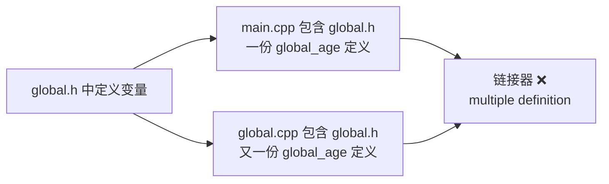

```cpp
// ===== global.h（❌ 在头文件中定义！）=====
#ifndef GLOBAL_H
#define GLOBAL_H
#include <string>
int global_age = 10;                     // 错误：头文件中定义
std::string global_name = "llfc";        // 错误：头文件中定义
#endif

// ===== global.cpp =====
#include "global.h"                      // 产生一份定义

// ===== main.cpp =====
#include <iostream>
#include "global.h"                      // 又产生一份定义！
int main() {
    cout << global_name << global_age;
}

// 链接错误：
// multiple definition of `global_age'
// multiple definition of `global_name'
```

**原因**：每个 `.cpp` 独立编译，各自展开 `global.h` 中的定义，生成了两份 `global_age` 和 `global_name`，链接器发现冲突。

### 19.2 解决方案

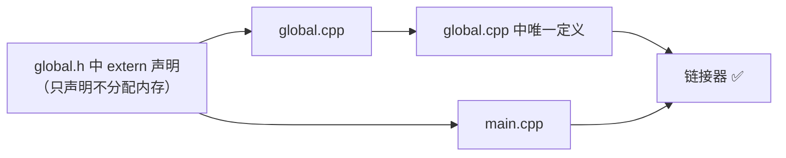

```cpp
// ===== global.h（✅ 声明）=====
#ifndef GLOBAL_H
#define GLOBAL_H
#include <string>
extern int global_age;                   // 声明：告诉编译器变量存在
extern std::string global_name;          // 不分配内存
#endif

// ===== global.cpp（✅ 唯一定义）=====
#include "global.h"
int global_age = 30;                     // 定义：分配内存（只有这一份！）
std::string global_name = "John Doe";

// ===== main.cpp =====
#include <iostream>
#include "global.h"
int main() {
    cout << global_age << " " << global_name;   // ✅ 30 John Doe
}
```

> **核心原则**：变量声明放在 `.h`（`extern`），变量定义放在 `.cpp`（只有一份）。

---

## 二十、左值与右值 ★★★

### 20.1 判定方法

```cpp
// 一个简单的判断：能对表达式取地址就是左值

int a = 10;
&a;                          // ✅ 可以取地址 → a 是左值

int foo() { return 42; }
// &foo();                   // ❌ 不能对返回值取地址 → 右值
// &100;                     // ❌ 不能对字面量取地址 → 右值
// &(a + 1);                 // ❌ 不能对临时结果取地址 → 右值

int *p = &a;
// &(*p);                    // *p 返回引用（左值），可以再取地址 → *p 是左值！

int &&rr = 200;
// &rr;                      // rr 是已命名的右值引用，可以取地址 → rr 本身是左值！
```

### 20.2 绑定规则

```cpp
int a = 100;
int &b = a;         // ✅ 左值引用 ← 左值
// int &c = 200;    // ❌ 左值引用 ← 右值（100 是字面量，不可被修改）

int &&d = 200;      // ✅ 右值引用 ← 右值
// int &&e = a;     // ❌ 右值引用 ← 左值（除非用 std::move）

const int &f = 200; // ✅ const 左值引用可以绑定到右值（特例！）
```

### 20.3 没有右值引用的痛苦

```cpp
string foo() {
    return string("Hello World");   // ⚠️ 这个临时 string 马上要被销毁
}

// C++98：必须深拷贝
string s = foo();    // 调用拷贝构造函数，从临时对象深拷贝到 s
                     // 临时对象立刻就销毁了 → 做了无用功！

// C++11：用右值引用 + 移动语义
string &&rs = foo(); // 接管临时对象的内部缓冲区，零开销
```

### 20.4 移动语义

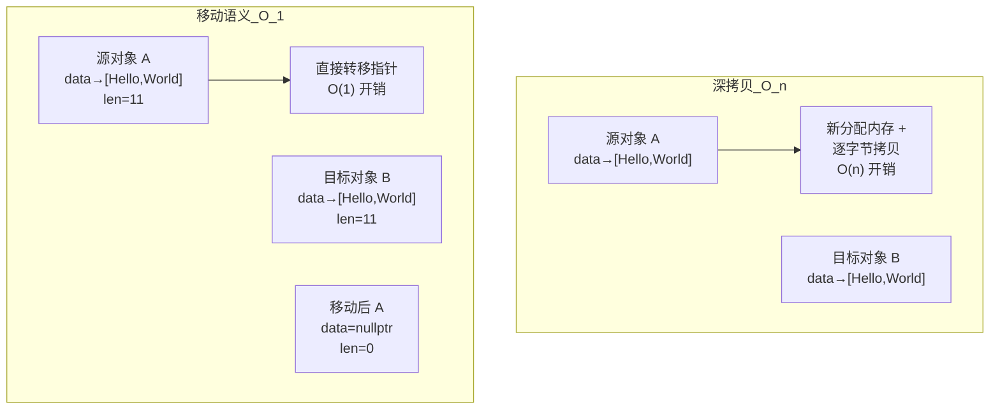

```cpp
#include <cstring>

class MyString {
    char *data;
    size_t len;
public:
    // 构造函数
    MyString(const char *s) : len(strlen(s)), data(new char[len + 1]) {
        strcpy(data, s);
    }

    // 拷贝构造（深拷贝，O(n)）
    MyString(const MyString &other) : len(other.len), data(new char[len + 1]) {
        strcpy(data, other.data);
    }

    // 移动构造（O(1)，"窃取"资源）
    MyString(MyString &&other) noexcept : len(other.len), data(other.data) {
        other.data = nullptr;          // ⚠️ 源对象置空，防止析构时 delete
        other.len = 0;
    }

    ~MyString() { delete[] data; }
};

MyString factory() {
    MyString tmp("temporary");
    return tmp;       // C++11 自动优先使用移动构造（返回值优化）
}
```

### 20.5 完美转发 (forward)

```cpp
#include <utility>

// ❌ 传值：丢失左值/右值信息，永远触发拷贝
template <typename T>
void bad(T t) {
    target(t);      // t 永远被当成左值
}

// ❌ 传右值引用：只能接受右值
void bad2(int &&x) {
    target(x);      // x 有名字，被当成左值！
}

// ✅ 万能引用（universal reference）+ forward
template <typename T>
void perfect(T &&t) {       // T&& 是万能引用，可以接左值也可以接右值
    target(std::forward<T>(t));  // forward 保持实参的左右值属性
}

// 使用
int a = 10;
perfect(a);          // a 是左值 → T=int& → forward 返回 int& → 左值传入
perfect(10);         // 10 是右值 → T=int → forward 返回 int&& → 右值传入
```

---

## 二十一、引用折叠 ★★★

### 21.1 四条折叠规则

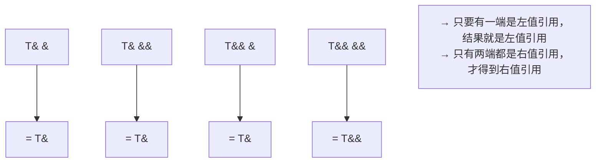

### 21.2 折叠发生在哪

```cpp
template <typename T>
void foo(T &&param);   // "万能引用" / universal reference

// 调用 foo(左值)
int x = 10;
foo(x);
// → T 推导为 int&
// → 参数类型：T&& → int& && → 按规则2 → int&

// 调用 foo(右值)
foo(100);
// → T 推导为 int
// → 参数类型：T&& → int&& → 按规则4 → int&&
```

### 21.3 笔记中的完整案例：flip 函数演进

```cpp
// === 场景：把你的笔记中的 ftemp 正确转发给 flip ===
void ftemp(int v1, int &v2) {
    cout << v1 << " " << ++v2 << endl;  // v2 是引用，会修改实参
}

// === 版本 1：传值（❌ j 不变） ===
template <typename F, typename T1, typename T2>
void flip1(F f, T1 t1, T2 t2) {
    f(t2, t1);                     // t1 是 j 的拷贝，ftemp 中 ++v2 改的是拷贝
}

int j = 100, i = 99;
flip1(ftemp, j, 42);
// j 被值传递拷贝了一份，ftemp 的 ++v2 改的是那份拷贝 → j 不变
// 类型推导：T1 = int, T2 = int（42 是右值，T2 不可能推导为 int&）

// === 版本 2：万能引用（✅ j 变了但有个大 Bug） ===
template <typename F, typename T1, typename T2>
void flip2(F f, T1 &&t1, T2 &&t2) {
    f(t2, t1);                     // t1 是 j 的左值引用，j 被成功修改！
}

int j = 100, i = 99;
flip2(ftemp, j, 42);
// T1 = int&,  T2 = int
// T1&&t1 → int& && → int& → t1 是 j 的真正引用
// 打印：42 101（j 被修改）✅

// === Bug 暴露 ===
void gtemp(int &&i, int &j) {
    cout << i << " " << j << endl;
}

flip2(gtemp, j, 42);    // ❌ 编译错误！
// 原因：t2 的类型是 int&&，但 t2 本身是左值 → 无法绑定到 gtemp 的 int&& i
// error: cannot bind rvalue reference of type ‘int&&’ to lvalue of type ‘int’

// === 解 Bug：T&& 类型的东西本身是左值！ ===
int i = 100;
int &&m = 200;     // m 的类型是 int&&（右值引用类型）
int &&k = m;       // ❌ m 是左值（有名字、可取地址），不能绑到 k（右值引用）
// 为什么报错：int&& 类型 ≠ 右值！右值引用类型的变量 m 本身是一个左值
// 因为它有名字，可以取地址（&m 合法）

// 解决办法：用 int() 临时转换或 std::move
int &&k1 = int(m);         // ✅ int(m) 是表达式，产生右值
int &&k2 = std::move(m);   // ✅ move 强制转右值

// === 最终版 3：完美转发 ===
template <typename F, typename T1, typename T2>
void flip_final(F f, T1 &&t1, T2 &&t2) {
    f(std::forward<T2>(t2), std::forward<T1>(t1));   // ✅ forward 保持属性
}
// std::forward<int>(42)   → int&&   → 右值 → 绑定到 gtemp 的 int&& i
// std::forward<int&>(j)   → int&    → 左值 → 绑定到 gtemp 的 int& j
```

> 🎯 **关键认知**：`int&&` 类型不是"右值"，它是"右值引用类型"。`T&&` 类型的变量如果有名字，那它在表达式中就是**左值**。只有 `std::move` 或 `std::forward` 才能将其还原为右值。

---

## 二十二、虚函数与动态绑定深度

### 22.1 虚函数表 (vtable) 机制

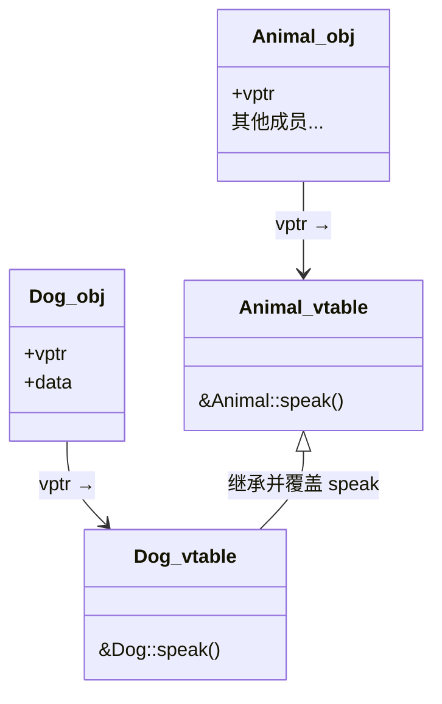

```cpp
class Animal {
public:
    virtual void speak() { cout << "Animal\n"; }
};

class Dog : public Animal {
public:
    void speak() override { cout << "Dog\n"; }
};

// 运行时
Animal *ptr = new Dog();
ptr->speak();
// 汇编级流程：
// 1. (*ptr).vptr → 找到 Dog 的虚函数表
// 2. vtable[0] → 找到 Dog::speak 的地址
// 3. call that address
// 这就是"动态绑定"——在运行时通过 vptr 查表决定调用哪个函数
```

### 22.2 构造/析构函数中的虚函数陷阱

```cpp
class Base {
public:
    Base()  { show(); }    // ⚠️ 构造中调用虚函数！
    virtual void show() { cout << "Base\n"; }
    virtual ~Base() {}
};

class Derived : public Base {
    int *data;
public:
    Derived() { data = new int[100]; }
    void show() override { cout << "Derived\n"; }
    ~Derived() override { delete[] data; }
};

Derived d;  // 打印 "Base" 而不是 "Derived"！

// 原因：构造 Derived 时，先构造 Base 部分。
// 在 Base 构造函数执行时，Derived 部分还没构建出来（data 还是未初始化的），
// 所以这时的虚函数表是 Base 的 vtable。调用 show() 就是 Base::show()
```

> ⚠️ **绝对不要在构造/析构函数中调用虚函数**，不会有动态绑定效果。

### 22.3 类互相引用

当 `A` 类含有 `B` 的成员，`B` 类含有 `A` 的成员时，编译会出问题（不完整类型）。解决方法是前向声明 + 指针：

```cpp
// 头文件 A.h
class B;                          // 前向声明
class A {
    B *b;                         // 只能用指针/引用
public:
    void setB(B *pb) { b = pb; }
};

// 头文件 B.h
class A;                          // 前向声明
class B {
    A *a;
public:
    void setA(A *pa) { a = pa; }
};
```

---

## 二十三、智能指针 ★★★

### 23.1 概述

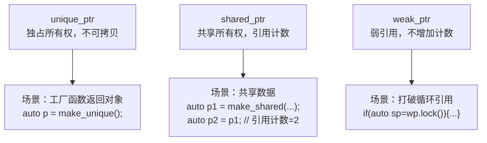

### 23.2 unique_ptr

```cpp
#include <memory>

auto p1 = make_unique<int>(42);
cout << *p1;                     // 42

// unique_ptr 不能拷贝
// auto p2 = p1;                 // ❌ 编译错误

// 但可以移动（转移所有权）
auto p2 = std::move(p1);         // p1 变为 nullptr，p2 拥有对象

// 自定义删除器
auto deleter = [](int *p) { cout << "deleting\n"; delete p; };
unique_ptr<int, decltype(deleter)> p3(new int(10), deleter);
```

### 23.3 shared_ptr

```cpp
auto p1 = make_shared<string>("hello");
auto p2 = p1;                    // 引用计数 = 2
auto p3 = p2;                    // 引用计数 = 3
cout << p1.use_count();          // 3

// 当所有 shared_ptr 销毁或重新赋值后，引用计数变 0，释放内存
p1 = nullptr;                    // 引用计数 = 2
p2 = nullptr;                    // 引用计数 = 1
p3 = nullptr;                    // 引用计数 = 0 → delete string
```

### 23.4 weak_ptr 解决循环引用

```cpp
class Child;

class Parent {
public: shared_ptr<Child> child;
    ~Parent() { cout << "~Parent\n"; }
};

class Child {
public: shared_ptr<Parent> parent;   // ❌ 循环引用
    ~Child() { cout << "~Child\n"; }
};

void test_leak() {
    auto p = make_shared<Parent>();
    auto c = make_shared<Child>();
    p->child = c;               // c 引用计数 = 2
    c->parent = p;              // p 引用计数 = 2
    // 离开作用域后，p 和 c 的引用计数各是 1（互相指着对方）
    // → 永远不会 delete → 内存泄漏！
}

// ✅ 修复：把 Child 中的 shared_ptr 改为 weak_ptr
class Child {
public: weak_ptr<Parent> parent;
    ~Child() { cout << "~Child\n"; }
};

void test_ok() {
    auto p = make_shared<Parent>();
    auto c = make_shared<Child>();
    p->child = c;                      // c 计数 = 2
    c->parent = p;                     // p 计数 = 1（weak 不增加）
    // 离开作用域：
    // p 销毁 → p 计数变 0 → delete Parent
    // c 的 parent 是 weak_ptr，不阻止销毁
    // c 销毁 → c 计数变 0 → delete Child
    // ✅ 全部正确释放
}

// 使用 weak_ptr 前要 lock
if (auto sp = wp.lock()) {
    cout << *sp;               // 安全使用
}
```

---

## 二十四、多线程 ★★★

### 24.1 线程创建

```cpp
#include <thread>
#include <iostream>
using namespace std;

// 方式 1：普通函数
void work(string str) {
    cout << str << endl;
}

string msg = "hello";
thread t1(work, msg);              // 或 thread t1(&work, msg)
t1.join();

// 方式 2：lambda
thread t2([](string s) {
    cout << "lambda: " << s << endl;
}, msg);
t2.join();

// 方式 3：仿函数（陷阱：Most Vexing Parse）
class Task {
public:
    void operator()(string s) { cout << s << endl; }
};

// thread t3(Task());              // ❌ 被解析为函数声明！
// "声明了一个函数 t3，返回值 thread，参数是一个无参返回 Task 的函数指针"
thread t3((Task()));               // ✅ 多一层括号
thread t4{Task()};                 // ✅ {} 初始化（C++11）
t3.join();
t4.join();
```

### 24.2 join vs detach

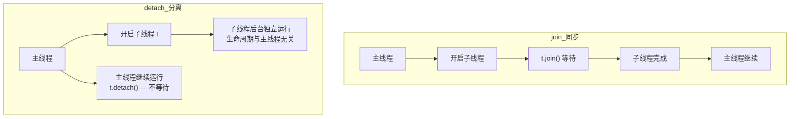

```cpp
// join：必须调（否则 ~thread() 调 terminate()）
thread t(work, msg);
t.join();                          // 阻塞直到子线程完成

// joinable()：检测是否可 join
if (t.joinable()) { t.join(); }

// detach：分离（之后不能再 join）
t.detach();
```

### 24.3 detach 的危险——访问已销毁的局部变量

```cpp
struct Func {
    int &ref;
    Func(int &r) : ref(r) {}
    void operator()() {
        for (int i = 0; i < 10; i++) {
            ref = i;               // ⚠️ 通过引用访问外部变量
            cout << ref << endl;
            this_thread::sleep_for(chrono::seconds(1));
        }
    }
};

void oops() {
    int local = 0;                 // 栈上的局部变量！
    Func f(local);
    thread t(f);
    t.detach();                    // ⚠️ 分离到后台
    // oops() 返回后，local 被销毁
    // 但后台线程仍通过 f.ref 访问 local → 野指针 → 崩溃！
}

int main() {
    oops();
    this_thread::sleep_for(chrono::seconds(3));  // 这期间线程很可能已崩溃
}
```

**解决方案**：

1. 改用 `join()`，保证线程结束在局部变量消亡前
2. 值拷贝方式传递参数（要求类型可拷贝）
3. 用智能指针保持数据存活

### 24.4 线程异常安全

```cpp
void risky() {
    Func f(some_data);
    thread t(f);

    try {
        // 可能抛异常的代码
        risky_operation();
    } catch (...) {
        t.join();                  // 异常路径下也要 join！
        throw;
    }
    t.join();
}
```

### 24.5 RAII 线程守卫

```cpp
class ThreadGuard {
    thread &t;
public:
    explicit ThreadGuard(thread &thr) : t(thr) {}
    ~ThreadGuard() {
        if (t.joinable()) t.join();
    }
    ThreadGuard(const ThreadGuard&) = delete;
    ThreadGuard& operator=(const ThreadGuard&) = delete;
};

void safe() {
    int local = 0;
    Func f(local);
    thread t(f);
    ThreadGuard guard(t);
    // 无论 safe 正常返回还是异常退出，guard 析构时都 join
}
```

### 24.6 隐式转换陷阱

```cpp
void print_str(int id, string s) { cout << id << ": " << s << endl; }

void danger(int param) {
    char buffer[1024];
    sprintf(buffer, "%d", param);

    thread t(print_str, 1, buffer);    // ⚠️ buffer 是 char*
    t.detach();                        // t 内部先把 char* buffer 存下来
}
// thread 内部：参数先被拷贝到线程内部存储
// 拷贝的是 char* 的指针地址，不是字符串内容
// detach 后 danger() 返回 → buffer 销毁 → 线程内部存的指针变悬空！
// → 在线程内部真正调用 print_str 时才将 char* 转 string → 访问野指针 → 崩溃

void safe_version(int param) {
    char buffer[1024];
    sprintf(buffer, "%d", param);

    thread t(print_str, 1, string(buffer));   // ✅ 显式转 string（立刻拷贝）
    t.detach();
}
```

### 24.7 引用参数需要 std::ref

```cpp
void addOne(int &x) { x++; }

void test() {
    int val = 0;
    // thread t(addOne, val);    // ❌ val 被拷贝后传给线程，addOne 改的是拷贝
    thread t(addOne, std::ref(val));  // ✅ std::ref 生成引用包装器
    t.join();
    cout << val;                      // 1
}
```

### 24.8 类成员函数启动线程

```cpp
class Worker {
public:
    void doWork() { cout << "working\n"; }
};

Worker w;
// 成员函数必须取地址，第二个参数是 this 指针
thread t(&Worker::doWork, &w);
t.join();

// 注意：普通函数前加 & 或省略都行，成员函数必须加 &
```

### 24.9 std::move 传独占资源

```cpp
void consume(unique_ptr<int> p) {
    cout << *p << endl;
    (*p)++;
}

void test() {
    auto p = make_unique<int>(100);
    thread t(consume, std::move(p));   // 所有权转移给线程
    t.join();
    // p 已经是 nullptr，不能再用
    // cout << *p;                     // ❌ 没有所有权了
}
```

---

## 二十五、C++11/14/17 新特性精选

### 25.1 原始字面量

```cpp
string path1 = "D:\\hello\\world\\test.txt";   // 老写法：必须转义
string path2 = R"(D:\hello\world\test.txt)";   // ✅ R"()" 内直接写

// 定界符防止 ) 冲突
string code = R"===(int a = (x + y);)===)";

// 多行
string html = R"(
<html>
  <body>
    <p>Hello</p>
  </body>
</html>
)";
```

### 25.2 auto / decltype

```cpp
auto a = 42;                   // int
auto b = 3.14;                 // double
auto c = "hello";              // const char*
auto d = make_shared<int>(10); // shared_ptr<int>

// 尾置返回类型
template <typename A, typename B>
auto add(A a, B b) -> decltype(a + b) {
    return a + b;
}
```

### 25.3 nullptr

```cpp
// C++98 的 NULL 是 0，可以被当成 int → 导致重载匹配错误
// C++11 nullptr 是专门的空指针字面量，解决这个麻烦
int *p = nullptr;
```

### 25.4 lambda 表达式

```cpp
// 格式：[捕获](参数) -> 返回类型 { 体 }
auto f = [](int x, int y) -> int { return x + y; };

int n = 10;
auto byVal = [n]() { return n; };         // 值捕获（只读）
// n 被拷贝一份进 lambda

auto byRef = [&n]() { n++; };             // 引用捕获（可改）

auto mixed = [=, &n]() {};                // 全部值捕获，n 引用捕获
auto mixed2 = [&, n]() {};                // 全部引用捕获，n 值捕获

// mutable：值捕获可修改内部副本
auto mut = [n]() mutable { n++; return n; };
cout << mut() << " " << n;                // 11 10（内部 n 变了，外不变）
```

### 25.5 override / final

```cpp
class Base {
    virtual void foo(int);
};

class Derived : public Base {
    void foo(int) override;    // ✅ 编译器检查是否真的覆盖了
    // void foo(double) override;   // ❌ 编译错误：没有匹配的虚函数
};

class FinalClass final { };    // 不能被继承
```

### 25.6 range-based for

```cpp
vector<int> v = {1, 2, 3, 4, 5};
for (int x : v) cout << x;          // 值遍历
for (int &x : v) x *= 2;            // 引用遍历（修改原值）
for (const auto &x : v) cout << x;  // 只读，auto 自动推导
```

### 25.7 移动语义/完美转发/引用折叠

已在第二十、二十一章节中详细展开。

---

## 二十六、Boost.Asio 网络编程关键要点

### 26.1 二次析构问题

```cpp
void Session::handle_read(const error_code& err, size_t bytes) {
    if (!err) {
        async_write(socket, buffer(data, bytes),
            bind(&handle_write, this, _1));          // ① 注册写回调
        async_read_some(socket, buffer(data, max_len),
            bind(&handle_read, this, _1, _2));        // ② 注册读回调
    } else {
        delete this;     // ❌ 客户端断开时，①和②各触发一次 delete → double free
    }
}

void Session::handle_write(const error_code& err) {
    if (err) {
        delete this;     // ❌ 又从写回调触发 delete
    }
}
```

**解决方案（乒乓方式）**：一次只注册一个异步操作（写了就不读，读了就不写），确保只有一个 `delete this`。或使用 `shared_from_this()`。

### 26.2 read_some / write_some 的问题与优化

```cpp
// write_some 的问题：一次可能只发送部分数据（如 "Hello World" 只发了 "Hel"）
// 解决：循环发送直到发完
void WriteCallback(const error_code& ec, size_t bytes, shared_ptr<MsgNode> node) {
    if (bytes + node->cur_len < node->total_len) {
        node->cur_len += bytes;
        socket->async_write_some(
            buffer(node->msg + node->cur_len, node->total_len - node->cur_len),
            bind(&WriteCallback, this, _1, _2, node));
    }
}
```

**更好的方案**：用 `boost::asio::async_write` 和 `boost::asio::async_read`（一次性发完/读完指定字节）。

```cpp
// 接收：先读固定长度头部，再读消息体
void Start() {
    recv_head->Clear();
    async_read(socket, buffer(recv_head->data, HEAD_LEN),
        bind(&HandleHead, this, _1, _2, sharedSelf()));
}

void HandleHead(const error_code& ec, size_t bytes, shared_ptr<CSession> self) {
    if (ec) return;  // 错误处理

    short msgLen = 0;
    memcpy(&msgLen, recv_head->data, HEAD_LEN);

    recv_msg = make_shared<MsgNode>(msgLen);
    async_read(socket, buffer(recv_msg->data, recv_msg->total_len),
        bind(&HandleMsg, this, _1, _2, self));
}
```

---

> **整理说明**：本文基于原始笔记中 00~07、C++基础知识、C++基础合并版笔记、C++进阶理解版、C++多线程、C++新特性、C++ boost网络编程 全部内容整合重构而成。关键概念均用 Mermaid 图辅助理解，配合大量可直接运行的代码示例，覆盖 C++ 从零基础到进阶实战的全部核心知识点。