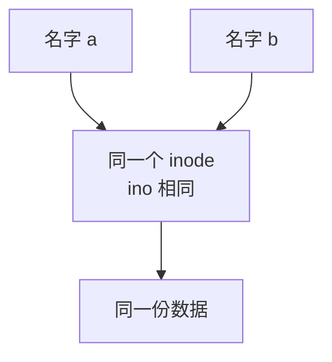
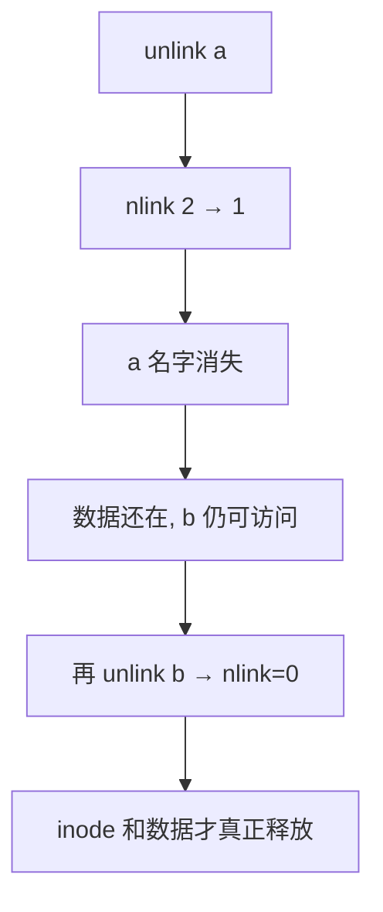

### 进程和内存

一个 xv6 进程由两部分组成，一部分是用户内存空间（指令，数据，栈），另一部分是仅对内核可见的进程状态。xv6 提供了分时特性：它在可用 CPU 之间不断切换，决定哪一个等待中的进程被执行。当一个进程不在执行时，xv6 保存它的 CPU 寄存器，当他们再次被执行时恢复这些寄存器的值。内核将每个进程和一个 **pid** (process identifier) 关联起来。

## 1 fork

### 1.1 fork示例代码(1)

一个进程可以通过系统调用 `fork` 来创建一个新的进程。`fork` 创建的新进程被称为**子进程**，子进程的内存内容同创建它的进程（父进程）一样。`fork` 函数在父进程、子进程中都返回（一次调用两次返回）。对于父进程它返回子进程的 pid，对于子进程它返回 0。考虑下面这段代码：

```C
int pid;
pid = fork();
if(pid > 0){
    printf("parent: child=%d\n", pid);
    pid = wait();
    printf("child %d is done\n", pid);
} else if(pid == 0){
    printf("child: exiting\n");
    exit();
} else {
    printf("fork error\n");
}
```


核心点：**fork 之后，父子进程从 fork 的下一行开始，各自独立往下执行**。

假设父进程 PID=100，fork 出的子进程 PID=200。

**1. 父进程执行**

```c
pid = fork();          // 返回 200（子进程 PID）
if(pid > 0){           // 200 > 0，成立
    printf("parent: child=200\n");
    pid = wait();      // 阻塞，等子进程结束
    // ... 子进程结束后被唤醒
    printf("child 200 is done\n");
}
```

父进程打印 `parent: child=200` 后，**卡在 `wait()` 等待**。

**2. 子进程执行**

```c
pid = fork();          // 返回 0
if(pid > 0){           // 0 > 0 不成立，跳过
} else if(pid == 0){   // 成立
    printf("child: exiting\n");
    exit();            // 子进程结束
}
```

子进程打印 `child: exiting`，然后 `exit()` 退出。系统调用 `exit` 会导致调用它的进程停止运行，并且释放诸如内存和打开文件在内的资源。

**3. 父进程被唤醒**

子进程退出后，`wait()` 返回**子进程的 PID（200）**，父进程继续：

```c
printf("child 200 is done\n");
```


**可能输出顺序**

```c
parent: child=200
child: exiting
child 200 is done
```

```c
child: exiting
parent: child=200
child 200 is done
```

**但顺序不保证！** fork 后父子进程并发运行，调度器决定谁先跑。可能出现的顺序：

| 顺序 | 输出                                            |
| :--- | :---------------------------------------------- |
| A    | child: exiting →  parent: child=200→ child done |
| B    | parent: child=200 → child: exiting → child done |

**唯一能确定的是**：`child ... is done` 一定在最后，因为父进程 `wait()` 会阻塞到子进程退出


**图解运行流程**

```c
        fork()
       /      \
   父进程      子进程
   pid=200    pid=0
     |          |
打印 parent   打印 child
     |          |
  wait()阻塞    exit()退出
     |          |
  被唤醒 ───────┘
     |
打印 child done
```


### 1.2 fork运行流程(2)

虽然 `fork` 复制了文件描述符，但每一个文件当前的偏移仍然是在父子进程之间共享的，考虑下面这个例子：

```C
if(fork() == 0) {
    write(1, "hello ", 6);
    exit();
} else {
    wait();
    write(1, "world\n", 6);
}
```

在这段代码的结尾，绑定在文件描述符1上的文件有数据"hello world"，父进程的 `write` 会从子进程 `write` 结束的地方继续写 (因为 `wait` ,父进程只在子进程结束之后才运行 `write`)。这种行为有利于顺序执行的 shell 命令的顺序输出，例如 `(echo hello; echo world)>output.txt`。


### 1.3 注意事项

需要留意的是父子进程拥有不同的内存空间和寄存器，改变一个进程中的变量不会影响另一个进程。


### 1.4 fork底层

#### 1.4.1 总览：fork 干了三件大事

```text
1. 创建新进程的内核数据结构（task_struct 等）
2. 复制父进程的资源（内存、fd 表、信号等）
3. 让子进程进入可调度状态，父子各返回一次
```

#### 1.4.2 入口：用户态调用链

```c
fork()
  → glibc 封装
    → syscall(SYS_clone) 或 sys_clone
      → 内核 do_fork() / kernel_clone()
```

现代 Linux 里 `fork` 底层其实是 **`clone` 系统调用**的特例：

| 调用           | 复制内容                                |
| :------------- | :-------------------------------------- |
| `fork()`       | 复制内存、fd、信号处理等（最完整）      |
| `vfork()`      | 共享内存，父进程挂起，子进程先跑        |
| `clone(flags)` | 按 flags 选择性复制（线程、命名空间等） |

`fork` ≈ `clone(SIGCHLD)`，只复制必要资源，不共享地址空间。

#### 1.4.3 内核做的具体步骤

**1. 复制 task_struct（进程控制块）**

每个进程在内核里有一个 `task_struct`，记录：

- PID、PPID
- 进程状态
- 内存描述符 mm
- 打开文件表 files
- 信号、调度信息

fork 时，内核 `copy_process()` 会**复制父进程的 task_struct**，然后修改关键字段：

- 分配新的 **PID**；
- 设 PPID = 父进程 PID；
- 状态设为可运行；
- 清空一些统计量。

**2. 复制内存：写时复制（Copy-On-Write）**

**这是 fork 最关键、最精妙的部分。**

早期 Unix 是**真的把父进程内存整份复制**给子进程，慢且浪费。现代 Linux 用 **COW**：

- fork 时**不复制物理内存**，只复制**页表**；
- 父子进程的虚拟页**指向同一份物理页**；
- 把这些页标记为**只读**；
- 一旦某一方**写入**，触发**缺页异常**，内核才真正复制那一页。

```text
fork 后:
  父页表 ─┐
          ├──> 物理页 A (只读)
  子页表 ─┘

子进程写 A:
  触发缺页 → 内核复制出新页 B
  子页表 -> 物理页 B (可写)
  父页表 -> 物理页 A (可写)
```

**好处**：fork 极快，只有真正写内存时才复制，省内存。

**3. 复制文件描述符表**

- 复制父进程的 **fd 表**（每个 fd 表项一份）；
- **但表项指向的打开文件对象是共享的**；
- 所以父子 fd 号相同，且**共享文件偏移量**。

```text
父 fd0 ─┐
        ├──> 打开文件对象 #7 (共享 offset)
子 fd0 ─┘
```

（如果 fork 后 exec，fd 表保留，这就是重定向能工作的原因。）

**4 复制其他资源**

| 资源     | 处理                                 |
| :------- | :----------------------------------- |
| 信号处理 | 复制，但**未决信号清空**             |
| 内存映射 | 复制页表，COW                        |
| 文件锁   | **不继承**（子进程不持有父的文件锁） |
| 定时器   | 不继承                               |
| 命名空间 | 默认共享（除非 clone 指定新建）      |

**5 加入调度、唤醒**

- 子进程被加入**调度队列**，状态 `TASK_RUNNING`；
- 父子进程都可能被调度器选中运行。

#### 1.4.4 返回两次怎么实现

fork 后，父子进程都从内核返回用户态，但返回值不同：

- **父进程**：`copy_process` 返回子进程 PID，父进程 `fork()` 得到 **>0**；
- **子进程**：内核把子进程的返回寄存器设为 **0**，子进程 `fork()` 得到 **0**。

**同一段代码，执行两次，返回值不同** —— 这就是 fork "调用一次返回两次"的本质。

#### 1.4.5 fork 之后父子进程的关系

```
fork 前:  父进程 (PID 100)
              │
fork 后:  ┌───┴───┐
       父(PID 100)  子(PID 200)
       fork返回200  fork返回0
       内存: 共享COW
       fd: 号相同, 对象共享
       各自独立调度
```

- **内存**：写时复制，逻辑独立；
- **fd**：表独立，指向对象共享；
- **执行**：并发，顺序不确定。

#### 1.4.6 为什么 fork 曾经很慢、现在很快

- 老 Unix：**整份复制内存**，进程大就慢；
- 现代 Linux：**COW**，fork 只复制页表，几乎瞬间完成；
- 只有父子真正写内存时，才按页复制。

#### 1.4.7 fork 的代价与风险

| 问题           | 说明                              |
| :------------- | :-------------------------------- |
| 页表复制       | 进程内存映射大时，页表本身也不小  |
| COW 缺页       | 写内存时触发缺页，有开销          |
| 缓冲区复制     | printf 缓冲区被复制，可能重复输出 |
| fd 共享 offset | 父子读同一文件会互相影响偏移      |

所以高并发场景更倾向用 **`vfork`** 或 **`posix_spawn`**，避免复制页表。


## 2 exec

系统调用 `exec` 将从某个*文件*（通常是可执行文件）里读取内存镜像，并将其替换到调用它的进程的内存空间。这份文件必须符合特定的格式，规定文件的哪一部分是指令，哪一部分是数据，哪里是指令的开始等等。xv6 使用 ELF 文件格式，第2章将详细介绍它。当`exec`执行成功后，它并不返回到原来的调用进程，而是从ELF头中声明的入口开始，执行从文件中加载的指令。`exec` 接受两个参数：可执行文件名和一个字符串参数数组。


### 2.1 exec示例代码

举例来说：

```C
char *argv[3];
argv[0] = "echo";
argv[1] = "hello";
argv[2] = 0;
exec("/bin/echo", argv);
printf("exec error\n");
```

xv6 shell 用以上调用为用户执行程序。shell 的主要结构很简单，详见 `main` 的代码（8001）。主循环通过 `getcmd` 读取命令行的输入，然后它调用 `fork` 生成一个 shell 进程的副本。父 shell 调用 `wait`，而子进程执行用户命令。举例来说，用户在命令行输入“echo hello”，`getcmd` 会以 `echo hello` 为参数调用 `runcmd`（7906）, 由 `runcmd` 执行实际的命令。对于 `echo hello`, `runcmd` 将调用 `exec` 。如果 `exec` 成功被调用，子进程就会转而去执行 `echo` 程序里的指令。在某个时刻 `echo` 会调用 `exit`，这会使得其父进程从 `wait` 返回。你可能会疑惑为什么 `fork` 和 `exec` 为什么没有被合并成一个调用，我们之后将会发现，将创建进程——加载程序分为两个过程是一个非常机智的设计。

xv6 通常隐式地分配用户的内存空间。`fork` 在子进程需要装入父进程的内存拷贝时分配空间，`exec` 在需要装入可执行文件时分配空间。一个进程在需要额外内存时可以通过调用 `sbrk(n)` 来增加 n 字节的数据内存。 `sbrk` 返回新的内存的地址。

xv6 没有用户这个概念当然更没有不同用户间的保护隔离措施。按照 Unix 的术语来说，所有的 xv6 进程都以 root 用户执行。


**exec运行流程**

**1. 声明一个能容纳 3 个 `char *` 的数组。**

`argv[0]` 设为 `"echo"`，按惯例这是**程序名**。

`argv[1]` 设为 `"hello"`，这是真正要传给程序的参数。

`argv[2]` 设为 `0`（即 `NULL`），**标记参数列表结束**。`exec` 系列函数依赖这个 NULL 来判断数组到哪里结束，缺少它会导致未定义行为。

此时内存布局大致是：

```c
argv ──┬──> "echo"
       ├──> "hello"
       └──> NULL
```


**2. 调用 exec**

```c
exec("/bin/echo", argv);
```

这里用的是 `exec`（通常指 `execv` 这类以路径为参数的版本）。它的行为是：

1. **查找并加载** `/bin/echo` 这个可执行文件。

2. **用新程序替换当前进程的地址空间**——代码段、数据段、堆、栈全部被 `/bin/echo` 的内容覆盖。原程序（调用 `exec` 的那个程序）的代码从此不再存在于内存中。

3. **保留** 进程号（PID）、打开的文件描述符、环境变量等部分属性。

4. **把 `argv` 数组作为参数传给新程序**，同时按约定把 `argc` 设为 2（`argv[0]` 和 `argv[1]`，`argv[2]` 是 NULL 不计入）。

5. 新程序的 `main` 函数开始执行，形式类似：

   ```c
   int main(int argc, char *argv[]);
   ```

   此时 `argc == 2`，`argv[0] == "echo"`，`argv[1] == "hello"`。


**3. /bin/echo 的运行**

`/bin/echo` 启动后，通常会：

- 忽略 `argv[0]`（这个程序的参数列表为`echo hello`。大部分的程序都忽略第一个参数，这个参数惯例上是程序的名字（此例是 echo））。
- 遍历 `argv[1]` 到 `argv[argc-1]`，把每个参数打印到标准输出，之间用空格分隔，最后换行。

于是终端输出：

```text
hello
```


**4. 关于 printf("exec error\n")**

```c
printf("exec error\n");
```

**这行代码只有在 `exec` 调用失败时才会执行。**

- `exec` 成功时，当前进程的代码已被 `/bin/echo` 完全替换，根本不会返回到这里。
- `exec` 失败时（例如 `/bin/echo` 不存在、没有执行权限等），它会返回 `-1` 并设置 `errno`，控制流继续往下走，于是打印 `exec error`。

所以这行 `printf` 实际上是一个**错误处理分支**，而不是正常流程的一部分。正常运行时看不到它。


| 要点                 | 说明                                                      |
| :------------------- | :-------------------------------------------------------- |
| `argv[argc] == NULL` | 必须由调用者保证，`exec` 靠它确定参数个数                 |
| `argv[0]` 是惯例     | 一般是程序名，但程序可以随意解释它                        |
| `exec` 不创建新进程  | 它替换当前进程映像，PID 不变                              |
| `exec` 成功不返回    | 只有失败才返回 `-1`，后续代码才执行                       |
| 路径 vs 文件名       | `exec` 用完整路径；`execlp`/`execvp` 才会去 `PATH` 里查找 |

如果你把 `exec` 换成 `execvp("echo", argv)`，那么即使不写 `/bin/echo`，系统也会在 `PATH` 环境变量指定的目录中查找 `echo`，效果通常相同。


### 2.2 exec底层

#### 2.2.1 xv6 shell 的整体结构

xv6 的 shell 本身就是一个普通用户程序，它做的事情可以概括成一个循环：

```c
while (1) {
    读取一行命令 (getcmd)
    runcmd(line)      // 解析并执行
}
```

对应的三个关键函数：

| 函数                     | 作用                          |
| :----------------------- | :---------------------------- |
| `main` (8001)            | shell 入口，主循环            |
| `getcmd`                 | 从终端读一行，返回给 `runcmd` |
| `runcmd` (7906)          | 解析这行命令，决定怎么执行    |
| `fork` / `exec` / `wait` | 实际执行命令的系统调用        |


#### 2.2.2 以 `echo hello` 为例的完整流程

用户在终端敲下：

```c
echo hello
```

**第 1 步：getcmd 读入**
`getcmd` 把这一行读进来，作为字符串 `"echo hello"` 交给 `runcmd`。

**第 2 步：runcmd 解析**
`runcmd` 看出这是要执行一个外部程序，于是：

- 父 shell 调用 `fork()`，产生一个子进程，子进程是 shell 的副本。
- **父进程** 调用 `wait()`，进入等待状态，直到子进程结束。
- **子进程** 调用 `exec("/bin/echo", argv)`，其中 `argv = ["echo", "hello", NULL]`。

这里 `exec` 的用法正是你上一条消息里那段代码的形态。

**第 3 步：exec 替换子进程**
`exec` 成功后：

- 子进程原来的 shell 代码被丢弃，地址空间换成 `/bin/echo`。
- 子进程开始执行 `echo` 程序的指令。
- `argv` 中的 `"hello"` 作为参数传进去。

**第 4 步：echo 运行并退出**
`echo` 把 `hello` 打印到标准输出，然后调用 `exit()`。

**第 5 步：父进程被唤醒**
子进程退出后，内核通知正在 `wait()` 的父 shell。`wait` 返回，shell 回到主循环，准备读下一条命令。

**整体时序：**

```text
父 shell                    子进程
   │
   ├── fork() ──────────────> 诞生（shell 副本）
   │
   ├── wait()  (阻塞)          exec("/bin/echo", argv)
   │                              │
   │                              ├─ 地址空间被替换为 echo
   │                              ├─ 打印 "hello"
   │                              └─ exit()
   │
   <── wait 返回 ──────────────┘
   │
   └─ 回到主循环，读下一条命令
```

这段代码将调用程序替换为 `/bin/echo` 这个程序，这个程序的参数列表为`echo hello`。大部分的程序都忽略第一个参数，这个参数惯例上是程序的名字（此例是 echo）。


#### 2.2.3 为什么 fork 和 exec 不合并成一个调用？

这是这段文字里最重要的一句话。原因在于 **分离后可以灵活地在 exec 之前对子进程做各种设置**，而这些设置只影响子进程、不影响父 shell。

常见的例子：

1. **I/O 重定向**
   命令 `echo hello > out.txt` 需要在 exec 之前把子进程的标准输出（fd 1）重定向到文件：

   text

   ```c
   close(1);
   open("out.txt", O_WRONLY|O_CREATE);
   exec("/bin/echo", argv);
   ```

   如果 fork 和 exec 合并成一个调用，就没机会在中间改文件描述符了。

2. **管道**
   `a | b` 需要 fork 两个子进程，用 `pipe()` 连接它们的输入输出，然后再分别 exec。分开才能做到。

3. **后台执行**
   `cmd &` 时父进程不 wait，直接继续；只有 fork 和 exec 分开才能这样安排。

4. **修改环境、改变工作目录、设置信号处理**等，都发生在 fork 之后、exec 之前。

**一句话总结**：fork 负责"造出一个可以自由改动的子进程"，exec 负责"把可执行文件装进去"。两者分开，中间那段窗口就是 shell 实现各种功能的舞台。合并成一体就失去了这个灵活性。


## 3 I/O 和文件描述符

文件描述符是一个整数，它代表了一个进程可以读写的被内核管理的对象。进程可以通过多种方式获得一个文件描述符，如打开文件、目录、设备，或者创建一个管道（pipe），或者复制已经存在的文件描述符。简单起见，我们常常把文件描述符指向的对象称为“文件”。文件描述符的接口是对文件、管道、设备等的抽象，这种抽象使得它们看上去就是字节流。

### 3.1 I/O 和文件描述符

**进程、文件描述符和 I/O 重定向** 的基本机制。下面我逐句解释它的含义。

**1. “每个进程都有一张表，而 xv6 内核就以文件描述符作为这张表的索引”**

在 xv6 中，每个进程有一个 **打开文件表**（open file table），本质是一个数组：

```c
struct file *ofile[NOFILE];  // 每个进程的打开文件表
```

- 数组的下标就是 **文件描述符**（file descriptor，简称 fd）。
- 数组元素是指向 `struct file` 的指针，代表一个打开的文件（或设备、管道等）。
- 所以，`fd = 0` 对应 `ofile[0]`，`fd = 1` 对应 `ofile[1]`，依此类推。

这就是“以文件描述符作为这张表的索引”的意思。

**2. “所以每个进程都有一个从 0 开始的文件描述符空间”**

因为每个进程有自己的 `ofile` 数组，所以：

- 进程 A 的 fd 0 和进程 B 的 fd 0 是**完全独立**的，指向不同的 `struct file`。
- 每个进程的 fd 都从 0 开始编号，互不影响。

**3. “按照惯例，进程从文件描述符 0 读入（标准输入），从文件描述符 1 输出（标准输出），从文件描述符 2 输出错误（标准错误输出）”**

这是 Unix/Linux 的**约定**，不是内核强制规定，但所有程序都遵守：

| fd   | 名称   | 用途         |
| :--- | :----- | :----------- |
| 0    | stdin  | 标准输入     |
| 1    | stdout | 标准输出     |
| 2    | stderr | 标准错误输出 |

程序调用 `read(0, ...)` 就是从标准输入读，`write(1, ...)` 就是往标准输出写。


### 3.2 fd详解

**一、fd 号是进程私有的**

每个进程有自己独立的**文件描述符表**。进程 A 的 fd 0 和进程 B 的 fd 0 是**两个不同的表项**，互不影响。

```c
进程 A 的 fd 表          进程 B 的 fd 表
  fd0 -> 终端键盘          fd0 -> 终端键盘
  fd1 -> 终端屏幕          fd1 -> 终端屏幕
  fd2 -> 终端屏幕          fd2 -> 终端屏幕
```

fork 时，子进程**复制**一份父进程的 fd 表。之后两个进程各自增删自己的表项，**互不干扰**。

所以：**进程 A 不能直接把进程 B 的 fd 0 改成别的**。fd 号不能"跨进程替换"。

**二、但 fd 指向的"打开文件"对象可以共享**

内核里有一个全局的**打开文件表**（open file table），每个表项记录：

- 文件偏移量（offset）
- 文件状态标志（读/写、阻塞等）
- 指向 inode 的指针

进程的 fd 表项只是**指向**打开文件表里的某个表项：

```c
进程 A fd0 ─┐
            ├──> 打开文件表项 #7 (offset=100, 指向 input.txt)
进程 B fd0 ─┘
```

**fork 之后**，子进程的 fd 0 和父进程的 fd 0 指向**同一个打开文件表项**。这意味着：

- 它们**共享文件偏移量**；
- 一个进程读了一段，另一个进程的 offset 也跟着前进。

这就是为什么 fork 后父子进程读同一个文件时，读到的内容不会重复。


### 3.3 read/write说明

**1. `read` 函数原型**

```c
int read(int fd, void *buf, int n);
```

- 从文件描述符 `fd` 指向的文件中，读取最多 `n` 个字节。

- 读到 `buf` 指向的内存里。

- **返回值**：实际读到的字节数；返回 `0` 表示读到文件末尾；返回 `-1` 表示出错，返回整数说明读取的字节数>0

- fd是文件描述符，buf是传入的位置指针，n是本次最多还能读多少字节（一般指buf里面的剩余空间）

- `read` 是个**阻塞式系统调用**，它的语义是：

  > 从 `fd` 读数据，**如果没有数据可读，就等，直到有数据或到达 EOF**。


**2.`write` 的原型**

```c
int write(int fd, const void *buf, int n);
```

| 参数  | 含义                 |
| :---- | :------------------- |
| `fd`  | 往哪写（文件描述符） |
| `buf` | 从哪块内存开始写     |
| `n`   | 写多少个字节         |


### 3.4 read/write示例代码

```c
char buf[512];
int n;

for(;;){
    n = read(0, buf, sizeof buf);
    if(n == 0)
        break;
    if(n < 0){
        fprintf(2, "read error\n");
        exit();
    }
    if(write(1, buf, n) != n){
        fprintf(2, "write error\n");
        exit() ;
    }
}
```


**1. 缓冲区声明**

```c
char buf[512];
int n;
```

- `buf`：一块 512 字节的缓冲区，用来临时存放从输入读到的数据。
- `n`：保存 `read` 的返回值（读到的字节数），后面也用来和 `write` 的返回值比较。

为什么是 512？这是 xv6 中磁盘块大小（BSIZE）的常见取值，一次读一块，效率合适。

**2. 无限循环**

```c
for(;;){
```

等价于 `while(1)`，一直循环，直到内部遇到 `break` 或 `exit()`。

**3. 从 fd 0 读取**

```c
n = read(0, buf, sizeof buf);
```

- `fd = 0`：标准输入。默认情况下指向控制台（键盘）。
- `buf`：读到的数据放这里。
- `sizeof buf` = 512：最多读 512 字节。
- 返回值 `n`：
  - `n > 0`：实际读到的字节数（可能小于 512）。
  - `n == 0`：文件结束（EOF）。
  - `n < 0`：出错。

**直观图示**

假设文件内容 `"hello"`（5 字节），缓冲区 512 字节：

```
文件:   h  e  l  l  o  [EOF]
偏移:   0  1  2  3  4   5
                        ↑
                    读到这时返回 0
```

第一次 read：

```
偏移 0 ──读 5 字节──> 偏移 5
返回 5，buf = "hello"
```

第二次 read：

```
偏移 5（已在 EOF）──> 返回 0
```

**关键点**：`read` 会从当前文件偏移处读，读完自动把偏移往后推 `n` 个字节。所以下一次 `read` 会接着读，不会重复。推动了文件指针偏移

**4. 判断文件结束**

```c
if(n == 0)
    break;
```

读到 0 字节表示输入结束，跳出循环，程序正常退出。

比如在终端按 `Ctrl-D`，控制台驱动会让 `read` 返回 0，cat 就结束了。

**5. 判断读错误**

```c
if(n < 0){
    fprintf(2, "read error\n");
    exit();
}
```

- `n < 0` 表示 `read` 失败。
- `fprintf(2, ...)`：往 **fd 2（标准错误）** 写错误信息。
  - 注意这里用的是 `2` 而不是 `1`，因为错误信息应该走 stderr，这样即使 stdout 被重定向到文件，错误仍然能显示在屏幕上。
- `exit()`：终止进程。

**6. 写入 fd 1 并检查**

```c
if(write(1, buf, n) != n){
    fprintf(2, "write error\n");
    exit();
}
```

- `write(1, buf, n)`：把 buf 中的 `n` 个字节写到 fd 1（标准输出）。
- 正常应返回 `n`。
- 如果返回值 `!= n`，说明没写全，即发生了错误（比如磁盘满、管道破裂）。
- 同样往 fd 2 报错并退出。

**为什么只判断 `!= n` 而不判断 `< 0`？**
因为 `write` 的语义是：返回值小于 `n` 就一定是出错了（可能返回 -1，也可能返回部分字节数）。所以直接和 `n` 比较最严谨。


### 3.5 重定向示例代码

这段代码实现的是 `cat < input.txt` 这个 shell 重定向功能。

```c
char *argv[2];
argv[0] = "cat";
### argv[1] = 0;
if(fork() == 0) {
    close(0);
    open("input.txt", O_RDONLY);
    exec("cat", argv);
}
```

意思是：**运行 cat，让它的标准输入来自 input.txt**，而不是键盘。

**核心前提：文件描述符的继承规则**

1. **fork 后**：子进程的文件描述符表和父进程完全一样（复制一份）。
2. **exec 后**：进程的内存被新程序替换，但**文件描述符表保留**。

所以关键在于：**在 exec 之前动手续，让 fd 0 指向 input.txt，exec 之后 cat 就会从 fd 0 读，也就读到了 input.txt。**

```c
char *argv[2];
argv[0] = "cat";
argv[1] = 0;          // argv 以 NULL 结尾，表示没有额外参数
```

注意 `argv[1] = 0`（即 NULL），所以 cat 没有命令行参数。这意味着 **cat 会从标准输入 fd 0 读数据**，而不是从某个文件名读。

```c
if(fork() == 0) {     // 子进程分支
    close(0);         // 关掉 fd 0（标准输入）
    open("input.txt", O_RDONLY);
    exec("cat", argv);
}
```

**1. 准备参数**

```c
char *argv[2];
argv[0] = "cat";
argv[1] = 0;      // NULL 结尾
```

构造出参数数组：程序名是 `"cat"`，**没有其他参数**。

为什么没有文件名？因为文件名不通过参数传给 cat，而是通过**重定向 fd 0** 给 cat。

**2. fork 出子进程**

```c
if(fork() == 0) {
```

fork 后：

- 父进程：什么都不做，直接往下走（其实这里没写父进程逻辑，父进程可能就退出了）。
- 子进程：进入 if 分支。

此刻**子进程的 fd 0 和父进程一样，指向终端（键盘）**。

**3. 关掉 fd 0**

```c
close(0);
```

子进程释放 fd 0。现在 fd 0 是空闲的。

**4. 打开 input.txt**

```c
open("input.txt", O_RDONLY);
```

因为 fd 0 空闲，而内核按**最小可用**分配，所以这次 open **返回 0**：

```
fd 0 -> input.txt
```

**这一步就是重定向的核心**：fd 0 从"键盘"变成了"input.txt"。

**5. 执行 cat**

```c
exec("cat", argv);
```

`exec` 做两件事：

- **用 cat 程序替换当前子进程的内存**（代码、数据全换掉）；
- **保留文件描述符表**——所以 fd 0 依然指向 input.txt。

然后 cat 开始运行。

**三、cat 运行后发生什么**

cat 的行为（没有参数时）：**从 fd 0 读，写到 fd 1**。

- fd 0 → input.txt
- fd 1 → 终端（没改过）

所以 cat 从 input.txt 读内容，打印到终端。**这就是 `cat < input.txt` 的效果。**

cat **根本不知道 input.txt 这个名字**，它只是从 fd 0 读，而 fd 0 恰好指向了那个文件。


### 3.6 非重定向示例代码

**参**的方式实现 `cat input.txt`，并和你的**重定向**方式做对照。

**一、传参版代码**

```c
#include <unistd.h>
#include <stdio.h>

int main() {
    char *argv[3];
    argv[0] = "cat";
    argv[1] = "input.txt";   // 文件名作为参数传给 cat
    argv[2] = 0;             // NULL 结尾

    if (fork() == 0) {
        // 子进程：不需要改 fd 0
        execvp("cat", argv);
        // exec 失败才会走到这里
        perror("execvp");
        _exit(1);
    }

    wait(NULL);   // 父进程等子进程结束
    return 0;
}
```

运行效果等价于：

```bash
cat input.txt
```


**二、它和重定向版的根本区别**

|                  | 传参版                       | 重定向版              |
| :--------------- | :--------------------------- | :-------------------- |
| argv 内容        | `["cat", "input.txt", NULL]` | `["cat", NULL]`       |
| 文件名怎么给 cat | 通过 **argv[1]** 传          | 通过 **fd 0** 给      |
| 是否改 fd        | 不改                         | `close(0); open(...)` |
| cat 怎么拿文件   | 读 argv[1]，自己 open        | 从 fd 0 读            |
| 等价 shell       | `cat input.txt`              | `cat < input.txt`     |


### 3.7 重定向原理

**一、内核的分配规则：最小可用**

`open` 成功后，内核要做的事是：**在进程的 fd 表里找一个最小的、当前没被占用的槽位，把新打开的文件对象填进去，返回这个槽位的编号。**

这就是 Unix 的经典规则：**返回当前最小的未使用文件描述符。**

**二、为什么你的代码里它选中了 0**

看进程启动时的 fd 表：

```c
fd 0 -> 终端（标准输入）   ← 占用
fd 1 -> 终端（标准输出）   ← 占用
fd 2 -> 终端（标准错误）   ← 占用
fd 3 -> (空闲)
fd 4 -> (空闲)
...
```

此时最小的空闲 fd 是 **3**，如果直接 open，会得到 3。

但代码里先做了一步：

```c
close(0);   // 释放 fd 0
```

fd 表变成：

```c
fd 0 -> (空闲)   ← 现在它最小了
fd 1 -> 终端
fd 2 -> 终端
fd 3 -> (空闲)
...
```

再 `open("input.txt", ...)`，内核找最小空闲槽位，找到的是 **0**，于是：

```c
fd 0 -> input.txt
```

所以**不是 open 自动认准了 0**，而是你**先腾出了 0**，open 才按"最小可用"规则落到了 0 上。

**三、换个顺序就得到不同结果**

```c
close(2);                          // 释放 fd 2
open("input.txt", O_RDONLY);       // 这次返回 2，不是 0
```

因为此时最小空闲是 2，**fd 2** 就指向 input.txt 了。

再比如：

```c
close(0);
close(1);
open("a.txt", ...);   // 返回 0
open("b.txt", ...);   // 返回 1
```

按最小可用规则依次填补。

**四、这就是重定向的实现技巧**

重定向不是"把 fd 0 的内容换成 input.txt"，而是：

1. **关掉目标 fd**（腾出这个编号）；
2. **open 新文件**，靠"最小可用"规则让新文件**恰好占据这个编号**。

想重定向 fd 0，就 `close(0)` 再 open；
想重定向 fd 1，就 `close(1)` 再 open。

**fd 0、1、2 并不是"创建文件描述符时自动带上的"，而是进程启动时由 shell/系统预先打开的。**

**五、fd 0、1、2 从哪来**

一个新进程（程序）被启动时，**内核/父进程已经帮它打开了三个文件**：

| fd   | 名称            | 默认指向     |
| :--- | :-------------- | :----------- |
| 0    | 标准输入 stdin  | 终端（键盘） |
| 1    | 标准输出 stdout | 终端（屏幕） |
| 2    | 标准错误 stderr | 终端（屏幕） |

这是**约定俗成**的，不是 open 自动产生的。任何程序一启动，就"继承"了这三个 fd。

**六、注意：0/1/2 指向的不一定是终端**

它们指向什么，取决于**谁启动了这个进程、怎么启动的**：

- 在终端里直接跑 `./a.out` → 0/1/2 都指向终端。
- 跑 `./a.out < in.txt` → **fd 0 指向 in.txt**，不是终端。
- 跑 `./a.out > out.txt` → **fd 1 指向 out.txt**，不是终端。
- 跑 `./a.out 2> err.txt` → **fd 2 指向 err.txt**。
- 在管道里 `ls | grep a` → ls 的 fd 1 指向管道，grep 的 fd 0 指向管道。

所以更准确的说法是：

> **fd 0/1/2 是进程启动时默认存在的三个描述符，具体指向什么由启动它的环境决定，通常默认是终端。**

**七、为什么默认是终端**

因为 shell 自己启动时，它的 fd 0/1/2 就指向终端。shell fork 出子进程后，子进程**继承**了 shell 的 fd 表，所以子进程的 0/1/2 也指向终端。

```c
终端
  │
shell (fd0/1/2 -> 终端)
  │  fork
子进程 (fd0/1/2 -> 终端)   ← 继承而来
```


## 4 dup

`dup` 复制一个已有的文件描述符，返回一个指向同一个输入/输出对象的新描述符。这两个描述符共享一个文件偏移，正如被 `fork` 复制的文件描述符一样。这里有另一种打印 “hello world” 的办法：

### 4.1 dup示例代码

```c
fd = dup(1);          // 1 和 fd 指向同一文件，offset 共享
write(1, "hello", 5); // 写入 5 字节，offset 变成 5
write(fd, "world", 5);// 从 offset 5 继续写，变成 10
```


**dup示例代码运行流程**

**一、`dup(1)` 的参数是什么**

`dup(fd)` 的参数是一个**文件描述符编号**（一个整数）。所以：

```c
fd = dup(1);
```

就是把**编号 1**（该进程的标准输出）传进去。

- 如果进程的 fd 1 指向终端，那 `dup(1)` 复制的就是"指向终端"的那个打开文件对象。
- 如果 fd 1 被重定向到文件，`dup(1)` 复制的就是"指向那个文件"的对象。

**关键：参数是编号，dup 会去进程的 fd 表里查编号 1 对应的底层对象。**

**二、dup 做了什么**

`dup` 的语义：**复制一个已有的 fd，返回一个新的 fd，两个 fd 指向同一个打开文件对象（共享偏移量、状态标志）。**

```c
调用前:
  fd 1 ──> 打开文件对象 X (终端)

调用 fd = dup(1) 后:
  fd 1 ──┐
         ├──> 打开文件对象 X (终端)
  fd 3 ──┘   (假设 3 是最小空闲)

返回 3
```

所以 `fd` 得到一个新编号（这里是 3），但和 fd 1 指向**同一个东西**。

**三、新 fd 编号怎么来**

和 `open` 一样，**最小可用原则**：

- 进程启动时 0、1、2 占用；
- 若 3 空闲，`dup(1)` 返回 **3**；
- 若 3 也被占，就返回 4，以此类推。

**四、你这段代码的效果**

```c
fd = dup(1);                  // fd 和 1 都指向标准输出
write(1, "hello", 6);         // 往 fd 1 写 "hello"（注意 6 字节含 '\0'）
write(fd, "world\n", 6);      // 往 fd 写 "world\n"
```

两个 write 都写到**同一个地方**（终端或 fd 1 指向的文件），所以输出：

```c
helloworld
```

（严格说 `"hello"` 是 5 个字符 + 1 个 `\0`，写 6 字节会把 `\0` 也写出去，终端上看不见，但不严谨。）

**五、为什么共享偏移量很重要**

因为 fd 1 和 fd 是同一个打开文件对象，**共享文件偏移量**。如果是写文件：

```c
fd = dup(1);          // 1 和 fd 指向同一文件，offset 共享
write(1, "hello", 5); // 写入 5 字节，offset 变成 5
write(fd, "world", 5);// 从 offset 5 继续写，变成 10
```

结果是 `helloworld` 顺序拼接。**如果 fd 是各自独立的打开对象，第二次写可能覆盖第一次。**

**六、和 `open` 的区别**

| 操作                  | 结果                                             |
| :-------------------- | :----------------------------------------------- |
| `fd = dup(1)`         | 新 fd 和 1 **共享**同一打开文件对象（同 offset） |
| `fd = open("f", ...)` | 新 fd 指向**全新**打开文件对象（独立 offset）    |


## 5 pipe

### 5.1 pipe示例代码

这段代码实现的是 `echo "hello world" | wc` 的管道功能。核心思路：**父进程往管道写，子进程从管道读，子进程的 fd 0 被换成管道读端，wc 就从管道读数据。** 

```c
int p[2];
char *argv[2];
argv[0] = "wc";
argv[1] = 0;
pipe(p);
if(fork() == 0) {
    close(0);
    dup(p[0]);
    close(p[0]);
    close(p[1]);
    exec("/bin/wc", argv);
} else {
    write(p[1], "hello world\n", 12);
    close(p[0]);
    close(p[1]);
}
```


**pipe示例代码运行流程**

**一、准备阶段**

```c
int p[2];
char *argv[2];
argv[0] = "wc";
argv[1] = 0;        // wc 无参数，从 fd 0 读
pipe(p);
```

**`pipe(p)` 创建管道**，p 数组得到两个 fd：

- `p[0]`：**读端**（从管道读数据）
- `p[1]`：**写端**（往管道写数据）

```
p[0] ──> 管道读端
p[1] ──> 管道写端
```

注意：此时 `p[0]`、`p[1]` 是**父进程的 fd**，编号一般是 3、4（0/1/2 被占）。

**二、子进程分支**

```c
if(fork() == 0) {
    close(0);           // 腾出 fd 0
    dup(p[0]);          // 复制管道读端，落到 fd 0
    close(p[0]);        // 关掉原来的 p[0]
    close(p[1]);        // 关掉写端（子进程只读）
    exec("/bin/wc", argv);
}
```

逐步看：

1.`close(0)`

释放 fd 0，让它变空闲。

2.`dup(p[0])`

`dup` 复制 `p[0]`（管道读端），按**最小可用**原则，fd 0 空闲，所以新 fd 就是 **0**。

```text
fd 0 ──> 管道读端   （和 p[0] 指向同一个管道）
p[0] ──> 管道读端
```

现在子进程的 fd 0 指向管道读端。

3.`close(p[0])`

原来的 `p[0]` 已经不需要了（fd 0 已经指向同一个管道），关掉它，避免 fd 泄漏。

4.`close(p[1])`

子进程只读不写，关掉写端。**这一步很重要**：如果子进程还持有写端，即使父进程写完后关闭，子进程的读端也不会收到 EOF，`wc` 会一直阻塞等数据。

5.`exec("/bin/wc", argv)`

用 wc 替换子进程内存，**保留 fd 表**。所以 wc 启动后：

- fd 0 → 管道读端
- wc 无参数，从 fd 0 读 → 读到管道里的数据

**三、父进程分支**

```c
} else {
    write(p[1], "hello world\n", 12);   // 往管道写 12 字节
    close(p[0]);                        // 父进程不读，关读端
    close(p[1]);                        // 写完关写端
}
```

1.`write(p[1], "hello world\n", 12)`

往管道写端写入 `"hello world\n"`（12 字节）。

2.`close(p[0])`

父进程不读，关掉读端。

3.`close(p[1])`

**关键**：父进程写完关闭写端后，管道所有写端都关了，子进程读端就会读到 **EOF**，`wc` 才知道数据结束，才能统计并退出。


### 5.2 read EOF问题

**第 1 步：fork**

```c
父进程 (PID=100)              子进程 (PID=200)
  fd0 -> 终端                   fd0 -> 终端
  fd1 -> 终端                   fd1 -> 终端
  fd2 -> 终端                   fd2 -> 终端
  fd3 -> 管道读端               fd3 -> 管道读端
  fd4 -> 管道写端               fd4 -> 管道写端

内核管道: 空, 写端引用计数 = 2 (父fd4 + 子fd4)
```

fork 返回：父得 200，子得 0。


**第 2 步：子进程执行（进入 if 分支）**

```c
close(0);        // 子 fd0 释放
dup(p[0]);       // 复制管道读端，最小空闲=0 → 子 fd0 -> 管道读端
close(p[0]);     // 关掉子 fd3
close(p[1]);     // 关掉子 fd4  ← 关键！
exec("/bin/wc", argv);
```

子进程 fd 表变化：

```c
子进程:
  fd0 -> 管道读端   (由 dup 得到)
  fd1 -> 终端
  fd2 -> 终端
  fd3 -> (关)
  fd4 -> (关)
```

**子进程关掉了写端 fd4，所以：**

```
内核管道: 写端引用计数 = 1 (只剩父的 fd4)
```

然后 exec，内存换成 wc，但 fd 表保留。wc 无参数，从 fd0 读 → 从管道读。


**第 3 步：父进程执行（进入 else 分支）**

```c
write(p[1], "hello world\n", 12);   // 写 12 字节进管道
close(p[0]);                        // 关读端
close(p[1]);                        // 关写端
```

父进程 fd 表变化：

```c
父进程:
  fd0 -> 终端
  fd1 -> 终端
  fd2 -> 终端
  fd3 -> (关)
  fd4 -> (关)
```

**父进程关掉写端后：**

```c
内核管道: 写端引用计数 = 0
```


**第 4 步：数据流动**

```c
时刻 A: 父 write
  内核管道缓冲区: "hello world\n"
  写端计数 = 1

时刻 B: 子 wc 从 fd0 读
  读到 "hello world\n"
  缓冲区变空

时刻 C: 子 wc 再 read
  缓冲区空，但写端计数 = 0
  → read 返回 0 (EOF)
  → wc 知道数据结束

时刻 D: wc 统计
  1 行, 2 单词, 12 字节
  输出到 fd1 -> 终端
```


**第 5 步：结束**

```text
终端输出:
      1       2      12
```

父进程也结束（或 wait 子进程）。


### 5.3 同步关系消除并发

**一、真实运行时是并发的**

fork 之后，父进程和子进程**同时在跑**，由调度器决定谁先谁后。可能是：

```text
时间 →
父: write("hello world\n") ── close(p[1]) ── 结束
子: close(0) ── dup ── close ── exec wc ── read ... ── 输出
```

也可能是：

```text
时间 →
子: close(0) ── dup ── close ── exec wc ── read(阻塞等数据) ...
父: write("hello world\n") ── close(p[1]) ── 结束
子: read 被唤醒，读到数据 ── 再 read 返回0 ── 输出
```

**两种顺序都可能，甚至更多交错。** 我前面写的"父写完子再读"只是其中一种，是为了让你看清数据怎么流，不是必然。


**二、并发下管道怎么保证正确**

关键：**管道本身是同步工具**，它让并发变得安全。看几种交错：

**情况 1：子进程先 read，父进程还没 write**

```text
子: read(fd0)  → 缓冲区空 → 阻塞等待
父: write(...) → 数据进缓冲区，唤醒读端
子: read 返回，读到数据
```

子进程**不会读到空**，它会**阻塞**，等父进程写。

**情况 2：父进程先 write，子进程还没 read**

```text
父: write(...) → 数据进缓冲区
子: read(fd0)  → 缓冲区有数据 → 立即读到
```

数据先存在缓冲区里，等子进程来取。

**情况 3：父进程写得快，缓冲区满了**

```text
父: write(...) → 缓冲区满 → 阻塞，等读端取走
子: read(...)  → 取走数据，缓冲区有空位
父: write 被唤醒，继续写
```

写端**不会丢数据**，满了就阻塞。

**所以无论谁先谁后，数据都不会乱、不会丢、不会读到半截。** 这就是管道的同步作用。


**三、那"EOF"在并发下还成立吗**

成立，因为 EOF 靠的是**写端计数**，不是靠执行顺序：

- 父进程 `close(p[1])` 后，写端计数减 1；
- 子进程也 `close(p[1])` 后，计数减到 0；
- **无论这些 close 谁先谁后**，只要**最终都关了**，计数就归 0；
- 子进程 `read` 在缓冲区空 + 写端计数 0 时，才返回 EOF。

**所以并发不影响 EOF 的判定，只影响"谁先谁后"，不影响"最终结果"。**


**四、那并发会不会导致"写没完就读"**

你最早问的这个担心，答案是**不会**，原因：

1. **小于 `PIPE_BUF`（4096 字节）的 write 是原子的** —— 一次 write 要么完整进缓冲区，要么阻塞，不会写一半被读走；
2. **read 从缓冲区取数据** —— 缓冲区里只有完整写入的数据；
3. **缓冲区空时 read 阻塞** —— 不会读到"半截"。

所以并发下，读到的永远是**某次完整 write 的内容**，不会读到写了一半的数据。


**五、并发带来的真正影响**

并发不破坏正确性，但影响**顺序和时序**：

| 影响     | 说明                         |
| :------- | :--------------------------- |
| 谁先执行 | 不确定，调度器决定           |
| 阻塞时机 | 取决于谁先到，但最终都能完成 |
| 输出顺序 | 如果都往终端打印，可能交错   |
| 性能     | 父子可真正并行，提高效率     |

**但数据的完整性、EOF 的正确性、通信的可靠性，都由管道保证，与并发无关。**


**六、用一句话修正我前面的说法**

我前面写：

> **"父 write → 子 read → 父 close → 子 read EOF"**

这是**逻辑数据流**，不是**执行顺序**。真实是：

> **父子并发执行，write 和 read 谁先谁后不确定；但管道保证：读空则阻塞、写满则阻塞、写端全关才 EOF。所以无论怎么交错，结果都正确。**


**七、一句话总结**

> **fork 后父子确实并发，执行顺序不确定。但管道是同步工具：read 在空时阻塞、write 在满时阻塞、EOF 靠写端计数判断。所以并发不会导致数据错乱或读到半截，只会影响"谁先谁后"。** 我前面写的顺序是逻辑流程，不是真实时序。

想让我写一个**故意让父子交错**的例子（比如父进程 sleep 一下再写），让你亲眼看到"子进程先 read 阻塞、父进程 later 写入、子进程被唤醒"的过程吗？


## 6 chdir

### 6.1 目录树与路径

xv6 的文件系统是一棵**树**：

```text
/                ← root 目录
├── a
│   └── b
│       └── c      ← 文件
├── dir
│   └── file
└── console        ← 设备文件
```

- **根是 `/`**，唯一的顶层目录；
- 目录本身**也是一种文件**（特殊文件），内容是"指向其他文件/目录的引用"；
- **绝对路径**：以 `/` 开头，从根算起，如 `/a/b/c`；
- **相对路径**：不以 `/` 开头，从**当前工作目录**算起，如 `c`。


### 6.2 chdir示例代码

**绝对路径 `chdir("/a")`**

```c
chdir("/a");
```

开头是 `/`，表示**从根目录出发**，找名为 `a` 的目录。

```
/               ← 从根开始
└── a           ← 进入 a
```

结果：当前目录变成 `/a`。**不管你现在在哪，`/a` 永远指向同一个地方。**

**相对路径 `chdir("b")`**

```c
chdir("b");
```

开头**不是** `/`，表示**从当前目录出发**，找名为 `b` 的目录。

**它指向哪里，取决于执行这一行时当前目录是什么。**

假设前面已经执行了 `chdir("/a")`，当前目录是 `/a`：

```text
/a              ← 当前目录
└── b           ← 从这里找 b
```

结果：当前目录变成 `/a/b`。

**如果当前目录不是 `/a`，结果就完全不同。** 比如当前在 `/x`：

```text
/x
└── b     ← 如果 /x 下有 b，就进 /x/b
          ← 如果 /x 下没有 b，报错
```


## 7 link 与unlink

### 7.1 link 与 unlink 参数

**函数原型**

```c
int link(const char *oldpath, const char *newpath);
```

**两个参数：**

| 参数      | 含义                       |
| :-------- | :------------------------- |
| `oldpath` | **已存在的**文件路径（源） |
| `newpath` | **新的**名字路径（目标）   |

**作用**

**给 `oldpath` 指向的 inode 再增加一个名字 `newpath`。**

两个名字指向**同一个 inode**，读写任意一个都是同一份数据。

**返回值**

- 成功：返回 **0**；
- 失败：返回 **-1**。


**函数原型**

```c
int unlink(const char *pathname);
```

**一个参数：**

| 参数       | 含义                   |
| :--------- | :--------------------- |
| `pathname` | 要删除的**文件名路径** |

**作用**

**从文件系统中移除 `pathname` 这个文件名。**

- **不是删数据**，只是删名字；
- inode 和磁盘空间，只有当 `nlink = 0` 时才真正释放。

**返回值**

- 成功：返回 **0**；
- 失败：返回 **-1**。


### 7.2 link与unlink示例代码

```c
open("a", O_CREATE|O_WRONLY);  // 创建文件 a
link("a", "b");                // 给同一 inode 再加一个名字 b
```



| 检查项         | 结果              |
| :------------- | :---------------- |
| 读写 a vs b    | 同一份数据        |
| fstat(a).ino   | 等于 fstat(b).ino |
| fstat(a).nlink | = 2               |

**文件名只是指向 inode 的"标签"，inode 才是文件的真正身份。**


```c
unlink("a");
```

**规则：**

- `unlink` 只是**移除一个文件名**；
- **inode 和磁盘空间，只有当 nlink = 0 时才真正释放**；
- 执行 `unlink("a")` 后，nlink 从 2 变 1，文件还在，**仍可通过 b 访问**。




## 8 open

### 8.1 open说明

```c
int open(const char *path, int flags);
```

| 参数    | 含义                   |
| :------ | :--------------------- |
| `path`  | 文件路径               |
| `flags` | 打开方式（标志位组合） |

**常见标志速查**

| 标志       | 含义                              |
| :--------- | :-------------------------------- |
| `O_RDONLY` | 只读                              |
| `O_WRONLY` | 只写                              |
| `O_RDWR`   | 读写                              |
| `O_CREATE` | 不存在则创建                      |
| `O_TRUNC`  | 打开时清空文件                    |
| `O_APPEND` | 追加模式，写到末尾                |
| `O_EXCL`   | 配合 `O_CREATE`，文件已存在则报错 |


### 8.2 open代码示例


