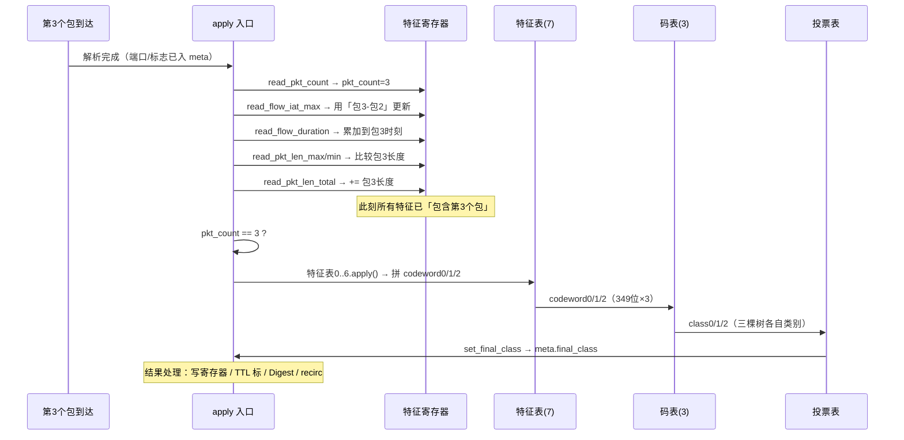

# Flowrest 第 5 课：P4 数据面（二）—— 推理流水线与再循环

> 本课对应《Flowrest课程大纲》第 5 课，是数据面的"高潮"。
> 第 4 课我们解决了"数据面如何认出并跟踪一条流"，本课回答：
> **特征表 → 码表 → 投票表如何被真正调用起来、结果如何写回、如何交给控制面。**
> 并对比 Conference 版与 Full 版在"推理后的收尾工作"上的差异。
> 代码：`P4/Conference_version/unsw_per_flow_16_classes/` 与 `P4/Full_version/unibs_flowrest.p4`。

## 学习目标

学完本课，你将能够：

1. 串起完整推理链路：`pkt_count==3` → 7 张特征表 → 3 张码表 → 投票表
2. 看懂 `SetCode*` 如何把特征区间码拼进 `codeword0/1/2`
3. 看懂 `SetClass*` 与 `set_final_class` 如何把码表结果写成类别并投票
4. 理解再循环（recirculate）的两种用途：Conference 回传投票结果、Full 处理超时碰撞
5. 理解 Full 版的 `flow_action_table`（转发/推理分流）与 Digest 上报
6. 对比两版差异，为 BMv2 复刻做准备

---

## 1. 完整推理链路总览

把第 3、4 课的知识拼起来，一个报文被分类的完整路径：

```
第 3 个包到达（pkt_count == 3）
      │
      ▼
 ┌─────────────────────────────────────────────────────┐
 │ 特征表（range 匹配）                                │
 │ table_feature0..6  每个特征查区间 → SetCode* 拼码    │
 └─────────────────────────────────────────────────────┘
      │ meta.codeword0/1/2 已拼好（349 位 × 3）
      ▼
 ┌─────────────────────────────────────────────────────┐
 │ 码表（ternary 匹配）                                │
 │ code_table0..2  每条路径 (code,mask) → SetClass*     │
 └─────────────────────────────────────────────────────┘
      │ meta.class0/1/2 已就位
      ▼
 ┌─────────────────────────────────────────────────────┐
 │ 投票表（exact 匹配）                                │
 │ voting_table (class0,class1,class2) → set_final_class│
 └─────────────────────────────────────────────────────┘
      │ meta.final_class 已就位
      ▼
 结果处理：写寄存器 / 打 TTL 标 / 上报 Digest / 再循环
```

> 这一整条链只在 **`pkt_count == 3`** 这一瞬间执行一次。前 2 个包只负责积累特征，第 4 包起直接读结果。

---

## 2. 触发点：`pkt_count == 3`

### Conference 版（第 437–454 行）

```p4
if (meta.pkt_count == 3) {
    // 特征表：把特征值编码成 codeword
    table_feature0.apply();
    table_feature1.apply();
    ...
    table_feature6.apply();
    // 码表：把 codeword 匹配成类别
    code_table0.apply();
    code_table1.apply();
    code_table2.apply();
    // 投票表：三棵树合流
    voting_table.apply();
}
```

### Full 版（第 450–463 行）几乎一样

```p4
if (meta.pkt_count == 3) {
    table_feature0.apply();
    ...
    table_feature4.apply();
    code_table0.apply();
    code_table1.apply();
    code_table2.apply();
    voting_table.apply();
    update_classified_flag.execute(meta.register_index);   // Full 多了一步：写回寄存器
}
```

> **为什么是"第 3 个包"？** 因为训练时的特征就是按"前 3 个包"统计的（第 2 课 3.1 节）。
> `pkt_count` 由 `read_pkt_count` 每包自增（Conference：先 +1 再判断，所以第 3 包时 ==3）。

### 2.1 关键时序：先更新特征，后触发推理

第 3 个包到达时，P4 的 `apply` 里**先**把当前包计入全部特征，**再**判断 `pkt_count==3` 触发推理。
也就是说推理用的是"**包含第 3 个包在内**"的统计——与训练样本（前 3 个包生成一条）完全等价。



**逐特征对照**（训练 vs P4，两者统计口径一致）：

| 特征 | 训练样本（前 3 包静态算） | P4（第 3 包到达时） | 一致 |
|------|--------------------------|--------------------|------|
| 端口 | 第 3 个包的 dstport | 解析器直接取当前包端口 | ✅ |
| total_len | 包1+包2+包3 | `read_pkt_len_total` 累加含包3 | ✅ |
| max/min_len | 前 3 包极值 | `read_pkt_len_max/min` 比较包3 | ✅ |
| duration | 包3时刻-首包时刻 | `read_flow_duration` 累加到包3 | ✅ |
| 间隔 | 含包3的 iat | `read_flow_iat_max` 用「包3-包2」 | ✅ |
| 当前包长 | 包3长度 | 包3的 total_len | ✅ |

> 训练是"一次性拿到 3 个包静态算"，P4 是"逐包累加、到第 3 包时恰好等于前 3 包统计"——
> **两者严格等价**，这正是第 3 课转换出的表项阈值能直接命中的前提。
> 实测 `unibs2009_train_3_pkt.csv`：`Packet Count` 全部 = 3；三包长度不同的样本
> `total=489 > max=168 > current=164 > min=157`，与上图逻辑吻合。

---

## 3. `SetCode*`：从特征区间到 codeword

### Conference 版（7 张特征表）

每张特征表命中一个**区间**，输出 3 棵树的码片段，按**位切片**填进 `codeword0/1/2`：

```p4
table table_feature0{
    key = { meta.pkt_len_total: range; }          // 特征0: 包长总和
    actions = { @defaultonly nop; SetCode0; }
    size = 200;
}
action SetCode0(bit<67> code0, bit<62> code1, bit<54> code2) {
    meta.codeword0[348:282] = code0;    // 填进树0码字的第 348~282 位
    meta.codeword1[348:287] = code1;    // 树1 的对应段
    meta.codeword2[348:295] = code2;    // 树2 的对应段
}
```

**要点**：

- `bit<67>` = 该特征在**树0**里的分裂节点数（第 3 课验证过 `[[67,30,61,...],...]`）；
- 7 张特征表各占 codeword 的一段，`SetCode0~6` 把它们拼成完整的 349 位；
- 某棵树没有该特征的分裂 → 该片段由 `@defaultonly nop` 兜底（不写）。

### Full 版（5 张特征表，位宽更小）

```p4
action SetCode0(bit<19> code0, bit<24> code1, bit<13> code2) {
    meta.codeword0[70:52] = code0;
    meta.codeword1[89:66] = code1;
    meta.codeword2[57:45] = code2;
}
```

Full 版 codeword 是 `bit<71>/bit<90>/bit<58>`（对应各树 72/91/59 叶），所以位宽小得多。

---

## 4. `SetClass*`：从 codeword 到类别

### Conference 版（不带置信度）

```p4
table code_table0{
    key = { meta.codeword0: ternary; }     // 拿拼好的 349 位码查路径
    actions = { @defaultonly nop; SetClass0; }
    size = 370;
}
action SetClass0(bit<8> classe) {
    meta.class0 = classe;                  // 树0 给的类别
}
```

### Full 版（带置信度 cert）

```p4
action SetClass0(bit<8> classe, int<8> cert) {
    meta.class0 = classe;                  // 类别
    meta.cert_t0 = cert;                   // 置信度（0~100）
}
```

> 置信度来自 `get_classes` 里的 `max/sum` 比例（第 3 课 3.5），Full 版保留了下来。

---

## 5. `set_final_class` 与投票

### Conference 版：投票 + 再循环回传

```p4
table voting_table {
    key = { meta.class0: exact; meta.class1: exact; meta.class2: exact; }
    actions = { set_final_class; @defaultonly nop; }
}
action set_final_class(bit<8> class_result) {
    meta.final_class = class_result;
    recirculate(68);                       // ★ 触发再循环，回传结果
}
```

### Full 版：投票 + 直接写寄存器

```p4
action set_final_class(bit<8> class_result) {
    meta.final_class = class_result;       // 不 recirculate
}
```

然后单独一步写回：

```p4
update_classified_flag.execute(meta.register_index);
```

> **两版核心差异**：Conference 靠"再循环绕一圈"把 `final_class` 塞进 `recirc_h.class_result`
> 再写寄存器；Full 版投票表直接写完，`update_classified_flag` 当场落寄存器——更简洁、省一次往返。

---

## 6. 再循环（recirculate）的两种用法

### 6.1 Conference：回传投票结果

```p4
action recirculate(bit<7> recirc_port) {
    ig_tm_md.ucast_egress_port[8:7] = ig_intr_md.ingress_port[8:7];
    ig_tm_md.ucast_egress_port[6:0] = recirc_port;   // 端口 68
    hdr.recirc.setValid();
    hdr.recirc.class_result = meta.final_class;      // ★ 把类别写进 recirc 头
    hdr.ethernet.ether_type = TYPE_RECIRC;           // 打标 0x88B5
}
```

包被再送进流水线后：
- parser 识别 `TYPE_RECIRC` → 解析 `recirc_h` → 拿到 `class_result`
- apply 里 `update_classified_flag` 把 `recirc_h.class_result` 写进 `reg_classified_flag`
- 从第 4 个包起，`classified_flag != 0` → 直接转发（TTL=类别号）

### 6.2 Full：处理超时碰撞

Full 版的 recirc 头是**空的**（`header recirc_h {}`），不再携带类别，只当"重新初始化"的信号：

```p4
if (meta.age_value < timeout_threshold) {   // 槽位还很"新鲜"
    meta.final_class = 255;                 // 确认为碰撞
    ipv4_forward(260);
} else {                                    // 槽位已超时
    meta.final_class = 127;                 // 判定为"旧流过期"
    recirculate(68);                        // ★ 再循环，重新初始化槽位
}
```

再循环后，`hdr.recirc.isValid()` 为真，apply 走"重新初始化"分支（`is_first=1` 等），
把槽位让给新的流。`timeout_threshold = 512`（types.p4 里定义，时间单位是 ms 级 `global_tstamp[47:20]`）。

---

## 7. Full 版独有的 `flow_action_table`（转发/推理分流）

### 7.1 为什么需要

Conference 版对**所有** IPv4 流都做推理。Full 版加了"只对关心的流推理"：

```p4
table flow_action_table {
    key = {
        hdr.ipv4.src_addr: exact;
        hdr.ipv4.dst_addr: exact;
        meta.hdr_srcport: exact;
        meta.hdr_dstport: exact;
        hdr.ipv4.protocol: exact;
    }
    actions = { set_flow_action; @defaultonly set_miss_flow_action; }
    size = 20000;
}
action set_flow_action(bit<2> f_action) {
    meta.f_action = f_action;              // 1 = 需要推理，0 = 只转发
}
action set_miss_flow_action() {
    meta.f_action = 0;
}
```

### 7.2 apply 里的分流

```p4
flow_action_table.apply();
if (meta.f_action != 0) {
    // 需要推理：走完整推理链路
    ...
} else {
    ipv4_forward(260);                     // 只转发，不推理
}
```

> 表项由 `generate_table_entries_from_RF.py` 从 `unibs2009_test_pkt_counts.csv` 生成，
> 只给"测试流"标 `f_action=1`。这样普通流量零推理开销。

---

## 8. Digest 上报：把结果交给控制面

### 8.1 为什么要上报

交换机算出类别后，控制面需要知道"哪条流分成了哪类"，用于统计、评估、以及重置寄存器。

### 8.2 Full 版实现

```p4
struct flow_class_digest {   // 最大 47 字节
    ipv4_addr_t  source_addr;     // 32 bit
    ipv4_addr_t  destin_addr;     // 32 bit
    bit<16> source_port;
    bit<16> destin_port;
    bit<8>  protocol;
    bit<8>  flow_class;           // 类别
    bit<16> register_index;       // 寄存器槽位
}

control IngressDeparser(...) {
    Digest<flow_class_digest>() digest;
    apply {
        if (ig_dprsr_md.digest_type == 1) {
            digest.pack({hdr.ipv4.src_addr, hdr.ipv4.dst_addr, meta.hdr_srcport,
                         meta.hdr_dstport, hdr.ipv4.protocol, meta.final_class,
                         meta.register_index});
        }
        pkt.emit(hdr.ethernet);   // 正常发出
        ...
    }
}
```

### 8.3 digest_type 的两种触发（Full 版）

| digest_type=1 时机 | 上报内容含义 |
|-------------------|--------------|
| 分类完成（第 468 行） | 正常分类：`flow_class` = 真实类别 |
| 碰撞判定（第 435 行） | `flow_class` = 255（碰撞）或 127（超时，走 recirculate） |

### 8.4 控制面接收（第 6 课细讲）

`control_plane_unibs.py` 用 `interface.digest_get()` 循环接收：
- 正常类别 → 写入 CSV、更新 `flow_action_table`（`f_action=0` 标记已分类）、清空寄存器
- 255 / 127 → 统计碰撞 / 超时计数

> Conference 版**没有** Digest 上报，结果只能靠 TTL 打标（`ipv4.ttl = classified_flag`）在带内观测。

---

## 9. 两版对比汇总

| 维度 | Conference 版 | Full 版 |
|------|---------------|---------|
| 特征表 | 7 张（range） | 5 张（range） |
| codeword | 349 × 3 位 | 71 / 90 / 58 位 |
| 置信度 cert | ❌ | ✅ |
| 推理触发 | `pkt_count == 3` | `pkt_count == 3` |
| 投票结果回写 | recirculate + `recirc_h.class_result` | 直接 `update_classified_flag` |
| recirc 用途 | 回传投票结果 | 超时碰撞重新初始化 |
| flow_action_table | ❌（所有流都推理） | ✅（只推理指定流） |
| Digest 上报 | ❌（TTL 带内观测） | ✅（五元组+类别+索引） |
| 碰撞处理 | TTL=255 标记后放弃 | 时间戳判定：新鲜→碰撞(255)/过期→超时(127)+recirc |

---

## 10. 动手：走读 apply 推理分支

1. 打开 `P4/Full_version/unibs_flowrest.p4`，定位第 379–487 行的 `apply`；
2. 对照本课 7.2 的分流图，给 `apply` 的每个分支加注释（推理/转发、首包/已有流、碰撞/超时、分类完成）；
3. 数一数 Full 版有多少张表、多少个寄存器：
   ```bash
   grep -c "Register" unibs_flowrest.p4
   grep -n "^[[:space:]]*table " unibs_flowrest.p4
   ```
4. 找全 `digest_type = 1` 的 2 处，思考它们各自的上报含义（对照第 8.3 表）；
5. 用 `convert_RF_to_table_entries.py`（Conference）跑出 `te_*.py`，比对投票表 4096 条表项与 8.5 的逻辑。

---

## 11. 本课小结

- 推理只在 `pkt_count == 3` 触发一次：特征表拼码 → 码表出类别 → 投票表定最终类别。
- `SetCode*` 按位切片拼 `codeword`；`SetClass*` 出单树类别（Full 带 cert）；`set_final_class` 出最终类别。
- Conference 用 recirculate 回传投票结果；Full 直接写寄存器，recirc 只用于超时碰撞重新初始化。
- Full 版三大增强：`flow_action_table` 转发/推理分流、`Digest` 上报、超时碰撞判定。
- 控制面收到 Digest 后：统计分类、更新表、重置寄存器（第 6 课）。

## 12. 思考题

1. 为什么推理要"凑够 3 个包"？如果改成 `pkt_count == 2`，特征表/训练数据要改什么？
2. Conference 的 recirculate 回传结果，相比 Full 直接写寄存器，多了哪些开销？为什么 Tofino 需要这样做？
3. `flow_action_table` 的 `f_action` 为什么是 `bit<2>` 而不是 `bit<1>`？留一位可能给谁用？
4. Digest 报文里带 `register_index` 有什么用？（提示：控制面要清空该流的寄存器，第 6 课）

## 13. 延伸阅读

- Full 版主程序：`P4/Full_version/unibs_flowrest.p4`
- 表项生成：`Python/Full_version/generate_table_entries_from_RF.py`
- 控制面：`Python/Full_version/control_plane_unibs.py`（第 6 课精读）
- 复习：第 4 课（状态机）、第 3 课（编码）、补充课（数值例子）

---

*下一课预告：第 6 课《BFRuntime 控制面、端到端部署与评估》，我们打开 `control_plane_unibs.py`，
看控制面如何用 Digest 学习分类结果、更新转发表、重置寄存器，完成"训练 → 编码 → 部署 → 收集"的闭环。*