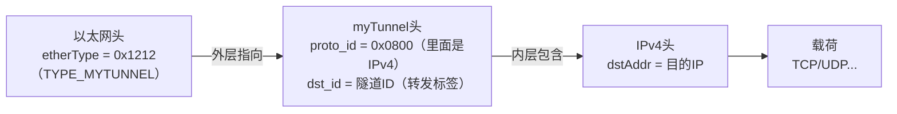

```cpp
// SPDX-FileCopyrightText: 2018 Nate Foster
// SPDX-License-Identifier: Apache-2.0
/* -*- P4_16 -*- */
#include <core.p4>
#include <v1model.p4>

// NOTE: new type added here
const bit<16> TYPE_MYTUNNEL = 0x1212;
const bit<16> TYPE_IPV4 = 0x800;

/*************************************************************************
*********************** H E A D E R S  ***********************************
*************************************************************************/

typedef bit<9>  egressSpec_t;
typedef bit<48> macAddr_t;
typedef bit<32> ip4Addr_t;

header ethernet_t {
    macAddr_t dstAddr;
    macAddr_t srcAddr;
    bit<16>   etherType;
}

// NOTE: added new header type
header myTunnel_t {
    bit<16> proto_id;
    bit<16> dst_id;
}

header ipv4_t {
    bit<4>    version;
    bit<4>    ihl;
    bit<8>    diffserv;
    bit<16>   totalLen;
    bit<16>   identification;
    bit<3>    flags;
    bit<13>   fragOffset;
    bit<8>    ttl;
    bit<8>    protocol;
    bit<16>   hdrChecksum;
    ip4Addr_t srcAddr;
    ip4Addr_t dstAddr;
}

struct metadata {
    /* empty */
}

// NOTE: Added new header type to headers struct
struct headers {
    ethernet_t   ethernet;
    myTunnel_t   myTunnel;
    ipv4_t       ipv4;
}

/*************************************************************************
*********************** P A R S E R  ***********************************
*************************************************************************/

// TODO: Update the parser to parse the myTunnel header as well
parser MyParser(packet_in packet,
                out headers hdr,
                inout metadata meta,
                inout standard_metadata_t standard_metadata) {

    state start {
        transition parse_ethernet;
    }

    state parse_ethernet {
        packet.extract(hdr.ethernet);
        transition select(hdr.ethernet.etherType) {
            TYPE_MYTUNNEL : parse_myTunnel;
            TYPE_IPV4: parse_ipv4;
            default : accept;
        }
    }
    state parse_ipv4{
        packet.extract(hdr.ipv4);
        transition accept;
    }

    state parse_myTunnel{
        packet.extract(hdr.myTunnel);
        transition select(hdr.myTunnel.proto_id) {
            TYPE_IPV4 : parse_ipv4;
            default : accept;
        }
    }
}

/*************************************************************************
************   C H E C K S U M    V E R I F I C A T I O N   *************
*************************************************************************/

control MyVerifyChecksum(inout headers hdr, inout metadata meta) {
    apply {  }
}


/*************************************************************************
**************  I N G R E S S   P R O C E S S I N G   *******************
*************************************************************************/

control MyIngress(inout headers hdr,
                  inout metadata meta,
                  inout standard_metadata_t standard_metadata) {
    action drop() {
        mark_to_drop(standard_metadata);
    }

    action ipv4_forward(macAddr_t dstAddr, egressSpec_t port) {
        standard_metadata.egress_spec = port;
        hdr.ethernet.srcAddr = hdr.ethernet.dstAddr;
        hdr.ethernet.dstAddr = dstAddr;
        hdr.ipv4.ttl = hdr.ipv4.ttl - 1;
    }

    table ipv4_lpm {
        key = {
            hdr.ipv4.dstAddr: lpm;
        }
        actions = {
            ipv4_forward;
            drop;
            NoAction;
        }
        size = 1024;
        default_action = drop();
    }

    // TODO: declare a new action: myTunnel_forward(egressSpec_t port)
    action myTunnel_forward(egressSpec_t port) {
        standard_metadata.egress_spec = port;
    }

    // TODO: declare a new table: myTunnel_exact
    table myTunnel_exact{
        key = {
            hdr.myTunnel.dst_id: exact;
        }
        actions = {
            myTunnel_forward;
            drop;
        }
        size = 1024;
        default_action = drop();
    }
    // TODO: also remember to add table entries!
    

    apply {
        // TODO: Update control flow
        if(hdr.myTunnel.isValid())
        {
            myTunnel_exact.apply();
        }

        if (hdr.ipv4.isValid() && !hdr.myTunnel.isValid()) {
            ipv4_lpm.apply();
        }
    }
}

/*************************************************************************
****************  E G R E S S   P R O C E S S I N G   *******************
*************************************************************************/

control MyEgress(inout headers hdr,
                 inout metadata meta,
                 inout standard_metadata_t standard_metadata) {
    apply {  }
}

/*************************************************************************
*************   C H E C K S U M    C O M P U T A T I O N   **************
*************************************************************************/

control MyComputeChecksum(inout headers  hdr, inout metadata meta) {
     apply {
        update_checksum(
            hdr.ipv4.isValid(),
            { hdr.ipv4.version,
              hdr.ipv4.ihl,
              hdr.ipv4.diffserv,
              hdr.ipv4.totalLen,
              hdr.ipv4.identification,
              hdr.ipv4.flags,
              hdr.ipv4.fragOffset,
              hdr.ipv4.ttl,
              hdr.ipv4.protocol,
              hdr.ipv4.srcAddr,
              hdr.ipv4.dstAddr },
            hdr.ipv4.hdrChecksum,
            HashAlgorithm.csum16);
    }
}

/*************************************************************************
***********************  D E P A R S E R  *******************************
*************************************************************************/

control MyDeparser(packet_out packet, in headers hdr) {
    apply {
        packet.emit(hdr.ethernet);
        // TODO: emit myTunnel header as well
        packet.emit(hdr.myTunnel);
        packet.emit(hdr.ipv4);
    }
}

/*************************************************************************
***********************  S W I T C H  *******************************
*************************************************************************/

V1Switch(
MyParser(),
MyVerifyChecksum(),
MyIngress(),
MyEgress(),
MyComputeChecksum(),
MyDeparser()
) main;

```


# 第 5 课：自定义头与隧道封装

> 本课对应大纲第 5 课。上一课我们把 `basic.p4` 做成了单跳 IPv4 转发交换机。
> 这一课要用**自定义协议头**做隧道封装/解封装：在以太网头和 IPv4 头之间**塞进一个我们自己发明的
> `myTunnel` 头**，按隧道 ID 转发。这是 P4"数据平面可编程"最过瘾的地方——**协议头由你定义**。

## 学习目标

学完本课，你将能够：

1. 设计一个自定义 header：字段布局、长度、用途
2. 用 `etherType` 区分"普通 IPv4"和"隧道包"，用 `proto_id` 做第二层分发
3. 理解"封装 = 在已有头之前压入新头"，掌握 `setValid()` + deparser `emit` 顺序
4. 用 `hdr.myTunnel.isValid()` 判断是否隧道包，做隧道转发决策
5. 定义按 `exact` 匹配的自定义头表（`myTunnel_exact`）
6. 独立补完 `basic_tunnel.p4` 的全部 TODO 并跑通隧道转发

---

## 1. 隧道思想：给包"套个壳"

普通包长这样：

```
[以太网头][IPv4头][载荷]
```

隧道包在 IPv4 头**前面**多套一层自定义头：

```
[以太网头][myTunnel头][IPv4头][载荷]
                   ↑ 新增：里面装"隧道 ID"
```

### 1.1 封装层次图：外层指向 + 内层包含

隧道包的完整层次（这是理解隧道的关键图）：



两个协议号各管一层：

| 层 | 字段 | 值 | 作用 |
|---|---|---|---|
| 外层 | `ethernet.etherType` | 0x1212 (TYPE_MYTUNNEL) | 以太网头**指向** myTunnel |
| 外层 | `ethernet.etherType` | 0x0800（TYPE_IPV4） | 以太网头直接**指向** ipv4 |
| 内层 | `myTunnel.proto_id` | 0x0800 (TYPE_IPV4) | myTunnel **包含** IPv4 |

对应 parser 的两级分发（solution 第 67-87 行）：

```cpp
state parse_ethernet {
    select(hdr.ethernet.etherType) {
        TYPE_MYTUNNEL: parse_myTunnel;   // ① 外层：以太网头"指向"隧道
        TYPE_IPV4:     parse_ipv4;       //    普通IPv4直接走
        default:       accept;
    }
}
state parse_myTunnel {
    select(hdr.myTunnel.proto_id) {
        TYPE_IPV4: parse_ipv4;           // ② 内层：隧道"包含"IPv4
        default:   accept;
    }
}
```

> 所以"以太网头指向 myTunnel，myTunnel 内部包含 IPv4"——**`etherType` 管外层、`proto_id` 管内层，
> 两层各自用协议号做"下一个头是什么"的分发**。只有 `etherType=0x1212` 的包，parser 才会进
> `parse_myTunnel`、`hdr.myTunnel` 才 valid；普通包 myTunnel 一直 invalid，deparser 的
> `emit(hdr.myTunnel)` 自动跳过。

为什么有用？

- 同一份 IP 流量，可以打上不同的 `dst_id`，**交换机只按隧道 ID 转发**，不用看目的 IP。
- 相当于"在数据面加了一层转发标签"，可用于 VPN、VLAN 思想的封装。
- 本课场景：入口交换机把普通 IP 包**封装**成隧道包；出口交换机按 `dst_id` **解封装/转发**。

```
h1 ──► s1（封装：普通IP包 → 加 myTunnel 头）──► s2（按 dst_id 转发）──► h2
```

---

## 2. 自定义头：设计 myTunnel

### 2.1 头定义（basic_tunnel.p4:26-29）

```cpp
// NOTE: added new header type
header myTunnel_t {
    bit<16> proto_id;    // 指示 myTunnel 里面装的是什么协议（如 0x0800 = IPv4）
    bit<16> dst_id;      // 隧道 ID（转发决策用）
}
```

设计要点：
- **字段布局自定**：`proto_id` 16 位 + `dst_id` 16 位 = 4 字节头。字段顺序即字节顺序。
- **`proto_id` 的作用**：和以太网的 `etherType` 类似——告诉解封装方"隧道里装的是什么"。
  本课装 IPv4，所以 `proto_id = 0x0800`。
- **`dst_id` 的作用**：转发标签，交换机通过查这个来决定下一个转发端口。交换机查 `myTunnel_exact` 表时用这个 ID 做 key。

### 2.2 放进 headers 结构体（第 51-55 行）

```cpp
struct headers {
    ethernet_t   ethernet;
    myTunnel_t   myTunnel;    // 插在 ethernet 和 ipv4 之间
    ipv4_t       ipv4;
}
```

**顺序 = 封装顺序**：ethernet → myTunnel → ipv4，正好对应包的字节布局。

### 2.3 新增协议号常量（第 8 行）

```cpp
const bit<16> TYPE_MYTUNNEL = 0x1212;   // 以太网 etherType：0x1212 = 隧道包
const bit<16> TYPE_IPV4 = 0x800;        // 原有：0x0800 = 普通 IPv4
```

> 0x1212 是教程自造的、没被 IEEE 分配的 etherType——**自定义协议就靠"没人用的类型号"区分**。

---

## 3. 解析器：按 etherType 分发到隧道

### 3.1 parser 升级（TODO ①，对照 solution 第 67-87 行）

```cpp
state parse_ethernet {
    packet.extract(hdr.ethernet);
    transition select(hdr.ethernet.etherType) {
        TYPE_MYTUNNEL: parse_myTunnel;    // ← 新增：0x1212 → 解析 myTunnel
        TYPE_IPV4:     parse_ipv4;        // 0x0800 → 普通 IPv4
        default:       accept;
    }
}

state parse_myTunnel {                    // ← 新增状态
    packet.extract(hdr.myTunnel);         // 解出 myTunnel 头
    transition select(hdr.myTunnel.proto_id) {   // 第二层分发：看隧道里装什么
        TYPE_IPV4: parse_ipv4;            // proto_id=0x0800 → 接着解 IPv4
        default:   accept;
    }
}

state parse_ipv4 {
    packet.extract(hdr.ipv4);
    transition accept;
}
```

### 3.2 两条分发路径对比

| 包类型 | etherType | parser 走法 | 结果 |
|---|---|---|---|
| 普通 IPv4 包 | 0x0800 | ethernet → ipv4 | `hdr.ipv4` valid，`hdr.myTunnel` **invalid** |
| 隧道包 | 0x1212 | ethernet → myTunnel →（proto_id=0x0800）→ ipv4 | `hdr.myTunnel` 和 `hdr.ipv4` **都 valid** |

> 关键：`hdr.myTunnel.isValid()` 就能区分"这是不是隧道包"——封装状态写在头上。

---

## 4. 封装/解封装：`setValid` + emit 顺序

### 4.1 "封装 = 把新头压到已有头之前"

隧道**入口**交换机要干的事：拿到一个普通 IP 包，在 IPv4 前面加一个 myTunnel 头。
P4 里没有"插入"命令，做法是**在 parser/ingress 里把新头 `setValid()`，然后 deparser 按顺序 emit**：

```cpp
// 伪代码：封装（ingress 里对要封装的包）
hdr.myTunnel.setValid();            // 让这个头"存在"
hdr.myTunnel.proto_id = TYPE_IPV4;  // 填 proto_id
hdr.myTunnel.dst_id = tunnel_id;    // 填隧道 ID
```

deparser 里按 **ethernet → myTunnel → ipv4** 的顺序 emit，myTunnel 就自然落在 IPv4 前面：

```cpp
control MyDeparser(packet_out packet, in headers hdr) {
    apply {
        packet.emit(hdr.ethernet);
        packet.emit(hdr.myTunnel);    // ← TODO：emit 隧道头（在第 184 行）
        packet.emit(hdr.ipv4);
    }
}
```

> **核心概念**：`emit` 只输出 `isValid()` 的头。普通 IPv4 包 myTunnel 是 invalid → 自动跳过 → 输出不变；
> 隧道包 myTunnel valid → 被 emit → 就封装上了。**"封装与否"完全由 isValid 状态决定。**

### 4.2 本课练习其实是"按隧道转发"，不是完整封装

`basic_tunnel` 的隧道 ID 是**发送方主机自己用 scapy 构造**的（`send.py`），交换机不做封装、
只做**按 `dst_id` 转发**（类似解封装后的动作）。但理解 `setValid` + emit 顺序是第 6、7 课头栈/源路由的基础。

---

## 5. 隧道转发：按 dst_id 查表

### 5.1 新动作 `myTunnel_forward`（TODO ②）

```cpp
action myTunnel_forward(egressSpec_t port) {
    standard_metadata.egress_spec = port;   // 隧道包：只按隧道 ID 决定出端口
}
```

注意：这里**不碰 MAC、不减 TTL**——隧道转发只关心"从哪个口出去"。

### 5.2 新表 `myTunnel_exact`（TODO ③）

```cpp
table myTunnel_exact {
    key = {
        hdr.myTunnel.dst_id: exact;    // 隧道 ID 是精确匹配（不是路由，是标签）
    }
    actions = {
        myTunnel_forward;
        drop;
    }
    size = 1024;
    default_action = drop();
}
```

| 表 | key | 匹配类型 | 语义 |
|---|---|---|---|
| `ipv4_lpm` | `hdr.ipv4.dstAddr` | lpm | 按目的 IP 路由（普通包） |
| `myTunnel_exact` | `hdr.myTunnel.dst_id` | **exact** | 按隧道标签转发（隧道包） |

> 为什么隧道 ID 用 `exact` 而路由用 `lpm`？因为隧道 ID 是**精确标签**不是**地址前缀**，没有"最长前缀"概念。

### 5.3 apply：两条互斥的转发逻辑（TODO ④）

```cpp
apply {
    if (hdr.ipv4.isValid() && !hdr.myTunnel.isValid()) {
        // 普通 IPv4 包：走 IP 路由表
        ipv4_lpm.apply();
    }

    if (hdr.myTunnel.isValid()) {
        // 隧道包：按隧道 ID 转发
        myTunnel_exact.apply();
    }
}
```

| 包类型 | `ipv4.isValid()` | `myTunnel.isValid()` | 走哪张表 |
|---|---|---|---|
| 普通 IPv4 | ✅ | ❌ | `ipv4_lpm` |
| 隧道包 | ✅ | ✅ | `myTunnel_exact` |

> `!hdr.myTunnel.isValid()` 保证"普通包不碰隧道表"——否则隧道包会两张表都查。

---

## 6. 控制平面：下发静态隧道规则

### 6.1 控制面怎么配（对应 `mycontroller.py`）

隧道转发需要两类表项：

| 交换机 | 表 | 表项 | 动作 |
|---|---|---|---|
| 入口 s1 | `ipv4_lpm` | `10.0.1.1/32` | `myTunnel_ingress`（封装，mycontroller 场景） |
| 中转 s1 | `myTunnel_exact` | `dst_id = 100` | `myTunnel_forward(port=2)` |
| 出口 s2 | `myTunnel_exact` | `dst_id = 100` | `myTunnel_egress`（解封装+转发） |

P4Runtime 下发的写法（`p4runtime/exercises/mycontroller.py` 模式）：

```python
table_entry = p4info_helper.buildTableEntry(
    table_name="MyIngress.myTunnel_exact",
    match_fields={"hdr.myTunnel.dst_id": tunnel_id},   # exact：单个值
    action_name="MyIngress.myTunnel_forward",
    action_params={"port": SWITCH_TO_SWITCH_PORT})
ingress_sw.WriteTableEntry(table_entry)
```

对照 `exact` 和 `lpm` 的匹配写法差异：

```python
match_fields={"hdr.myTunnel.dst_id": 100}        # exact：直接填值
match_fields={"hdr.ipv4.dstAddr": ("10.0.2.2", 32)}  # lpm：填 (值, 前缀长度)
```

### 6.2 `send.py` 怎么造隧道包（数据面看不到，但要知道）

`exercises/basic_tunnel/send.py` 用 scapy 在以太网和 IP 之间塞 myTunnel 头：

```python
pkt = Ether(dst=..., src=...) \
    / Tunnel(proto_id=0x0800, dst_id=tunnel_id) \
    / IP(dst='10.0.1.1', ttl=64) \
    / TCP(...)
```

- 主机自己构造隧道包（etherType=0x1212）→ 交换机 parser 走 `parse_myTunnel` → `myTunnel_exact` 转发。
- 这就是"封装由发送端完成"的简化版。

---

## 7. 动手：补完 basic_tunnel.p4

`exercises/basic_tunnel/basic_tunnel.p4` 的 TODO：

1. **解析器**：`parse_ethernet` 加 `TYPE_MYTUNNEL` 分支 + 新增 `parse_myTunnel` 状态（§3.1）
2. **动作**：声明 `myTunnel_forward(egressSpec_t port)`（§5.1）
3. **表**：声明 `myTunnel_exact`（§5.2）
4. **apply**：更新控制流，分普通/隧道两条路径（§5.3）
5. **deparser**：加 `packet.emit(hdr.myTunnel)`（§4.1）

编译验证：

```bash
cd /workspace/tutorials/exercises/basic_tunnel
make run
# mininet CLI：
mininet> h1 ping h2 -c 1            # 普通 IP 路径
mininet> h1 ping h3 -c 1            # 走隧道
# 或运行 send.py 发隧道包：
mininet> h1 ./send.py 10.0.2.2 100  h2
```

---

## 8. 本课小结

- **自定义头**：`header myTunnel_t { proto_id; dst_id; }`，字段布局自己定。
- **区分协议**：`etherType = 0x1212` 表示隧道包；`proto_id` 做隧道内第二层分发。
- **封装/解封装**：`setValid()` 让头存在 + deparser 按顺序 `emit`；emit 自动跳过 invalid 头。
- **隧道转发**：`myTunnel_exact` 用 `dst_id` 做 `exact` 匹配，隧道包只按标签出端口。
- **apply 分流**：`isValid()` 组合判断，普通包走 `ipv4_lpm`、隧道包走 `myTunnel_exact`。

## 9. 思考题

1. `proto_id` 和 `etherType` 的角色分别是什么？为什么隧道里还要再分一次？
2. 如果把 deparser 的 emit 顺序写成 ethernet → ipv4 → myTunnel，会发生什么？
3. `hdr.myTunnel.setValid()` 但 `hdr.ipv4` invalid 时，deparser 会输出什么？
4. 为什么 `myTunnel_exact` 用 `exact` 而不是 `lpm`？
5. 如果入口交换机要真正"封装"（把普通 IP 包套上隧道头），在 ingress 里要写哪几行？和本题的"主机造好隧道包"有何不同？
6. 隧道包经过 s1 时 `ipv4_lpm.apply()` 会被调用吗？（看 apply 条件）

## 10. 延伸阅读

- 本仓库《P4控制面与数据面配合详解.md》《P4从p4info到WriteRequest-字段对应全解析.md》（控制面如何下发 myTunnel 表项）
- 官方教程 `exercises/basic_tunnel/README.md`（步骤与 scapy 用法）
- 下一个：第 6 课《头栈与带内网络遥测》（`exercises/mri`）

---

*下一课预告：第 6 课《头栈与带内网络遥测》。自定义头之后是**头栈（header stack）**——用
`push_front`/`pop_front` 逐跳往栈顶塞节点信息，实现带内网络遥测（INT）。*


