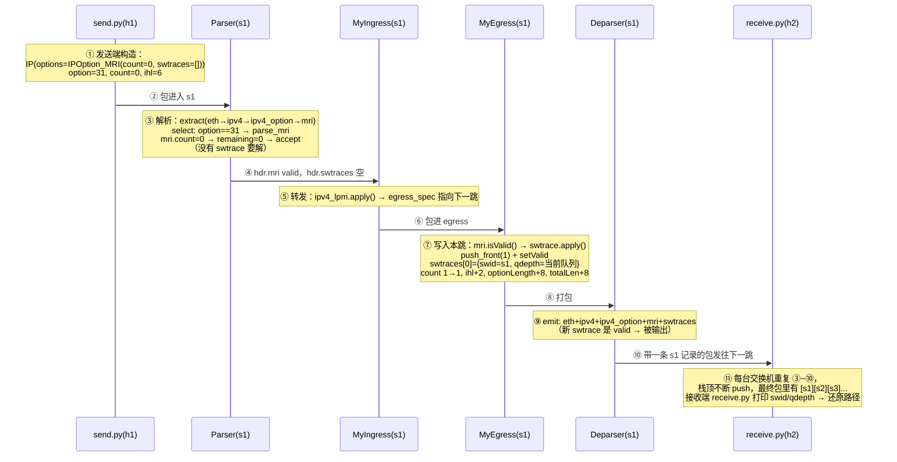

```cpp
// SPDX-FileCopyrightText: 2018 Nate Foster
// SPDX-License-Identifier: Apache-2.0
/* -*- P4_16 -*- */
#include <core.p4>
#include <v1model.p4>

const bit<8>  UDP_PROTOCOL = 0x11;
const bit<16> TYPE_IPV4 = 0x800;
const bit<5>  IPV4_OPTION_MRI = 31;

#define MAX_HOPS 9

/*************************************************************************
*********************** H E A D E R S  ***********************************
*************************************************************************/

typedef bit<9>  egressSpec_t;
typedef bit<48> macAddr_t;
typedef bit<32> ip4Addr_t;
typedef bit<32> switchID_t;
typedef bit<32> qdepth_t;

header ethernet_t {
    macAddr_t dstAddr;
    macAddr_t srcAddr;
    bit<16>   etherType;
}

header ipv4_t {
    bit<4>    version;
    bit<4>    ihl;
    bit<8>    diffserv;
    bit<16>   totalLen;
    bit<16>   identification;
    bit<3>    flags;
    bit<13>   fragOffset;
    bit<8>    ttl;
    bit<8>    protocol;
    bit<16>   hdrChecksum;
    ip4Addr_t srcAddr;
    ip4Addr_t dstAddr;
}

header ipv4_option_t {
    bit<1> copyFlag;
    bit<2> optClass;
    bit<5> option;
    bit<8> optionLength;
}

header mri_t {
    bit<16>  count;
}

header switch_t {
    switchID_t  swid;
    qdepth_t    qdepth;
}

struct ingress_metadata_t {
    bit<16>  count;
}

struct parser_metadata_t {
    bit<16>  remaining;
}

struct metadata {
    ingress_metadata_t   ingress_metadata;
    parser_metadata_t   parser_metadata;
}

struct headers {
    ethernet_t         ethernet;
    ipv4_t             ipv4;
    ipv4_option_t      ipv4_option;
    mri_t              mri;
    switch_t[MAX_HOPS] swtraces;
}

error { IPHeaderTooShort }

/*************************************************************************
*********************** P A R S E R  ***********************************
*************************************************************************/

parser MyParser(packet_in packet,
                out headers hdr,
                inout metadata meta,
                inout standard_metadata_t standard_metadata) {

    state start {
        transition parse_ethernet;
    }

    state parse_ethernet {
        packet.extract(hdr.ethernet);
        transition select(hdr.ethernet.etherType) {
            TYPE_IPV4: parse_ipv4;
            default: accept;
        }
    }

    state parse_ipv4 {
        packet.extract(hdr.ipv4);
        verify(hdr.ipv4.ihl >= 5, error.IPHeaderTooShort);
        // ipv4.inl的单位是4B，5*4=20B
        transition select(hdr.ipv4.ihl) {
            5             : accept;
            default       : parse_ipv4_option;
        }
    }

    state parse_ipv4_option {
        /*
        * TODO: Add logic to:
        * - Extract the ipv4_option header.
        *   - If value is equal to IPV4_OPTION_MRI, transition to parse_mri.
        *   - Otherwise, accept.
        */
        packet.extract(hdr.ipv4_option);
        transition select(hdr.ipv4_option.option) {
            IPV4_OPTION_MRI: parse_mri;   // 31 → 是遥测，继续解
            default: accept;
        }
    }

    state parse_mri {
        /*
        * TODO: Add logic to:
        * - Extract hdr.mri.
        * - Set meta.parser_metadata.remaining to hdr.mri.count
        * - Select on the value of meta.parser_metadata.remaining
        *   - If the value is equal to 0, accept.
        *   - Otherwise, transition to parse_swtrace.
        */
        packet.extract(hdr.mri);
        meta.parser_metadata.remaining = hdr.mri.count;
        meta.ingress_metadata.count = hdr.mri.count;
        transition select(meta.parser_metadata.remaining){
            0: accept;
            default: parse_swtrace;
        }
    }

    state parse_swtrace {
        /*
        * TODO: Add logic to:
        * - Extract hdr.swtraces.next.
        * - Decrement meta.parser_metadata.remaining by 1
        * - Select on the value of meta.parser_metadata.remaining
        *   - If the value is equal to 0, accept.
        *   - Otherwise, transition to parse_swtrace.
        */
        packet.extract(hdr.swtraces.next);
        meta.parser_metadata.remaining -= 1;
        transition select(meta.parser_metadata.remaining){
            0: accept;
            default: parse_swtrace;
        }
    }
}


/*************************************************************************
************   C H E C K S U M    V E R I F I C A T I O N   *************
*************************************************************************/

control MyVerifyChecksum(inout headers hdr, inout metadata meta) {
    apply {  }
}


/*************************************************************************
**************  I N G R E S S   P R O C E S S I N G   *******************
*************************************************************************/

control MyIngress(inout headers hdr,
                  inout metadata meta,
                  inout standard_metadata_t standard_metadata) {
    action drop() {
        mark_to_drop(standard_metadata);
    }

    action ipv4_forward(macAddr_t dstAddr, egressSpec_t port) {
        standard_metadata.egress_spec = port;
        hdr.ethernet.srcAddr = hdr.ethernet.dstAddr;
        hdr.ethernet.dstAddr = dstAddr;
        hdr.ipv4.ttl = hdr.ipv4.ttl - 1;
    }

    table ipv4_lpm {
        key = {
            hdr.ipv4.dstAddr: lpm;
        }
        actions = {
            ipv4_forward;
            drop;
            NoAction;
        }
        size = 1024;
        default_action = NoAction();
    }

    apply {
        if (hdr.ipv4.isValid()) {
            ipv4_lpm.apply();
        }
    }
}

/*************************************************************************
****************  E G R E S S   P R O C E S S I N G   *******************
*************************************************************************/

control MyEgress(inout headers hdr,
                 inout metadata meta,
                 inout standard_metadata_t standard_metadata) {
    action add_swtrace(switchID_t swid) {
        /*
        * TODO: add logic to:
        - Increment hdr.mri.count by 1
        - Add a new swtrace header by calling push_front(1) on hdr.swtraces.
        - Set hdr.swtraces[0].swid to the id parameter
        - Set hdr.swtraces[0].qdepth to (qdepth_t)standard_metadata.deq_qdepth
        - Increment hdr.ipv4.ihl by 2
        - Increment hdr.ipv4.totalLen by 8
        - Increment hdr.ipv4_option.optionLength by 8
        */
        // header switch_t {
        //     switchID_t  swid;
        //     qdepth_t    qdepth;
        // }
        hdr.mri.count += 1;
        hdr.swtraces.push_front(1);
        hdr.swtraces[0].setValid();
        hdr.swtraces[0].swid = swid;
        hdr.swtraces[0].qdepth = (qdepth_t)standard_metadata.deq_qdepth;
        hdr.ipv4.ihl += 2; // 2 * 4B = 8B等于 swid + qdepth
        hdr.ipv4.totalLen += 8; // bit swid + qdepth是8字节
        hdr.ipv4_option.optionLength += 8; // bit swid + qdepth是8字节
    }

    table swtrace {
        actions        = {
            add_swtrace;
            NoAction;
        }

        default_action =  NoAction();
    }

    apply {
        /*
        * TODO: add logic to:
        * - If hdr.mri is valid:
        *   - Apply table swtrace
        */
        if(hdr.mri.isValid())
        {
            swtrace.apply();
        }
    }
}

/*************************************************************************
*************   C H E C K S U M    C O M P U T A T I O N   **************
*************************************************************************/

control MyComputeChecksum(inout headers hdr, inout metadata meta) {
     apply {
        update_checksum(
            hdr.ipv4.isValid(),
            { hdr.ipv4.version,
              hdr.ipv4.ihl,
              hdr.ipv4.diffserv,
              hdr.ipv4.totalLen,
              hdr.ipv4.identification,
              hdr.ipv4.flags,
              hdr.ipv4.fragOffset,
              hdr.ipv4.ttl,
              hdr.ipv4.protocol,
              hdr.ipv4.srcAddr,
              hdr.ipv4.dstAddr },
            hdr.ipv4.hdrChecksum,
            HashAlgorithm.csum16);
    }
}

/*************************************************************************
***********************  D E P A R S E R  *******************************
*************************************************************************/

control MyDeparser(packet_out packet, in headers hdr) {
    apply {
        // packet.emit(hdr.ethernet);
        packet.emit(hdr.ipv4);
        packet.emit(hdr.ipv4_option);
        packet.emit(hdr.mri);
        packet.emit(hdr.swtraces);
        /* TODO: emit ipv4_option, mri and swtraces headers */
    }
}

/*************************************************************************
***********************  S W I T C H  *******************************
*************************************************************************/

V1Switch(
MyParser(),
MyVerifyChecksum(),
MyIngress(),
MyEgress(),
MyComputeChecksum(),
MyDeparser()
) main;

```


# 第 6 课：头栈与带内网络遥测

> 本课对应大纲第 6 课。前面我们处理的都是**单个**头。这一课引入**头栈（header stack）**——
> 一组同类型的头按顺序排列——并用它实现 **带内网络遥测（In-Band Network Telemetry, INT）**：
> 每个交换机把"我是谁、队列有多深"写进包里，让接收端能看到包经过的整条路径。
> 练习对应 `exercises/mri`（MRI = Multiple Rapid Iterative protocol，P4 教程经典遥测实验）。

## 学习目标

学完本课，你将能够：

1. 逐字段讲清 `ipv4_option_t`：`copyFlag` / `optClass` / `option` / `optionLength` 各是什么、MRI 里怎么用
2. 画出 MRI 包的完整布局（eth → ipv4 → ipv4_option → mri → swtraces）
3. 定义头栈：`switch_t[MAX_HOPS] swtraces`，理解 `[N]` 的含义
4. 用 `push_front(1)` / `pop_front(1)` 操作头栈，理解"栈顶在 0 号位"
5. 用 `hdr.swtraces.next` 在 parser 里**逐元素解析**栈，用 metadata 控制循环次数
6. 在 egress 阶段逐跳写节点信息（switch ID + 队列深度 qdepth）
7. 说出处理一个 MRI 包的**完整流程**（发送端构造 → 解析 → 转发 → 逐跳写入 → 打包 → 接收端读取）
8. 理解"从 MRI 到完整 INT"的扩展思路
9. 独立补完 `mri.p4` 的全部 TODO

---

## 1. INT 思想：把路径"写进包里"

普通转发：包经过交换机，交换机只决定从哪出，**包上不留痕迹**。

```
h1 ──► s1 ──► s2 ──► s3 ──► h2
```

带内遥测：每台交换机在包里**追加一段自己的信息**（ID、队列深度），包到终点时，
接收方读出来就知道"包经过了哪些交换机、每跳拥堵情况如何"：

```
h1 ──► s1 ──► s2 ──► s3 ──► h2
        │     │     │
        ▼     ▼     ▼
     写入  写入  写入
   [s1信息][s2信息][s3信息]   ← 全部塞在包里一起走
```

| 传统方案 | INT 方案 |
|---|---|
| 每个包不动，另起"遥测包"统计（抽样、慢） | **每个包自带遥测信息**（逐跳、实时、零额外流量） |
| 接收方不知道具体路径 | 接收方能重建完整路径 + 每跳状态 |

---

## 2. IPv4 选项头 `ipv4_option_t`：逐字段精讲

### 2.1 为什么要把遥测数据塞进 IPv4 选项

标准 IPv4 头是 20 字节，但它带一个"可选的尾巴"——**IPv4 选项（options）**。
MRI 把遥测标记塞在这个选项里，这样**不需要新发明协议**，普通 IP 包就能携带遥测数据。

```text
[eth 14B][ipv4 20B][ipv4_option 2B][mri 2B][swtrace 8B×N][UDP...]
                   └──────── 这叫"IPv4 选项" ────────┘
			└──────── 这叫"IPv4" ──────----------──┘
```

### 2.2 头定义（mri.p4:44-49）

```cpp
header ipv4_option_t {
    bit<1> copyFlag;      // 1 位：复制标志
    bit<2> optClass;      // 2 位：选项类别
    bit<5> option;        // 5 位：选项编号
    bit<8> optionLength;  // 8 位：选项总长度（字节）
}
```

1 + 2 + 5 + 8 = **16 位 = 2 字节**，正好对应标准 IPv4 选项头（RFC 791）。

### 2.3 每个字段的"标准含义" vs "MRI 里的用法"

先看标准 IPv4 选项的 **type 字节**是怎么拼出来的：

```
 位号   7        6 5       4 3 2 1 0
      ┌──────────┬──────────┬─────────┐
      │ copy(1)  │ class(2) │ number  │   ← 合起来叫"选项类型"（type 字节）
      └──────────┴──────────┴─────────┘
```

| 字段 | 位宽 | RFC 791 标准含义 | MRI 里的值/作用 |
|---|---|---|---|
| `copyFlag` | 1 | 该选项是否**复制到每个分片**（1=是，0=只在第一个分片） | 0（不关心分片场景，教程里保持 0） |
| `optClass` | 2 | 选项类别（大类）：`0`=控制类，`2`=调试/测量类 | **2**（测量/遥测类） |
| `option` | 5 | 选项编号（和类别组合成"选项类型"） | **31 = `IPV4_OPTION_MRI`**，表示"这是 MRI 遥测选项" |
| `optionLength` | 8 | 整个选项的长度（字节），**含这 2 字节头在内** | `4 + 8×count` |

**关于 `optClass`（控制类 vs 调试类）**：RFC 791 把选项分成几大类——

| class | 含义 | 典型选项例子 |
|---|---|---|
| 0 | **控制类**：影响"包怎么走/怎么处理" | Record Route(7)、Source Route(137)、EOL(0)、NOP(1) |
| 2 | **调试/测量类**：用来"观测网络" | Timestamp(68)、Traceroute(82) |

- 控制类 = 让包"按我说的走"（路由/路径控制）；
- 调试/测量类 = 让包"记录网络状态"（时间戳/路径/队列）。

> ⚠️ **注意本练习的实际包**：send.py 的 `IPOption_MRI` **只设置了 `option = 31`**，`copy_flag`/`optclass`
> 都用 scapy 默认值 **0（control）**——所以抓到的包 `optclass = control`，不是 2。
> 而 **P4 端只检查 `option == 31`，根本不看 class**。所以本练习里 optclass 字段没有实际作用，
> 只是带着默认值 0 走一遍。（RFC 语义上 2 才是"调试/测量"，但发送端没设置成 2。）

**关于 `option`（选项编号）**：class 是大类、number 是编号，两者合成唯一选项类型
（`type = (copy<<7)|(class<<5)|number`，如 Record Route=7、Timestamp=68、**MRI=95**）。
`option = 31` 就是 MRI 的"身份证号"，parser 靠它认出遥测选项：

```cpp
transition select(hdr.ipv4_option.option) {
    IPV4_OPTION_MRI: parse_mri;   // 31 → 是遥测，继续解
    default: accept;
}
```

**关于 `optionLength`（"含这 2 字节头"的意思）**：length 字节**从头数到尾**——包括 type 字节、
length 字节本身、以及后面所有数据（mri + swtraces）：

```
字节0 字节1    字节2  字节3    字节4...           字节(4+8N-1)
┌─────┬───────┬────────────┬─── swtrace0 (8B) ───┬─── swtrace1 (8B) ── ...
│type │length │  count(2B)  │                       │
├ ipv4_option(2B) ┤  mri(2B) ├──── swtraces 8B×N ───┤
└─────┴───────┴────────────┴───────────────────────┘
  ▲ 从这里开始数                                  ▲
  └────── optionLength = 2 + 2 + 8N = 4 + 8N ─────┘
```

所以 `optionLength = ipv4_option(2B) + mri(2B) + 8×N(swtraces) = 4 + 8N`。
| count=0 | count=1 | count=2 |
|---|---|---|
| 4 B | 12 B | 20 B |

> 每加一跳 `optionLength + 8`：多了一个 swtrace（8 字节），选项总长 +8，length 字段必须同步
> 改，否则对端会把 swtrace 误读成 UDP 头。

### 2.4 完整的 MRI 选项在包里长这样（字节级）

```
┌─ ipv4_option (2B) ─┬─ mri (2B) ─┬── swtrace0 (8B) ──┬── swtrace1 (8B) ──┬ ...
│copyFlag optClass   │  count      │  swid(4B) qdepth  │  swid(4B) qdepth  │
│ optClass option=31 │  =N         │  (4B)    (4B)     │  (4B)    (4B)     │
│ 2 bits  5bits      │             │                   │                   │
└────────────────────┴─────────────┴───────────────────┴───────────────────┘
     optionLength = 4 + 8×N
```

- `optionLength` 的初始值（count=0 时）= 4 字节：2 字节选项头 + 2 字节 count。
- 每加一个 swtrace（8 字节），`optionLength + 8`。

### 2.5 对照 send.py（scapy 怎么造这个选项）

`exercises/mri/send.py` 用 scapy 构造：

```python
class IPOption_MRI(IPOption):
    name = "MRI"
    option = 31                                    # ← option 字段 = 31
    fields_desc = [ _IPOption_HDR,                 # copyFlag/optClass/option/optionLength
                    FieldLenField("length", None, fmt="B",
                                  length_of="swtraces",
                                  adjust=lambda pkt, l: l*2+4),   # optionLength = 4+8N
                    ShortField("count", 0),        # ← mri.count
                    PacketListField("swtraces", [], SwitchTrace,   # ← swtraces 栈
                                    count_from=lambda pkt: (pkt.count*1)) ]

pkt = Ether(...) / IP(dst=addr, options=IPOption_MRI(count=0, swtraces=[])) / UDP(...) / "hi"
```

- 发送端把 `option=31`、`count`、`swtraces` 全塞进 IP 头选项。
- 接收端 `receive.py` 用同一个类解析，打印出 swid/qdepth——就还原了路径。

---

## 3. 头栈：一组同类型的头

### 3.1 定义（mri.p4:55-58, 78）

```cpp
header switch_t {          // 一个"遥测记录"长什么样
    switchID_t  swid;      // 交换机 ID（32 位）
    qdepth_t    qdepth;    // 队列深度（32 位）—— 拥塞指标
}

// headers 里：
switch_t[MAX_HOPS] swtraces;   // 头栈：最多 MAX_HOPS=9 个 switch_t
```

- `switch_t[MAX_HOPS] swtraces` 声明**一个包含最多 9 个 `switch_t` 的头栈**。
- 头栈 = 一串**同类型**的头，像一个数组。每个元素可以单独 `isValid()`。
- `MAX_HOPS 9` 用 `#define` 定义，编译器展开成 `switch_t[9]`。

### 3.2 头栈和其他头的关系（headers 顺序 = 包布局）

```cpp
struct headers {
    ethernet_t         ethernet;
    ipv4_t             ipv4;
    ipv4_option_t      ipv4_option;   // IPv4 选项头（放 MRI 标记）
    mri_t              mri;           // 遥测计数头
    switch_t[MAX_HOPS] swtraces;      // 头栈：一串遥测记录
}
```

包的布局：`[eth][ipv4][ipv4_option][mri][swtrace0][swtrace1]...`

### 3.3 配套的 mri_t 头

```cpp
header mri_t {
    bit<16>  count;    // 已经记录了几跳（决定要解析几个 swtrace）
}
```

`mri.count` 是"遥测记录数"——parser 靠它决定解析多少个 `swtraces` 元素。

---

## 4. 解析器：逐元素解析头栈

### 4.1 需要循环解析

栈有 9 个槽，但包里的实际记录数由 `mri.count` 决定。parser 要**循环** `count` 次，每次解析一个
`swtrace`。P4 的 parser 是状态机，循环靠"状态自我跳转"实现。

### 4.2 parser 状态流（对照 solution 第 104-137 行）

```cpp
state parse_ipv4 {
    packet.extract(hdr.ipv4);
    verify(hdr.ipv4.ihl >= 5, error.IPHeaderTooShort);   // IHL 至少要 5 个字（20B 基础头）
    transition select(hdr.ipv4.ihl) {
        5: accept;                       // IHL=5 → 没有选项 → 直接结束
        default: parse_ipv4_option;      // 否则去解析选项
    }
}
```

> **💡 parser 怎么知道有没有 ipv4_option？——靠 `ihl` 字段**
> `hdr.ipv4.ihl`（Internet Header Length）声明 **IPv4 头总长，单位是 4 字节字**：
>
> - `ihl == 5` → 头正好 20 字节（标准头，无选项）→ 后面直接是载荷 → `accept`
> - `ihl > 5` → 头多出来的字节就是选项 → 进 `parse_ipv4_option`
>
> "有没有选项"不是 parser 猜的，是 `ihl` 自己声明的。发送端（send.py 的 scapy）会根据选项字节数
> 自动算好 ihl（count=0 时选项 4 字节 → ihl=6）；交换机每加一跳遥测要 `ihl + 2`（+8 字节 = +2 个字），
> 就是为了让下一跳 parser 读到的 ihl 是同步更新后的值。
>
> 简化说明：本课 parser 只判断 `ihl==5` 还是 `>5`，假设只有 MRI 一个选项；真实 IPv4 解析器会循环
> 处理多个选项，靠每个选项的 `optionLength` 跳过。
>
> **💡 `verify(hdr.ipv4.ihl >= 5, IPHeaderTooShort)` 为什么是"大于等于5就 TooShort"？——读反了**
> P4 的 `verify(condition, error)` 语义是**断言：条件为假才报错**。
> ```p4
> verify(hdr.ipv4.ihl >= 5, error.IPHeaderTooShort);
> ```
> | ihl 的值 | `ihl >= 5` | 结果 |
> |---|---|---|
> | 5、6、8…（正常） | 真 | 不报错，继续解析 ✅ |
> | 0~4（异常） | 假 | **报 `IPHeaderTooShort`**，拒收 ❌ |
>
> 原因：IPv4 标准头最少就是 20 字节 = 5 个字。`ihl < 5` 说明头连标准字段都装不下（畸形/被截断），
> 继续解析会把载荷误读成头字段，所以直接报错拒收。**错误只在 ihl < 5 时触发，>= 5 是正常范围。**


> **💡 要不要在选项这里也 verify？——不需要，而且不能写 `hdr.ipv4_option >= 2`**
>
> > - `hdr.ipv4_option` 是 **header 实例**（字段集合），不是数字，**不能和整数比大小**（编译报类型错误）。
> >   要比只能比字段，如 `verify(hdr.ipv4_option.optionLength >= 2, ...)`。
> > - 本课不需要额外 verify：
> >   - `verify(ihl >= 5)` 已保证能走到这 → 选项区存在；
> >   - `select(option == 31)` 做语义分发；
> >   - extract 遇到包不够长会自带 `PacketTooShort` 错误兜底。
>

```cpp
state parse_ipv4_option {
    packet.extract(hdr.ipv4_option);                       // ① 解出选项头（2 字节）
    transition select(hdr.ipv4_option.option) {           // ② 看选项编号
        IPV4_OPTION_MRI: parse_mri;                        //    =31 → 有遥测数据
        default: accept;
    }
}

state parse_mri {
    packet.extract(hdr.mri);                               // ③ 解出 mri 头
    meta.parser_metadata.remaining = hdr.mri.count;        // ④ 把"还要解几个"存进 metadata
    transition select(meta.parser_metadata.remaining) {
        0: accept;                                         //    一个都没有 → 结束
        default: parse_swtrace;                            //    有 → 去解第一个 swtrace
    }
}

state parse_swtrace {
    packet.extract(hdr.swtraces.next);                     // ⑤ 解栈的"下一个元素"
    meta.parser_metadata.remaining = meta.parser_metadata.remaining - 1;  // ⑥ 计数减一
    transition select(meta.parser_metadata.remaining) {
        0: accept;                                         //    解完了 → 结束
        default: parse_swtrace;                            //    还有 → 继续解下一个（循环）
    }
}
```

### 4.3 关键语法点

- **`hdr.swtraces.next`**：P4 里 `xxx.next` 指头栈的"下一个未解析元素"。每 extract 一次，内部指针前进到下一元素——parser 就能连续解出 swtrace[0]、swtrace[1]……- **`meta.parser_metadata.remaining`**：metadata 是跨阶段共享的"草稿本"。parser 把"还剩几跳"写进
  `remaining`，靠它控制循环次数（这是**没有 while 的循环**——状态自己跳自己）。- **`select` 做条件**：`remaining == 0` 结束，否则回到 `parse_swtrace`。
- **`verify(ihl >= 5)`**：保护性检查，IHL 小于 5 说明头太短（错误包），直接报 `IPHeaderTooShort`。

> 类比：`for (i = count; i > 0; i--) { extract(swtraces.next); }`——用状态机模拟的循环。

> **💡 `swtraces.next` 是什么？为什么"数组"还有 .next？**
> `next` 不是你在 `switch_t` 里定义的字段，而是 **P4 语言给头栈内置的特殊属性**，只用于
> parser 里"逐个填栈元素"。头栈有三种访问方式：
>
> | 写法 | 含义 | 用在哪 |
> |---|---|---|
> | `swtraces[0]`、`swtraces[1]`… | **按下标访问**某元素 | 控制块（ingress/egress），如 `swtraces[0].swid` |
> | `swtraces.next` | **"下一个待解析的元素"** | **只限 parser** |
> | `swtraces.last` | 栈里最后一个有效元素 | parser/控制块 |
>
> 机制：P4 头栈内部有一个"next index"（下一个要填的下标）。每次 `extract(swtraces.next)` 成功，
> next index **自动 +1**——所以没有 for 循环也能连续填 0→1→2…（count=2 时填 swtraces[0]、
> swtraces[1]，其余 invalid）。9 个全填满后 `.next` 为 invalid，再 extract 会失败。
> `.next` 只在 parser 状态合法；控制块里要用 `swtraces[i]`。


> **💡 为什么放 `parser_metadata.remaining`，而不是 `ingress_metadata.count`？**
>
> ```p4
> struct ingress_metadata_t { bit<16> count; }   // ← 定义存在，但整个代码没人用它
> struct parser_metadata_t  { bit<16> remaining; }  // ← 真正用的是这个
> struct metadata { ingress_metadata_t ingress_metadata;
>                parser_metadata_t  parser_metadata; }
> ```
> - `remaining` 是 **parser 内部的循环计数器**，只在 parse_mri（初始化）→ parse_swtrace（递减）之间传递，
>   属于 parser 的"草稿本" → 放 `parser_metadata`。
> - metadata 结构体是**按使用者分格子**：parser 用的进 `parser_metadata`，MyIngress 用的才进 `ingress_metadata`。
> - `ingress_metadata.count` 是模板里的预留/遗留字段，**从未被读取**。
> - `hdr.mri.count` 的"去向"有两个：parser 阶段**读**它复制进 `remaining`（控制解析循环）；
>   egress 阶段**改**它（`hdr.mri.count + 1`）直接更新包头——后者不经过 metadata。

---

## 5. Egress 阶段：逐跳写入遥测数据

### 5.1 为什么在 Egress 而不是 Ingress

队列深度（`deq_qdepth`）是**出方向**才知道的（包被发出时队列有多深）。所以遥测写点在 **MyEgress**。

> **💡 Parser 读 vs Ingress/Egress 写：为什么更新放 Egress？**
> 把"读"和"写"分开看：
>
> | 阶段 | 对 option/mri/swtraces 做什么 | 为什么 |
> |---|---|---|
> | **Parser** | **读**：extract 出前几跳已有的 swtrace，按 count 循环 | 只有读出来，才知道"这是遥测包、已有几跳记录" |
> | **MyIngress** | **不动遥测头**（只做 IP 转发） | 队列深度此时还没法测 |
> | **MyEgress** | **写**：push_front 一条新的（swid + deq_qdepth） | **`deq_qdepth` 只有包被出队时（egress）才有值** |
> | **Deparser** | **打包**：emit 所有 valid 的 swtrace | 把读到的旧的 + 新写的合成一包发出 |
>
> **核心原因**：`add_swtrace` 要写两个值——`swid`（我的 ID，任何阶段都行）和 `deq_qdepth`
> （**出队队列深度**）。`deq_qdepth` 只有包**已经入队、正在被取出发送**时才测得准，也就是 egress 阶段；
> ingress 阶段包还没进队列，测不了。所以遥测写入必须在 MyEgress。
>
> 逐跳接力：每台交换机都重新解析（parser 读到上一跳写的记录），然后在自己的 egress push 一条新的——
> 最终包里有 `[出口交换机]...[入口交换机]`，接收端按 count 读出来就是完整路径 + 每跳队列深度。

> **💡 为什么 ingress 阶段包还没排队、拿不到 deq_qdepth？——流水线顺序决定的**
> v1model 流水线的真实顺序是：
> ```
> ① Parser → ② MyIngress（做转发决策：设 egress_spec）→ ③ 流量管理器（入队/排队/出队）→ ④ MyEgress（出队）→ ⑤ Deparser
> ```
> **排队发生在 ingress 之后、egress 之前**。所以：
> - **MyIngress**：包刚做完转发决策，**还没进队列**，`deq_qdepth` 没被填（没意义）。
> - **MyEgress**：包**已经从队列里取出来**，此时 `standard_metadata.deq_qdepth` 才有值。
>
> `standard_metadata` 里的时间点字段对照：
> | 字段 | 何时填 | 含义 |
> |---|---|---|
> | `enq_timestamp` / `enq_qdepth` | **入队**（流量管理器） | 放进去的时刻 / 当时多深 |
> | `deq_timedelta` / `deq_qdepth` | **出队**（egress） | 等了多久 / 出队时多深 |
>
> `deq_qdepth` 名字里的 **deq（dequeue）** 就说明它只在"出队"瞬间有效。拥塞发生在**出端口队列**
> （所有去往同一端口的包挤在一起），所以只有包被取出发送前那一刻（egress）测到的才是它
> 真实经历过的拥塞。

### 5.2 动作 `add_swtrace`（TODO，对照 solution 第 195-209 行）

```cpp
action add_swtrace(switchID_t swid) {
    hdr.mri.count = hdr.mri.count + 1;                        // ① 记录数 +1

    hdr.swtraces.push_front(1);                               // ② 栈顶压入 1 个新元素
    hdr.swtraces[0].setValid();                               // ③ 新元素必须显式置有效！
    hdr.swtraces[0].swid = swid;                              // ④ 写我的 ID
    hdr.swtraces[0].qdepth = (qdepth_t)standard_metadata.deq_qdepth;  // ⑤ 写队列深度

    hdr.ipv4.ihl += 2; // 2 * 4B = 8B等于 swid + qdepth
    hdr.ipv4.totalLen += 8; // bit swid + qdepth是8字节
    hdr.ipv4_option.optionLength += 8; // bit swid + qdepth是8字节
}
```

### 5.3 逐行解释

| 行 | 代码 | 为什么 |
|---|---|---|
| ① | `mri.count + 1` | 多了一跳，记录数自增 |
| ② | `swtraces.push_front(1)` | **在栈顶（0 号位）压入 1 个新元素**，旧元素整体后移 |
| ③ | `swtraces[0].setValid()` | P4-16 规范：push_front 压入的元素默认 **invalid**，必须手动 setValid，否则 emit 不会输出它 |
| ④ | `swtraces[0].swid = swid` | 记录本交换机 ID（动作参数，控制面下发时填） |
| ⑤ | `deq_qdepth` | 从 `standard_metadata` 读当前出队列深度，cast 成 qdepth_t |
| ⑥⑦⑧ | `ihl/totalLen/optionLength` 同步变大 | 因为包实际变长了（多了 8 字节），IPv4 头的长度字段必须跟着改，否则对端解析错位 |

### 5.4 为什么是 +8 字节 / +2 个字

- 每个 `switch_t` = swid(4B) + qdepth(4B) = **8 字节**。
- IPv4 的 `ihl` 单位是 **4 字节字**：8 字节 = 2 个字 → `ihl + 2`。
- `optionLength` 和 `totalLen` 单位是字节：→ 各 `+ 8`。

### 5.5 表与 apply（TODO）

```cpp
table swtrace {
    actions = { add_swtrace; NoAction; }
    default_action = NoAction();
}

apply {
    if (hdr.mri.isValid()) {     // 只有带遥测标记的包才写记录
        swtrace.apply();         // 触发 add_swtrace（swid 由控制面下发表项提供）
    }
}
```

> `swtrace` 表没有 `key`——**无条件表**，apply 就执行默认/命中动作，常用于"每包必做某件事"的分派。

---

## 6. Deparser：emit 头栈

```cpp
control MyDeparser(packet_out packet, in headers hdr) {
    apply {
        packet.emit(hdr.ethernet);
        packet.emit(hdr.ipv4);
        packet.emit(hdr.ipv4_option);   // ← TODO：补这三个
        packet.emit(hdr.mri);
        packet.emit(hdr.swtraces);      // 头栈：只 emit 栈里 valid 的那些元素
    }
}
```

- `emit(hdr.swtraces)` 会**遍历栈**，只输出 `isValid()` 的元素（被 push 且 setValid 的）。
- 顺序必须和 parser 解析顺序一致：ethernet → ipv4 → ipv4_option → mri → swtraces。

---

## 7. 完整处理流程：一个 MRI 包的从头到尾

把 §2~§6 串起来，一个带遥测的包从发送到解析的完整旅程：



要点回顾（对照 §2.4 的字节布局）：

| 阶段 | 对 `ipv4_option_t` 做了什么 | 对 `mri` / `swtraces` 做了什么 |
|---|---|---|
| 发送端（scapy） | 造 `option=31, optionLength=4` | `count=0`，空栈 |
| Parser（每跳） | extract 出选项头，看 `option==31` | extract mri，按 count 循环 extract swtrace |
| Egress（每跳） | `optionLength + 8` | `count + 1`，push_front 一条 swtrace |
| Deparser（每跳） | emit 选项头 | emit mri + 栈里所有 valid 的 swtrace |
| 接收端（scapy） | 按 `option==31` 识别 | 按 count 读出每条 swid/qdepth |

---

## 8. 从 MRI 到完整 INT（扩展思路）

| MRI（本课） | 完整 INT（生产） |
|---|---|
| 用 IPv4 选项头（option=31）携带 | 用专用 INT 头 / Geneve 头携带 |
| 记录 swid + qdepth | 可记录时间戳、排队延迟、流 ID、逐跳端口… |
| 每跳 push_front 一个 8 字节记录 | 有固定头格式（metadata header）统一描述 |
| 最多 MAX_HOPS=9 | 用 TTL/计数动态限制 |

**本质不变**：都是"头栈 + 逐跳 push + 计数控制"，学会 MRI 就掌握了 INT 的核心机制。

---

## 9. 动手：补完 mri.p4 的 TODO

| TODO | 位置 | 要写什么 |
|---|---|---|
| ① parser | `parse_ipv4_option`（mri.p4:113-121） | extract ipv4_option；option==31 → parse_mri |
| ② parser | `parse_mri`（123-133） | extract mri；remaining=count；remaining!=0 → parse_swtrace |
| ③ parser | `parse_swtrace`（135-145） | extract swtraces.next；remaining-1；循环 |
| ④ egress | `add_swtrace`（203-214） | §5.2 的 8 步 |
| ⑤ egress | `apply`（225-232） | `if (hdr.mri.isValid()) swtrace.apply();` |
| ⑥ deparser | `MyDeparser`（263-270） | emit ipv4_option / mri / swtraces |

完整参考在 `exercises/mri/solution/mri.p4`。

编译 + 验证：

```bash
cd /workspace/tutorials/exercises/mri
make run
```

### 9.1 send.py / receive.py 的完整实验流程

`send.py` 需要 **3 个参数**：目的地址、消息内容、发送次数。少传会报
`pass 2 arguments: <destination> "<message>"`。

```python
# send.py 的 main（send.py:62-75）
if len(sys.argv) < 3:
    print('pass 2 arguments: <destination> "<message>"')
    exit(1)
...
pkt = Ether(...) / IP(dst=addr, options=IPOption_MRI(count=0, swtraces=[])) / UDP(dport=4321, sport=1234) / sys.argv[2]
for i in range(int(sys.argv[3])):        # 还需要第 3 个参数：发送次数
    sendp(pkt, iface=iface); sleep(1)
```

正确流程（mri 拓扑：h1=10.0.1.1、h11=10.0.1.11 挂 s1；h2=10.0.2.2、h22=10.0.2.22 挂 s2；h3=10.0.3.3 挂 s3）：

> ⚠️ **别用 `xterm h1 h2`**：本教程跑在 Docker 容器里，没有图形界面（X display），
> `xterm` 一定报 `Error: Cannot connect to display`。**统一用下面"mininet 后台方式"**。

**mininet 命令行后台方式（唯一推荐）**
```
mininet> h1 ./receive.py &
mininet> h2 ./send.py 10.0.1.1 "P4 is cool" 30
```

- `receive.py` 在 h1 后台跑，输出直接显示在 mininet 终端。
- `send.py` 从 h2 发 30 个带遥测的 UDP 包到 h1，路径 h2 → s2 → s1 → h1（2~3 跳）。

参数对照：

| 参数 | 值 | 含义 |
|---|---|---|
| `sys.argv[1]` | `10.0.1.1` | 目的地址（要发给谁，就写谁的 IP） |
| `sys.argv[2]` | `"P4 is cool"` | 消息内容（UDP 载荷） |
| `sys.argv[3]` | `30` | 发送次数（每秒一个） |

`receive.py` 会打印解出来的遥测记录（`pkt.show2()`）——每跳的 `switch id` 和 `queue depth`，即包的真实路径。期望看到类似：

```
###[ IP ]###
  proto = udp
  options = ...
###[ MRI ]###
    count = 3
    swtraces = [<SwitchTrace swid=2 qdepth=0 |<SwitchTrace swid=1 ...>]
```

> ⚠️ 四个坑：
> 1. `send.py` 必须传满 3 个参数，只传目的地址会报 `pass 2 arguments`。
> 2. 目的 IP 要写**接收端（跑 receive.py 的那台）**的地址；用 `mininet> h1 ifconfig` 确认 IP。
> 3. 想看到多跳遥测记录，拓扑要有多台交换机；单跳拓扑只有一条 swtrace。
> 4. **xterm 在无 X display 的容器里用不了**，一律用 `hN <命令> &` 后台方式；想实时看输出就
>    把 receive.py 跑在前台、send.py 另开一个 `mininet>` 窗口（新开一个 docker exec 终端连进去）。

### 9.2 常见错误：mininet 残留与清理

**症状**：重新 `make run` 报 `Error creating interface pair (s1-eth3,s2-eth3): RTNETLINK answers: File exists`

**原因**：上一次 `make run` **异常退出**（Ctrl+C / 报错中断）时，mininet 没来得及清理，
残留的 veth 网卡（s1-eth3、s2-eth3…）还在内核里，这次建网接口名重复 → `File exists`。

**标准清理命令**：
```bash
sudo mn -c        # mininet clean：删残留网卡、命名空间、进程、隧道
```

**如果 `mn -c` 卡住或不干净（可靠兜底）**：
```bash
pkill -9 -f simple_switch 2>/dev/null                        # 杀残留交换机进程
for intf in $(ip link show 2>/dev/null | grep -oE "s[0-9]-eth[0-9]+|h[0-9]+-eth[0-9]+" | sort -u); do
    ip link del "$intf" 2>/dev/null                          # 删残留 veth
done
ip link show | grep -cE "s[0-9]-eth|h[0-9]+-eth"             # 应输出 0
```

**何时需要清理**：

| 情况 | 需要吗 |
|---|---|
| 正常 `exit` 退出 mininet | 不需要（mininet 自动清理） |
| 报 `RTNETLINK answers: File exists` | ✅ 需要 |
| Ctrl+C 中途打断 make run | ✅ 需要 |
| 交换机启动失败/端口被占 | ✅ 需要 |

一句话：**正常退出不用管；异常中断后先 `sudo mn -c`，不行再 `pkill simple_switch` + `ip link del` 删残留网卡，然后重新 `make run`。**

---

## 10. 本课小结

- **`ipv4_option_t`**：2 字节标准 IPv4 选项头，`copyFlag`(1)/`optClass`(2)/`option`(5)/`optionLength`(8)；
  `option=31` 标记 MRI，`optionLength` 表示选项总长。
- **头栈**：`switch_t[MAX_HOPS] swtraces`，一串同类型头，用 `[N]` 声明。
- **push_front / pop_front**：在 0 号位压入/弹出元素；**压入的元素默认 invalid，要 setValid()**。
- **循环解析**：`hdr.swtraces.next` + metadata `remaining` + 状态自我跳转，模拟 for 循环。
- **逐跳写入**：在 egress 用 `deq_qdepth` 拿队列深度，`push_front(1)` 加记录。
- **长度同步**：加了 8 字节，必须同步改 `ihl(+2)/optionLength(+8)/totalLen(+8)`，否则包坏。
- **完整流程**：scapy 构造（option=31）→ parser 识别并循环解析 → egress 逐跳 push → deparser 按序 emit → 接收端还原路径。
- **MRI → INT**：核心都是"头栈 + push + 计数"，只是扩展记录内容和头格式。

## 11. 思考题

1. `ipv4_option_t` 的 4 个字段分别占几位？`option=31` 和 `optionLength` 各自的作用是什么？
2. `hdr.swtraces.next` 和 `hdr.swtraces[0]` 有什么区别？分别在哪用？
3. push_front 压入的元素为什么必须 `setValid()`？不调用会怎样（deparser 会输出它吗）？
4. 如果 `mri.count = 2`，parser 会解析几个 swtrace？把 remaining 逻辑手写一遍。
5. 为什么要在 Egress 阶段写 qdepth，而不是 Ingress？
6. 不加 `ihl + 2` / `totalLen + 8` 会发生什么？（接收方 / 中间设备会怎么解析）
7. 如果想让某台交换机"不记录"，控制面怎么配？（看 swtrace 表的 actions）
8. 头栈 `MAX_HOPS=9`，如果路径超过 9 跳会怎样？怎么改进？

## 12. 延伸阅读

- `exercises/mri/README.md`（实验步骤、scapy 发包、receive.py 解析）
- RFC 791（IPv4 选项头字段定义）：`https://datatracker.ietf.org/doc/html/rfc791`
- P4-16 规范头栈章节：`https://p4.org/p4-spec/docs/P4-16-v1.2.3.html`
- INT 规范：`https://github.com/p4lang/p4-applications/tree/master/docs/INT`
- 下一个：第 7 课《源路由》（`exercises/source_routing`）

---

*下一课预告：第 7 课《源路由》。头栈不仅能"记录路径"，还能"指定路径"——源主机把一串出端口号
压进头栈，每个交换机 pop 一个端口转发，实现源路由。*