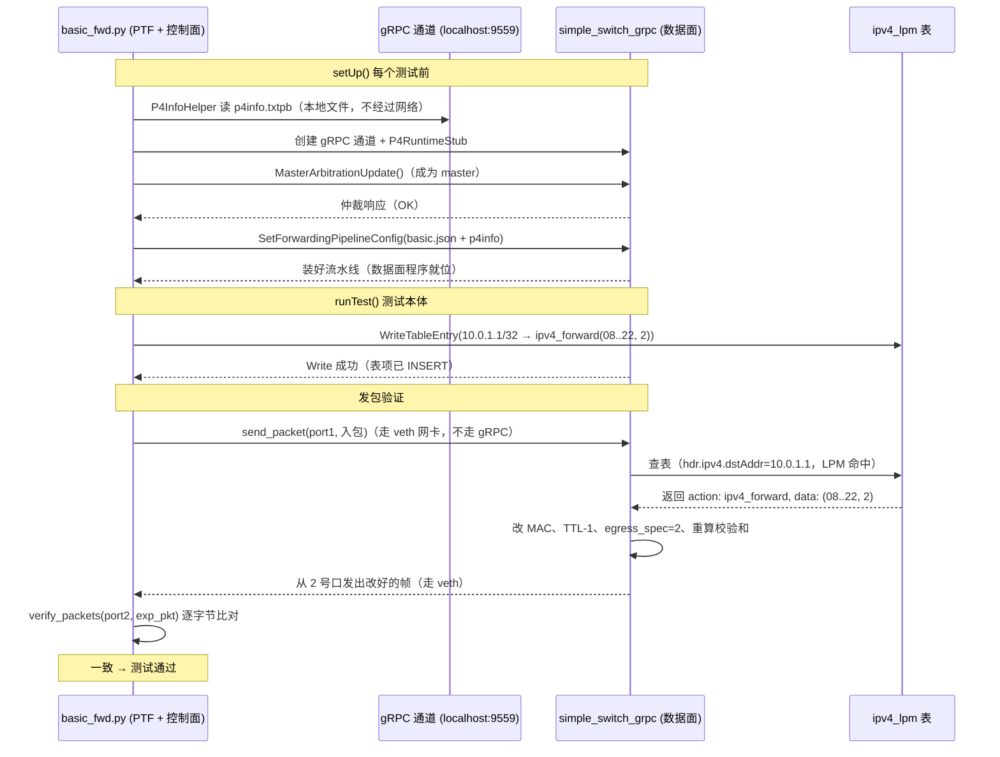

# P4 从零开始：控制面与数据面全流程逐行拆解

> 面向完全零基础的读者。本教程不做任何假设，从"什么是程序、什么是客户端"开始，把
> `basic_fwd.py` + `helper.py` + `switch.py` + `basic.p4` 这四套代码**每一行**讲清楚，
> 最终让你自己能把"控制面怎么控制数据面"这条链路从头讲到尾。

---

## 第0章 铺垫：先搞懂 5 个概念（别跳过，后面全靠它们）

### 0.1 "程序"、"进程"、"包（package）"、"模块（module）"

| 词 | 大白话 | 例子 |
|---|---|---|
| 程序 | 一份写好的代码 | `basic_fwd.py`、`basic.p4` |
| 进程 | 程序被**运行**起来后，占用 CPU/内存的那个"活的东西" | `simple_switch_grpc` 是一个进程；python 运行 basic_fwd.py 也是一个进程 |
| 包（package） | 一个**装着若干 .py 文件的文件夹**，里面必须有 `__init__.py` | `ptf/`、`p4runtime_lib/` |
| 模块（module） | 包里的单个 .py 文件 | `ptf/base_tests.py`、`p4runtime_lib/helper.py` |
| import | "把别人写好的代码拿进来用" | `import ptf.testutils` |

所以 `from ptf.base_tests import BaseTest` 的意思是：**打开 `ptf` 这个包里的 `base_tests` 这个模块，把里面的 `BaseTest` 这个名字拿进来**。ptf 是别人（p4lang）写好的一个 Python 包，用 pip 装的，不是本教程写的。

### 0.2 "客户端"和"服务器"

- **服务器（server）**：一个进程，**一直开着，等别人来连它**，别人发消息它就处理。
- **客户端（client）**：一个进程，**主动去连接服务器**，然后向服务器发请求。

本教程里：
- 服务器 = `simple_switch_grpc`（那个 C++ 交换机进程，一直在 9559 端口等连接）
- 客户端 = 跑 basic_fwd.py 的 python 进程（主动去连 9559）

> 你之前问"服务器监听机制在哪"——就在 `simple_switch_grpc` 这个 C++ 进程内部。它的代码不在本教程仓库里，教程里只有客户端（python 侧）。

### 0.3 "gRPC" 和 "protobuf"

- **gRPC**：一种"客户端→服务器"的通信方式。约定：用什么地址连、能调用哪些"方法"、消息长什么样。本教程的通道是 P4Runtime over gRPC。
- **protobuf**：一种"把数据打包成二进制"的格式。相当于"快递盒子的标准尺寸"，客户端和服务器都用同一个标准，所以能互相读懂。
- 类比：**gRPC 是电话线，protobuf 是电话里说的语言（都按同一种语法说话）。**

### 0.4 "表（table）"和"表项（entry）"

- **表**：P4 程序里声明的一个数据结构（`ipv4_lpm`），长在**交换机内部**。
- **表项**：表里的一条记录。空表什么都没记录；控制面往里"插"记录，表才有内容。
- 类比：**表 = 手机通讯录（空本子），表项 = 一条联系人记录。**

### 0.5 "数据面"和"控制面"

- **数据面（data plane）**：交换机里"处理每一个数据包"的那部分逻辑。**每来一个包都跑一遍**。P4 程序就是数据面。
- **控制面（control plane）**：给交换机"配置"的那部分。它不碰包，它只负责往表里填内容。basic_fwd.py 和控制器都属于控制面。
- 关键：**数据面处理包是"自动的、每包一次"；控制面配表是"手动的、按需一次"。** 控制面配完表，就不管了。

---

## 第1章 系统全景：谁在哪台机器上跑

```
┌────────────────── 主机（host）上同时跑着 ──────────────────┐
│                                                          │
│ 进程A：simple_switch_grpc（数据面，C++）                    │
│    ├─ 运行着编译好的 basic.p4（basic.json）                 │
│    ├─ 开着 8 个 veth 网卡端口（veth0~veth14）              │
│    ├─ 监听 9559 端口（等控制面来连）                       │
│    └─ 内部有一张 ipv4_lpm 表（一开始是空的）                │
│                                                          │
│ 进程B：python 跑 basic_fwd.py（控制面 + 测试，Python）       │
│    ├─ 作为 gRPC 客户端连上 9559                           │
│    ├─ 烧录程序、下发表项                                   │
│    ├─ 从 veth 网卡发包/抓包（PTF 干的）                    │
│    └─ 逐字节比对验证结果                                   │
│                                                          │
│ 进程C：python 跑 ptf（就是进程B的一部分，包在 basic_fwd.py 里）│
│    └─ 它就是 basic_fwd.py import 进来的那些代码             │
└──────────────────────────────────────────────────────────┘

          │ P4Runtime (gRPC, 9559 端口，protobuf 二进制)
          │ 和 veth 虚拟网线（走网络包）两条通道
          ▼
  （没有别的机器，全都在这一台主机上，用虚拟网卡模拟）
```

> 注意：这里没有"前端后端网页"，没有 JSON 通信。主机就一台，用虚拟网卡和 gRPC 端口模拟"交换机"和"测试机"。

---

## 第2章 第一步：编译（p4c 干了什么）

运行 `make test` → `runptf.sh` 里的这一步（runptf.sh:19-23）：

```bash
p4c --target bmv2 --arch v1model \
    --p4runtime-files build/basic.p4info.txtpb \
    -o build solution/basic.p4
```

| 参数 | 含义 |
|---|---|
| `solution/basic.p4` | 输入：P4 源码 |
| `--target bmv2` | 编译给 BMv2（软件交换机）用 |
| `--arch v1model` | 用 v1model 架构（就是带 standard_metadata 的那套） |
| `-o build` | 输出目录 |
| `--p4runtime-files build/basic.p4info.txtpb` | 额外生成一份"控制面契约"文件 |

**产出两个文件：**

```
build/basic.json            → 给交换机执行的"程序"（数据面怎么处理包）
build/basic.p4info.txtpb    → 给控制面看的"目录"（有哪些表、动作、参数、它们的 ID 和位宽）
```

关键理解：**同一份 basic.p4，编译出了两份东西，分别给两个角色用**：
- 数据面用 `basic.json` 干活
- 控制面用 `basic.p4info.txtpb` 知道"怎么对交换机下命令"

---

## 第3章 basic_fwd.py 逐行精讲

完整源码（带行号），我们一块一块拆。

### 3.1 文件头部：import（第 6-21 行）

```python
 6: import logging                       # 日志库
 7: import os                            # 操作系统接口
 8: import sys                           # python 系统相关
 9: from time import sleep               # 睡眠
10:
11: import grpc                           # gRPC 库（pip 装）
12:
13: import ptf                            # PTF 包（pip 装）——见 §11
14: import ptf.testutils as tu            # PTF 的工具函数，起个短名字 tu
15: from ptf.base_tests import BaseTest   # PTF 的测试基类
16:
17: # Import p4runtime_lib from the tutorials repo utils directory
18: # Probably there's a better way of doing this.
19: sys.path.append(
20:     os.path.join(os.path.dirname(os.path.abspath(__file__)),
21:                  '../../../utils/'))
```

逐行解释：

- **第 11 行** `import grpc`：导入 gRPC 库。这个库负责"建立连接、发消息"。
- **第 13 行** `import ptf`：导入 PTF 包。PTF 是个**独立的第三方库**（`pip install ptf`），专门做网络包测试。
- **第 14 行** `import ptf.testutils as tu`：把 `ptf.testutils` 模块里的函数拿进来，后面用 `tu.xxx()` 调用。`testutils` 里有：
  - `tu.simple_tcp_packet(...)`：构造一个 TCP 包
  - `tu.simple_arp_packet(...)`：构造一个 ARP 包
  - `tu.send_packet(...)`：从某个端口把包发出去
  - `tu.verify_packets(...)`：断言"某个端口收到了某个包"
  - `tu.test_param_get(...)`：读取命令行传进来的测试参数
- **第 15 行** `from ptf.base_tests import BaseTest`：PTF 里定义好的测试基类，我们的测试类都要继承它，这样 PTF 才知道"这是个测试，要运行它"。
- **第 19-21 行** `sys.path.append(...)`：把 `utils/` 目录加进 python 的搜索路径。**为什么要手动加？** 因为 `p4runtime_lib` 是教程仓库自己写的（在 `utils/p4runtime_lib/` 里），python 默认找不到，所以手动把路径塞进去。`os.path.abspath(__file__)` 是"当前文件在哪"，`../..` 往上一级两级到 `exercises/`，再进 `utils/`。

> 这行代码解释了为什么你能 `import p4runtime_lib.bmv2`——它是教程自己写的，靠第 19 行手动加路径才能被找到。而 `ptf` 不用加，因为它是 pip 装的，python 自动找得到。

### 3.2 类定义与 setUp（第 33-67 行）

```python
33: class BasicFwdTest(BaseTest):
34:     def setUp(self):
35:         self.dataplane = ptf.dataplane_instance
36:         self.dataplane.flush()
37:
38:         logging.debug("BasicFwdTest.setUp()")
39:
40:         # Get test parameters
41:         grpc_addr = tu.test_param_get("grpcaddr")
42:         if grpc_addr is None:
43:             grpc_addr = 'localhost:9559'
44:         p4info_txt_fname = tu.test_param_get("p4info")
45:         p4prog_binary_fname = tu.test_param_get("config")
46:
47:         # Create P4Info helper for building table entries
48:         self.p4info_helper = p4runtime_lib.helper.P4InfoHelper(p4info_txt_fname)
49:
50:         # Connect to the switch via gRPC
51:         self.sw = p4runtime_lib.bmv2.Bmv2SwitchConnection(
52:             name='s1',
53:             address=grpc_addr,
54:             device_id=0,
55:             proto_dump_file='logs/s1-p4runtime-requests.txt')
56:
57:         # Establish as master controller
58:         self.sw.MasterArbitrationUpdate()
59:
60:         # Load the P4 program onto the switch
61:         self.sw.SetForwardingPipelineConfig(
62:             p4info=self.p4info_helper.p4info,
63:             bmv2_json_file_path=p4prog_binary_fname)
64:
65:     def tearDown(self):
66:         logging.debug("BasicFwdTest.tearDown()")
67:         ShutdownAllSwitchConnections()
```

逐行解释：

**第 33 行** `class BasicFwdTest(BaseTest):` —— 定义一个测试类，继承 PTF 的 `BaseTest`。PTF 运行时会**自动发现并运行**继承 BaseTest 的类。

**第 34 行** `def setUp(self):` —— 这是**测试框架的标准钩子方法**。PTF 会**在每个测试用例执行之前**自动调用 `setUp`。所以 setUp 里放的是"每个测试都要先准备好的东西"。

**第 35-36 行** —— 拿 PTF 的数据平面实例，清空残留包：
```python
self.dataplane = ptf.dataplane_instance   # PTF 的"抓包引擎"（在 veth 上抓包的家伙）
self.dataplane.flush()                    # 把之前可能残留的包清掉，保证测试环境干净
```
`ptf.dataplane_instance` 是 PTF 包**在测试开始时自动创建**的一个全局对象，它管着所有 veth 网卡。`flush()` 就是清空网卡缓冲区。

**第 41-45 行** —— 读取测试参数：
```python
grpc_addr = tu.test_param_get("grpcaddr")     # 从 runptf.sh 的 --test-params 里读
if grpc_addr is None:                          # 如果没传就用默认值
    grpc_addr = 'localhost:9559'
p4info_txt_fname = tu.test_param_get("p4info")   # 'build/basic.p4info.txtpb'
p4prog_binary_fname = tu.test_param_get("config") # 'build/basic.json'
```
这些参数是 runptf.sh（/workspace/tutorials/exercises/basic/runptf.sh） 第 56 行传进来的：
```
--test-params="grpcaddr='localhost:9559';p4info='build/basic.p4info.txtpb';config='build/basic.json'"
```
`tu.test_param_get("xxx")` 就是从这条字符串里取 `xxx` 的值。

**第 48 行** —— 创建"P4 信息解析器"：
```python
self.p4info_helper = p4runtime_lib.helper.P4InfoHelper(p4info_txt_fname)
```
这行代码**只做一件事**：把 `basic.p4info.txtpb` 文件读进内存，变成一个能查"名字↔ID"的对象。它现在还没连交换机，只是读文件。这是**第一个关键对象**，因为后面所有"我要操作哪个表"的查询都靠它。

**第 51-55 行** —— 创建 gRPC 连接对象（**还没真正连接**，只是准备）：
```python
self.sw = p4runtime_lib.bmv2.Bmv2SwitchConnection(
    name='s1',                              # 给这个连接起个名字（只是标签）
    address=grpc_addr,                      # 连谁：'localhost:9559'
    device_id=0,                            # 交换机编号（有多个交换机时区分）
    proto_dump_file='logs/s1-p4runtime-requests.txt')  # 把 gRPC 消息 dump 到文件，方便调试
```
在 `switch.py` 里，这个构造函数做了：`grpc.insecure_channel(address)`（创建 gRPC 通道）、`P4RuntimeStub(channel)`（创建"遥控器"）。**注意：创建通道≠连接**，真正的请求是从下一行开始的。

**第 58 行** —— 握手成为 master：
```python
self.sw.MasterArbitrationUpdate()
```
P4Runtime 规定：控制面要先说"我是主控"，交换机同意后，才允许你写表。防止多个控制器同时写。内部实现（switch.py:80-90）往 `StreamChannel` 里塞了一条带 `election_id=1` 的消息。

**第 61-63 行** —— 烧录 P4 程序：
```python
self.sw.SetForwardingPipelineConfig(
    p4info=self.p4info_helper.p4info,      # 把 p4info 契约给交换机
    bmv2_json_file_path=p4prog_binary_fname)  # 把 basic.json 给交换机
```
**这一步是"把数据面程序装进交换机"**。等价于给手机刷机：装完这个，交换机的流水线才从"空白"变成"会跑 basic.p4 的逻辑"。

**第 65-67 行** `tearDown` —— 每个测试**跑完后**自动调用，关掉所有 gRPC 连接。

> **setUp 四步小结：** 读文件（p4info）→ 建连接对象 → 握手（master）→ 烧程序。之后测试类里的每个测试用例（如 FwdTest）就可以直接用了。

### 3.3 下发表项的辅助函数（第 74-85 行）

```python
74:     def add_ipv4_lpm_entry(self, ipv4_addr_str, prefix_len, dst_mac_str, port):
75:         table_entry = self.p4info_helper.buildTableEntry(
76:             table_name='MyIngress.ipv4_lpm',
77:             match_fields={
78:                 'hdr.ipv4.dstAddr': (ipv4_addr_str, prefix_len)
79:             },
80:             action_name='MyIngress.ipv4_forward',
81:             action_params={
82:                 'dstAddr': dst_mac_str,
83:                 'port': port
84:             })
85:         self.sw.WriteTableEntry(table_entry)
```

这是**控制面的核心动作**：往交换机表里塞一条记录。参数含义：

| 参数 | 举例 | 是什么 |
|---|---|---|
| `ipv4_addr_str` | `'10.0.1.1'` | 匹配的 IP（前缀的网络部分） |
| `prefix_len` | `32` | 前缀长度（/32） |
| `dst_mac_str` | `'08:00:00:00:02:22'` | 命中了就把目的 MAC 改成这个（下一跳） |
| `port` | `2` | 命中了就从 2 号口出去 |

第 75 行 `buildTableEntry` 把上面这些"人的说法"变成"交换机能懂的消息"（详见第4章）。第 85 行 `WriteTableEntry` 通过 gRPC 把这条消息发给交换机。

> **类比：** buildTableEntry = 填一张"快递单"，WriteTableEntry = 把单子交给快递员（gRPC）送走。

### 3.4 一个完整的测试用例（第 102-124 行 FwdTest）

```python
102: class FwdTest(BasicFwdTest):
103:     def runTest(self):
104:         in_dmac  = 'ee:30:ca:9d:1e:00'   # 入包的目的 MAC
105:         in_smac  = 'ee:cd:00:7e:70:00'   # 入包的源 MAC
106:         ip_dst   = '10.0.1.1'            # 包要去的 IP
107:         ig_port  = 1                     # 从交换机 1 号口进去
108:         eg_port  = 2                     # 期望从 2 号口出来
109:         out_dmac = '08:00:00:00:02:22'   # 控制面填的下一跳 MAC
110:
111:         self.add_ipv4_lpm_entry(ip_dst, 32, out_dmac, eg_port)
112:
113:         pkt = tu.simple_tcp_packet(eth_src=in_smac, eth_dst=in_dmac,
114:                                    ip_dst=ip_dst, ip_ttl=64)
115:
116:         exp_pkt = tu.simple_tcp_packet(eth_src=in_dmac, eth_dst=out_dmac,
117:                                        ip_dst=ip_dst, ip_ttl=63)
118:
119:         tu.send_packet(self, ig_port, pkt)
120:         tu.verify_packets(self, exp_pkt, [eg_port])
```

- **第 103 行** `runTest`：PTF 要求测试类实现这个方法，它就是"一个测试用例的本体"。
- **第 111 行**：调用第 3.3 节的函数，下发表项 `10.0.1.1/32 → ipv4_forward(08:...:22, 2)`。
- **第 113-114 行**：构造**入包**。`simple_tcp_packet` 是 PTF 提供的"造包函数"，它返回一个字节串，内容是：
  ```
  [目的MAC=ee:30:ca:9d:1e:00][源MAC=ee:cd:00:7e:70:00][IP目的=10.0.1.1][TTL=64] + TCP头 + 载荷
  ```
- **第 116-117 行**：构造**期望的出包**。注意和入包的差别：
  - `eth_src=in_dmac`：源 MAC 变成了入包的目的 MAC（对应 action 里 `srcAddr = dstAddr`）
  - `eth_dst=out_dmac`：目的 MAC 变成了下一跳 MAC（对应 action 里 `dstAddr = dstAddr` 参数）
  - `ip_ttl=63`：TTL 减了 1（对应 action 里 `ttl - 1`）
- **第 119 行**：`send_packet` 把入包从 PTF 端口 1 发出去（veth → 交换机 1 号口）。
- **第 120 行**：`verify_packets` 在 PTF 端口 2 上抓包，断言"收到了 exp_pkt"（逐字节比对）。**如果交换机按 basic.p4 正确处理了，就会收到一模一样的字节；比对不通过则测试失败。**

> 这一小节是整个测试的"灵魂"：它描述了**数据面应该把包改成什么样**。这个"应该"，正是 basic.p4 里 action 三行代码做的事情。

---

## 第4章 helper.py 逐行精讲：buildTableEntry 内部干了什么

第 3.3 节的第 75 行 `buildTableEntry` 会走到 `utils/p4runtime_lib/helper.py`。这一章把它拆开。

### 4.1 查找：名字怎么变成 ID（第 22-41 行）

```python
22:     def get(self, entity_type, name=None, id=None):
23:         if name is not None and id is not None:
24:             raise AssertionError("name or id must be None")
25:
26:         for o in getattr(self.p4info, entity_type):   # 遍历 p4info 里的某类对象
27:             pre = o.preamble                          # 每个对象都有 preamble（含名字和ID）
28:             if name:
29:                 if (pre.name == name or pre.alias == name):  # 按名字匹配
30:                     return o
31:             else:
32:                 if pre.id == id:                      # 按 ID 匹配
33:                     return o
34:
35:         if name:
36:             raise AttributeError("Could not find %r of type %s" % (name, entity_type))
37:         else:
38:             raise AttributeError("Could not find id %r of type %s" % (id, entity_type))
```

- `self.p4info` 就是 setUp 第 48 行读进来的 p4info 对象。它内部有 `tables`、`actions` 等字段，每个字段是一组对象，每个对象都带 `preamble`（里面有 `name`、`alias`、`id`）。
- `get("tables", name="MyIngress.ipv4_lpm")` 就是**遍历所有表，找到名字对上的那一个，返回它**。找到后，`preamble.id` 就是数字 ID。
- 这套代码是 P4Runtime 的规矩：**网络上传送时用数字 ID（快、省空间），人的代码里用名字（好读）。** 所以必须做"名字→ID"的翻译。

### 4.2 匹配字段怎么变成 FieldMatch（第 85-108 行）

```python
85:     def get_match_field_pb(self, table_name, match_field_name, value):
86:         p4info_match = self.get_match_field(table_name, match_field_name)  # 查 p4info 找到字段
87:         bitwidth = p4info_match.bitwidth    # 从 p4info 读出位宽，比如 32
88:         p4runtime_match = p4runtime_pb2.FieldMatch()   # 建一个 protobuf 的"匹配字段"对象
89:         p4runtime_match.field_id = p4info_match.id     # 填字段 ID
90:         match_type = p4info_match.match_type           # 看匹配类型：EXACT / LPM / TERNARY ...
91:         if match_type == p4info_pb2.MatchField.EXACT:
92:             exact = p4runtime_match.exact
93:             exact.value = encode(value, bitwidth)      # 精确匹配：直接填值
94:         elif match_type == p4info_pb2.MatchField.LPM:
95:             lpm_entry = p4runtime_match.lpm
96:             lpm_entry.value = encode(value[0], bitwidth)  # LPM：填前缀的值
97:             lpm_entry.prefix_len = value[1]               # LPM：填前缀长度
98:         elif match_type == p4info_pb2.MatchField.TERNARY:
99:             ternary_entry = p4runtime_match.ternary
100:             ternary_entry.value = encode(value[0], bitwidth)
101:             ternary_entry.mask = encode(value[1], bitwidth)
102:         elif match_type == p4info_pb2.MatchField.RANGE:
103:             range_entry = p4runtime_match.range
104:             range_entry.low = encode(value[0], bitwidth)
105:             range_entry.high = encode(value[1], bitwidth)
106:         else:
107:             raise Exception("Unsupported match type with type %r" % match_type)
108:         return p4runtime_match
```

- `get_match_field`（第 66-77 行）：在 p4info 的表定义里找"叫这个名字的匹配字段"。因为 p4info 里记录了 `hdr.ipv4.dstAddr` 的 `bitwidth=32`、`match_type=LPM`，**所以控制面代码不用自己说"我是 LPM"**——它是从 p4info 里自动读出来的！
- `encode()`（convert.py:71-92）：把字符串转成二进制字节：
  - `'10.0.1.1'` → `socket.inet_aton` → 4 个字节 `\x0a\x00\x01\x01`
  - `'08:00:00:00:02:22'` → 去掉冒号转十六进制 → 6 个字节
  - 数字 `2` → 2 个字节 `\x00\x02`
  - 如果字节数不对，第 91 行会 assert 失败——这是防止你填错位宽。
- 因为 basic 用的是 LPM，所以走第 94-97 行：`value[0]` 是 `'10.0.1.1'`，`value[1]` 是 `32`。

### 4.3 组装成完整的 TableEntry（第 151-185 行）

```python
151:     def buildTableEntry(self, table_name, match_fields=None,
152:                         default_action=False, action_name=None,
153:                         action_params=None, ...):
159:         table_entry = p4runtime_pb2.TableEntry()          # 新建"表项"消息
160:         table_entry.table_id = self.get_tables_id(table_name)  # 表名→表ID
161:
162:         if priority is not None: table_entry.priority = priority
163:         ...
168:         if match_fields:
169:             table_entry.match.extend([
170:                 self.get_match_field_pb(table_name, match_field_name, value)
171:                 for match_field_name, value in match_fields.items()   # 每个匹配键转换
172:             ])
173:
174:         if default_action:
175:             table_entry.is_default_action = True
176:
177:         if action_name:
178:             action = table_entry.action.action            # 设置动作
179:             action.action_id = self.get_actions_id(action_name)  # 动作名→动作ID
180:             if action_params:
181:                 action.params.extend([
182:                     self.get_action_param_pb(action_name, field_name, value)
183:                     for field_name, value in action_params.items()  # 每个动作参数转换
184:                 ])
185:         return table_entry
```

到这里，`buildTableEntry` 返回一个 **protobuf 消息对象**，内容相当于：

```
TableEntry {
  table_id = 37375156                            # MyIngress.ipv4_lpm
  match {
    field_id = 1                                 # hdr.ipv4.dstAddr
    lpm { value = \x0a\x00\x01\x01, prefix_len = 32 }
  }
  action {
    action_id = 28792405                         # MyIngress.ipv4_forward
    params { param_id=1, value = \x08\x00\x00\x00\x02\x22 }  # dstAddr
    params { param_id=2, value = \x00\x02 }                  # port
  }
}
```

---

## 第5章 switch.py 逐行精讲：消息怎么发到交换机

### 5.1 建立 gRPC 连接（第 55-70 行）

```python
55:     def __init__(self, name=None, address='127.0.0.1:50051', device_id=0,
56:                  proto_dump_file=None):
57:         self.name = name
58:         self.address = address
59:         self.device_id = device_id
60:         self.p4info = None
61:         self.channel = grpc.insecure_channel(self.address)   # ① 创建 gRPC 通道
62:         if proto_dump_file is not None:                       # ② 如果要求 dump 日志
63:             interceptor = GrpcRequestLogger(proto_dump_file)  # ③ 造一个"记录员"
64:             self.channel = grpc.intercept_channel(self.channel, interceptor) # ④ 把记录员挂到通道上
65:         self.client_stub = p4runtime_pb2_grpc.P4RuntimeStub(self.channel)   # ⑤ 造"遥控器"
66:         self.requests_stream = IterableQueue()
67:         self.stream_msg_resp = self.client_stub.StreamChannel(iter(self.requests_stream))
68:         self.dispatcher = StreamDispatcher(self.stream_msg_resp)
69:         self.proto_dump_file = proto_dump_file
70:         connections.append(self)
```

- **第 61 行** `grpc.insecure_channel(address)`：创建一个 gRPC 通道，指向 `localhost:9559`。注意：**这只是"线路准备好了"，还没真发消息**。
- **第 62-64 行**：如果你传了 `proto_dump_file`（basic_fwd.py:55 传了），就挂一个"拦截器"。它会在**每次 gRPC 消息经过时**把内容写到日志文件——这就是 `logs/s1-p4runtime-requests.txt` 的来历。
- **第 65 行** `P4RuntimeStub(channel)`：stub 的意思是"遥控器"——它定义了你**能对交换机调用哪些方法**：`Write`、`Read`、`SetForwardingPipelineConfig`、`StreamChannel` 等。
- **第 67-68 行**：打开一条**双向流**（StreamChannel），并起一个后台线程（StreamDispatcher）不停地收交换机推过来的消息。这条流平时挂着，等仲裁、PacketIn 等消息。

### 5.2 握手：MasterArbitrationUpdate（第 80-90 行）

```python
80:     def MasterArbitrationUpdate(self, dry_run=False, **kwargs):
81:         request = p4runtime_pb2.StreamMessageRequest()
82:         request.arbitration.device_id = self.device_id
83:         request.arbitration.election_id.high = 0
84:         request.arbitration.election_id.low = 1
85:         if dry_run:
86:             print("P4Runtime MasterArbitrationUpdate: ", request)
87:         else:
88:             self.requests_stream.put(request)     # 塞进流
89:             return self.dispatcher.arbitration_queue.get()   # 等交换机回"你是master"
```

- 构造一条"仲裁"消息（我是谁、我的选举号=1），从流里发给交换机，然后**阻塞等待**交换机回一条仲裁响应。拿到响应，表示我们成为 master。

### 5.3 烧录程序：SetForwardingPipelineConfig（第 92-106 行）

```python
92:     def SetForwardingPipelineConfig(self, p4info, dry_run=False, **kwargs):
93:         device_config = self.buildDeviceConfig(**kwargs)   # 读 basic.json，包装成配置
94:         request = p4runtime_pb2.SetForwardingPipelineConfigRequest()
95:         request.election_id.low = 1
96:         request.device_id = self.device_id
97:         config = request.config
98:         config.p4info.CopyFrom(p4info)                     # 带上 p4info 契约
99:         config.p4_device_config = device_config.SerializeToString()  # 带上 json 程序
100:         request.action = ...VERIFY_AND_COMMIT
101:         ...
106:         self.client_stub.SetForwardingPipelineConfig(request)  # 通过 gRPC 发给交换机
```

- 把 `basic.json` 和 p4info **一起**打包成 gRPC 请求，发给交换机。交换机解析后，把流水线加载进去。**从这一刻起，交换机才会按 basic.p4 的逻辑处理包。**

### 5.4 下发表项：WriteTableEntry（第 108-121 行）

```python
108:     def WriteTableEntry(self, table_entry, dry_run=False):
109:         request = p4runtime_pb2.WriteRequest()        # 一个"写"请求
110:         request.device_id = self.device_id
111:         request.election_id.low = 1
112:         update = request.updates.add()                # 一个 update 操作
113:         if table_entry.is_default_action:
114:             update.type = p4runtime_pb2.Update.MODIFY # 改默认动作用 MODIFY
115:         else:
116:             update.type = p4runtime_pb2.Update.INSERT # 插表项用 INSERT
117:         update.entity.table_entry.CopyFrom(table_entry)  # 把第4章组装的表项塞进去
118:         if dry_run:
119:             print("P4Runtime Write:", request)
120:         else:
121:             self.client_stub.Write(request)           # 通过 gRPC 发给交换机
```

- 把第 4 章组装好的 TableEntry 消息，包成一个 `WriteRequest`，通过 stub 的 `Write` 方法发给交换机 9559 端口。
- 交换机的 gRPC 服务器（C++）收到后，把这条记录 INSERT 进 `ipv4_lpm` 表。

> **到这里，控制面做的事就全完了。** 之后交换机怎么处理包，控制面不再插手——那是数据面的事（下一章）。

---

## 第6章 数据面代码 basic.p4 逐行精讲（含与控制面的对应）

> 这一章我们站在**数据面**这一侧，把 `solution/basic.p4` 从头到尾每一行都讲一遍，
> 并标出**每一处和控制面代码的对应关系**。这才是"两套代码怎么配合"的完整版。

### 6.0 整体骨架：一个 P4 程序由几块组成

`basic.p4` 的结构（从上到下）：

```
1. 常量 + typedef          （第 7-15 行）类型和常量
2. header 定义              （第 17-36 行）以太网头、IPv4 头长什么样
3. struct 定义              （第 38-45 行）metadata、headers 这两个"收纳盒"
4. parser MyParser          （第 51-73 行）阶段①：解析（解包）
5. control MyVerifyChecksum （第 79-81 行）阶段②：校验和验证
6. control MyIngress        （第 88-120 行）阶段③：查表转发（核心！）
7. control MyEgress         （第 126-130 行）阶段④：出方向
8. control MyComputeChecksum（第 136-154 行）阶段⑤：重算校验和
9. control MyDeparser       （第 160-165 行）阶段⑥：重新组装（打包）
10. V1Switch(...) main      （第 171-178 行）把 1~9 按顺序串成一条流水线
```

**最关键的第 10 点**：`V1Switch` 是这个程序的总入口，它按固定顺序把前面 6 个阶段串起来
（Parser → VerifyChecksum → Ingress → Egress → ComputeChecksum → Deparser）。
**这个顺序是架构（v1model）规定的，你只能往每个盒子里写内容，不能改盒子顺序。**
数据面处理每个包，就是顺着这条流水线走一遍。

### 6.1 常量、类型定义（第 7-15 行）

```p4
 7: const bit<16> TYPE_IPV4 = 0x800;     // 以太网协议号：0x0800 代表 IPv4
13: typedef bit<9>  egressSpec_t;         // 端口号的类型：9 位（支持最多 512 个端口）
14: typedef bit<48> macAddr_t;            // MAC 地址类型：48 位
15: typedef bit<32> ip4Addr_t;            // IPv4 地址类型：32 位
```

- **第 7 行**：`bit<16>` 是 16 位无符号整数；`const` 是常量。0x800 是十六进制，写成 16 位二进制是 `0000 1000 0000 0000`，即以太网帧里的 etherType 字段值，表示"后面跟着的是 IPv4"。parser 靠它判断是否继续解析 IPv4。
- **第 13-15 行**：`typedef` 是"给类型起别名"。以后写 `macAddr_t` 就等于写 `bit<48>`。
  **和控制面的对应**：p4info 里记录 `dstAddr` 参数 `bitwidth: 48`、`port` 参数 `bitwidth: 9`，正是这里定义出来的（p4info 里对应本文件的 14、15 行）。

### 6.2 header 定义：数据包的"模板"（第 17-36 行）

```p4
17: header ethernet_t {                  // 以太网头模板
18:     macAddr_t dstAddr;                // 目的 MAC，48 位 = 6 字节
19:     macAddr_t srcAddr;                // 源 MAC，48 位
20:     bit<16>   etherType;              // 协议类型，16 位 = 2 字节（0x0800=IPv4）
21: }
22:
23: header ipv4_t {                       // IPv4 头模板
24:     bit<4>    version;                // 版本（4 位，值为 4）
25:     bit<4>    ihl;                    // 头长度（4 位）
26:     bit<8>    diffserv;               // 差分服务
27:     bit<16>   totalLen;               // 总长度
28:     bit<16>   identification;         // 标识
29:     bit<3>    flags;                  // 标志位
30:     bit<13>   fragOffset;             // 分片偏移
31:     bit<8>    ttl;                    // 生存时间（8 位）
32:     bit<8>    protocol;               // 上层协议（TCP=6, UDP=17）
33:    bit<16>   hdrChecksum;            // 头校验和
34:     ip4Addr_t srcAddr;                // 源 IP，32 位
35:     ip4Addr_t dstAddr;                // 目的 IP，32 位
36: }
```

- `header` 是 P4 的关键字，它描述"这种头在包里的字节布局"。**字段加起来正好是标准的以太网头 14 字节、IPv4 头 20 字节。**
- 理解方式：`header ethernet_t` 定义了"读包时怎么把以太网这段切出来"——前 6 字节叫 dstAddr，再 6 字节叫 srcAddr，再 2 字节叫 etherType。
- **和控制面的对应**：你在 basic_fwd.py 里写 `match_fields={'hdr.ipv4.dstAddr': ('10.0.1.1', 32)}`，`hdr.ipv4.dstAddr` 这个名字就对应这里第 35 行定义的字段；p4info 里记录的 `bitwidth: 32` 也是从这行推断的。

### 6.3 struct 定义：装数据的"收纳盒"（第 38-45 行）

```p4
38: struct metadata {                    // 自定义元数据（本程序没用，先留空）
39:     /* empty */
40: }
41:
42: struct headers {                      // 所有被解析出来的头的"收纳盒"
43:     ethernet_t   ethernet;            // 里面放一个以太网头
44:     ipv4_t       ipv4;                // 里面放一个 IPv4 头
45: }
```

- `hdr` 在整个程序里频繁出现（`hdr.ethernet`、`hdr.ipv4`），它就是 `struct headers` 类型的一个实例，由架构创建、在各阶段间传递。
- `hdr.ipv4.isValid()` 就是问"这个盒子里 ipv4 那个格有没有被 parser 放东西进去"。

### 6.4 parser：阶段① 解析（第 51-73 行）

```cpp
51: parser MyParser(packet_in packet,
52:                 out headers hdr,
53:                 inout metadata meta,
54:                 inout standard_metadata_t standard_metadata) {
55:
56:     state start {
57:         transition parse_ethernet;        // 起点：去解析以太网
58:     }
59:
60:     state parse_ethernet {
61:         packet.extract(hdr.ethernet);     // 把前 14 字节按 ethernet_t 模板切出来
62:         transition select(hdr.ethernet.etherType) {   // 看看 etherType 是多少
63:             TYPE_IPV4: parse_ipv4;        // 0x0800 → 继续解析 IPv4
64:             default: accept;              // 其他 → 解析到此为止
65:         }
66:     }
67:
68:     state parse_ipv4 {
69:         packet.extract(hdr.ipv4);         // 把接下来 20 字节按 ipv4_t 模板切出来
70:         transition accept;                // 完成
71:     }
72: }
```

- **第 51-54 行**：parser 的签名。`packet_in` 是"进来的字节流"；`out headers hdr` 是"把解析结果填到 hdr 里交出去"；`standard_metadata_t` 是架构给的元数据。
- **第 56-57 行**：P4 的 parser 是**状态机**。`start` 是必有的入口状态，`transition parse_ethernet` 表示"下一步去 parse_ethernet 状态"。
- **第 61 行** `packet.extract(hdr.ethernet)`：**核心动作**。把字节流开头的 14 字节按照 `ethernet_t` 模板的字段布局，填进 `hdr.ethernet`。extract 完，字节流的"指针"前进 14 字节。
- **第 62-65 行** `transition select(...)`：按 `hdr.ethernet.etherType` 的值做**分发**。等于 `TYPE_IPV4`（0x0800）就去 `parse_ipv4`，否则 `accept`（结束解析）。
- **第 69 行**：extract 接下来的 20 字节进 `hdr.ipv4`。此刻 `hdr.ipv4.dstAddr` 就有了值——**LPM 查表要用的键，就是在这里被提取出来的。**

> **再三强调（这是你最早困惑的点）**：parser 里的 `select` 只是"看 etherType 是 IPv4 还是别的"来**决定解不解析 IPv4**，
> 它**不做最长前缀匹配、不查路由表**。`hdr.ipv4.dstAddr : lpm` 那个 LPM 在 MyIngress 的表里，不在这。

### 6.5 MyIngress：阶段③ 核心转发逻辑（第 88-120 行）

这是数据面里**和控制面关系最直接**的部分，逐块讲。

```p4
 88: control MyIngress(inout headers hdr,
 89:                   inout metadata meta,
 90:                   inout standard_metadata_t standard_metadata) {
 91:     action drop() {
 92:         mark_to_drop(standard_metadata);
 93:     }
```

**第 91-93 行：`drop` 动作。** `mark_to_drop(standard_metadata)` 是 v1model 提供的内置函数，
它把 `standard_metadata` 标记成"丢弃"，流水线后面的流量管理器看到这个标记就直接丢掉包。
（它内部实质是往 `egress_spec` 里写一个特殊值 NO_PORT。）

```p4
 95:     action ipv4_forward(macAddr_t dstAddr, egressSpec_t port) {
 96:         standard_metadata.egress_spec = port;
 97:         hdr.ethernet.srcAddr = hdr.ethernet.dstAddr;
 98:         hdr.ethernet.dstAddr = dstAddr;
 99:         hdr.ipv4.ttl = hdr.ipv4.ttl - 1;
100:     }
```

**第 95-100 行：`ipv4_forward` 动作**——数据面的"转发动作"：

| 行 | 代码 | 干什么 | 控制面对应 |
|---|---|---|---|
| 95 | `(macAddr_t dstAddr, egressSpec_t port)` | 声明动作的两个参数 | basic_fwd.py 里 `action_params={'dstAddr':..., 'port':...}` 填的就是这两个 |
| 96 | `egress_spec = port;` | **核心**：告诉架构从哪个端口出去 | `action_params` 里的 `port` |
| 97 | `srcAddr = dstAddr;` | 源 MAC 换成原目的 MAC（basic 简化写法） | FwdTest 里 `exp_pkt` 的 `eth_src=in_dmac` |
| 98 | `hdr.ethernet.dstAddr = dstAddr;` | 目的 MAC 换成下一跳 MAC | FwdTest 里 `exp_pkt` 的 `eth_dst=out_dmac` |
| 99 | `ttl = ttl - 1;` | TTL 减一 | FwdTest 里 `exp_pkt` 的 `ip_ttl=63` |

**参数从哪来（关键！）**：`dstAddr`、`port` 是**形参**，真正执行时它们的值 = 查表命中的那条表项里存的 action 数据。
控制面下发表项 → 表项里存 `dstAddr=08...22, port=2` → 包查表命中 → 交换机把 08...22 绑给 `dstAddr`、2 绑给 `port` → 执行动作。
**这就是前面第 4 章组装的那个 protobuf 消息，最终变成这里变量的值。**

```p4
102:     table ipv4_lpm {
103:         key = {
104:             hdr.ipv4.dstAddr: lpm;
105:         }
106:         actions = {
107:             ipv4_forward;
108:             drop;
109:             NoAction;
110:         }
111:         size = 1024;
112:         default_action = drop();
113:     }
```

**第 102-113 行：定义表 `ipv4_lpm`**。这张表是控制面下发表项的"容器"：

| 行 | 内容 | 含义 | 控制面对应 |
|---|---|---|---|
| 104 | `hdr.ipv4.dstAddr: lpm` | 匹配键是目的 IP，匹配方式是**最长前缀匹配** | basic_fwd.py 的 `match_fields={'hdr.ipv4.dstAddr': ('10.0.1.1', 32)}`——p4info 说它是 LPM，控制面就填"值+前缀长度" |
| 107-109 | `actions = { ipv4_forward; drop; NoAction; }` | 这张表**允许执行**哪些动作 | p4info 的 `action_refs` 就是这三条；控制面只能下这些动作 |
| 111 | `size = 1024` | 最多 1024 条表项 | p4info 的 `size: 1024` |
| 112 | `default_action = drop()` | 一条都没命中时执行 drop | p4info 的 `initial_default_action { action_id: MyIngress.drop }` |

```p4
115:     apply {
116:         if (hdr.ipv4.isValid()) {
117:             ipv4_lpm.apply();
118:         }
119:     }
120: }
```

**第 115-119 行：MyIngress 的 apply 主体**——每个包都会执行这里：
- **第 116 行** `hdr.ipv4.isValid()`：问 parser 是否成功解析出了 IPv4 头。ARP 包解析不到 IPv4 头 → 条件为假 → **跳过查表** → 包按默认行为走（v1model 里没设 egress_spec 就原样从 0 号口出，这对应 `NonIpv4DropTest`）。
- **第 117 行** `ipv4_lpm.apply()`：**触发查表**。用 `hdr.ipv4.dstAddr` 查表：
  1. 匹配（LPM）→ 执行命中的动作（`ipv4_forward` 或 `drop`）
  2. 不匹配 → 执行 `default_action`（`drop()`）
  
  `apply()` 查表时用的表项内容，就是控制面 WriteTableEntry 塞进来的。

### 6.6 MyEgress / MyComputeChecksum / MyDeparser（第 126-165 行）

```p4
126: control MyEgress(inout headers hdr, inout metadata meta,
127:                  inout standard_metadata_t standard_metadata) {
128:     apply {  }                                    // 空：basic 不需要出方向处理
129: }
```

**第 126-129 行：Egress 阶段**。basic 里留空。真实交换机常在这里做队列/镜像等。

```p4
136: control MyComputeChecksum(inout headers  hdr, inout metadata meta) {
137:     apply {
138:         update_checksum(
139:             hdr.ipv4.isValid(),                    // 只有 IPv4 包才算
140:             { hdr.ipv4.version, hdr.ipv4.ihl, ... hdr.ipv4.dstAddr },  // 参与校验的字段
141:             hdr.ipv4.hdrChecksum,                  // 算出来的校验和写回这里
142:             HashAlgorithm.csum16);                 // 用 16 位补码和算法
143:     }
144: }
```

**第 136-144 行：重算 IPv4 校验和**。**为什么必须重算？** 因为 Ingress 里改了 TTL（第 99 行），TTL 是校验和的一部分，不改校验和对端会认为包损坏。`update_checksum` 是 v1model 的内置 extern：把列出的字段（正好是标准 IPv4 头校验和覆盖的范围）重新算一遍，写回 `hdr.ipv4.hdrChecksum`。
**和控制面的对应**：FwdTest 里 `exp_pkt` 用 `tu.simple_tcp_packet` 自动算好正确的校验和，所以比对时校验和一致才通过。

```p4
160: control MyDeparser(packet_out packet, in headers hdr) {
161:     apply {
162:         packet.emit(hdr.ethernet);       // 把（可能被改过的）以太网头写回字节流
163:         packet.emit(hdr.ipv4);           // 把 IPv4 头写回
164:     }
165: }
```

**第 160-165 行：Deparser（打包）**。`emit` 是 extract 的反操作：**把 hdr 里的头按布局重新拼成字节流**。
只有 `isValid()` 的头才会被 emit。Ingress 改的 MAC、TTL 最终在这里变成字节。

### 6.7 V1Switch：总装配（第 171-178 行）

```p4
171: V1Switch(
172: MyParser(),            // 阶段①：解包
173: MyVerifyChecksum(),    // 阶段②：校验和验证（空）
174: MyIngress(),           // 阶段③：查表转发（核心）
175: MyEgress(),            // 阶段④：出方向（空）
176: MyComputeChecksum(),   // 阶段⑤：重算校验和
177: MyDeparser()           // 阶段⑥：打包
178: ) main;
```

- `main` 是 P4 程序的入口，`V1Switch(...)` 是 v1model 架构提供的"装配器"：把 6 个阶段按顺序接好。
- 这一句把第 6.0 节的骨架变成真实可运行的流水线。**每个进来的包都按这个顺序走一遍。**

### 6.8 数据面代码 ↔ 控制面代码 总对应表（建议打印）

| basic.p4 位置 | basic.p4 内容 | 控制面代码里对应的东西 |
|---|---|---|
| 第 14-15 行 typedef | macAddr_t=48位、egressSpec_t=9位 | p4info 里 dstAddr bitwidth=48、port bitwidth=9；encode 时按此编码 |
| 第 35 行 | `hdr.ipv4.dstAddr` 字段 | `match_fields={'hdr.ipv4.dstAddr': ...}` 的键名 |
| 第 61 行 extract | 解析出以太网头 | （数据面内部，控制面看不到） |
| 第 69 行 extract | 解析出 IPv4 头、拿到 dstAddr | 数据面查表的键由此而来 |
| 第 95 行 | `ipv4_forward(macAddr_t dstAddr, egressSpec_t port)` 参数声明 | `action_params={'dstAddr':..., 'port':...}` 填的就是这俩 |
| 第 96 行 | `egress_spec = port` | `port` 值来自表项 |
| 第 97-99 行 | 改 src/dst MAC、TTL-1 | FwdTest 里 exp_pkt 的 eth_src/eth_dst/ip_ttl |
| 第 102 行 | `table ipv4_lpm` | `table_name='MyIngress.ipv4_lpm'` |
| 第 104 行 | `hdr.ipv4.dstAddr: lpm` | `match_fields` 传 (ip, prefix_len)；p4info 记 LPM |
| 第 107-109 行 | 允许的动作集 | p4info 的 action_refs；控制面只能下这些动作 |
| 第 112 行 | default_action = drop | p4info initial_default_action；DropTest 验证它 |
| 第 117 行 | `ipv4_lpm.apply()` | 查表发生在这里；表的"内容"是控制面 WriteTableEntry 灌的 |
| 第 138-142 行 | update_checksum | exp_pkt 里校验和一致（simple_tcp_packet 自动算） |

### 6.9 一个包进来，数据面做了这几步（完整版）

假设包从 1 号口进来（就是 FwdTest 发的那个），把 6.4~6.7 所有阶段串起来：

```
① MyParser（第 51-73 行）：extract 以太网头 → etherType=0x0800 → extract IPv4 头
     hdr.ethernet = {dstMAC=ee:30:ca:9d:1e:00, srcMAC=ee:cd:00:7e:70:00, etherType=0x0800}
     hdr.ipv4 = {dstAddr=10.0.1.1, ttl=64, ...}

② MyIngress.apply()（第 115-119 行）：
     hdr.ipv4.isValid() → true
     ipv4_lpm.apply()（第 117 行）：
         用 hdr.ipv4.dstAddr(=10.0.1.1) 查表（LPM）
         表里有控制面下的：10.0.1.1/32 → ipv4_forward(dstAddr=08:00:00:00:02:22, port=2)
         命中 → 执行 ipv4_forward（第 95-100 行）：
             standard_metadata.egress_spec = 2        ← 表项里的 port
             hdr.ethernet.srcAddr = hdr.ethernet.dstAddr   ← 旧dstMAC变源MAC
             hdr.ethernet.dstAddr = 08:00:00:00:02:22      ← 表项里的 dstAddr
             hdr.ipv4.ttl = 64 - 1 = 63

③ MyComputeChecksum（第 136-144 行）：TTL 变了 → update_checksum 重算 hdrChecksum

④ MyDeparser（第 160-165 行）：emit(ethernet) + emit(ipv4) → 重新拼成字节流

⑤ 流量管理器（架构固定部件，不在 P4 里）：读 egress_spec=2 → 从 2 号口发出

⑥ PTF 在 veth 上抓到该帧，和 exp_pkt 逐字节比对 → 一致 → 测试通过
```

**注意 ②里 `port` 和 `dstAddr` 的值从哪来？** 就是第 4 章控制面组装的表项里的 action 参数。
它们被存在表项里，查表命中时，交换机把表项里的值**绑定给 action 的参数**再执行。
**这就是"控制面填的数，数据面拿去用"的精确含义。**

### 6.10 一句话记住数据面

> **basic.p4 = 一张"处理流程图"：解析（提取 dstAddr）→ 查表（LPM）→ 按表项里存的动作和参数
> （dstAddr/port 是控制面填的）改包（MAC、TTL）→ 重算校验和 → 打包 → 由 egress_spec 决定出哪个口。
> 它自己没有"知识"，所有"去哪、下一跳是谁"的知识都是控制面塞进表里的。**

---

## 第7章 完整时序图（一个测试的完整生命周期）



---

## 第8章 一句话总结 + 常问的坑

### 8.1 一句话总结

> **控制面（basic_fwd.py + p4runtime_lib）通过 gRPC 把"表项"塞进交换机的表里（只干这一次），
> 然后数据面（basic.p4）对每个包自动查这张表、执行表项里绑定的动作（dstAddr/port 都来自控制面填的值），
> 改完包后由流量管理器按 egress_spec 送出端口。验证转发是否正确，是 PTF 在 veth 网卡上抓包比对的，不走 gRPC。**

### 8.2 常问的坑

| 坑 | 真相 |
|---|---|
| "p4info 是通信的 JSON" | 是编译期契约，本地文件，启动读一次，不是通信协议 |
| "Python 是服务器" | 不是，Python 是 gRPC **客户端**；服务器是 simple_switch_grpc（C++） |
| "控制面读回了数据面的转发结果" | 没读。结果靠 PTF 抓包；要读用 `Read`/`ReadCounters` |
| "dstAddr 是 P4 程序算出来的" | 不是，是控制面下发表项时填的参数 |
| "动作直接把包发出去" | 不是，动作只写 egress_spec，物理发送是流量管理器干的 |
| "parser 做了 LPM" | 不是，parser 只解析；LPM 在 MyIngress 的表 apply() |