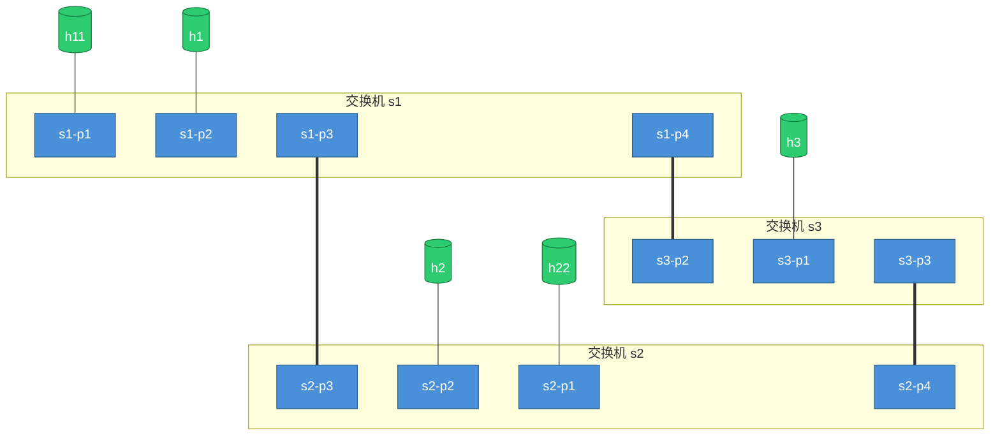
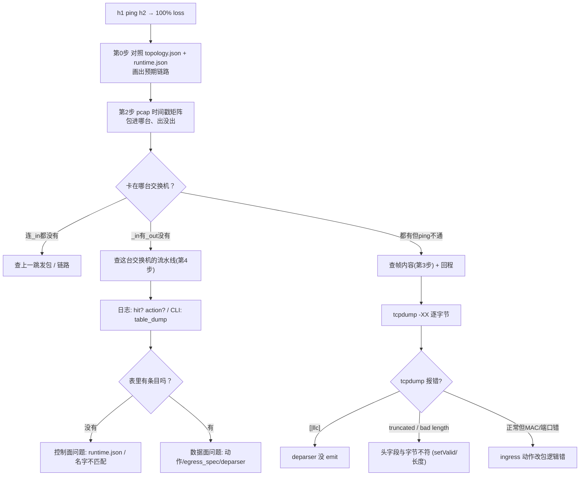

# P4 调试实战：从 `ping 不通` 到定位流水线具体环节

> 这份文档是"真正的调试流程"——不是命令清单，而是一套**可复现的排查路线**：
> 从 `ping` 开始，用指令一步步确定"包到哪了、被谁改了、改对了没"，最终**定位到
> parser / verify_checksum / ingress / egress / compute_checksum / deparser 六阶段中的
> 哪一个、哪一句**，或确认是控制面问题。全程用我们真实踩过的坑做例子。

---

## 第 0 步：先建立"预期"（不看代码就调试=瞎调）

调试前，先对照**拓扑图和每台交换机的配置**，在脑子里画一条"包应该怎么走"的线。这是第 1 步的前提。

### 0.1 看拓扑：`topology.json`

```json
"links": [ ["h1","s1-p1"], ["h2","s1-p2"], ["h1"→s1-p1 ...] ]
```

- 记下：**哪台主机挂在哪台交换机的哪个端口**，交换机之间怎么连。
- 例：basic 的 pod-topo 里 h1→s1-p1、h2→s1-p2，所以 `h1 ping h2` 只过 s1 一台。

### 0.2 看每台交换机的控制面配置：`sN-runtime.json`

```json
{ "table": "MyIngress.ipv4_lpm",
  "match": { "hdr.ipv4.dstAddr": ["10.0.2.2", 32] },
  "action_name": "MyIngress.ipv4_forward",
  "action_params": { "dstAddr": "08:00:00:00:02:22", "port": 2 } }
```

- 记下：**这台交换机对"去某个 IP 的包"该转发到哪个口、改什么 MAC**。
- **每台交换机一张表**，别只看一台——多跳路径要每跳都查。

### 0.3 写出"预期链路"

```
h1(10.0.1.1) →[s1 port1]→ s1 查表 →[s1 port2]→ h2(10.0.2.2)
   dstMAC=网关      dstAddr=10.0.2.2      dstMAC=08:..:02:22
   cd /workspace/tutorials/exercises/source_routing
```

> 有了这条预期，后面每一步"包应该在哪、应该长什么样"就清楚了。




## 第 1 步：`ping` 是端到端探测，先跑它

```bash
mininet> h1 ping h2 -c 1
```

结果分三种，各指不同方向：

| ping 结果 | 说明 | 下一步 |
|---|---|---|
| `0% packet loss` | 通了 | 恭喜，不用调（若功能不对再看具体行为） |
| `100% packet loss` | **包没往返** | 进入第 2 步：查包到哪 |
| `Destination Host Unreachable` | 本机 ARP/路由问题 | 先查主机配置（`h1 arp`、`h1 route`） |

> ping 不通 ≠ 全是数据面问题。它只是"症状"，原因在下面几层里。

---

## 第 2 步：包到哪了？——用 pcap 的"时间戳矩阵"定位卡点

**这是最关键的定位手段**。`make run` 时交换机在每个端口的入/出都写 pcap：
`pcaps/s1-eth1_in.pcap`（s1 的 1 号口进来的包）、`s1-eth2_out.pcap`（s1 的 2 号口出去的包）。

### 2.1 打一个包，立刻看各点有没有更新

```bash
mininet> h1 ping h2 -c 1
# 然后在另一个终端看（mri 例）：
tshark -r pcaps/s1-eth1_out.pcap -V -c 1 # 包出没出eth1也就是p1端口

tcpdump -r pcaps/s2-eth2_in.pcap -nn | tail -2     # 包进 s2（h2 那侧）
tcpdump -r pcaps/s2-eth3_out.pcap -nn | tail -2    # s2 往 s1 转发？
tcpdump -r pcaps/s1-eth3_in.pcap -nn | tail -2     # 包进 s1
tcpdump -r pcaps/s1-eth2_out.pcap -nn | tail -2    # s1 往 h1 转发？
```

### 2.2 用"时间戳矩阵"判断卡在哪

假设预期路径是 h1 → s1 → s2 → h2（去程），列一张表：

| 检查点 | 文件 | 有包？ |
|---|---|---|
| 包进 s1 | `s1-eth1_in` | ✅ |
| 包出 s1 往 s2 | `s1-eth3_out` | ❌ ← **卡在 s1** |
| 包进 s2 | `s2-eth3_in` | — |

**判读**：
- `_in` 有、对应 `_out` 没有 → **包被这台交换机内部处理丢了** → 查它的流水线（第 4 步）。
- 连 `_in` 都没有 → 包没到这台交换机 → 上一跳没发 / 链路问题 / 发包问题。
- 全链路 `_in`/`_out` 都有但 ping 不通 → 帧内容坏了（第 3 步）或回程断了。

> 关键：**时间戳**。`_in` 有更新而 `_out` 停在旧时间 = 这轮包进交换机但没出来。

---

## 第 3 步：看包头——用工具解码（别硬读 hex）

pcap 只看"有没有"；要看"对不对"，用工具让**字段名直接打出来**，不用 `-XX` 数十六进制偏移。

> **工具够用就好**：大部分调试只需要"这个口有没有包 + 包的关键字段"，`tcpdump -e -nn -v`
> 就完全够。**图形化 Wireshark（GUI）是可选**——只在你想视觉上追一条流、Follow Stream 看载荷、
> 或看自定义头展开时才需要（WSLg 直接跑 `wireshark 文件.pcap`，或拷 pcap 到本地打开）。
> 别为了看图先装一堆东西，先跑通命令再说。

### 3.1 三个递进的命令

```bash
# ① 快速看 MAC + 类型 + 帧长（不看 hex）
tcpdump -r pcaps/s1-eth2_out.pcap -e -nn

# ② 看 TTL/协议/长度/校验和
tcpdump -r pcaps/s1-eth2_out.pcap -nn -v        # -vv / -vvv 更详细

# ③ 完整逐字段解码（Wireshark 风格，最省眼）
tshark -r pcaps/s1-eth2_out.pcap -V
```

### 3.2 `tcpdump -e -nn -v` 直接读出的字段（示例）

```
08:00:00:00:01:00 > 08:00:00:00:01:01, ethertype IPv4 (0x0800), length 72:
    (tos 0x0, ttl 62, id 1, offset 0, flags [none], proto UDP (17),
     length 58, options (unknown 31), bad cksum 60b0 (->4197)!)
    10.0.2.2.1234 > 10.0.1.1.4321: [udp sum ok] UDP, length 10
```

| 你关心什么 | 输出里看哪 |
|---|---|
| dstMAC / srcMAC 改对没 | 第一段 `src > dst` |
| TTL 减没减 | `ttl 62`（入包 64 → 出包 62 = 减了 2 跳 ✓） |
| totalLen/ihl | `length 58` / `options (...)` |
| 校验和 | `bad cksum ... !`（异常会直接标 `!`） |
| 协议/端口 | `proto UDP (17)` / `1234 > 4321` |

### 3.3 `tshark -V`：完整逐字段解码（含自定义头）

```
Frame Length: 72 bytes
Destination: 08:00:00:00:01:01          ← MAC 直接给名字
Source: 08:00:00:00:01:00
Type: IPv4 (0x0800)
Version: 4
Header Length: 40 bytes (10)            ← ihl
Total Length: 58
Protocol: UDP (17)
Header Checksum: 0x60b0
Source Address: 10.0.2.2                ← IP 直接给
Destination Address: 10.0.1.1
Options: (20 bytes)                     ← IP 选项（MRI 等）
Source Port: 1234                       ← UDP 端口
Destination Port: 4321
```

> 自定义头（MRI 的 swtrace、myTunnel 的 dst_id 等）在 `tshark -V` 里也能展开看，
> 不用自己数偏移——这是**读头的最省力方式**。

### 3.4 tcpdump 的报错 = 最强线索

> 先把工具搭好，判断规则见下。下表因为含 `|` 符号在 markdown 表格里会乱码，所以改用
> 逐条详解 + 真实示例。

### 3.4 tcpdump 报错 = 最强线索（逐条详解 + 示例）

#### 3.4.1 


#### ① `[|llc]`（帧只有几十字节）

- **报错长什么样**：
  ```
  tcpdump: 15:30:37.273138  [|llc]
  ```
- **含义**：tcpdump 想按以太网类型（0x0800=IPv4）解帧，但 etherType 字段不是合法值
  （变成 0x0000 之类），于是尝试按 802.3/LLC 解析，也没解出来 → 以太网头坏了。
- **常见场景**：**deparser 没 emit** 以太网/IP 头，出帧直接从载荷开始。
- **真实示例（basic 练习）**：deparser 是空的（没写 `packet.emit`），出帧变成：
  ```
  0800 2be4 4336 0001 1d86 ...   ← 以太网头没了，直接从 ICMP 数据开始
  ```
  前面 14 字节不是合法 MAC/etherType → tcpdump 报 `[|llc]`。
- **指向环节**：**Deparser**（忘了 `emit(ethernet)` / `emit(ipv4)`）。

#### ② `truncated-ip - 8 bytes missing`

- **报错长什么样**：
  ```
  IP truncated-ip - 8 bytes missing! 10.0.2.2 > 10.0.1.1: UDP, bad length 29464 > 10
  ```
- **含义**：IP 头的 `totalLen`（或 ihl）声称这个 IP 包有 N 字节，但帧里实际字节比 N 少
  8（或更多）→ **头字段和实际字节对不上**。
- **常见场景**：改动了头部长度字段（`ihl`/`totalLen`/`optionLength`）但**对应的头字节没真正
  发出去**。
- **真实示例（mri 忘 setValid）**：`add_swtrace` 把 `count` 改成 1、`ihl+2`、`totalLen+8`，
  但 `push_front` 压入的 swtrace 没 `setValid()` → deparser 的 `emit(swtraces)` 跳过它 →
  8 字节没上线上。帧实际 56 字节，但 IP 头说 64 → 差 8 字节。
- **指向环节**：**Deparser** 或**改了长度字段的动作**（Egress/Ingress）。

#### ③ `bad length 29464 > 10`

- **报错长什么样**：
  ```
  10.0.2.2.20532 > 10.0.1.1.8297: UDP, bad length 29464 > 10
  ```
- **含义**：UDP 头的 length 字段（或端口）错得离谱（29464 这种数字），说明**帧错位**——
  tcpdump 把不该是 UDP 头的字节当成了 UDP 头。
- **常见场景**：deparser 的 emit 顺序错（头排列错位）、或头字节缺失导致后面整体偏移。
- **指向环节**：**Deparser**（顺序/字节对齐）。

#### ④ `[|udp]`

- **报错长什么样**：
  ```
  IP truncated-ip - 16 bytes missing! 10.0.2.2 > 10.0.1.1:  [|udp]
  ```
- **含义**：tcpdump 知道是 IP，但 UDP 头解析失败（常伴随前面的 truncated/bad length）。
- **常见场景**：同 ②③——中间少了字节，UDP 头位置错乱。
- **指向环节**：**Deparser**。

#### ⑤ `bad cksum ... !`

- **报错长什么样**：
  ```
  (tos 0x0, ttl 62, ... bad cksum 60b0 (->4197)!)
  ```
- **含义**：IP/UDP/TCP 校验和与字段内容不匹配。注意 tcpdump 抓的帧有时校验和是**捕获后才算**
  的假象（offload），但如果 `bad cksum` 持续出现且对端丢包，就是真问题。
- **常见场景**：**改了头（TTL、IP 选项等）但没重算校验和**（MyComputeChecksum 缺失或没覆盖
  该字段）。
- **真实示例**：basic 里 `ipv4_forward` 改了 TTL，若 `update_checksum` 没配好，对端丢弃。
- **指向环节**：**ComputeChecksum**。

#### ⑥ 包能解析，但 MAC/端口/内容不对

- **含义**：tcpdump 一切正常，但和你的"预期"（第 0 步画的那条线）不符。
- **常见场景**：ingress 动作改包逻辑错（MAC 写错、端口写错、参数顺序错）。
- **真实示例**：`hdr.ethernet.dstAddr = dstAddr` 里 `dstAddr` 参数被控制面填错（如填了源 MAC），
  出帧的 dst MAC 就不是目标主机。
- **指向环节**：**Ingress** 的动作体 + 控制面填的参数。

---

## 第 4 步：定位是流水线**哪个阶段、哪句**出错

包进了交换机但 `_out` 没有 / 帧坏了，就要钻进流水线。六阶段各有"案发现场"：

```
Parser → VerifyChecksum → Ingress → (流量管理器排队) → Egress → ComputeChecksum → Deparser
```

### 4.1 每个阶段怎么看

| 阶段 | 怎么查 | 看什么 |
|---|---|---|
| **Parser** | `tail logs/sN.log` 搜 `Parser state` / `Parser 'parser': end` | 有没有解析、`key is 86dd` 等 etherType；`verify` 报错会在这里 |
| **VerifyChecksum** | 日志 `checksum` / 出错时 parser_error | 校验失败会拒包 |
| **Ingress** | 搜 `Applying table 'MyIngress.ipv4_lpm'` / `hit` / `Action entry` | 表命中没、动作执行没、参数对不对 |
| **Egress** | 搜 `Applying table 'MyEgress.swtrace'` 等 | egress 动作（如遥测写入）执行没 |
| **ComputeChecksum** | 日志 `update_checksum` / 出帧校验和 | 改头后校验和重算 |
| **Deparser** | **看 `_out` pcap**（它是 deparser 的产物） | 帧长度、头顺序、字节数 |

> **关键**：parser 的问题看日志，ingress/egress 的**决策**看日志，deparser 的问题**只能看出帧 pcap**（日志不报错，它就是"把 hdr 拼成字节"，拼错只有字节级才看得出来）。

### 4.2 逐阶段排查命令

```bash
# Parser 阶段
grep -E "Parser state|key is" logs/s1.log | tail          # 解析到了哪个状态

# Ingress 阶段
grep -E "Applying table|hit|miss|Action entry" logs/s1.log | tail
#   "Applying table 'MyIngress.ipv4_lpm'" → 查了表
#   "hit with handle 2"                    → 命中
#   "Action entry is MyIngress.ipv4_forward - 800..,2," → 动作+参数

# Egress 阶段
grep -E "MyEgress|add_swtrace" logs/s1.log | tail

# 校验和
grep -iE "checksum" logs/s1.log | tail
```

### 4.3 用 `simple_switch_CLI` 交叉验证（查控制面/表状态）

```bash
simple_switch_CLI --thrift-port 9090    # s1；每台交换机 +1
RuntimeCmd: show_tables                 # 有哪些表
RuntimeCmd: table_info MyIngress.ipv4_lpm    # 表信息
RuntimeCmd: table_dump MyIngress.ipv4_lpm    # 表项内容 ← 确认控制面配没配
```

---

## 第 5 步：数据面 vs 控制面，怎么分

| 症状 | 是数据面还是控制面 |
|---|---|
| 表里**有**条目但包不进（_in 没有） | 都不是（链路/发包） |
| 表里**有**条目、包**进**交换机但 `_out` 没有 | **数据面**：动作没设 egress_spec / 被 default 丢 |
| 表里**没**条目 | **控制面**：runtime.json 没配 / 名字和 p4info 不一致 / 没下发 |
| 表命中、动作执行、_out 有包但帧坏 | **数据面**：deparser / 长度字段 / 校验和 |
| 表项下发时报错（helper AttributeError） | **控制面**：表名/字段名/参数名写错 |

**一句话分法**：
- 用 `table_dump` 看**表里有没有** → 判断控制面；
- 用 `_in`/`_out` pcap + 日志看**包处理对不对** → 判断数据面。

---

## 第 6 步：从"症状"反推"哪一句"（真实案例）

### 案例 A：basic 的 deparser 忘 emit（ping 100% 丢）

```
第2步：s1-eth1_in 有包 ✅，s1-eth2_out 只有 104 字节的怪帧
第3步：出帧 [|llc]，56 字节，从 ICMP 载荷开始，没有以太网头/IP头
第4步：日志显示表命中、动作执行正常（ingress OK）
推断：ingress 决策没错，但 deparser 没把 hdr 拼回去
定位：MyDeparser 里 packet.emit(...) 一个都没写
```

### 案例 B：mri 的 add_swtrace 忘 setValid（receive 没打印）

```
第2步：s2-eth3_out 有包 ✅，能到 h1（s1-eth2_out 有 30 个）
第3步：tcpdump 报 truncated-ip - 8 bytes missing
      字节解码：04 d2 10 e1 00 12 1c 7b = UDP头（sport 1234, dport 4321）
      说明 swtrace 的 8 字节没上线上，count/ihl 却声称有
第4步：日志显示 egress 的 add_swtrace 执行了（count 加了）
推断：push_front 压入的元素没 setValid → deparser emit 跳过
定位：add_swtrace 里缺 hdr.swtraces[0].setValid();
```

### 案例 C：表没命中（包进交换机但 default 丢）

```
第2步：s1-eth1_in 有 ✅，s1-eth2_out 无 ❌
第4步：日志 "Applying table 'MyIngress.ipv4_lpm'" 后没有 "hit"（或 "no match"）
第5步：table_dump MyIngress.ipv4_lpm 显示条目是空的/没有这条
定位：控制面 runtime.json 没给这台交换机配这条，或匹配键（IP/前缀）对不上
```

---

## 第 7 步：对照拓扑逐交换机核对（多跳路径必做）

多跳转发（如 mri 的 h2→s2→s1→h1），**每一跳都要单独验证**：

```bash
# 去程：h2 → s2 → s1 → h1
tcpdump -r pcaps/s2-eth2_in.pcap  -nn   # h2 发出，进 s2
tcpdump -r pcaps/s2-eth3_out.pcap -nn   # s2 → s1
tcpdump -r pcaps/s1-eth3_in.pcap  -nn   # 进 s1
tcpdump -r pcaps/s1-eth2_out.pcap -nn   # s1 → h1

# 回程：h1 → s1 → s2 → h2（ping 要往返，回程断了也一样不通）
tcpdump -r pcaps/s1-eth2_in.pcap  -nn
tcpdump -r pcaps/s1-eth3_out.pcap -nn
tcpdump -r pcaps/s2-eth3_in.pcap  -nn
tcpdump -r pcaps/s2-eth2_out.pcap -nn
```

每跳分别看：
- **这台交换机的 runtime.json**：有没有这条目的的路由、出端口对不对。
- **出帧的 dst MAC**：是不是下一跳的接口 MAC（不是最终主机 MAC，除非直连）。
- **TTL**：每跳减 1。

---

## 总结：一次标准调试的完整路线



**心法**：
1. **先定位到"哪一台、哪一步"**，再谈"哪一句"——别在没确认包走到哪时就猜代码。
2. **parser 看日志、ingress/egress 看日志、deparser 看出帧 pcap**。
3. **帧的"头字段"和"实际字节"必须一致**——不一致就是 deparser/长度字段的错。
4. **控制面 = 表里有没有**（table_dump），**数据面 = 包处理对不对**（pcap+日志）。