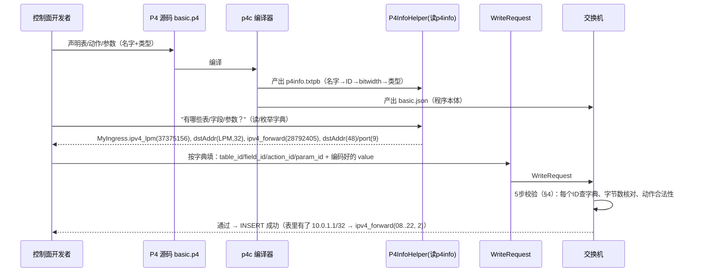

# P4：从 p4info 到 WriteRequest —— 字段一一对应全解析

> 这份文档回答一个核心问题：**控制面看到 p4info 里的表/动作/参数后，该"回"什么格式的 WriteRequest？
> 发回去的信息怎么和 p4info 里的字段一一对应，让交换机识别？**
>
> 一句话答案：**WriteRequest 里所有数字（table_id、field_id、action_id、param_id、value）都是从 p4info
> 里"抄"来的——p4info 是"字典"，WriteRequest 是"填好的表单"，每个数字都能在字典里查到它代表什么。**
>
> 本文用 basic 的真实文件讲解：`basic.p4`（P4 源码）→ `basic.p4info.txtpb`（p4info 契约）→
> `basic.json`（程序本体）→ WriteRequest（控制面发的消息），四者逐字段对照。

---

## 1. 三份文件 + 一条消息，先摆出来

### 1.1 源头：basic.p4 里声明的表（P4 源码）

```p4
table ipv4_lpm {                              // ← 表名 ipv4_lpm
    key = {
        hdr.ipv4.dstAddr: lpm;                // ← 匹配字段 hdr.ipv4.dstAddr，类型 lpm
    }
    actions = {
        ipv4_forward;                         // ← 允许动作1（带参数 dstAddr, port）
        drop;                                 // ← 允许动作2
        NoAction;                             // ← 允许动作3
    }
    size = 1024;
    default_action = drop();                  // ← 默认动作
}

action ipv4_forward(macAddr_t dstAddr, egressSpec_t port) { ... }   // ← 参数：dstAddr(48bit), port(9bit)
```

### 1.2 编译产物①：p4info（控制面的字典）

```protobuf
# proto-file: p4/config/v1/p4info.proto
# proto-message: p4.config.v1.P4Info
pkg_info { arch: "v1model" }

tables {
  preamble { id: 37375156  name: "MyIngress.ipv4_lpm"  alias: "ipv4_lpm" }
  match_fields { id: 1  name: "hdr.ipv4.dstAddr"  bitwidth: 32  match_type: LPM }
  action_refs { id: 28792405 }     # ipv4_forward
  action_refs { id: 25652968 }     # drop
  action_refs { id: 21257015 }     # NoAction
  initial_default_action { action_id: 25652968 }   # default_action = drop
  size: 1024
}

actions {
  preamble { id: 28792405  name: "MyIngress.ipv4_forward"  alias: "ipv4_forward" }
  params { id: 1  name: "dstAddr"  bitwidth: 48 }
  params { id: 2  name: "port"     bitwidth: 9 }
}
actions { preamble { id: 25652968  name: "MyIngress.drop"  alias: "drop" } }
actions { preamble { id: 21257015  name: "NoAction" } }
type_info {}
```

### 1.3 编译产物②：basic.json 里对应的表与动作（程序本体，给交换机执行）

```json
// 表（basic.json 里 name: "MyIngress.ipv4_lpm"，BMv2 内部 id=0）
{
  "name": "MyIngress.ipv4_lpm",
  "id": 0,
  "key": [ { "match_type": "lpm", "name": "hdr.ipv4.dstAddr", "target": ["ipv4", "dstAddr"] } ],
  "match_type": "lpm",
  "max_size": 1024,
  "action_ids": [2, 1, 0],
  "actions": ["MyIngress.ipv4_forward", "MyIngress.drop", "NoAction"],
  "default_entry": { "action_id": 1, "action_data": [] }
}

// 动作（basic.json 里 name: "MyIngress.ipv4_forward"，BMv2 内部 id=2）
{
  "name": "MyIngress.ipv4_forward",
  "id": 2,
  "runtime_data": [
    { "name": "dstAddr", "bitwidth": 48 },
    { "name": "port",    "bitwidth": 9 }
  ],
  "primitives": [ ... egress_spec = port; srcAddr = dstAddr; dstAddr = dstAddr; ttl = ttl-1 ... ]
}
```

> ⚠️ **注意两套 ID**：p4info 用 **P4Runtime 全局 ID**（表 37375156、动作 28792405）；
> basic.json 用 **BMv2 内部 ID**（表 0、动作 2）。请求#1（SetForwardingPipelineConfig）就是让
> 交换机把这两套对应起来。**控制面只用 p4info 那套，别用 basic.json 的。**

### 1.4 控制面发回的消息：WriteRequest（填好的表单）

```protobuf
WriteRequest {
  device_id: 0
  election_id { high: 0  low: 1 }
  updates {
    type: INSERT
    entity {
      table_entry {
        table_id: 37375156
        match { field_id: 1  lpm { value: "\x0a\x00\x01\x01"  prefix_len: 32 } }
        action { action_id: 28792405
                 params { param_id: 1  value: "\x08\x00\x00\x00\x02\x22" }
                 params { param_id: 2  value: "\x00\x02" } }
      }
    }
  }
}
```

---

## 2. 逐字段对应表（拿 basic 的真实数值）

### 2.1 表部分：table_id

| p4info 字段 | p4info 值 | → WriteRequest 字段 | WriteRequest 值 |
|---|---|---|---|
| `tables.preamble.id` | `37375156` | `table_entry.table_id` | `37375156` |
| `tables.preamble.name` | `"MyIngress.ipv4_lpm"` | （不发名字，只发 ID） | — |

### 2.2 匹配字段部分：field_id + 匹配值

| p4info 字段 | p4info 值 | → WriteRequest 字段 | WriteRequest 值 |
|---|---|---|---|
| `match_fields.id` | `1` | `match.field_id` | `1` |
| `match_fields.bitwidth` | `32` | `match.lpm.value` 的**字节数** | 编码成 4 字节 `\x0a\x00\x01\x01` |
| `match_fields.match_type` | `LPM` | `match.lpm`（决定用 lpm 分支） | `lpm { value, prefix_len }` |
| （LPM 特有） | — | `match.lpm.prefix_len` | `32`（控制面给） |

### 2.3 动作部分：action_id + 参数

| p4info 字段 | p4info 值 | → WriteRequest 字段 | WriteRequest 值 |
|---|---|---|---|
| `actions.preamble.id` | `28792405` | `action.action_id` | `28792405` |
| `actions.params[0].id` | `1` | `action.params[0].param_id` | `1` |
| `actions.params[0].bitwidth` | `48` | `action.params[0].value` 的**字节数** | 编码成 6 字节 `\x08\x00\x00\x00\x02\x22` |
| `actions.params[1].id` | `2` | `action.params[1].param_id` | `2` |
| `actions.params[1].bitwidth` | `9` | `action.params[1].value` 的**字节数** | 编码成 2 字节 `\x00\x02` |

> **关键：bitwidth 决定 value 编码成几个字节**。48 bit → 6 字节，9 bit → 向上取整 2 字节，32 bit → 4 字节。

---

## 3. 对应关系总图（mermaid）

```mermaid
flowchart TD
    subgraph P4INFO["p4info.txtpb（控制面的字典）"]
        T["tables.preamble.id = 37375156<br/>name = MyIngress.ipv4_lpm"]
        MF["match_fields.id = 1<br/>name = hdr.ipv4.dstAddr<br/>bitwidth = 32<br/>match_type = LPM"]
        A["actions.preamble.id = 28792405<br/>name = MyIngress.ipv4_forward"]
        P1["params.id = 1<br/>name = dstAddr<br/>bitwidth = 48"]
        P2["params.id = 2<br/>name = port<br/>bitwidth = 9"]
    end

    subgraph WRITE["WriteRequest（控制面发的表单）"]
        TID["table_id: 37375156"]
        FID["match.field_id: 1<br/>lpm.value: 4字节<br/>lpm.prefix_len: 32"]
        AID["action.action_id: 28792405"]
        PV1["params.param_id: 1<br/>value: 6字节 = 08..22"]
        PV2["params.param_id: 2<br/>value: 2字节 = 2"]
    end

    T -- "ID 抄过来" --> TID
    MF -- "ID/类型/长度决定" --> FID
    A -- "ID 抄过来" --> AID
    P1 -- "ID + 位宽决定长度" --> PV1
    P2 -- "ID + 位宽决定长度" --> PV2
flowchart LR
    subgraph CHECK["交换机收到 WriteRequest 后的 5 步校验"]
        C1["① table_id 37375156<br/>查翻译表 → ipv4_lpm ✓"]
        C2["② field_id 1<br/>字段存在 ✓<br/>match_type=LPM 要求 lpm 分支 ✓"]
        C3["③ value 4字节 == 32bit ✓<br/>prefix_len 32 ≤ 32 ✓"]
        C4["④ action_id 28792405<br/>在 action_refs 里 ✓"]
        C5["⑤ param_id 1/2<br/>位宽 48→6字节、9→2字节 ✓"]
    end
    C1 --> C2 --> C3 --> C4 --> C5 --> RESULT["INSERT 成功<br/>表里出现：10.0.1.1/32 → ipv4_forward(08..22, 2)"]
```

---

## 4. 交换机如何"一一对应并识别"（详细验证流程）

交换机收到 WriteRequest 后，按顺序做 5 次"查字典"校验：

```
① table_id = 37375156
      └─ 在"翻译表"里查（请求#1 建好的映射）→ 37375156 ↔ 内部表 ipv4_lpm ✓
         （若查不到 → 报"表不存在"）

② match.field_id = 1
      └─ 查该表的 match_fields → 存在 field_id=1 = hdr.ipv4.dstAddr ✓
      └─ 看它的 match_type = LPM → 所以要求消息里是 lpm 分支（字段类型必须一致！）
         （如果 p4info 说 LPM 你却发 exact → 报"匹配类型不匹配"）

③ lpm.value 4 字节 + prefix_len 32
      └─ 校验 value 字节数 == bitwidth/8（32bit → 4字节）✓
      └─ 校验 prefix_len ≤ 32 ✓
      └─ 存进表的 key：10.0.1.1/32

④ action.action_id = 28792405
      └─ 查该表 action_refs → 28792405 在允许列表里 ✓
         （p4info 里 action_refs 有 28792405/25652968/21257015，
          发一个不在列表里的 action_id → 报"该表不允许这个动作"）

⑤ params: param_id=1 值6字节, param_id=2 值2字节
      └─ 查该动作的 params → param_id 1=dstAddr(48bit→6字节)、2=port(9bit→2字节) ✓
      └─ 每个 value 字节数 == 对应 bitwidth 编码长度 ✓
      └─ 填进动作的"空槽"：dstAddr=08..22、port=2

全部通过 → INSERT 成功，表里出现：10.0.1.1/32 → ipv4_forward(08..22, 2)
```

**这就是"一一对应"的精确含义：** 交换机拿着 p4info（请求#1 时它也有）当字典，
把 WriteRequest 里每个数字 ID 逐个查表验证，全对才写入。

---

## 4.5 补充：lpm 的 value 和 prefix_len 到底什么意思？（为什么不是"值+掩码"）

**`value` = 前缀的值（完整 32 位都在里面）；`prefix_len` = 这个值里**前多少位算数**。
掩码是隐含的：prefix_len=24 等价掩码 255.255.255.0，prefix_len=32 等价掩码 255.255.255.255。**

```
表项 value=10.0.1.1(32bit) 00001010 00000000 00000001 00000001
包   dstAddr=10.0.1.5      00001010 00000000 00000001 00000101
prefix_len=32 → 只比较前32位 → 最后一位 1 vs 5 → 不同 → 不匹配 ✗

表项 value=10.0.2.0  prefix_len=24
包   dstAddr=10.0.2.99
→ 只比较前24位：00001010 00000000 00000010 全等 → 匹配 ✓（后8位"不在乎"）
```

| | LPM | TERNARY |
|---|---|---|
| 给什么 | `value` + `prefix_len` | `value` + `mask`（显式） |
| 掩码 | **隐含**（由 prefix_len 推出） | 显式自己填 |
| 不关心位 | 尾部连续 | 任意位置 |

helper.py 印证：LPM 分支只填 `value + prefix_len`（94-97 行），TERNARY 才填 `value + mask`（98-101 行）。

**为什么"最长前缀优先"**：多条表项都匹配时（如同时有 /8 和 /24），prefix_len 大的胜出。
这就是 `LpmTiebreakerTest`（basic_fwd.py:169-193）测的语义。

一句话：**value 是前缀的值，prefix_len 是前多少位算数，掩码由 prefix_len 推出；
匹配 = 包 dstAddr 前 prefix_len 位与 value 前 prefix_len 位逐位全等即命中。**

---

## 5. 为什么非要用 ID 和二进制，不用名字和字符串？

| 用名字 | 用数字 ID + 二进制 |
|---|---|
| `"MyIngress.ipv4_lpm"` 一串字符串，网络传输占空间 | `37375156` 一个 4 字节整数，省带宽 |
| 交换机比对字符串慢 | 比对整数快 |
| 名字还可能重复/改名 | ID 唯一且稳定 |

P4Runtime 规范规定：**线上传输只允许数字 ID + 原始字节**。helper.py 的职责就是在两边做翻译
（名字→ID、字符串→字节），switch.py 负责传输——这就是为什么你要经过这两层工具。

---

## 6. 值是怎么"编码"成字节的（convert.py）

WriteRequest 里的 value 都是原始字节，编码规则（`convert.py`）：

| 你要填的值 | 类型 | 编码结果 | 依据 |
|---|---|---|---|
| `'10.0.1.1'` | IPv4 字符串 | `\x0a\x00\x01\x01`（4 字节） | `socket.inet_aton`；p4info 说 bitwidth=32 |
| `'08:00:00:00:02:22'` | MAC 字符串 | `\x08\x00\x00\x00\x02\x22`（6 字节） | `bytes.fromhex`；bitwidth=48 |
| `2` | 整数 | `\x00\x02`（2 字节） | 按 bitwidth=9 补零；`encodeNum` |
| `32`（前缀长度） | 整数 | 不是字节，直接填 `prefix_len = 32` | LPM 特有字段 |

> 字节数必须和 bitwidth 对应，helper 的 `encode()` 最后有 `assert(len==byte_len)` 兜底，填错当场报错。

---

## 7. 从 p4info 到 WriteRequest 的"开发心理过程"

假设你是控制面开发者，看到 p4info，你会这样推导出要发的 WriteRequest：

```
1. "我要往哪张表插？"        → tables 只有一张 → table_id = 37375156
2. "key 是什么、怎么匹配？"   → match_fields: hdr.ipv4.dstAddr, LPM, 32bit
                              → match { field_id: 1, lpm { value, prefix_len } }
                              → value = 把"我要匹配的IP"编码成4字节，prefix_len = 我想要的/32
3. "命中后执行什么动作？"     → 挑 action_refs 里合法的 → action_id = 28792405 (ipv4_forward)
4. "动作有哪些参数要填？"     → params: dstAddr(48bit)、port(9bit)
                              → param_id 1 填下一跳MAC（6字节）、param_id 2 填端口（2字节）
5. "哪个动作当默认？"         → initial_default_action = drop（一般不用主动改）
```

用代码实现（basic_fwd.py 的真实写法）：

```python
entry = p4info_helper.buildTableEntry(
    table_name='MyIngress.ipv4_lpm',        # → 内部查 p4info 拿 table_id=37375156
    match_fields={
        'hdr.ipv4.dstAddr': ('10.0.1.1', 32)  # → field_id=1，LPM：value 编码 + prefix_len=32
    },
    action_name='MyIngress.ipv4_forward',   # → 查 p4info 拿 action_id=28792405
    action_params={
        'dstAddr': '08:00:00:00:02:22',     # → param_id=1，编码成 6 字节
        'port': 2,                          # → param_id=2，编码成 2 字节
    })
sw.WriteTableEntry(entry)                   # → 包进 WriteRequest 发给交换机
```

---

## 8. 三个最容易错的点

| 坑 | 为什么错 | 正确做法 |
|---|---|---|
| table_id 写成 BMv2 内部 ID（0） | p4info 给的是 P4Runtime ID（37375156） | 用 helper.get_tables_id(name) 拿 |
| 值字节数不对 | bitwidth 决定长度（9bit 是 2 字节不是 1） | 让 helper.encode 处理，别手写 |
| match 类型用错分支（该 lpm 用 exact） | p4info 声明 LPM，消息必须 lpm | 照着 p4info 的 match_type 发 |

---

## 9. 完整四步链路（mermaid 时序图）



---

## 10. 一句话总结

> **WriteRequest 不是随便写的——它是 p4info 的"数字副本"：表/字段/动作/参数各用一个 ID，
> 值按 bitwidth 编码成字节。交换机手里也有同一份 p4info（请求#1 给的），收到 WriteRequest 后
> 把每个 ID 逐个查字典验证（表存在→字段类型对→动作合法→参数位宽对），全对才 INSERT。
> 所以"发回去的信息和 p4info 一一对应"，就是"每个 ID 都能在字典里查到、每个字节数都对得上"。**