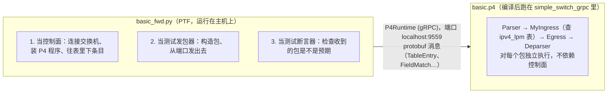
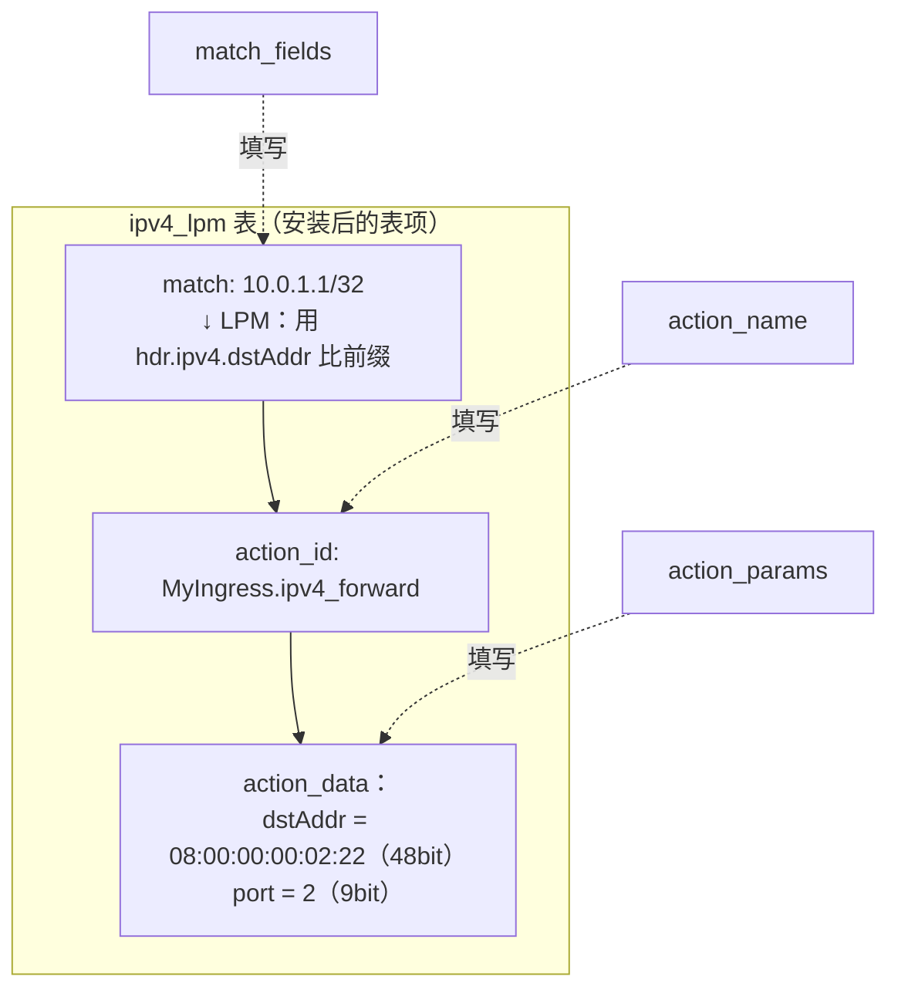
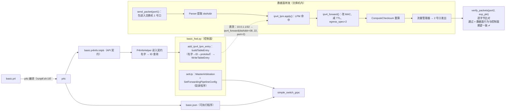
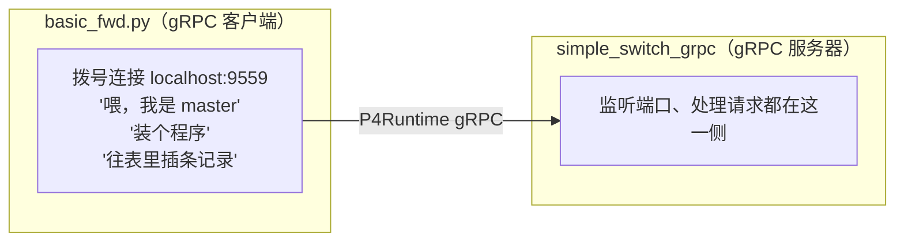
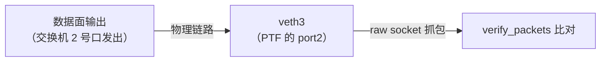

# basic.p4 与 PTF 控制面代码的配合全解析

> 本文把两套代码逐行对起来讲：
> - **数据面**：`tutorials/exercises/basic/solution/basic.p4`（P4 程序，跑在交换机里）
> - **控制面 + 测试**：`tutorials/exercises/basic/ptf/basic_fwd.py`（PTF 测试，通过 P4Runtime 控制交换机）
>
> 看完你会彻底明白：`basic.p4` 里声明的表/动作/参数，是怎么被 Python 控制面代码找到、填值、下发，然后驱动数据面完成转发的。
>
> **维护约定**：以后关于这套代码的疑问/解释（如 ptf 是什么、gRPC 监听在哪、JSON 误解等），都会同步更新到本文档对应章节，这里就是唯一权威来源。
>
> 💡 如果你需要**从零开始的逐行讲解**（连 import、客户端/服务器、protobuf 是什么都讲的那种），请先看《[P4从零开始-控制面与数据面全流程.md](./P4从零开始-控制面与数据面全流程.md)》，它把 basic_fwd.py / helper.py / switch.py / basic.p4 每一行都拆开讲了；本文档是它的"速查+答疑版"。

---

## 1. 两套代码的角色划分



**关键桥梁：编译时生成的 `build/basic.p4info.txtpb`（p4info 文件）。**

- `p4c` 编译 `basic.p4` 时，除了产出可执行的 `basic.json`，还会产出一份 p4info——它就像"数据面暴露给控制面的 API 契约"。
- 里面用**名字 + 数字 ID** 记录了所有表、动作、字段、参数的信息。
- 控制面代码就是照着 p4info 里的名字来定位表/动作的，所以两边能对上。

---

## 2. 桥梁：p4info 文件里到底有什么

这是刚用 `p4c` 编译 `solution/basic.p4` 得到的 `build/basic.p4info.txtpb`：

```protobuf
tables {
  preamble {
    id: 37375156
    name: "MyIngress.ipv4_lpm"     # ← basic.p4:102 的表
    alias: "ipv4_lpm"
  }
  match_fields {
    id: 1
    name: "hdr.ipv4.dstAddr"       # ← basic.p4:104 的 key
    bitwidth: 32
    match_type: LPM                # ← 对应 lpm 匹配类型
  }
  action_refs {
    id: 28792405                   # MyIngress.ipv4_forward
  }
  action_refs {
    id: 25652968                   # MyIngress.drop
  }
  action_refs {
    id: 21257015                   # NoAction
  }
  initial_default_action { action_id: 25652968 }  # default_action = drop
  size: 1024
}
actions {
  preamble {
    id: 28792405
    name: "MyIngress.ipv4_forward"
    alias: "ipv4_forward"
  }
  params {
    id: 1
    name: "dstAddr"                # ← basic.p4:95 的 action 参数
    bitwidth: 48                   #    macAddr_t = bit<48>
  }
  params {
    id: 2
    name: "port"                   # ← egressSpec_t = bit<9>
    bitwidth: 9
  }
}
```

### P4 程序 ↔ p4info ↔ Python 的对照表

| basic.p4 里声明 | p4info 里的记录 | basic_fwd.py 里怎么引用 |
|---|---|---|
| `table ipv4_lpm` (basic.p4:102) | table `"MyIngress.ipv4_lpm"` | `table_name='MyIngress.ipv4_lpm'` (basic_fwd.py:76) |
| `key = { hdr.ipv4.dstAddr: lpm }` (basic.p4:104) | match_field `"hdr.ipv4.dstAddr"`, bitwidth=32, type=LPM | `match_fields={'hdr.ipv4.dstAddr': ('10.0.1.1', 32)}` |
| `action ipv4_forward(macAddr_t dstAddr, egressSpec_t port)` (basic.p4:95) | action `"MyIngress.ipv4_forward"`, params dstAddr(48bit)/port(9bit) | `action_name='MyIngress.ipv4_forward'` + `action_params={'dstAddr': ..., 'port': ...}` |
| `default_action = drop()` (basic.p4:112) | `initial_default_action { action_id: MyIngress.drop }` | （测试里直接测 drop 行为，不用显式设默认） |

> 注意名字都带 `MyIngress.` 前缀，因为表/动作定义在 `MyIngress` 控制块里，p4c 会做名字限定。

---

## 3. basic_fwd.py 的控制面部分：一步步拆解

### 3.1 `setUp()` —— 每个测试开始前，扮演控制面把 P4 程序装进交换机

```python
class BasicFwdTest(BaseTest):                     # basic_fwd.py:33
    def setUp(self):                              # basic_fwd.py:34
        self.dataplane = ptf.dataplane_instance
        self.dataplane.flush()                    # 清空网卡上残留的包

        grpc_addr = tu.test_param_get("grpcaddr") # 'localhost:9559'，来自 runptf.sh:56
        p4info_txt_fname = tu.test_param_get("p4info")  # build/basic.p4info.txtpb
        p4prog_binary_fname = tu.test_param_get("config") # build/basic.json

        self.p4info_helper = P4InfoHelper(p4info_txt_fname)   # ← 读入 p4info 契约

        self.sw = Bmv2SwitchConnection(           # ← 建 gRPC 连接
            name='s1', address=grpc_addr, device_id=0)
        self.sw.MasterArbitrationUpdate()         # ← 控制面成为 master
        self.sw.SetForwardingPipelineConfig(      # ← 把 P4 程序烧进交换机
            p4info=self.p4info_helper.p4info,
            bmv2_json_file_path=p4prog_binary_fname)
```

对应关系：
- `P4InfoHelper(p4info_txt_fname)`（`helper.py:14-20`）：把 p4info 文本解析进 protobuf 对象 `self.p4info`，之后用它做"名字 → ID"查询。
- `SetForwardingPipelineConfig`：等价于"给交换机烧录固件"，把 `basic.json`（编译产物）交给交换机，此后交换机才开始按 `basic.p4` 的逻辑跑。
- `MasterArbitrationUpdate`：P4Runtime 规定写表前必须先拿 master 身份（防止多个控制器抢着写）。

### 3.2 `add_ipv4_lpm_entry()` —— 下发表项（控制面的核心动作）

```python
def add_ipv4_lpm_entry(self, ipv4_addr_str, prefix_len, dst_mac_str, port):  # basic_fwd.py:74
    table_entry = self.p4info_helper.buildTableEntry(
        table_name='MyIngress.ipv4_lpm',          # ① 按名定位表
        match_fields={
            'hdr.ipv4.dstAddr': (ipv4_addr_str, prefix_len)  # ② LPM 匹配键
        },
        action_name='MyIngress.ipv4_forward',     # ③ 按名定位动作
        action_params={
            'dstAddr': dst_mac_str,               # ④ 动作参数：下一跳 MAC
            'port': port                          # ④ 动作参数：出端口
        })
    self.sw.WriteTableEntry(table_entry)          # ⑤ 通过 gRPC 下发
```

这条函数内部经过 `helper.py` 的三步转换（**这就是"名字"变成"机器能懂的 ID"的过程**）：

**第一步：查 p4info 拿 ID（`helper.py:22-41`）**
```python
def get_id(self, entity_type, name):
    return self.get(entity_type, name=name).preamble.id
```
- `table_name='MyIngress.ipv4_lpm'` → 找到 `preamble.id = 37375156`
- `action_name='MyIngress.ipv4_forward'` → `id = 28792405`

**第二步：把匹配键变成 FieldMatch 消息（`helper.py:85-108`）**
```python
def get_match_field_pb(self, table_name, match_field_name, value):
    p4info_match = self.get_match_field(table_name, match_field_name)
    bitwidth = p4info_match.bitwidth           # 从 p4info 读出 bitwidth=32
    ...
    elif match_type == p4info_pb2.MatchField.LPM:   # 因为 p4info 里写的是 LPM
        lpm_entry = p4runtime_match.lpm
        lpm_entry.value = encode(value[0], bitwidth)  # '10.0.1.1' → 32bit 字节
        lpm_entry.prefix_len = value[1]               # 32
```
`encode()`（`convert.py:71`）：把 `'10.0.1.1'` 这类字符串转成 4 字节。如果这里匹配类型是 `exact`/`ternary`，则走 `exact`/`ternary` 分支（`basic_fwd.py` 里用的就是 `exact` 分支的封装）。

**第三步：把动作参数填进消息（`helper.py:177-184`）**
```python
action.action_id = self.get_actions_id(action_name)      # 28792405
action.params.extend([
    self.get_action_param_pb(action_name, field_name, value)
    for field_name, value in action_params.items()
])
```
- `'dstAddr': '08:00:00:00:02:22'` → 编码成 6 字节（对应 p4info 里 bitwidth=48）
- `'port': 2` → 编码成 2 字节（对应 bitwidth=9）

**第四步：`WriteTableEntry`（`switch.py`）** 把这条 `TableEntry` protobuf 消息用 gRPC 发给交换机 9559 端口。

> 这条流程和 `s1-runtime.json`（`pod-topo` 里）、`simple_switch_CLI`（`table_add ...`）**是完全等价的操作**，只是协议不同：
> - P4Runtime（gRPC + protobuf，用数字 ID 标识）→ `basic_fwd.py`、`mycontroller.py`
> - BMv2 CLI / runtime.json（直接用名字）→ 调试用

---

## 4. 数据面（basic.p4）怎么"接住"这条表项

交换机收到 TableEntry 后，把它**安装进 `ipv4_lpm` 这张表的硬件/软件存储**里。此后每个包来查表时，用的就是你刚填的这三样东西：



然后，数据面处理包时（`basic.p4:115-119`）：

```p4
apply {
    if (hdr.ipv4.isValid()) {
        ipv4_lpm.apply();        // 用解析出的 hdr.ipv4.dstAddr 查表
    }
}
```

`ipv4_lpm.apply()` 执行的动作（`basic.p4:95-100`），参数值就来自表项里的 action_data：

```p4
action ipv4_forward(macAddr_t dstAddr, egressSpec_t port) {
    standard_metadata.egress_spec = port;           // port = 2
    hdr.ethernet.srcAddr = hdr.ethernet.dstAddr;
    hdr.ethernet.dstAddr = dstAddr;                 // dstAddr = 08:...:22
    hdr.ipv4.ttl = hdr.ipv4.ttl - 1;
}
```

**"配合"的本质就在这里**：Python 端用字符串写 `dstAddr='08:00:00:00:02:22'` → 编码成 48bit → 存进表项 → 数据面查表命中后把它塞进 `ipv4_forward` 的 `dstAddr` 参数 → 写进包头的目的 MAC。

---

## 5. 一个测试从发起到通过的全过程（以 FwdTest 为例）

`basic_fwd.py:102-124`：

```python
class FwdTest(BasicFwdTest):
    def runTest(self):
        in_dmac  = 'ee:30:ca:9d:1e:00'   # 入包的目的 MAC（随意写的，测试用）
        in_smac  = 'ee:cd:00:7e:70:00'   # 入包的源 MAC
        ip_dst   = '10.0.1.1'            # 包的目的 IP
        ig_port  = 1                     # 从 1 号口进入
        eg_port  = 2                     # 期望从 2 号口出去
        out_dmac = '08:00:00:00:02:22'   # 控制面填的下一跳 MAC

        self.add_ipv4_lpm_entry(ip_dst, 32, out_dmac, eg_port)   # ① 控制面：下发表项

        pkt = tu.simple_tcp_packet(eth_src=in_smac, eth_dst=in_dmac,
                                   ip_dst=ip_dst, ip_ttl=64)     # ② 构造入包

        exp_pkt = tu.simple_tcp_packet(eth_src=in_dmac, eth_dst=out_dmac,
                                       ip_dst=ip_dst, ip_ttl=63) # ③ 构造期望出包

        tu.send_packet(self, ig_port, pkt)                       # ④ 从 port1 发入包
        tu.verify_packets(self, exp_pkt, [eg_port])              # ⑤ 断言 port2 收到 exp_pkt
```

拆开每一步，数据面在其中干的事：

| 步骤 | 谁 | 干什么 |
|---|---|---|
| ① | Python（控制面） | 下发表项 `10.0.1.1/32 → ipv4_forward(08:...:22, 2)` |
| ② | Python（发包器） | 构造 `[dstMAC=ee:30:ca:9d:1e:00, srcMAC=ee:cd:00:7e:70:00, IP dst=10.0.1.1, TTL=64]` |
| ④ | Python（发包器） | 把包从 veth1 注入 → 交换机 1 号口 |
| — | P4 Parser | extract 以太网头 + IPv4 头，`hdr.ipv4.dstAddr=10.0.1.1` |
| — | P4 MyIngress | `ipv4_lpm.apply()`：LPM 命中 /32 → 执行 `ipv4_forward(dstAddr=08:...:22, port=2)`：`egress_spec=2`；`srcMAC=ee:30:ca:9d:1e:00`（旧 dstMAC）；`dstMAC=08:...:22`；`ttl=63` |
| — | P4 ComputeChecksum | TTL 变了，重算 IPv4 校验和（`basic.p4:136-154`） |
| — | P4 Deparser | 重新拼成字节流 |
| — | 流量管理器 | 读 `egress_spec=2`，把包从 2 号口发出 |
| ⑤ | Python（断言器） | 从 veth3（对应交换机 2 号口）收到包，和 `exp_pkt` **逐字节比对**：MAC 是否被改写、TTL 是否=63、校验和是否合法 |

`exp_pkt` 的三个字段直接对应 `basic.p4` 里 action 的三行代码：
- `eth_src=in_dmac`（旧目的 MAC 变源）↔ `hdr.ethernet.srcAddr = hdr.ethernet.dstAddr;`
- `eth_dst=out_dmac`（下一跳 MAC）↔ `hdr.ethernet.dstAddr = dstAddr;`
- `ip_ttl=63` ↔ `hdr.ipv4.ttl = hdr.ipv4.ttl - 1;`

**所以 FwdTest 通过 = 你的 `ipv4_forward` 实现和 PTF 期望完全一致。**

---

## 6. 其他测试对应的数据面行为

| 测试 | 下发的表项 | 验证的行为（对应 basic.p4 哪句） |
|---|---|---|
| `DropTest` (88) | 不下发任何表项 | 无命中 → `default_action = drop()` → 端口收不到任何包 |
| `MultiEntryTest` (127) | 1 条 /32 + 2 条 /24 | 三条前缀各路由到不同端口（验证多表项共存） |
| `LpmTiebreakerTest` (169) | `10.0.0.0/16` 和 `10.0.1.0/24` | 发 `10.0.1.99` 命中 /24 从 port2 出 → **验证 LPM 最长前缀语义** |
| `TtlBoundaryTest` (196) | `10.0.9.9/32` | TTL=1 → 转发后 TTL=0 正常出（basic 不判 TTL=0，直接转发） |
| `NonIpv4DropTest` (218) | 无（ARP 包） | `hdr.ipv4.isValid()==false` → 跳过查表 → 从 port0 原样出 |

注意 `LpmTiebreakerTest` 特别有意思：它下发了 `/16` 和 `/24` **两条重叠路由**，发的包两个都匹配，但只期望在 `/24` 对应的 port2 收到。这直接测试了 `key = { hdr.ipv4.dstAddr: lpm; }` 里 `lpm` 的语义——而 parser 里是没有这个语义的（见上一个文档 §3）。

---

## 7. 端口是怎么对上的：runptf.sh 的 veth 映射

`basic_fwd.py` 里说"从 port1 进、port2 出"，这个端口号怎么和物理网卡对上？在 `runptf.sh` 里：

```bash
# 交换机的端口 ↔ veth 偶数端（runptf.sh:32-39）
sudo simple_switch_grpc -i 0@veth0 -i 1@veth2 -i 2@veth4 ...

# PTF 的端口 ↔ veth 奇数端（runptf.sh:48-55）
sudo ptf -i 0@veth1 -i 1@veth3 -i 2@veth5 ...
```

每对 `veth2/veth3` 是一根虚拟网线：PTF 的 port1 发包 → veth3 → 交换机 1 号口（veth2）。所以：
- `tu.send_packet(self, ig_port=1, pkt)` → 交换机端口 1
- `tu.verify_packets(self, exp_pkt, [2])` → 检查交换机端口 2
- 而 `egress_spec=2` 就是 P4 action 里写的 `port` 参数 → 数据面 → 流量管理器 → veth4 → PTF 端口 2 收到

---

## 8. 完整协作流程图（把全文串起来）



---

## 9. 一句话回答"两套代码怎么配合"

> `basic.p4` 用名字声明了表、动作、参数（**这是什么**），
> p4c 编译时生成 p4info 把名字和 ID 对应起来（**契约**），
> `basic_fwd.py` 用 p4info 按名字定位（**拿契约当字典**），
> 把字符串转成数字 ID 和二进制值打包成 P4Runtime 消息下发（**填数据**），
> 交换机安装进 `ipv4_lpm` 表，之后每个包查表时自动执行 `ipv4_forward(dstAddr, port)`（**数据面消费**）。
>
> 控制面只负责"装表"，转发是数据面独立完成的。

---

## 10. 答疑：JSON？服务器监听在哪？控制面怎么得到数据面的信息？

这几个问题往往来自同一个误解——把"p4info 文件"当成了前后端通信的 JSON。逐个拆开讲。

### 10.1 不是 JSON 通信，p4info 是编译期契约，不是运行时消息

`build/basic.p4info.txtpb` 虽然长得像 JSON，但**不是前后端在通信**：

- 它是 `p4c` **编译时**生成的、描述 P4 程序接口的 protobuf 文本（一个"API 清单"）。
- 控制面（`basic_fwd.py`）只在**启动时**读它一次（`P4InfoHelper(p4info_txt_fname)`，`helper.py:14-20`），把它当成"名字 → ID 的字典"。
- 之后**运行时通信走的是 P4Runtime over gRPC，传输 protobuf 二进制消息**（`TableEntry`、`FieldMatch`、`WriteRequest`…），**没有 JSON**。

对比一下三种"看起来像传输"的文件/协议：

| 东西 | 是什么 | 什么时候用 | 传输媒介 |
|---|---|---|---|
| `basic.json` | 编译出的可执行流水线 | 烧进交换机一次 | 文件→gRPC 配置消息 |
| `basic.p4info.txtpb` | API 契约（名字/ID/位宽） | 控制面启动读一次 | 本地文件 |
| P4Runtime | 运行时控制协议 | 每次下发表项 | gRPC + protobuf |

> 一句话：**p4info 是"说明书"，gRPC 才是"电话"。** 说明书只在打电话前看，电话里说的都是二进制。

### 10.2 服务器监听在哪：在 simple_switch_grpc（C++ 交换机）里，不在 Python 里

你在 `basic_fwd.py` 里找不到"监听"是正常的——**它根本不是服务器，它是 gRPC 客户端**。服务器是 `runptf.sh:28` 启动的 `simple_switch_grpc`，它才是那个监听 `localhost:9559` 的进程：

```python
# switch.py:61 —— Python 侧只做了"拨号"这一步（客户端连服务器）
self.channel = grpc.insecure_channel(self.address)   # address='localhost:9559'
self.client_stub = p4runtime_pb2_grpc.P4RuntimeStub(self.channel)
```

真正的服务端监听逻辑在 `simple_switch_grpc`（BMv2 的 C++ 程序，教程仓库里**没有它的源码**，是编译好的可执行文件）。它负责：

1. 在 9559 端口接受 gRPC 请求；
2. 把 `SetForwardingPipelineConfig` 带来的 `basic.json` 装成流水线；
3. 把 `WriteTableEntry` 带来的表项写进 `ipv4_lpm` 表；
4. 按 `Read` / `StreamChannel` 把数据面状态回传给控制面。

**角色关系：**



### 10.3 控制面怎么得到数据面的信息？——basic_fwd.py 其实"只写不读"

这是最关键的澄清：**basic_fwd.py 从头到尾没有从数据面"读"过任何东西。** 它只调用了三个写方向的方法：

| basic_fwd.py 调用的 | 方向 | 作用 |
|---|---|---|
| `MasterArbitrationUpdate()` (basic_fwd.py:58) | 控制面→数据面（+响应） | 握手成为 master |
| `SetForwardingPipelineConfig()` (basic_fwd.py:61) | 控制面→数据面 | 烧录 P4 程序 |
| `WriteTableEntry()` (basic_fwd.py:85) | 控制面→数据面 | 下发表项 |

那么"转发对不对"是怎么知道的？——**不是问交换机，而是 PTF 自己在测试机网卡上抓包比对**：

```python
self.dataplane = ptf.dataplane_instance   # basic_fwd.py:35 —— PTF 的抓包引擎
...
tu.send_packet(self, ig_port, pkt)          # 从 veth 发入交换机 1 号口
tu.verify_packets(self, exp_pkt, [eg_port]) # 在 veth 网卡上抓交换机发出来的帧，和 exp_pkt 逐字节比
```

这条"验证数据面干了啥"的路径走的是 **veth 网卡上的 raw socket 抓包**（`runptf.sh:48` 里 `ptf -i 1@veth3 ...` 建的映射），**不是 P4Runtime**。



### 10.4 P4Runtime 里"数据面→控制面"的信息通道（basic_fwd.py 没用，但存在）

如果你想主动**读回**数据面状态，用的是 `switch.py` 里的这些方法（`mycontroller.py` 的 `readTableRules`/`printCounter` 就用了）：

```python
def ReadTableEntries(self, table_id=None):        # switch.py:135 —— 读表内容
    for response in self.client_stub.Read(request):   # gRPC Read 调用（一问一答）
        yield response

def ReadCounters(self, counter_id=None, index=None):  # switch.py:150 —— 读计数器
    for response in self.client_stub.Read(request):
        yield response
```

**主动推送**方向（交换机→控制面的长连接流）在 `switch.py:67`：

```python
self.stream_msg_resp = self.client_stub.StreamChannel(iter(self.requests_stream))
self.dispatcher = StreamDispatcher(self.stream_msg_resp)   # 后台线程持续收流
```

`StreamDispatcher`（`switch.py:22-48`）起一个**后台线程** `_dispatch_loop`，循环遍历流里的消息，按类型放进队列：

```python
def _dispatch_loop(self):
    for msg in self.stream:
        if msg.HasField("arbitration"):        # 仲裁响应
            self.arbitration_queue.put(msg.arbitration)
        elif msg.HasField("packet"):           # 交换机发给控制面的包（PacketIn）
            self.packet_in_queue.put(msg.packet)
        elif msg.HasField("idle_timeout_notification"):  # 表项老化通知
            self.timeout_queue.put(msg.idle_timeout_notification)
```

| 通道 | 方法 | 方向 | 什么时候用 |
|---|---|---|---|
| `Read` | `ReadTableEntries` / `ReadCounters` | 一问一答 | 控制面主动查表/计数器 |
| `StreamChannel` | `PacketIn` (switch.py:179) | 交换机推送 | 数据面把包上交控制面（如 ARP、未知流） |
| `StreamChannel` | `PacketOut` (switch.py:186) | 控制面下发 | 控制面让交换机替自己发个包（如回 ARP） |
| `StreamChannel` | `IdleTimeoutNotification` (switch.py:204) | 交换机推送 | 表项超时通知控制面 |

### 10.5 三大常见误解对照

| 误解 | 真相 |
|---|---|
| "p4info 是前后端通信的 JSON" | 是**编译期契约**，启动读一次；运行时走 gRPC/protobuf，无 JSON |
| "Python 里应该有服务器监听" | Python 是**客户端**；服务器是 `simple_switch_grpc`（C++），监听 9559 |
| "basic_fwd.py 从数据面读回了转发结果" | **没读**。它只写；转发结果靠 PTF 在 veth 上抓包验证 |

---

## 11. 答疑：`ptf` 是什么？`from ptf.base_tests import BaseTest` 从哪来？

### 11.1 ptf 是一个 Python 包（第三方库），不是教程仓库里的东西

- `ptf`（Packet Test Framework）是 **p4lang 官方的数据面测试框架**，源码在 `github.com/p4lang/ptf`。
- 安装方式：`pip install ptf`（教程的 docker 镜像里已装好）。
- `from ptf.base_tests import BaseTest` 就是从这个包里导入：
  - `ptf`：Python 包（一个目录，含 `__init__.py`）
  - `ptf.base_tests`：子模块 `base_tests.py`，定义 `BaseTest` 基类
  - `BaseTest`：测试基类，由它派生你的 `BasicFwdTest`（basic_fwd.py:33）

### 11.2 basic_fwd.py 里用到的 ptf 内容

| 导入 | 来源 | 作用 |
|---|---|---|
| `from ptf.base_tests import BaseTest` (basic_fwd.py:13) | ptf 包 | 测试基类 |
| `import ptf` | ptf 包 | 用 `ptf.dataplane_instance` 拿抓包引擎 (basic_fwd.py:35) |
| `import ptf.testutils as tu` | ptf 包 | 构造包、发包、断言、读测试参数 |

其中 `dataplane_instance` 是 ptf 的核心：它在 veth 网卡上建 raw socket，负责**收发抓包**——这正是 §10.3 说的"验证数据面输出不走 P4Runtime，而走 PTF 抓包"的实现者。

### 11.3 ptf 和 p4runtime_lib 是两条独立的线

basic_fwd.py 的 import 有两条线：

```
ptf（外部库：抓包/发包/断言）         p4runtime_lib（教程 utils/ 里的：控制交换机）
  ├─ 构造/发送测试包                    ├─ 通过 gRPC 连交换机（switch.py）
  ├─ 在 veth 上抓数据面输出             ├─ 烧 P4 程序、下发表项
  └─ 逐字节比对断言                     └─ 读表/计数器（可选）
```

- `p4runtime_lib` 在教程仓库 `utils/` 里，`basic_fwd.py:16-21` 用 `sys.path.append('../../utils/')` 手动加进 import 路径。
- `ptf` 是 pip 安装的独立包，源码不在本教程代码里（这台机器没装，docker 镜像里有）。