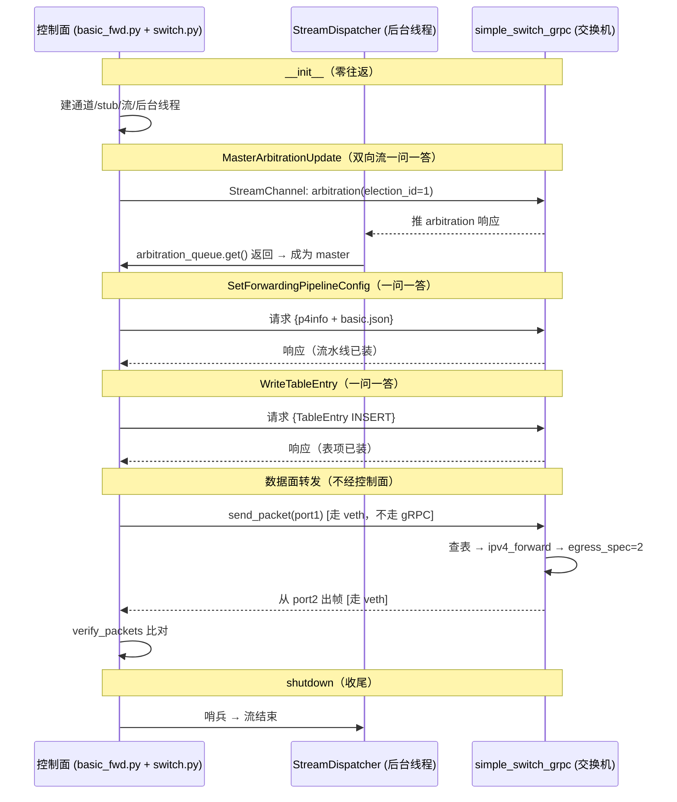

# P4Runtime switch.py 代码详解

> 文件：`tutorials/utils/p4runtime_lib/switch.py`（246 行）
>
> 一句话定位：**switch.py 是"控制面 ↔ 交换机"的通信客户端。**
> 它负责建立 gRPC 连接、作为 master 握手、烧录 P4 程序、下发/删除/读取表项，
> 以及处理交换机主动推上来的消息（PacketIn、表项超时等）。
> 它是 control plane 里唯一真正"碰网络"的模块——helper.py 造消息，switch.py 发消息。

---

## 1. 定位：和 helper.py 的分工

```
helper.py  ← 造"消息的内容"（把名字翻译成 ID、组装 TableEntry）
     │
     ▼
switch.py  ← 把消息"送出去/收回来"（建立连接、调用 gRPC 方法）
     │
     ▼
simple_switch_grpc（C++ 服务器，监听 localhost:9559）
```

- **helper.py 不碰网络**：只负责"翻译 + 组装"。
- **switch.py 不碰名字**：只负责"连接 + 收发"。
- 一个完整的控制面调用 = 先 helper 造消息，再 switch 发消息。

---

## 2. 文件结构总览

```
switch.py
│
├─ 模块级：connections 列表 + ShutdownAllSwitchConnections()
│
├─ class StreamDispatcher        ← 后台线程：收交换机推上来的流消息，按类型入队
│     ├─ __init__  创建 4 个队列 + 起线程
│     ├─ _dispatch_loop  循环分拣消息
│     └─ stop
│
├─ class SwitchConnection       ← 抽象基类：gRPC 客户端本体
│     ├─ __init__            建立通道、stub、流、dispatcher
│     ├─ buildDeviceConfig   抽象方法（子类实现，见 bmv2.py）
│     ├─ shutdown
│     ├─ MasterArbitrationUpdate    握手成为 master
│     ├─ SetForwardingPipelineConfig 烧录 P4 程序
│     ├─ WriteTableEntry     插表项（INSERT / MODIFY）
│     ├─ DeleteTableEntry    删表项
│     ├─ ReadTableEntries    读表项
│     ├─ ReadCounters        读计数器
│     ├─ WritePREEntry       写组播/镜像
│     ├─ PacketIn            取交换机上交的包
│     ├─ PacketOut           让交换机帮发一个包
│     └─ IdleTimeoutNotification 取表项超时通知
│
├─ class GrpcRequestLogger     ← gRPC 拦截器：把请求日志写到文件
│
└─ class IterableQueue         ← 把 Queue 变成可迭代对象（用于 gRPC 流）
```

---

## 3. import 与模块级变量（第 4-20 行）

```python
 4: from abc import abstractmethod        # 定义抽象方法用
 5: from datetime import datetime         # 日志时间戳
 6: from queue import Queue               # 线程安全队列
 7: import threading                      # 后台线程
 8:
 9: import grpc                           # gRPC 库
10: from p4.tmp import p4config_pb2       # 设备配置的 protobuf 定义
11: from p4.v1 import p4runtime_pb2, p4runtime_pb2_grpc   # P4Runtime 消息 + gRPC stub
12:
13: MSG_LOG_MAX_LEN = 1024                # 日志里单条消息的最大长度
14:
15: # List of all active connections
16: connections = []                      # 全局：所有活动的连接对象
17:
18: def ShutdownAllSwitchConnections():
19:     for c in connections:             # 遍历所有连接，逐个关掉
20:         c.shutdown()
```

- **第 11 行**：`p4runtime_pb2_grpc` 里装着 **P4RuntimeStub**——这是 gRPC 自动生成的"遥控器"类，定义了能调用的远程方法（`Write`、`Read`、`SetForwardingPipelineConfig`、`StreamChannel`）。
- **第 16 行**：`connections` 全局列表，记录所有创建过的连接。谁创建连接都会 `append` 自己进去（第 70 行）。
- **第 18-20 行**：测试结束时统一清理。basic_fwd.py 的 `tearDown` 就调它。

---

## 4. `StreamDispatcher`：交换机→控制面的"收信员"（第 22-51 行）

P4Runtime 有一条**双向流**（StreamChannel），交换机可以随时主动推消息给控制面。
`StreamDispatcher` 起一个**后台线程**专门等这些消息。

```python
22: class StreamDispatcher:
23:     def __init__(self, stream):
24:         self.stream = stream                       # 双向流（从 SwitchConnection 传入）
25:         self.running = True
26:         # Queues for each message type
27:         self.arbitration_queue = Queue()           # 仲裁响应（握手结果）
28:         self.packet_in_queue = Queue()             # PacketIn：交换机上交的包
29:         self.timeout_queue = Queue()               # 表项空闲超时通知
30:         self.error_queue = Queue()                 # 错误消息
31:
32:         self.thread = threading.Thread(target=self._dispatch_loop, daemon=True)
33:         self.thread.start()                        # 起后台线程，立刻开始收
```

- **第 27-30 行**：四个队列，每种消息一个。用 `Queue` 是因为它线程安全：后台线程往里放，主线程可以随时取。
- **第 32-33 行**：开一个**守护线程**（daemon=True，主程序退出时它自动结束）跑 `_dispatch_loop`。

```python
35:     def _dispatch_loop(self):
36:         for msg in self.stream:                     # 一直从流里取消息
37:             if not self.running:                    # 被 stop() 后退出
38:                 break
39:             if msg.HasField("arbitration"):         # 仲裁响应 → 仲裁队列
40:                 self.arbitration_queue.put(msg.arbitration)
41:             elif msg.HasField("packet"):            # PacketIn → 包队列
42:                 self.packet_in_queue.put(msg.packet)
43:             elif msg.HasField("idle_timeout_notification"):  # 超时通知 → 超时队列
44:                 self.timeout_queue.put(msg.idle_timeout_notification)
45:             elif msg.HasField("error"):             # 错误 → 错误队列
46:                 self.error_queue.put(msg.error)
47:             else:
48:                 print("Unknown StreamMessageResponse:", msg)
```

- **第 36 行**：`for msg in self.stream`——流对象实现了迭代器（靠第 239 行的 `IterableQueue`），所以能直接遍历。
- **第 39-46 行**：`HasField("xxx")` 是 protobuf 的方法，看这条消息携带了哪种内容，然后**放进对应的队列**。
- 调用方怎么取？见第 90 行（仲裁）、第 180 行（PacketIn）、第 205 行（超时）。

> **▶ 运行示例（模拟一次 PacketIn 到达）**
> ```python
> # 交换机在数据面遇到不认识/要上交的包，通过流推过来
> stream_msg = p4runtime_pb2.StreamMessageResponse()
> stream_msg.packet.payload = b'\xff\xff\xff\xff\xff\xff\x08\x00...'   # 一个包
>
> # 后台 _dispatch_loop 收到它：
> #   msg.HasField("packet") → True → msg.packet 被放进 packet_in_queue
> #
> # 之后控制面想取这个包：
> pkt = sw.PacketIn()          # 内部就是 dispatcher.packet_in_queue.get()
> pkt.packet.payload          # b'\xff\xff\xff\xff\xff\xff\x08\x00...'
> ```
> 也就是说：**交换机主动推消息 → 后台线程分拣入队 → 控制面按需取**。四个队列分别装四类消息。

---

## 5. `SwitchConnection.__init__`：建立 gRPC 连接（第 55-70 行）

```python
55:     def __init__(self, name=None, address='127.0.0.1:50051', device_id=0,
56:                  proto_dump_file=None):
57:         self.name = name                       # 连接名字（标签）
58:         self.address = address                 # gRPC 服务器地址
59:         self.device_id = device_id             # 交换机编号
60:         self.p4info = None                     # 稍后由调用方填入
61:         self.channel = grpc.insecure_channel(self.address)   # ① gRPC 通道
62:         if proto_dump_file is not None:                       # ② 要 dump 日志？
63:             interceptor = GrpcRequestLogger(proto_dump_file)  #    造一个记录员
64:             self.channel = grpc.intercept_channel(self.channel, interceptor)  # 挂到通道
65:         self.client_stub = p4runtime_pb2_grpc.P4RuntimeStub(self.channel)     # ③ 遥控器
66:         self.requests_stream = IterableQueue()               # ④ 我们要发的流消息的队列
67:         self.stream_msg_resp = self.client_stub.StreamChannel(iter(self.requests_stream))  # ⑤ 打开双向流
68:         self.dispatcher = StreamDispatcher(self.stream_msg_resp)  # ⑥ 起收信员
69:         self.proto_dump_file = proto_dump_file
70:         connections.append(self)               # ⑦ 登记到全局列表
```

- **第 61 行**：创建 gRPC 通道。`insecure_channel` = 不加 TLS 加密（本教程是本地模拟）。**注意：创建通道 ≠ 连接**，真正的连接在第一次发请求时建立。
- **第 62-64 行**：如果需要日志（basic_fwd.py 传了 `proto_dump_file='logs/...'`），就造一个 `GrpcRequestLogger` 拦截器并挂到通道上。之后**每条发出的 gRPC 请求都会先经过它被记录**（第 231-237 行）。这就是 `logs/s1-p4runtime-requests.txt` 的来源。
- **第 65 行**：创建 stub（"遥控器"）。它把远程方法变成 Python 函数：`stub.Write(...)`、`stub.Read(...)`。
- **第 66 行**：`IterableQueue` 是我们要发给交换机的消息队列（仲裁、PacketOut 等走这里）。
- **第 67 行**：调用 `StreamChannel` 打开**双向流**——传入我们这边消息的迭代器，返回的是交换机推消息的流。这条流和 `Write/Read` 这类"一问一答"是并行的两条通道。
- **第 68 行**：把流交给 `StreamDispatcher`，后台线程开始收信。
- **第 70 行**：登记到全局列表，供 `ShutdownAllSwitchConnections` 统一清理。

> **两条通道的区分（重要）：**
> - **一问一答**（Unary）：`Write`、`Read`、`SetForwardingPipelineConfig` —— 发请求、等响应，用 `stub.xxx(request)`。
> - **双向流**（Streaming）：`StreamChannel` —— 常开，用于仲裁、PacketIn、超时通知。

> **▶ 运行示例（basic_fwd.py setUp 里的实际调用）**
> ```python
> # basic_fwd.py:51-55 只调了这一句：
> self.sw = Bmv2SwitchConnection(name='s1', address='localhost:9559',
>                                device_id=0,
>                                proto_dump_file='logs/s1-p4runtime-requests.txt')
> ```
>
> ⚠️ **Bmv2SwitchConnection 自己没有写 `__init__`**（bmv2.py 全文件只有 20 行），
> 所以这行调用执行的是**父类 `SwitchConnection.__init__`**（本文件第 55-70 行，§5）。
> 这个"父类没有子类自己实现就用父类的"行为叫**继承（inheritance）**——这是看懂下面内容的钥匙。
>
> 构造完，`self.sw` 里就有了这些可用的东西：
> ```python
> sw.channel          # grpc 通道对象（连向 localhost:9559）
> sw.client_stub      # 遥控器：sw.client_stub.Write(...) 可直接调
> sw.requests_stream  # 我们的"发"队列（仲裁/PacketOut 塞这里）
> sw.stream_msg_resp  # 交换机的"推"流（后台线程在收）
> sw.dispatcher       # 收信员（4 个队列）
> sw.address          # 'localhost:9559'
> sw.device_id        # 0
> ```
> 同时磁盘上**立刻出现** `logs/s1-p4runtime-requests.txt`（空文件，由 GrpcRequestLogger 创建，第 216-218 行）。
>
> **调用链还原（一次构造做了什么）：**
> ```
> Bmv2SwitchConnection(...)                 # bmv2.py:18
>   └─ 自己没 __init__ → 找父类
>      SwitchConnection.__init__(...)       # switch.py:55
>        ├─ grpc.insecure_channel(9559)     # 建通道
>        ├─ GrpcRequestLogger + intercept   # 挂日志记录员（创建空日志文件）
>        ├─ P4RuntimeStub(channel)          # 造遥控器
>        ├─ IterableQueue()                 # 发队列
>        ├─ StreamChannel(...)              # 打开双向流
>        └─ StreamDispatcher(...)           # 起后台收信线程
> ```
> 注意：此刻**还没发任何网络请求**（通道≠连接，见第 61 行注释）。真正的网络动作从 `MasterArbitrationUpdate` 开始（§7）。

---

## 6. 子类：`Bmv2SwitchConnection`（bmv2.py 全文件详解）

`SwitchConnection` 是抽象基类，里面 `buildDeviceConfig` 是抽象的（第 72-74 行），
因为"把 P4 程序打包成设备配置"这个动作**因交换机型号而异**。先看完整的 bmv2.py（只有 20 行）：

```python
# bmv2.py（tutorials/utils/p4runtime_lib/bmv2.py，全文 20 行）
1: # SPDX-FileCopyrightText: 2017 Open Networking Foundation
2: #
3: # SPDX-License-Identifier: Apache-2.0
4: from p4.tmp import p4config_pb2
5:
6: from .switch import SwitchConnection          # 引入父类（相对导入，同一包内）
7:
8:
9: def buildDeviceConfig(bmv2_json_file_path=None):
10:     "Builds the device config for BMv2"
11:     device_config = p4config_pb2.P4DeviceConfig()     # 设备配置消息
12:     device_config.reassign = True                     # 允许重复加载流水线
13:     with open(bmv2_json_file_path) as f:              # 打开 basic.json
14:         device_config.device_data = f.read().encode('utf-8')  # 整份读进 device_data
15:     return device_config
16:
17:
18: class Bmv2SwitchConnection(SwitchConnection):
19:     def buildDeviceConfig(self, **kwargs):
20:         return buildDeviceConfig(**kwargs)             # 调用上面的模块级函数
```

### 6.1 它其实只有两个东西

1. **一个模块级函数** `buildDeviceConfig(json_path)`（第 9-15 行）：纯粹的文件读取 + 打包，
   把 `basic.json` 文本塞进 `P4DeviceConfig.device_data`。
2. **一个类** `Bmv2SwitchConnection`（第 18-20 行）：继承 `SwitchConnection`，
   **只重写了 `buildDeviceConfig` 一个方法**，别的（`__init__`、`Write`、`Read`…）全部用父类的。

### 6.2 继承关系图（看这个就懂）

```
SwitchConnection（switch.py，抽象基类）
    │  ▲ 继承（Bmv2SwitchConnection 没有的属性/方法，都用父类的）
    │  │
    │  └─ buildDeviceConfig()   ← 抽象（父类只声明，没实现，switch.py:72-74）
    │
Bmv2SwitchConnection（bmv2.py:18）
    └─ buildDeviceConfig()       ← 实现（BMv2 特有：读 basic.json）
```

所以：
- `Bmv2SwitchConnection(...)` → 执行 `SwitchConnection.__init__`（§5 调用链里的那个"找父类"）。
- `sw.SetForwardingPipelineConfig(...)` → 父类方法，内部第 93 行调用 `self.buildDeviceConfig(...)`，
  Python 会**动态派发**到 `Bmv2SwitchConnection.buildDeviceConfig`（第 19 行）→ 模块级函数（第 9 行）→ 读 basic.json。
- **好处**：以后换真机（如 Intel Tofino），写个 `TofinoSwitchConnection(SwitchConnection)` 只重写
  `buildDeviceConfig`（改成读 Tofino 的编译产物），`WriteTableEntry`/`Read` 等几十行逻辑全部复用。

### 6.3 动态派发演示（`SetForwardingPipelineConfig` 里谁在干活）

```python
# 第 92-93 行执行到：
def SetForwardingPipelineConfig(self, p4info, ...):
    device_config = self.buildDeviceConfig(**kwargs)
    #                              ↑
    #  self 是 Bmv2SwitchConnection 实例 → 调 bmv2.py:19 的 buildDeviceConfig
    #  → 调 bmv2.py:9 的模块级函数 → 读 basic.json → 返回 P4DeviceConfig
```

> **▶ 运行示例（basic.json 是怎么被打包的）**
> ```python
> >>> from p4runtime_lib.bmv2 import buildDeviceConfig
> >>> cfg = buildDeviceConfig(bmv2_json_file_path='build/basic.json')
> >>> cfg.reassign
> True
> >>> len(cfg.device_data)          # 整个 basic.json 文本按 utf-8 编码
> 123456                           # （实际字节数）
> >>> cfg.device_data[:20]
> b'{"program":"P4_16","'         # 就是 basic.json 的开头
> ```
> 这段 `cfg` 会被 `SetForwardingPipelineConfig` 放进请求的 `p4_device_config` 字段发给交换机（§8）。

---

## 7. `MasterArbitrationUpdate`：握手成为 master（第 80-90 行）

```python
80:     def MasterArbitrationUpdate(self, dry_run=False, **kwargs):
81:         request = p4runtime_pb2.StreamMessageRequest()   # 一条流消息
82:         request.arbitration.device_id = self.device_id   # 我要管哪个设备
83:         request.arbitration.election_id.high = 0
84:         request.arbitration.election_id.low = 1          # 选举号（越大越优先）
85:
86:         if dry_run:
87:             print("P4Runtime MasterArbitrationUpdate: ", request)
88:         else:
89:             self.requests_stream.put(request)            # ① 塞进"发"队列
90:             return self.dispatcher.arbitration_queue.get()  # ② 阻塞等交换机的仲裁响应
```

- **第 81-84 行**：构造一条携带"仲裁"信息的流消息：声明 `device_id`，带一个 `election_id=1`。P4Runtime 规定：**多个控制器想管同一台交换机时，选举号最大的那个成为 master；写表前必须 master 身份**。
- **第 89 行**：消息经第 66 行的 `IterableQueue` 流发出去。
- **第 90 行**：**阻塞等待**交换机回复仲裁响应。交换机在 `StreamChannel` 上回一条，后台 `_dispatch_loop` 把它放进 `arbitration_queue`，这里 `get()` 拿到。
- `dry_run` 模式：所有方法都支持，只打印不真发，方便调试。

> **💡 为什么 election_id 全是 high=0, low=1？**
> - `election_id` 是 **128 位整数**，protobuf 里拆成 `high`（高 64 位）+ `low`（低 64 位）两段发。
>   `high=0, low=1` 组合起来就是数值 **1**。
> - **竞选规则**：多个控制器同时连交换机，谁带的最大谁当 master（有写权限），其余是 slave。
> - **不能是 0**：P4Runtime 规范里 0 表示"没参与竞选"，没有写权限；必须 ≥1。
> - **不需要更大**：教程只有一个控制器，没人和你抢，用最小合法值 1 就够。
> - 每次 `Write` 都带 `election_id.low=1`（第 111、126 行），让交换机校验"请求来自 master"。
> - 多控制器高可用场景：备用控制器带更大的号（如 2）发仲裁更新，就能接管 master。

> **💡 所以其实每次只让 id 大的接管，对吗？—— 对，本质就这一句**
> ```text
> 控制器 A 带 election_id=1 ──► 当前 master
> 控制器 B 带 election_id=2 ──► 发送仲裁更新
> 交换机比较：2 > 1 → B 接管 master，A 降级为 slave
> 之后 B 的 Write 才有效；A 再发带 1 的写请求会被拒
> ```
> 三个关键点：
> 1. **不是"主动让权"，是交换机每次请求都比一次**。master 身份不永久锁定——每次写操作
>    带上自己的 election_id，交换机实时比较、以当前最大者为准。
> 2. **低号方不会自动掉线**，只是降为 slave：仍连着，能读表（Read 通常允许），但写操作被拒。
> 3. **这是"抢权"不是"投票"**。P4Runtime 不认先来后到，只认号大。做主备切换 = 备控制器
>    带更大的号发一次仲裁。
>
> 这也解释了教程为什么全用 1：单控制器下"最大就是 1"，没有竞争者，恒定 master。

> **▶ 运行示例（结合 dry_run 看它构造了什么）**
> ```python
> >>> sw.MasterArbitrationUpdate(dry_run=True)   # dry_run：只打印不发
> P4Runtime MasterArbitrationUpdate:
> arbitration {
>   device_id: 0
>   election_id {
>     high: 0
>     low: 1
>   }
> }
> ```
> 真实调用（dry_run=False）时，这一条消息被塞进 `requests_stream`，通过双向流发给交换机；
> 第 90 行**挂起等待**，直到交换机回 `status{code: OK}` 才返回。若交换机没起来/连不上，
> 这里会一直阻塞（所以测试前要先启动 simple_switch_grpc）。

> **💡 怎么知道自己成为 master 了？——靠第 90 行的返回值和里面的 status**
> P4Runtime 规定：交换机对每条仲裁消息**必须**回一个 `arbitration` 响应，里面带
> `status`（google.rpc 状态码）+ `election_id`：
> ```protobuf
> MasterArbitrationUpdate {
>   status { code: 0 }          # 0 = OK = 你是 master！
>   election_id { high: 0  low: 1 }
> }
> ```
> 所以 `arbitration_queue.get()`（第 90 行）拿到的这个裁定就是答案。严谨判断：
> ```python
> resp = sw.MasterArbitrationUpdate()
> if resp.status.code == 0:          # google.rpc.Status.OK
>     print("我已成为 master")
>     sw.WriteTableEntry(entry)      # 现在写才放行
> else:
>     print("竞选失败", resp.status)
> ```
> **但教程没检查**：basic_fwd.py:58 / mycontroller.py:155 都直接调用、扔掉返回值。
> 它靠两个隐式前提：① 单控制器必然回 OK；② `get()` 阻塞到拿到响应才算返回。
> 真正的失败（非 primary）要到后续 Write 才以 gRPC 异常暴露——属于简化写法。

> **💡 其他函数怎么知道已是 master？——它们不知道，判断权在交换机，靠外部调用顺序保证**
> - switch.py 里**没有任何"我是 master"的状态标记**。`WriteTableEntry` 等函数只是每次自动
>   带上 `election_id.low=1`（第 111、126 行），不自己判断。
> - **校验在交换机**：收到 Write → 读你带的 election_id → 和它记录的当前 master 比较 →
>   一致放行、不一致拒绝。
> - 所以顺序依赖是**外部代码保证的**（basic_fwd.py setUp 固定顺序）：
>   ```
>   MasterArbitrationUpdate()       # ① 先注册：交换机的"当前 master" = 1
>   SetForwardingPipelineConfig()   # ② 带 1 → 比对通过
>   WriteTableEntry()               # ③ 带 1 → 比对通过
>   ```
> - 不先做①：交换机没有 master 记录，②③ 会被拒绝（报"不是 primary"）。
> - 一句话：**master 身份在交换机侧，Python 从不存储也不自行判断；"知道自己是 master"=外部先调过握手，之后每个函数带同一个号，由交换机裁决。**

---

## 8. `SetForwardingPipelineConfig`：烧录 P4 程序（第 92-106 行）

```python
92:     def SetForwardingPipelineConfig(self, p4info, dry_run=False, **kwargs):
93:         device_config = self.buildDeviceConfig(**kwargs)     # ① 把 basic.json 打包成设备配置
94:         request = p4runtime_pb2.SetForwardingPipelineConfigRequest()
95:         request.election_id.low = 1                          # 也带选举号
96:         request.device_id = self.device_id
97:         config = request.config
98:
99:         config.p4info.CopyFrom(p4info)                       # ② 带上契约（helper 读的那份）
100:        config.p4_device_config = device_config.SerializeToString()  # ③ 带上程序
101:
102:         request.action = ...VERIFY_AND_COMMIT               # ④ 校验 + 提交
103:         if dry_run:
104:             print(...)
105:         else:
106:             self.client_stub.SetForwardingPipelineConfig(request)   # ⑤ 发给交换机
```

- **第 93 行**：调子类的 `buildDeviceConfig`，把 `basic.json` 读进来。
- **第 99-100 行**：请求里带两份东西：p4info（告诉交换机"有哪些表/动作"）+ 程序本体。
- **第 102 行**：`VERIFY_AND_COMMIT` 意思是"先验证程序合法性，通过就生效"。成功后交换机就开始按 basic.p4 的逻辑处理包了。
- **第 106 行**：走**一问一答**通道（`stub.SetForwardingPipelineConfig`）。

> **💡 这几行之后 request 里到底有什么？**
> ```python
> request = SetForwardingPipelineConfigRequest()  # ① 空请求
> request.election_id.low = 1                     # ② 选举号 {high:0, low:1}（我是 master）
> request.device_id = 0                           # ③ 设备号
> config = request.config                         # ④ 取 config 子消息
> config.p4info.CopyFrom(p4info)                  # ⑤ 深拷贝整份契约
> config.p4_device_config = device_config.SerializeToString()  # ⑥ basic.json 转二进制塞入
> request.action = VERIFY_AND_COMMIT              # ⑦ 校验并生效
> ```
> | 行 | 塞的字段 | 内容 |
> |---|---|---|
> | ② | `election_id` | `{high:0, low:1}` |
> | ③ | `device_id` | `0` |
> | ⑤ | `config.p4info` | **整份契约**（CopyFrom 深拷贝：tables/actions/params 定义+ID） |
> | ⑥ | `config.p4_device_config` | **basic.json 的二进制字节**（SerializeToString） |
> | ⑦ | `action` | `VERIFY_AND_COMMIT` |
>
> 完成后的请求（"契约 + 程序"双保险）：
> ```protobuf
> SetForwardingPipelineConfigRequest {
>   election_id { high: 0  low: 1 }
>   device_id: 0
>   action: VERIFY_AND_COMMIT
>   config {
>     p4info { tables {...} actions {...} }          # 第⑤行
>     p4_device_config: "<basic.json 的二进制字节>"    # 第⑥行
>   }
> }
> ```
> `CopyFrom` = 复制内容而非引用；`SerializeToString` = 把 P4DeviceConfig 消息编码成二进制 bytes 字段。

> **💡 两条请求完整展开（含 basic.json 内部）+ 交换机如何串联**
> **请求 #1**：`config.p4info`（契约，见上）+ `config.p4_device_config`（basic.json 全文，关键块）：
> ```json
> // basic.json 里 ipv4_forward 动作（真正"怎么改包"的指令）：
> { "name": "MyIngress.ipv4_forward", "id": 2,
>   "runtime_data": [ {"name":"dstAddr","bitwidth":48}, {"name":"port","bitwidth":9} ],
>   "primitives": [
>     { "op":"assign", ... egress_spec = runtime_data[1] },   // port
>     { "op":"assign", ... srcAddr = dstAddr },
>     { "op":"assign", ... dstAddr = runtime_data[0] },       // dstAddr
>     { "op":"assign", ... ttl = ttl - 1 } ] }
> // basic.json 里 ipv4_lpm 表（"怎么查表"）：
> { "name":"MyIngress.ipv4_lpm", "id":0,
>   "key":[ { "match_type":"lpm", "target":["ipv4","dstAddr"] } ],
>   "action_ids":[2,1,0], "default_entry":{ "action_id":1 } }
> ```
> **注意两套 ID**：p4info 用 P4Runtime 全局 ID（表 37375156、动作 28792405），
> basic.json 用 BMv2 内部 ID（表 0、动作 2）——**请求 #1 就是让交换机建立两者的映射**。
>
> **请求 #2**：`table_id: 37375156` + `action_id: 28792405` + `param_id 1/2`（全是 p4info 的外部 ID）。
>
> **交换机串联过程**：
> ```
> 请求#1: 用 basic.json 建流水线(建表id0/注册动作id2/挂parser/checksum)
>         + 用 p4info 建翻译表(37375156↔表0, 28792405↔动作2, param_id1↔dstAddr, param_id2↔port)
> 请求#2: table_id 37375156→表0 ✓; field_id1=ipv4.dstAddr→存key; action_id→动作2 ✓;
>         param_id1=08..22→填dstAddr槽; param_id2=2→填port槽 → INSERT 成功
> 此后包查表命中 → 执行 basic.json 的 primitives，用填好的槽值改包
> ```
> 一句话：**请求 #1 = 装程序 + 建"外部ID↔内部对象"翻译表；请求 #2 = 用外部 ID 引用表和动作、
> 把值填进空槽。两者靠 #1 建的翻译表在交换机内部接起来，并不合并成一条消息。**

> **▶ 运行示例（这一步前后交换机的"能力"变化）**
> ```python
> # basic_fwd.py:61-63 的实际调用：
> self.sw.SetForwardingPipelineConfig(
>     p4info=self.p4info_helper.p4info,
>     bmv2_json_file_path='build/basic.json')
> ```
> 发出的请求（grpc 拦截器记录到日志文件里）：
> ```protobuf
> SetForwardingPipelineConfigRequest {
>   election_id { high: 0  low: 1 }
>   device_id: 0
>   action: VERIFY_AND_COMMIT
>   config {
>     p4info { tables {...} actions {...} }          # 契约
>     p4_device_config: "{...basic.json 全部内容...}"
>   }
> }
> ```
> **效果对比：**
> - 调用前：交换机是 `--no-p4` 空壳（runptf.sh:40），发包全部被丢弃（流水线没装）。
> - 调用后：交换机开始按 basic.p4 的 Parser→MyIngress→Deparser 处理包，`ipv4_lpm` 表出现但**还是空的**（待下一条命令填）。

---

## 9. `WriteTableEntry`：下发表项（第 108-121 行）

```python
108:     def WriteTableEntry(self, table_entry, dry_run=False):
109:         request = p4runtime_pb2.WriteRequest()          # "写"请求
110:         request.device_id = self.device_id
111:         request.election_id.low = 1                     # 带选举号（确认有权限写）
112:         update = request.updates.add()                  # 请求里可以有多个 update
113:         if table_entry.is_default_action:
114:             update.type = p4runtime_pb2.Update.MODIFY   # 改默认动作用 MODIFY
115:         else:
116:             update.type = p4runtime_pb2.Update.INSERT   # 插普通表项用 INSERT
117:         update.entity.table_entry.CopyFrom(table_entry) # 把 helper 组装的 TableEntry 放进来
118:         if dry_run:
119:             print(...)
120:         else:
121:             self.client_stub.Write(request)             # 发给交换机
```

- **第 109-112 行**：`WriteRequest` 可以包含多个 `update`（批量写）。这里只加一个。
- **第 113-116 行**：根据表项是不是默认动作，选 `MODIFY`（改）还是 `INSERT`（插）。P4Runtime 里默认动作只有一条，只能 MODIFY；普通表项用 INSERT。
- **第 117 行**：helper.py `buildTableEntry` 返回的那个 protobuf 消息，在这里被塞进 `update.entity.table_entry`。
- **第 121 行**：`stub.Write(request)` 发出。交换机把这条记录装进 `ipv4_lpm` 表。

> **▶ 运行示例（FwdTest 下发的真实请求）**
> ```python
> entry = helper.buildTableEntry(
>     table_name='MyIngress.ipv4_lpm',
>     match_fields={'hdr.ipv4.dstAddr': ('10.0.1.1', 32)},
>     action_name='MyIngress.ipv4_forward',
>     action_params={'dstAddr': '08:00:00:00:02:22', 'port': 2})
> sw.WriteTableEntry(entry)
> ```
> 发给交换机的 `WriteRequest`（日志文件里能看到）：
> ```protobuf
> WriteRequest {
>   device_id: 0
>   election_id { high: 0  low: 1 }
>   updates {
>     type: INSERT                       # ← 普通表项 → INSERT（第 116 行）
>     entity {
>       table_entry {
>         table_id: 37375156
>         match { field_id: 1  lpm { value: "\x0a\x00\x01\x01"  prefix_len: 32 } }
>         action { action_id: 28792405
>                  params { param_id: 1  value: "\x08\x00\x00\x00\x02\x22" }
>                  params { param_id: 2  value: "\x00\x02" } }
>       }
>     }
>   }
> }
> ```
> **效果**：交换机 `ipv4_lpm` 表里多了一条 `10.0.1.1/32 → ipv4_forward(08:...:22, port2)`。
> 之后包查表命中就执行该动作。若用 `buildTableEntry(default_action=True, ...)` 则会走 `MODIFY` 分支。

> 对比 `DeleteTableEntry`（第 123-133 行）：结构几乎一样，只把 `update.type` 换成 `Update.DELETE`。

---

## 10. 读操作：`ReadTableEntries` / `ReadCounters`（第 135-165 行）

```python
135:     def ReadTableEntries(self, table_id=None, dry_run=False):
136:         request = p4runtime_pb2.ReadRequest()
137:         request.device_id = self.device_id
138:         entity = request.entities.add()            # 要读哪类实体
139:         table_entry = entity.table_entry           # 指定：读表项
140:         if table_id is not None:
141:             table_entry.table_id = table_id        # 指定读哪张表
142:         else:
143:             table_entry.table_id = 0               # 0 = 所有表
144:         ...
147:         else:
148:             for response in self.client_stub.Read(request):  # Read 是"流式响应"
149:                 yield response                     # 一个 response 里可能有多条
```

- **第 147-149 行**：`Read` 不是返回单个响应，而是返回一个**响应流**（因为表里可能有成百上千条），所以用 `for ... yield` 变成生成器，调用方 `for response in sw.ReadTableEntries():` 逐批处理。
- `ReadCounters`（第 150-165 行）：同样的套路，只是读 `counter_entry`。`index` 指定读哪个计数器格。
- 这两个方法就是之前说的"控制面主动读数据面状态"的通道。basic_fwd.py 没用，mycontroller.py 的 `readTableRules`/`printCounter` 用了。

> **▶ 运行示例（读回刚才 Insert 的表项）**
> ```python
> # 下发过一条之后，读回来看：
> for response in sw.ReadTableEntries():
>     for entity in response.entities:
>         print(entity.table_entry)
> ```
> 控制台输出（交换机流式返回表里现有条目）：
> ```protobuf
> table_id: 37375156
> match { field_id: 1
>         lpm { value: "\x0a\x00\x01\x01"  prefix_len: 32 } }
> action { action_id: 28792405
>          params { param_id: 1  value: "\x08\x00\x00\x00\x02\x22" }
>          params { param_id: 2  value: "\x00\x02" } }
> -----
> ```
> 未指定 `table_id`（传 0 = 所有表）；若只要这张表，传 `ReadTableEntries(table_id=37375156)`。
> 这就是验证"下发的条目到底装没装上"最直接的手段。

---

## 11. 复制引擎与包收发

### 11.1 `WritePREEntry`（第 167-177 行）

```python
167:     def WritePREEntry(self, pre_entry, dry_run=False):
168:         request = p4runtime_pb2.WriteRequest()
169:         request.device_id = self.device_id
170:         request.election_id.low = 1
171:         update = request.updates.add()
172:         update.type = p4runtime_pb2.Update.INSERT
173:         update.entity.packet_replication_engine_entry.CopyFrom(pre_entry)
...
177:             self.client_stub.Write(request)
```

和 `WriteTableEntry` 一模一样的结构，只是写的是 `packet_replication_engine_entry`
（组播组/镜像会话，helper.py 的 `buildMulticastGroupEntry`/`buildCloneSessionEntry` 造的那个消息）。

### 11.2 `PacketIn` / `PacketOut`：控制面收发包（第 179-202 行）

**数据面把包上交控制面**（比如交换机遇到不懂的包，交给控制面决定）：

```python
179:     def PacketIn(self, dry_run=False):
180:         request = self.dispatcher.packet_in_queue.get()   # 从后台线程填的队列取
181:         ...
183:             return request
```

**控制面让交换机替自己发个包**（比如控制面帮主机回一个 ARP）：

```python
186:     def PacketOut(self, payload, metadatas):
187:         packet_out = p4runtime_pb2.PacketOut()
188:         packet_out.payload = payload                    # 要发的原始字节
189:
190:         metadata_list = []
191:         i = 1
192:         for meta in metadatas:                          # 每个元数据（如从哪口出）
193:             item = p4runtime_pb2.PacketMetadata()
194:             item.metadata_id = i                        # 元数据 ID 从 1 递增
195:             item.value = meta["value"].to_bytes(meta["bitwidth"], 'big')
196:             metadata_list.append(item)
197:             i +=1
198:         packet_out.metadata.extend(metadata_list)
199:
200:         request = p4runtime_pb2.StreamMessageRequest()
201:         request.packet.CopyFrom(packet_out)
202:         self.requests_stream.put(request)               # 走"发"流发出去
```

- `metadatas` 是 `[{'value': ..., 'bitwidth': ...}, ...]`，通常是"从哪个端口发出"等控制信息。
- **第 202 行**：PacketOut 走的是**双向流**（塞进 `requests_stream`），不是一问一答——因为它本来就不是"请求-响应"式，而是"单向指令"。

> **▶ 运行示例（控制面代发一个 ARP 应答）**
> ```python
> # 交换机把 ARP 请求上交控制面（PacketIn 已取到），控制面构造应答：
> arp_reply = bytes.fromhex(
>     '080000000111080000000222080600010800060400010800000002220a000002'
>     '0800000001110a000001')          # 一段 ARP 应答字节（以太网头 + ARP）
>
> # 让交换机从 1 号口发出，并指定 ingress_port 元数据
> sw.PacketOut(payload=arp_reply,
>              metadatas=[{'value': 1, 'bitwidth': 9}])   # egress_spec = 1
> ```
> 内部构造的流消息：
> ```protobuf
> StreamMessageRequest {
>   packet {
>     payload: "...arp_reply 的字节..."
>     metadata { metadata_id: 1  value: "\x00\x01" }    # 端口 1
>   }
> }
> ```
> **效果**：交换机收到 PacketOut 后，把 payload 从指定端口发出去——等于"控制面借交换机的端口发了个包"。
> 注意 PacketOut 走 `requests_stream`（发流），与 Write 的一问一答是两条路。

### 11.3 `IdleTimeoutNotification`（第 204-209 行）

```python
204:     def IdleTimeoutNotification(self, dry_run=False):
205:         msg = self.dispatcher.timeout_queue.get()      # 从后台线程填的队列取
206:         ...
208:             return msg
```

如果表项设置了 `idle_timeout_ns`（helper.py `buildTableEntry` 的参数之一），交换机在表项超时后
会主动推通知给控制面，控制面用这个函数取。

---

## 12. `GrpcRequestLogger`：gRPC 拦截器（第 210-237 行）

```python
210: class GrpcRequestLogger(grpc.UnaryUnaryClientInterceptor,
211:                         grpc.UnaryStreamClientInterceptor):
212:     """Implementation of a gRPC interceptor that logs request to a file"""
213:
214:     def __init__(self, log_file):
215:         self.log_file = log_file
216:         with open(self.log_file, 'w') as f:
217:             f.write("")                               # 打开时清空旧内容
218:
219:     def log_message(self, method_name, body):
220:         with open(self.log_file, 'a') as f:            # 追加写
221:             ts = datetime.utcnow().strftime('%Y-%m-%d %H:%M:%S.%f')[:-3]
222:             msg = str(body)
223:             f.write("\n[%s] %s\n---\n" % (ts, method_name))   # 时间 + 方法名
224:             if len(msg) < MSG_LOG_MAX_LEN:                      # 太长的消息只写长度
225:                 f.write(str(body))
226:             else:
227:                 f.write("Message too long (%d bytes)! Skipping log...\n" % len(msg))
228:             f.write('---\n')
229:
230:     def intercept_unary_unary(self, continuation, client_call_details, request):
231:         self.log_message(client_call_details.method, request)   # 记日志
232:         return continuation(client_call_details, request)       # 然后放行
233:
234:     def intercept_unary_stream(self, continuation, client_call_details, request):
235:         self.log_message(client_call_details.method, request)
236:         return continuation(client_call_details, request)
```

- **gRPC 拦截器** = 给 gRPC 调用装"中间件"：每次请求发出前，先执行 `intercept_*` 方法。
- 实现两个接口：`UnaryUnaryClientInterceptor`（一问一答）和 `UnaryStreamClientInterceptor`（流式响应，如 Read）。
- **第 230-237 行**：两个方法都是"先记日志，再调用 `continuation(...)` 放行"。`continuation` 是"继续真正发送"的回调。
- 这就是 `logs/s1-p4runtime-requests.txt` 每一条记录的形成过程（时间戳 + 方法名 + 消息内容）。

> **▶ 运行示例（日志文件里的真实记录）**
> 跑完一次测试后打开 `logs/s1-p4runtime-requests.txt`，能看到多条记录，每条格式（第 220-228 行）：
> ```text
> [2026-08-14 10:30:01.123] /p4.v1.P4Runtime/SetForwardingPipelineConfig
> ---
> election_id {
>   high: 0
>   low: 1
> }
> device_id: 0
> action: VERIFY_AND_COMMIT
> ...
> ---
> [2026-08-14 10:30:01.456] /p4.v1.P4Runtime/Write
> ---
> device_id: 0
> updates {
>   type: INSERT
>   ...
> }
> ---
> ```
> - 第一行 `[时间] /p4.v1.P4Runtime/方法名` 来自第 223 行。
> - 方法名是 gRPC 的完整调用路径（`client_call_details.method`）。
> - 消息正文超过 1024 字符时只写"Message too long"（第 227 行）——`SetForwardingPipelineConfig` 那条大概率被截断，因为 basic.json 很大。

---

## 13. `IterableQueue`：把 Queue 变成可迭代（第 239-246 行）

```python
239: class IterableQueue(Queue):
240:     _sentinel = object()                       # 独一无二的"终止标记"
241:
242:     def __iter__(self):
243:         return iter(self.get, self._sentinel)  # 一直 get()，直到取到终止标记
244:
245:     def close(self):
246:         self.put(self._sentinel)               # 放入终止标记，让迭代结束
```

- 标准 `Queue` 不能被 `for` 遍历。gRPC 的双向流需要传入一个可迭代对象（第 67 行 `iter(self.requests_stream)`）。
- `iter(self.get, sentinel)` 是 Python 的**哨兵法**：不断调用 `self.get()`，每次返回一个元素，直到某个返回值等于 `sentinel`（`object()` 创建的、任何真实消息都不可能相等的标记）就停止。
- `close()` 放入哨兵，优雅关闭流——`shutdown()`（第 76-78 行）就用它。

> **▶ 运行示例（哨兵机制演示）**
> ```python
> q = IterableQueue()
> q.put('仲裁消息')          # 控制面塞入
> q.put('PacketOut')         # 又塞入一条
>
> it = iter(q)               # 第 243 行：iter(self.get, sentinel)
> next(it)                   # → '仲裁消息'
> next(it)                   # → 'PacketOut'
>
> # 没有更多消息时，next() 会一直阻塞（等待 get()）
> # 直到有人调用：
> q.close()                  # 第 246 行：放入哨兵
> next(it)                   # 返回 sentinel → for 循环自然结束（第 37 行 break）
> ```
> 这就是为什么 gRPC 的双向流能"一直挂着等消息"，又能被 `shutdown()` 优雅终止。

---

## 14. 完整调用链：一个 `WriteTableEntry` 从 Python 到交换机

```
basic_fwd.py: add_ipv4_lpm_entry
   │  self.p4info_helper.buildTableEntry(...)   ← helper.py 组装消息（见 helper 文档）
   ▼
   self.sw.WriteTableEntry(table_entry)         ← switch.py
   │
   ├─ 第 109-117 行：包成 WriteRequest，type=INSERT，塞入 TableEntry
   ├─ 第 121 行：self.client_stub.Write(request)
   │     │
   │     └─ gRPC 拦截器（如果有）：写日志（第 230-237 行）
   │            │
   │            ▼
   │      gRPC 网络传输（localhost:9559，protobuf 二进制）
   ▼
simple_switch_grpc（C++ 服务器）：
   收到 WriteRequest → 把表项 INSERT 进 ipv4_lpm 表
   → 后续每个包查这张表时命中这条 → 执行 ipv4_forward(dstAddr, port)
```

> **💡 SetForwardingPipelineConfigRequest 和 WriteRequest 怎么"融合"的？**
> **它们不合并——是两条独立的 gRPC 请求，由 setUp 里两次调用先后发出。** "融合"发生在交换机内部状态：
> ```
> 请求 #1（SetForwardingPipelineConfig）：
>   用 config.p4info + basic.json → 交换机创建 ipv4_lpm 表（结构 + ID 37375156 登记好）
> 请求 #2（WriteTableEntry）：
>   只带 table_id: 37375156 → 交换机对照 #1 的登记：37375156 = ipv4_lpm → INSERT 进去
> ```
> - #2 里的 `table_id: 37375156` 不是凭空能用——它对应的表是 #1 建的。没有 #1，交换机报"找不到表"。
> - 顺序依赖：**必须先 SetForwardingPipelineConfig（建表）再 WriteTableEntry（填表）**，反过来失败。
> - 类比：#1 = 先创建空的 Excel 文件（建好表头），#2 = 再填入一行数据。两条操作各自独立，靠文件（表）串起来。

---

## 15. 常见问题

### Q1：`client_stub` 是从哪来的？
`p4runtime_pb2_grpc.P4RuntimeStub(channel)`（第 65 行），由 gRPC 工具根据 P4Runtime 的 `.proto`
文件自动生成的类。它把远程服务的方法暴露成本地函数：`stub.Write(request)` 等价于"向服务器发一个 Write 请求"。

### Q2：`StreamChannel` 和 `Write/Read` 有什么区别？
- `Write/Read/SetForwardingPipelineConfig`：**一问一答**（发一个请求，等响应），一次性调用。
- `StreamChannel`：**常开的长连接流**，双向。控制面 → 交换机：仲裁、PacketOut；交换机 → 控制面：仲裁响应、PacketIn、超时通知。

### Q3：为什么 `Read` 用 `yield`？
`Read` 的响应是一个**流**，可能含很多条记录（几百条表项）。`yield` 让调用方可以分批处理，不用一次全收进内存。

### Q4：为什么要 `election_id`？
P4Runtime 用选举号决定谁是 master：号大者胜。写表（Write）时带上选举号，交换机校验"你的选举号是不是当前 master 的"，防止非 master 乱写。教程里所有请求都带 `election_id.low=1`。

### Q4.5：是不是必须先 `MasterArbitrationUpdate` 才能用别的函数？
**"写"类必须，"读"类不强制。** P4Runtime 规定只有 primary（master）能做修改操作：

| 函数 | 类型 | 必须先握手？ |
|---|---|---|
| `SetForwardingPipelineConfig` | 写 | ✅ 必须 |
| `WriteTableEntry` / `DeleteTableEntry` / `WritePREEntry` | 写 | ✅ 必须 |
| `PacketOut` | 写 | ✅ 必须 |
| `ReadTableEntries` / `ReadCounters` | 读 | ❌ 不强制（slave 也能读） |
| `PacketIn` | 收 | 交换机**只推给 master** |

所以教程顺序永远固定：`MasterArbitrationUpdate()` → `SetForwardingPipelineConfig()` → `WriteTableEntry()`。
不先握手就 Write，交换机返回"不是 primary"错误。每个 Write 带 `election_id.low=1` 正是让交换机校验这个。

### Q5：`connections` 列表是干嘛的？
记录所有创建过的连接对象，方便一次性关闭（`ShutdownAllSwitchConnections`）。basic_fwd.py 的 `tearDown` 靠它收尾。

### Q6：`shutdown()` 做了什么？
`requests_stream.close()` 放入哨兵让流优雅结束，`dispatcher.stop()` 让后台线程退出。
```

---

## 16. 运行示例：每一步实际跑起来是什么样

> 下面用 basic 的真实场景（basic.p4 + p4info + FwdTest）展示 switch.py 每个方法**运行时**的样子。
> 这些内容很多就是 `logs/s1-p4runtime-requests.txt` 里真实 dump 的内容。

### 16.1 完整运行环境（先还原现场）

```bash
cd /workspace/tutorials/exercises/basic
sudo ./runptf.sh
```

此时：
- `simple_switch_grpc` 已在后台监听 `localhost:9559`
- ptf 开始逐个跑 basic_fwd.py 的测试类
- 每个测试类 setUp 会创建连接、握手、烧录

### 16.2 例1：setUp 建立连接（`__init__` 第 55-70 行）

运行到 `setUp` 里这一行时：

```python
self.sw = Bmv2SwitchConnection(name='s1', address='localhost:9559',
                               device_id=0,
                               proto_dump_file='logs/s1-p4runtime-requests.txt')
```

构造函数做的事（一行一行对应 §5）：

| 代码 | 实际效果 |
|---|---|
| `grpc.insecure_channel('localhost:9559')` | 建立到 9559 的 gRPC 通道（此时还没发包） |
| `GrpcRequestLogger('logs/...')` + `intercept_channel` | 挂上记录员，并**立刻创建** `logs/s1-p4runtime-requests.txt` 空文件 |
| `P4RuntimeStub(channel)` | 拿到"遥控器"，之后可以 `stub.Write(...)` 等 |
| `StreamChannel(iter(requests_stream))` | 打开双向流，后台线程开始等交换机推消息 |

> 所以 `logs/s1-p4runtime-requests.txt` 在这一刻被创建。如果之后你看到它**一直是空的**，
> 说明没有任何 gRPC 请求发出去（常见原因：交换机没起来，连接失败）。

### 16.3 例2：MasterArbitrationUpdate（第 80-90 行）

调用：
```python
self.sw.MasterArbitrationUpdate()
```

发出去的流消息（protobuf 文本表示）：
```protobuf
StreamMessageRequest {
  arbitration {
    device_id: 0
    election_id { high: 0  low: 1 }
  }
}
```

然后 `arbitration_queue.get()` **阻塞等待**。交换机回：
```protobuf
StreamMessageResponse {
  arbitration {
    status { code: OK }
    election_id { high: 0  low: 1 }
  }
}
```
拿到 `OK`，握手成功，此时才允许后面写表。

### 16.4 例3：SetForwardingPipelineConfig（第 92-106 行）

调用：
```python
self.sw.SetForwardingPipelineConfig(p4info=self.p4info_helper.p4info,
                                    bmv2_json_file_path='build/basic.json')
```

内部：
- `buildDeviceConfig('build/basic.json')` 打开文件、把整份 JSON 读成字符串、`encode('utf-8')` 塞进 `device_data`。
- 发出的请求（gRPC 拦截器会把它写进日志文件）：
```protobuf
SetForwardingPipelineConfigRequest {
  election_id { high: 0  low: 1 }
  device_id: 0
  action: VERIFY_AND_COMMIT
  config {
    p4info { tables {...} actions {...} }        # helper 读进来的整份契约
    p4_device_config: "...<basic.json 的字节>..."
  }
}
```

**解决什么**：交换机在此之前是 `--no-p4` 空跑的（runptf.sh:40），这一步把 basic.json 装上，
之后交换机才按 basic.p4 的 Parser/MyIngress/Deparser 处理包。**这一行没有它，后面发的包全被丢弃。**

### 16.5 例4：WriteTableEntry（第 108-121 行）

调用（来自 add_ipv4_lpm_entry）：
```python
self.sw.WriteTableEntry(self.p4info_helper.buildTableEntry(
    table_name='MyIngress.ipv4_lpm',
    match_fields={'hdr.ipv4.dstAddr': ('10.0.1.1', 32)},
    action_name='MyIngress.ipv4_forward',
    action_params={'dstAddr': '08:00:00:00:02:22', 'port': 2}))
```

发出的 `WriteRequest`（这就是 `logs/s1-p4runtime-requests.txt` 里能看到的内容）：
```protobuf
WriteRequest {
  device_id: 0
  election_id { high: 0  low: 1 }
  updates {
    type: INSERT
    entity {
      table_entry {
        table_id: 37375156                       # MyIngress.ipv4_lpm
        match {
          field_id: 1                            # hdr.ipv4.dstAddr
          lpm { value: "\x0a\x00\x01\x01"        # 10.0.1.1
                prefix_len: 32 }
        }
        action {
          action_id: 28792405                    # MyIngress.ipv4_forward
          params { param_id: 1  value: "\x08\x00\x00\x00\x02\x22" }  # dstAddr
          params { param_id: 2  value: "\x00\x02" }                 # port
        }
      }
    }
  }
}
```

**解决什么**：这就是"把路由表项装进交换机"。从此交换机查 `ipv4_lpm` 表时，遇到 `10.0.1.1/32`
就能命中并执行 `ipv4_forward`。没有这条，包会走 `default_action = drop()`。

### 16.6 例5：ReadTableEntries（第 135-149 行）—— 读回数据面

如果把 `mycontroller.py` 里被注释的 `readTableRules` 打开，运行后控制台会打印：

```python
for response in sw.ReadTableEntries():
    for entity in response.entities:
        print(entity.table_entry)
```

输出（交换机把表里存的条目**流式**返回）：
```protobuf
table_id: 37375156
match { field_id: 1
        lpm { value: "\x0a\x00\x01\x01"  prefix_len: 32 } }
action { action_id: 28792405
         params { param_id: 1  value: "\x08\x00\x00\x00\x02\x22" }
         params { param_id: 2  value: "\x00\x02" } }
```

**解决什么**：这是"控制面从数据面读状态"的标准通道——验证下发的条目有没有真正装上、
读计数器统计流量等。注意它走的是**流式响应**，所以代码里用 `for ... yield` 分批收。

### 16.7 例6：PacketIn / PacketOut（第 179-202 行）—— 控制面插手包

模拟一个场景：交换机遇到 ARP 包（basic 里没有 ARP 表），把它上交控制面：

```python
# 后台线程已把包放进 packet_in_queue
pkt = sw.PacketIn()          # 取出交换机上交的包
print(pkt.packet.payload)    # b'\xff\xff\xff\xff\xff\xff...'  ARP 请求字节

# 控制面决定"替交换机从 1 号口回一个包"
sw.PacketOut(payload=b'\x08\x00\x00\x00\x01\x11...',   # 要发的字节
             metadatas=[{'value': 1, 'bitwidth': 9}])  # 从端口 1 发出
```

发出的流消息：
```protobuf
StreamMessageRequest {
  packet {
    payload: "...<要发的字节>..."
    metadata { metadata_id: 1  value: "\x00\x01" }   # egress_spec = 1
  }
}
```

**解决什么**：P4 程序里没有的逻辑（如 ARP 应答、未知流上报）可以交给控制面，
靠 `PacketIn`（收）+ `PacketOut`（发）完成"控制面在数据面上干活"。

### 16.8 例7：一次 `make test` 的控制台输出（把上面串起来）

跑完 `make test`，屏幕大致长这样（`set -x` 会打印每条命令）：

```
+ p4c --target bmv2 --arch v1model --p4runtime-files build/basic.p4info.txtpb -o build solution/basic.p4
+ sudo simple_switch_grpc --log-file ss-log ... -i 0@veth0 ... --no-p4 &
Started simple_switch_grpc. Waiting 2 seconds before starting PTF test...
+ sudo ... ptf -i 0@veth1 ... --test-dir ptf

(六个测试类依次执行，这里以 FwdTest 为例)
FwdTest: setUp → 连 gRPC(§16.2) → 握手(§16.3) → 烧录(§16.4) → WriteTableEntry(§16.5)
        → send_packet(port1, 入包) → 交换机查表执行 ipv4_forward → 从 port2 发出
        → verify_packets 逐字节比对 → 通过 ✔
[PASS] FwdTest
...（其余 5 个测试类似）...

PTF test finished. Waiting 2 seconds before killing simple_switch_grpc...
+ sudo pkill --signal 9 --list-name simple_switch
Cleaning up veth interfaces...
```

同时 `logs/s1-p4runtime-requests.txt` 里会累积所有 §16.2~16.5 的 gRPC 请求记录，
每一条长这样（GrpcRequestLogger 的格式，第 220-228 行）：

```
[2026-08-14 10:30:01.123] /p4.v1.P4Runtime/SetForwardingPipelineConfig
---
device_id: 0
election_id { high: 0  low: 1 }
...
---
[2026-08-14 10:30:01.456] /p4.v1.P4Runtime/Write
---
device_id: 0
...
---
```

---

## 17. 每条 switch.py 函数的往返流程（Request/Response 全图）

> 这是你问的"整个调用的流程往返"——把每个函数的**请求走哪条路、响应怎么回来、哪里阻塞**画全。
> 先记一个总原则：**控制面发请求只有两种通道（一问一答 / 双向流），响应也只有两种形态（直接返回 / 入队后取）。**

### 17.1 先看两条物理通道

```
通道 A：一问一答（Unary）          通道 B：双向流（StreamChannel）
┌──────────────┐                 ┌───────────────────────────────┐
│ 控制面 stub.  │                 │ 控制面 requests_stream（发）    │
│ Xxx(request) │                 │      ↓ put()                  │
│      ↓        │                 │      ──────────────────►      │
│  gRPC 发请求  │                 │         交换机                │
│      ↓        │                 │      ◄──────────────────      │
│ 等单个响应     │                 │ 交换机推送 → stream_msg_resp   │
│ 返回 response │                 │      ↓ 后台线程分拣入 4 队列    │
└──────────────┘                 │ 控制面 queue.get() 取           │
                                 └───────────────────────────────┘
```

| 通道 | 用到的函数 | 响应形态 |
|---|---|---|
| A 一问一答 | `SetForwardingPipelineConfig`、`Write`、`DeleteTableEntry`、`Read` | 直接返回（Read 是流式响应） |
| B 双向流 | `MasterArbitrationUpdate`、`PacketOut`（发）、`PacketIn`/`IdleTimeout`（收） | 交换机推，入队后 get() |

> **💡 为什么有的用 `client_stub.Write(request)`，有的用 `requests_stream.put(request)`？**
> | 发送方式 | 函数 | 消息类型 | 响应怎么回 |
> |---|---|---|---|
> | `client_stub.xxx(request)`（一问一答） | SetForwardingPipelineConfig(106)、WriteTableEntry(121)、DeleteTableEntry(133)、WritePREEntry(177)、Read(147/164) | 各自专属类型：`WriteRequest`/`ReadRequest`/… | `stub.xxx()` **阻塞等响应**，直接拿结果 |
> | `requests_stream.put(request)`（双向流） | MasterArbitrationUpdate(89)、PacketOut(202) | 流消息 `StreamMessageRequest`（oneof 装 arbitration/packet） | `put()` 只塞本地发队列，异步发出；响应由交换机推回 → 后台线程入队 → `get()` 取 |
> | `dispatcher.xxx_queue.get()`（流的收侧） | PacketIn(180)、IdleTimeoutNotification(205)、仲裁(90) | — | 纯接收，交换机主动推 |
>
> **为什么规范这么分？**
> - **表/流水线操作**（Write/Read/SetForwardingPipelineConfig）是离散的"问一句答一句"事务 → Unary RPC 天然匹配，一次一结。
> - **仲裁**要建立"谁是谁"的长连接会话 → 必须走流（规范强制）。
> - **PacketIn/PacketOut** 是持续的双向数据通道 → 必须走流（规范强制）。
>
> 类比：`client_stub.Write()` = 打电话（拨号、说事、等答复、挂断，一次一结）；
> `requests_stream.put()` = 对讲机（同一频道持续讲话，回复由后台监听员转交）。

### 17.2 `__init__` —— 零往返

```
调用：Bmv2SwitchConnection(...)
往返：无（不产生任何网络消息）
阻塞：无
说明：只建通道、stub、流、后台线程。网络动作从下一个函数开始。
```

### 17.3 `MasterArbitrationUpdate` —— 双向流，发一条、等一条

```
控制面                   交换机
  │ put 仲裁消息(request)   │
  │ ───────────────────────►│ 处理：比较 election_id
  │                         │   (election_id 最大者 → master)
  │ ◄───────────────────────│ 推回 arbitration 响应
  │ arbitration_queue.get() │
  │   ↑ 阻塞，直到收到       │
  ▼                         ▼
返回响应对象（status OK = 成为 master）
```

### 17.4 `SetForwardingPipelineConfig` —— 一问一答，发一条、等一条

```
控制面                   交换机
  │ stub.SetForwardingPipelineConfig(request)  │
  │ ───────────────────────►│ 校验 P4 程序 (VERIFY_AND_COMMIT)
  │                         │ 加载 basic.json 进流水线
  │ ◄───────────────────────│ 返回响应（空，成功即 OK）
  │ 直接返回                │
  ▼                         ▼
此后交换机才按 basic.p4 处理包
```

### 17.5 `WriteTableEntry` / `DeleteTableEntry` / `WritePREEntry` —— 一问一答

```
控制面                   交换机
  │ stub.Write(request)     │
  │ ───────────────────────►│ 把表项 INSERT / MODIFY / DELETE 进表
  │ ◄───────────────────────│ 返回响应（成功 = 空响应无异常）
  │ 直接返回                │
  ▼                         ▼
没有"收到确认数据"——gRPC 成功返回本身就表示交换机处理完了
```

### 17.6 `ReadTableEntries` / `ReadCounters` —— 一问一答，但响应是"流"

```
控制面                   交换机
  │ stub.Read(request)      │
  │ ───────────────────────►│ 查表/计数器，把所有条目打包
  │ ◄───────────────────────│ 返回多个 response（流式）
  │ for response in ...     │
  │   yield response        │   ← 生成器：一个 response 里有多条记录
  ▼                         ▼
```

### 17.7 `PacketIn` —— 零请求，纯"收"（被动）

```
交换机遇到要上交的包：
  │ 通过双向流推 StreamMessageResponse{packet}
  │ ───────────────────────► 后台线程 _dispatch_loop
  │                          │ HasField("packet") → packet_in_queue.put()
  ▼                          ▼
控制面：sw.PacketIn() = 只是 packet_in_queue.get()（若队列空则阻塞等）
（控制面这边没发任何东西，包是交换机主动送上门的）
```

### 17.8 `PacketOut` —— 单向"发"，无响应

```
控制面
  │ PacketOut(payload, metadatas)
  │ 组装 StreamMessageRequest{packet}
  │ requests_stream.put(request)   ──► 交换机收到后把包发出
  │
  ▼
不等待任何响应（这是单向指令，不是请求-响应）
```

### 17.9 `IdleTimeoutNotification` —— 同 PacketIn，纯"收"

```
表项超时了：
  交换机推 StreamMessageResponse{idle_timeout_notification}
    → 后台线程 → timeout_queue.put()
控制面：sw.IdleTimeoutNotification() = timeout_queue.get()
```

### 17.10 `shutdown` —— 单向收尾

```
控制面
  │ requests_stream.close()    → 发队列放入哨兵，双向流优雅结束
  │ dispatcher.stop()          → 后台线程退出
  ▼
```

### 17.11 一次性看清：完整测试的往返时间线（mermaid 时序图）



### 17.12 速查表：每个函数"发什么、等什么、回什么"

| 函数 | 通道 | 发出去的 | 等/收的 | 阻塞吗 |
|---|---|---|---|---|
| `__init__` | 无 | 无 | 无 | 否 |
| `MasterArbitrationUpdate` | 双向流 | `arbitration(election_id)` | 交换机推 `arbitration` 响应 | **是**（等队列） |
| `SetForwardingPipelineConfig` | 一问一答 | `{p4info + json}` | 单个响应 | 是（等响应） |
| `WriteTableEntry` | 一问一答 | `{TableEntry}` | 单个响应（成功即 OK） | 是 |
| `DeleteTableEntry` | 一问一答 | `{TableEntry}` | 单个响应 | 是 |
| `ReadTableEntries` | 一问一答(流) | `{table_id}` | 多个响应流 | 是（迭代时） |
| `ReadCounters` | 一问一答(流) | `{counter_id, index}` | 多个响应流 | 是（迭代时） |
| `WritePREEntry` | 一问一答 | `{PRE entry}` | 单个响应 | 是 |
| `PacketIn` | 双向流(收) | 无 | 后台线程入队的包 | 是（队列空时） |
| `PacketOut` | 双向流(发) | `{payload + metadata}` | 无（单向） | 否 |
| `IdleTimeoutNotification` | 双向流(收) | 无 | 后台线程入队的超时通知 | 是（队列空时） |
| `shutdown` | 双向流(收尾) | 哨兵 | 无 | 否 |

> **一句话总结往返规律**：**一问一答的函数是"发请求→等响应→返回"，双向流里的收发则是
> "put 进发队列"（发）或"从后台线程填的队列 get"（收）。** 所有"等"的本质都是 gRPC 在等网络往返，或队列在等后台线程放数据。