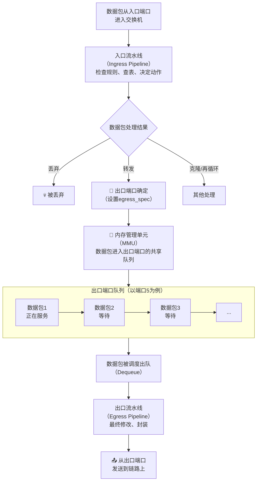
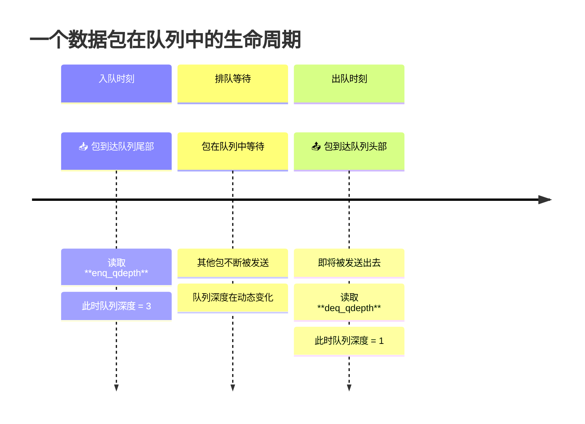
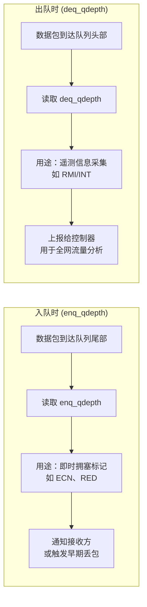
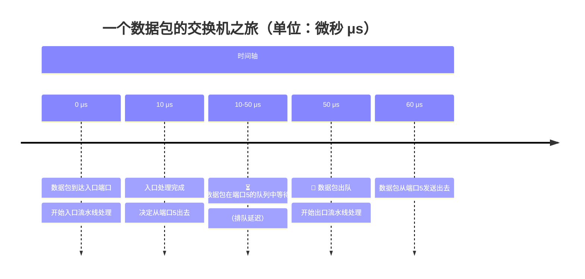

在P4的`v1model`架构中，`standard_metadata_t`是一个包含了数据包处理所需关键信息的结构体。你可以把它理解成P4程序与底层交换机（如BMv2 simple_switch）之间的**信息枢纽**，里面主要有以下几类信息。

下表整理了它最核心的字段、类型和作用，方便你快速查阅。

| 字段名                         | 类型 (bits) | 主要作用                                                     | 备注                                                         |
| :----------------------------- | :---------- | :----------------------------------------------------------- | :----------------------------------------------------------- |
| **`ingress_port`**             | 9           | 数据包从哪个端口进入交换机。                                 | 只读                                                         |
| **`egress_spec`**              | 9           | **你指定**的数据包应该从哪个端口发出。                       | 在入口（Ingress）设置，核心控制字段。你之前问题里修改的就是它。 |
| **`egress_port`**              | 9           | 数据包**实际**从哪个端口发出（最终决定）。                   | 只读，由系统根据`egress_spec`解析得到。                      |
| **`drop`**                     | 1           | 是否丢弃该数据包（1为丢弃）。                                | **注意**：这是一个**已弃用（deprecated）**的字段，推荐使用`mark_to_drop()`函数替代。 |
| **`packet_length`**            | 32          | 数据包的总长度（以字节为单位）。                             | 只读                                                         |
| **`instance_type`**            | 32          | 标识数据包的来源或类型，如`NORMAL`、`RESUBMIT`、`RECIRC`、`INGRESS_CLONE`等。 | 可用于区分数据包的生成方式。                                 |
| **`clone_spec`**               | 32          | 用于控制数据包克隆（镜像）的规格参数。                       |                                                              |
| **`recirculate_port`**         | 16          | 用于控制数据包再循环（Recirculation）的端口。                |                                                              |
| **`ingress_global_timestamp`** | 48          | 数据包开始**入口（Ingress）**流水线处理的时间戳，单位微秒。  | 常用于测量时延或记录到达时间。                               |
| **`egress_global_timestamp`**  | 48          | 数据包开始**出口（Egress）**流水线处理的时间戳，单位微秒。   |                                                              |
| **`enq_timestamp`**            | 32          | 数据包**入队**的时间戳。                                     | 队列相关，用于计算排队延迟。                                 |
| **`deq_timedelta`**            | 32          | 数据包在队列中等待的时间（即`当前时间 - enq_timestamp`）。   | 可以理解为**排队延迟**。                                     |
| **`enq_qdepth`**               | 19          | 数据包**入队**时，该输出端口的队列深度（排队的包数）。       | 队列相关，你代码里用的`deq_qdepth`是其出队时的对应值。       |
| **`deq_qdepth`**               | 19          | 数据包**出队**时，该输出端口的队列深度。                     |                                                              |
| **`mcast_grp`**                | 16          | 用于组播（Multicast）的组ID。                                |                                                              |
| **`egress_rid`**               | 16          | 用于标识出口副本的ID，在组播或克隆时使用。                   |                                                              |
| **`checksum_error`**           | 1           | 如果校验和检查失败，则为1；否则为0。                         | 只读。                                                       |
| **`resubmit_flag`**            | 1           | 用于控制数据包是否重新提交（Resubmit）的标志。               |                                                              |

### 💡 补充说明

- **关于`priority`和`qid`**：这两个字段在`v1model`的标准定义中**并不存在**。如果要用它们来实现QoS功能，你需要手动修改`v1model.p4`文件，将它们添加到`standard_metadata_t`结构体中。
- **如何查看完整定义**：这些定义都位于P4编译器（如`p4c`）安装目录下的`p4include/v1model.p4`文件中，你可以直接打开查看。


### 系统全景图：数据包在交换机内部的旅程

想象一下，你要从邮局寄一个包裹，一个数据包在交换机（邮局）内部的完整旅程如下：



### 核心概念详解：从“入队”到“出队”

让我们聚焦于上图的 **🔄 内存管理单元（MMU）** 和 **📤 出队** 这两个部分。

#### 1. 队列（Queue）是什么？

首先，交换机内部为**每个出口端口**都维护了一个或多个 **先进先出（FIFO）的队列**。你可以把每个队列想象成一个**单行的货架**：

- **入队（Enqueue）**：当入口流水线处理完一个数据包，决定将它从端口5发出去时，这个数据包就会被**放到端口5的货架（队列）末尾**等待。这个过程就叫“入队”。
- **出队（Dequeue）**：端口5的发送电路一次只能发送一个数据包。它总是从**货架（队列）的最前面**取一个包发出去。这个过程就叫“出队”。

#### 2. 队列深度（Queue Depth）是什么？

**“队列深度”** 就是**此刻这个“货架”上正在排队等待被发送的数据包的总数**。

- 它就是一个**瞬时计数器**，直观反映了**这个出口端口的拥塞程度**。
- **深度值大** = 货架上堆满了包 = 该端口很拥堵。
- **深度值小** = 货架上几乎空 = 该端口很空闲。

所以，你的理解完全正确！**它就是在统计“这个端口当时有多少个包在排队”，是衡量端口阻塞情况的一个直接指标。**

------

### 深入剖析：`enq_qdepth` vs `deq_qdepth`

这两个变量就像两个“快照”，从不同时间点记录了同一组货架（队列）上的情况。我们可以用一个时间线图来精确区分它们。



为了让你更直观地看明白，我们再结合“货架”模型看一遍：

1. **`enq_qdepth`（入队深度）**：
   - **发生时点**：数据包**刚被放到货架（队列）末尾**的那一刻。
   - **记录的值**：记录的是**那一刻**，整个货架上（包括它自己）总共有多少个包。
   - **用途**：这个值反映了数据包“刚来的时候”端口有多堵。如果这个值很大，说明它来的时候就很堵，可能会等很久。
2. **`deq_qdepth`（出队深度）**：
   - **发生时点**：数据包**从货架（队列）头部被取下，即将发送**的那一刻。
   - **记录的值**：记录的是**那一刻**，整个货架上（**不包括**它自己，因为它已经被取下了）还有多少个包在等待。
   - **用途**：你代码中 `hdr.swtraces[0].qdepth = ... standard_metadata.deq_qdepth;` 这行，记录的就是这个包在**即将离开交换机时**，它所在端口的排队情况。这能反映出“这个包发出去的时候，这个端口还有多堵”。

------

### ❓ 为什么会让你联想到“RMI”和“交换机ID”？

你的联想非常棒，它们虽然不是同一个东西，但在实际网络遥测（INT，即In-band Network Telemetry）中经常**组合使用**。

我们做个对比：

| 概念                                | 作用           | 是什么？                                                    | 你的代码可能想做什么？                                       |
| :---------------------------------- | :------------- | :---------------------------------------------------------- | :----------------------------------------------------------- |
| **`enq_qdepth` / `deq_qdepth`**     | **测量“拥堵”** | 交换机内部某个端口的瞬时负载情况。                          | 将`deq_qdepth`记录下来，可能用来**探测路径上的拥塞点**，看哪个交换机端口最堵。 |
| **“交换机ID” (Switch ID)**          | **记录“位置”** | 标识数据包经过了哪个交换机。                                | 通常会在每个交换机上把一个预设的唯一ID（如`switch_id = 1`）写入到`hdr.swtraces`中。 |
| **RMI (Remote Memory/Instruction)** | 一种**操作**   | 在P4中，RMI通常指远程查表或指令调用，是获取信息的一种方式。 | 可能你看到过用RMI来读取外部数据库，然后决定如何设置`egress_spec`，但`qdepth`本身**不是**通过RMI获取的，它是交换机自身的内置元数据。 |

**总结一下**：`qdepth` 是“拥挤程度”，`switch_id` 是“地理位置”。你要构建一个网络监控系统，通常会同时记录**沿途每个交换机节点（ID）**的**端口繁忙程度（qdepth）**，这样才能画出一张完整的网络健康地图。你代码的作用，正是在数据包经过某个节点（交换机）时，拍下该节点出口队列的“拥堵快照”。

现在，整个流程和这两个变量的含义应该非常清晰了。它们不是用来找路由的，而是用来**观察和分析网络流量状态**的关键数据源。如果还有哪个环节不太明白，我们可以继续深入。

你这个问题问得非常精准，触及了P4网络遥测（INT）中一个核心的设计选择。

让我直接回答你的两个疑问：

1. **入队深度和出队深度有什么区别？**——区别在于**观察的时间点不同**，导致它们的数值和用途完全不同。
2. **为什么RMI实验选择在出队时计算深度？**——因为**出队深度更能反映"真实"的拥塞体验**。

------

## 一、入队深度 vs 出队深度：核心区别

### 用"超市收银台"来类比

想象一个超市有多个收银台（对应交换机的多个出口端口），每个收银台前都有一队顾客（对应数据包队列）：

| 场景         | 入队深度 (enq_qdepth)                   | 出队深度 (deq_qdepth)                              |
| :----------- | :-------------------------------------- | :------------------------------------------------- |
| **观察时机** | 你**刚站到队尾**的那一刻                | 你**即将走到收银台前**的那一刻                     |
| **记录的值** | 你前面有多少人 + 你自己（= 总排队人数） | 你**前面还有多少人**（不包括你自己）               |
| **感受**     | "我来的时候这队有多长？"                | "我走的时候这队还有多长？"                         |
| **含义**     | 反映**入队瞬间**的端口拥塞状况          | 反映**出队瞬间**（即你即将被服务时）的端口拥塞状况 |

------

### 为什么数值可能不同？

因为在你排队等待的这段时间里，队列长度是**动态变化**的：

```text
时间线：
─────────────────────────────────────────────────────►
│                                                      │
入队时刻                    出队时刻
(你刚到队尾)                (你到队头了)
   │                            │
   ▼                            ▼
队列长度 = 5人              队列长度 = 2人
(包括你自己)                (不包括你自己，前面还有2人)
```

**关键洞察**：如果入队时很深（5人），但出队时很浅（2人），说明这个端口的"消化能力"很强，拥堵只是暂时的。反过来，如果入队时和出队时都很深，说明这个端口**持续拥堵**。

------

## 二、为什么RMI（带内网络遥测）实验选择在出队时计算深度？

### 1. RMI要测量的是什么？

RMI（In-band Network Telemetry，带内网络遥测）的目标是**让数据包自己报告沿途经过的交换机状态**，从而帮助控制器（Controller）构建全网视图。

一个典型RMI数据包头（如你代码中的`hdr.swtraces[0]`）会记录：

- 交换机ID
- 端口号
- **队列深度**
- 时间戳
- ...

### 2. 为什么选`deq_qdepth`而不是`enq_qdepth`？

| 考量维度             | 用`enq_qdepth`（入队深度）                                   | 用`deq_qdepth`（出队深度）                                   |
| :------------------- | :----------------------------------------------------------- | :----------------------------------------------------------- |
| **时效性**           | 信息可能"过时"——入队到出队之间可能有几十到几百微秒的排队延迟 | **信息最新**——在数据包即将离开交换机的瞬间读取，反映**当前时刻**的拥塞状态 |
| **准确性**           | 无法反映数据包**实际经历**的排队情况                         | 配合`enq_timestamp`和`deq_timedelta`，可以计算**实际排队延迟**，更准确 |
| **实用性**           | 控制器拿到这个值，只知道"这个包来的时候堵不堵"               | 控制器拿到这个值，知道"这个包走的时候这个端口还有多堵"，可以用来做**实时流量工程**决策 |
| **与延迟测量的配合** | 单独用意义不大                                               | 可以和`deq_timedelta`（排队等待时间）配合，完整还原数据包的排队经历 |

### 3. 最关键的原因：**排队延迟 = 出队时才能计算**

RMI实验中，通常还会采集`deq_timedelta`（数据包在队列中等待的总时间），而这个值**只有到出队那一刻才能最终确定**：

text

```
排队延迟 = deq_timedelta = 出队时间 - 入队时间
                              ↑              ↑
                         (此时才能算出来)  (入队时记录)
```


所以，如果你想用RMI收集完整信息（包括这个包**等了多久**、**走的时候端口还堵不堵**），**出队时刻是唯一能同时拿到所有数据的时间点**。

------

## 三、两者在代码中的实际应用场景

### 场景1：拥塞预警（用`enq_qdepth`）

p4

```
// 入队时发现队列深度超过阈值，立即标记为ECN（显式拥塞通知）
if (standard_metadata.enq_qdepth > 100) {
    hdr.ipv4.ecn = 1;  // 告诉接收方：网络堵了
}
```


**为什么用入队？** 因为要尽早标记，让接收方有足够时间反应。

### 场景2：路径拥塞分析（用`deq_qdepth`，你的RMI场景）

p4

```
// 出队时记录队列深度到遥测头
hdr.swtraces[0].qdepth = (qdepth_t)standard_metadata.deq_qdepth;
hdr.swtraces[0].switch_id = local_switch_id;
hdr.swtraces[0].egress_port = standard_metadata.egress_port;
```


**为什么用出队？** 因为这记录的是**数据包离开时的真实状况**，控制器收集所有交换机上报的数据后，可以精确知道**每个时间点、每个端口的拥堵情况**。

------

## 四、图示对比：两种深度的不同用途



## 五、总结一句话

- **入队深度** = 数据包"**来的时候**"端口有多堵 → 用于**即时反应**（如拥塞标记）
- **出队深度** = 数据包"**走的时候**"端口有多堵 → 用于**事后分析**（如RMI遥测）

你的RMI实验选择在出队时采集深度，正是因为RMI的目标是**收集最准确、最新的网络状态信息**，而**出队时刻**提供了数据包在交换机内的**最终"快照"**，配合时间戳，可以完整还原该包经历的排队延迟和端口拥塞情况。


## 一、核心问题：什么是"信息过时"？

"过时"不是说这个数据本身是错误的，而是指：**你采集信息的时间点和你最终使用信息的时间点之间，网络状态可能已经发生了巨大变化**。

### 🎬 用一个"电梯监控"的比喻来理解

假设你要监控一栋大楼一楼电梯口的**拥堵情况**（有多少人在等电梯）：

| 采集方式                    | 采集时机                                     | 采集到的值          | 问题                                                         |
| :-------------------------- | :------------------------------------------- | :------------------ | :----------------------------------------------------------- |
| **方式A（类似enq_qdepth）** | 你刚**走进大楼门口**时，看一眼电梯口有多少人 | 比如看到 **10个人** | 等你走到电梯口，可能已经**5分钟过去了**，这10个人可能已经坐电梯走了，现在只有2个人。你记录的数据已经"过时"了。 |
| **方式B（类似deq_qdepth）** | 你**即将进入电梯**时，再回头看电梯口有多少人 | 比如看到 **3个人**  | 这个数据是**最新的**，反映的是你走的那一刻的真实情况。       |

### 🔄 对应到交换机里



**现在关键问题来了**：

- **如果你在 10 μs（入队时）读取 `enq_qdepth`**：你看到端口5队列里有 **8个包**。
- **如果你在 50 μs（出队时）读取 `deq_qdepth`**：你看到端口5队列里有 **2个包**。

**为什么从8变成了2？**
因为在10μs到50μs这40微秒里，端口5一直在发送数据包，发走了6个，所以队列变浅了。

**如果我拿着"入队时读到的8"去告诉控制器："端口5现在很堵！"** —— 但等到控制器（可能经过几毫秒的网络延迟）收到这个消息时，端口5可能早就空了，或者甚至已经开始堵到20个包了。

**这就是"信息过时"的含义**：你采集的是**过去的**状态，不是**现在的**状态。

## 二、为什么说"入队深度无法反映数据包实际经历的排队情况"？

因为**数据包实际经历的排队延迟**，是从它**入队**到它**出队**之间的时间差。

```text
实际排队延迟 = 出队时间 - 入队时间
```

- **入队时间**：数据包到达队列尾部时，记录 `enq_timestamp`
- **出队时间**：数据包到达队列头部时，记录 `deq_timedelta`（或计算出 `出队时间 - 入队时间`）

**这两个时间点的差值，只有在出队那一刻才能精确算出来！**

### 举个例子

| 数据包 | 入队时队列长度 (enq_qdepth) | 出队时队列长度 (deq_qdepth) | 实际排队延迟   |
| :----- | :-------------------------- | :-------------------------- | :------------- |
| 包A    | 5人                         | 5人                         | 100 μs（很慢） |
| 包B    | 5人                         | 1人                         | 20 μs（很快）  |

**关键洞察**：包A和包B入队时看到的深度**都是5**，但它们的实际排队体验**完全不同**！

- 包A出队时队列还有5人，说明这个端口**一直很堵**，包A等了很久。
- 包B出队时队列只剩1人，说明这个端口的服务速度很快，包B很快就发出去了。

**如果只采集 `enq_qdepth`（入队深度），你会认为包A和包B"来时都挺堵的"，但你完全看不出它们实际等了多久。**

**如果采集 `deq_qdepth`（出队深度），再配合 `deq_timedelta`（排队延迟），你就能完整还原：这个包在队列里等了多久，以及它走的时候这个端口还有多堵。**

------

## 三、为什么说"控制器拿到入队深度，只知道'来的时候堵不堵'"？

### 场景：控制器要做出实时决策

假设控制器（远程服务器）要决定是否将某些流量从端口5切换到端口6。

| 信息类型                           | 控制器拿到的数据              | 控制器能做的判断                                  |
| :--------------------------------- | :---------------------------- | :------------------------------------------------ |
| **只有 `enq_qdepth`（入队深度）**  | "包A来的时候端口5队列有8个包" | ❌ 无法判断现在端口5是不是还堵着（可能已经空了）   |
| **有 `deq_qdepth`（出队深度）**    | "包A走的时候端口5队列有2个包" | ✅ 可以判断：至少在这个包走的时候，端口5已经不堵了 |
| **有 `deq_timedelta`（排队延迟）** | "包A在端口5等了40微秒"        | ✅ 可以精确评估端口5的服务质量                     |

### 实际场景

假设你要做一个**动态路由**系统：

```text
数据包A：入队深度=100, 出队深度=80, 排队延迟=500μs
数据包B：入队深度=100, 出队深度=5,  排队延迟=50μs
```

- 如果只看入队深度，A和B看起来都一样（都是100），你无法区分哪个端口更健康。
- 如果看出队深度和排队延迟，你立刻知道：**端口5服务速度很快（B只等了50μs），端口6服务速度很慢（A等了500μs）**。于是你把流量往端口5导。

**这就是"实用性"的区别**：入队深度只能告诉你"历史"，出队深度+排队延迟能告诉你"现状和体验"。

------

## 四、终极图示：为什么出队时采集更准？

```mermaid
graph TD
    subgraph "入队时刻采集 enq_qdepth"
        A1[数据包到达队列] --> A2[记录: 队列深度 = 8]
        A2 --> A3[然后排队等待...]
        A3 --> A4[队列深度变为 2]
        A4 --> A5[数据包出队]
        A5 --> A6[❌ 上报给控制器: 深度=8]
        A6 --> A7[但此时实际深度已经是2了!]
    end

    subgraph "出队时刻采集 deq_qdepth"
        B1[数据包到达队列] --> B2[排队等待...]
        B2 --> B3[队列深度变为 2]
        B3 --> B4[数据包即将出队]
        B4 --> B5[✅ 记录: 队列深度 = 2]
        B5 --> B6[上报给控制器: 深度=2]
        B6 --> B7[✅ 就是这个时刻的真实状态!]
    end
```



## 五、一句话总结

> **入队深度（enq_qdepth）是"过去时"** —— 它告诉你"这个包来的时候有多堵"，但等你把这信息上报，情况可能已经变了。
>
> **出队深度（deq_qdepth）是"现在时"** —— 它告诉你"这个包走的时候有多堵"，是最新、最准确的状态快照。

所以RMI选`deq_qdepth`，就是为了**采集最实时的拥塞数据，让控制器能做出最准确的决策**。


