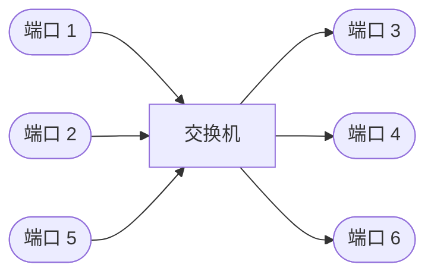
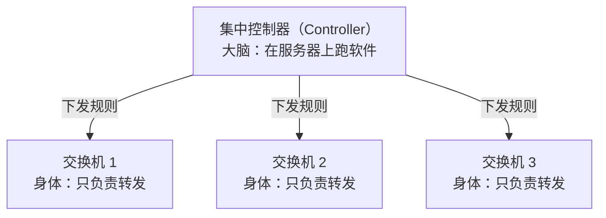
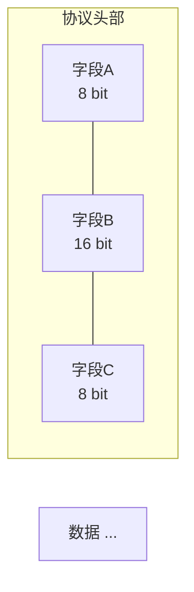
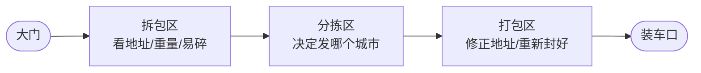
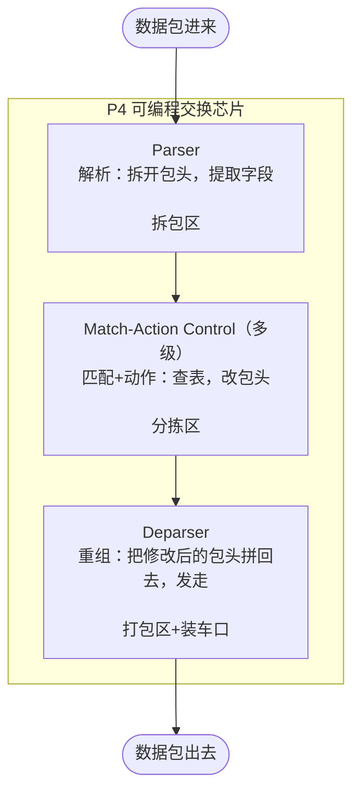
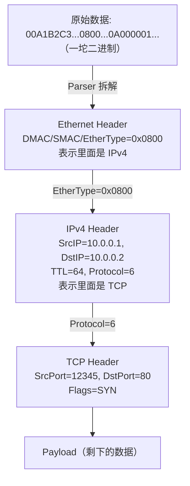
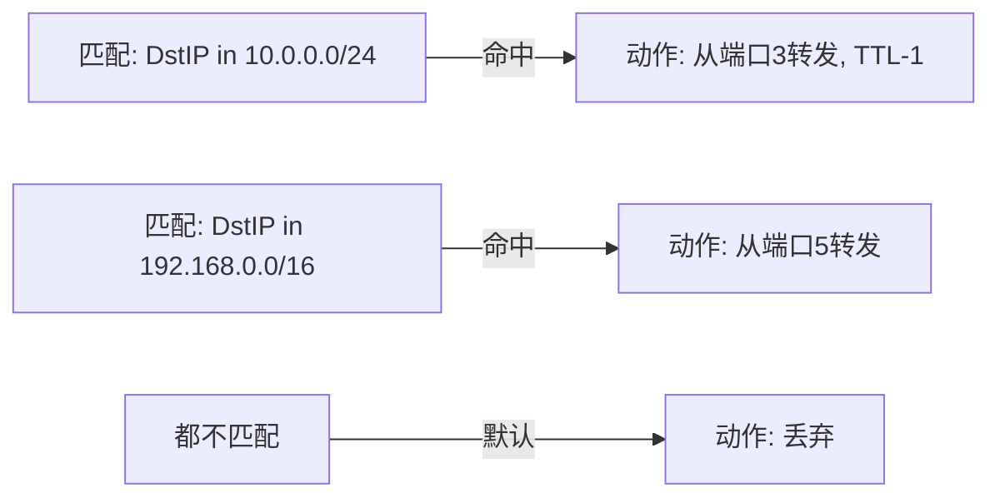
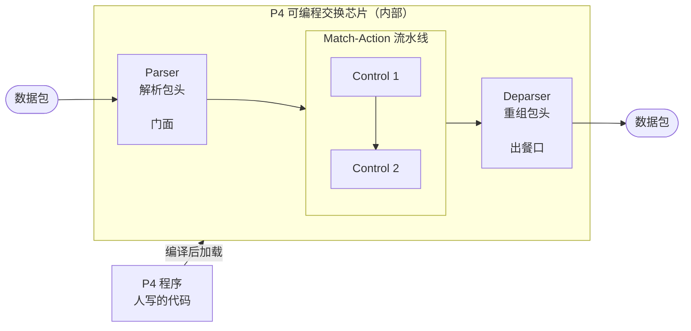
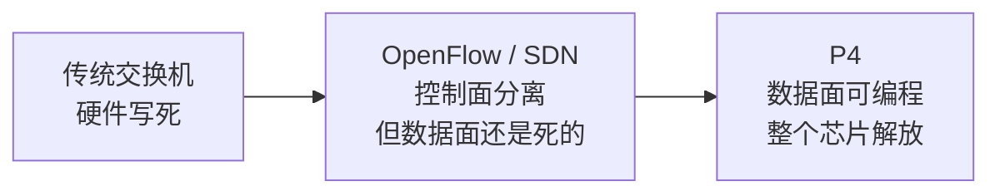
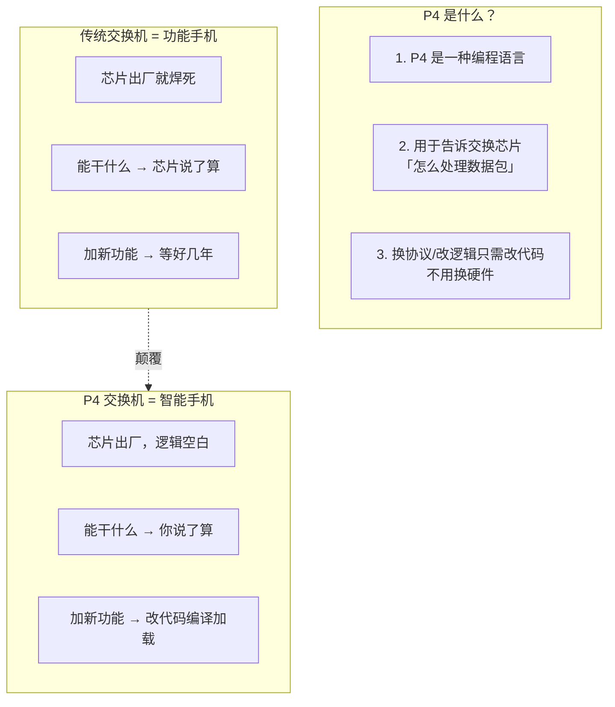

# 从零理解可编程交换芯片

> 写给完全零基础的人。不要求你懂网络，不要求你懂硬件。我们从最基础的概念开始，一步一步来。

---

## 第一章：交换机到底是什么

### 1.1 先忘掉"交换机"三个字

你用过**接线员**的故事吗？

很久以前打电话，你需要拿起电话，对总机接线员说："帮我接老王家。" 接线员把一根线插到老王的插孔上，你们就能通话了。

**交换机干的就这件事**——把从 A 口进来的数据，按照某种规则，送到 B 口出去。



数据从端口 1 进来，交换机看一眼，决定从端口 4 发出去。就这么简单。

### 1.2 那它怎么"决定"从哪个口出去？

靠一个东西叫**转发表**。你也可以理解为"通讯录"。

比如：

| 目标地址     | 从哪个口出去 |
| ------------ | ------------ |
| 192.168.1.10 | 端口 3       |
| 192.168.1.20 | 端口 5       |
| 10.0.0.1     | 端口 2       |

交换机收到一个数据包，一看目标地址是 `192.168.1.10`，查表，从端口 3 扔出去。搞定。

到这里你只需要记住一句话：**交换机 = 查表 + 转发**。

---

## 第二章：传统交换机是怎么做的

### 2.1 用硬件做，不是用软件做

你可能会想：这不就是查个表吗，写个 Python 程序不就完了？

问题在于：**太慢了**。

一个普通的交换机，每秒钟要处理**几十亿个包**。你用 Python 写个 if-else，一个包还没处理完，后面一亿个包已经丢了。

所以交换机里的数据处理，必须是**纯硬件电路**来做。硬件的好处是：快。非常快。

### 2.2 什么是 ASIC

ASIC 的全称是 Application-Specific Integrated Circuit（专用集成电路）。

翻译成人话：**一个焊死的、不能改的、专门干一件事的芯片**。

就像微波炉里的芯片只能加热食物，不能拿来打游戏。交换机的 ASIC 只能做"解析包头→查表→转发"，不能干别的。

它的处理流程大概是这样的：


**这个流程是刻死在芯片里的**。芯片出厂的时候，它能解析什么协议、能怎么查表、能怎么转发，全定了。

### 2.3 传统方案的致命问题

2010 年代前后，网络世界出现了几个变化：

**问题一：协议越来越多，芯片跟不上**

以前网络就 IPv4 + TCP，简单。后来有了 VLAN、MPLS、VXLAN、GRE、Geneve、GTP、SRv6……每出一个新协议，你就得：

- 等芯片厂设计新芯片（通常 2~3 年）
- 设备商把新芯片做成交换机（再 1~2 年）
- 你买回来，部署

**一个新协议要等 4~5 年才能用上**。云计算时代的节奏等不了这么久。

**问题二：每个厂商的芯片行为不完全一样**

你有 Cisco 的交换机，也有华为的交换机。同一个"转发"功能，两个芯片内部实现不同。

写网络管理软件的人最头疼的就是这个——他们需要为**每一种交换机单独写一份适配代码**。

**问题三：你想做点创新？门都没有**

比如你想在交换机里加一个自定义的"流量染色"功能：高优先级流量标记为红色，普通流量标蓝色。用传统交换机？不好意思，芯片不支持，你改不了硬件。

### 2.4 一个比喻

传统交换机就像**功能手机**。

老式诺基亚能打电话能发短信，但你没法给它装 App。一切都是出厂就定好的。你想加个新功能？买下一代手机吧。

---

## 第三章：SDN 的尝试——"让大脑和身体分离"

### 3.1 传统交换机的另一个问题

传统交换机里，**转发表是谁写的**？

答案是：交换机自己。

交换机之间互相通信（路由协议如 OSPF、BGP），各自计算各自的路由表。这就像一个没有交警的城市，每个司机自己计算路线，各有各的想法，堵车了也没人统一调度。

### 3.2 OpenFlow 的想法

2008 年前后，斯坦福大学的研究者们提出了 **SDN (Software-Defined Networking, 软件定义网络)**。

核心思想很简单：



大脑（Controller）统一计算所有交换机的转发表，下发给身体（交换机）。身体只管执行，不自己瞎算。

这个"大脑"和"身体"之间的通信协议，就是 **OpenFlow**。

### 3.3 OpenFlow 的好与不好

**好的一面**：

- 统一控制，不再各自为政
- 控制器可以写软件实现，灵活多了
- OpenFlow相当于整个流程是固定的，但是转发的方向，和转发经过的缓存位置都是可以改变的

**不好的地方（致命缺陷）**：

- OpenFlow 只能操作**已经存在的协议**（IPv4、TCP 等等）
- 你想加个新协议？对不起，还得改硬件
- OpenFlow 能改表项的内容，但改不了"怎么处理包"的流程

还是那个诺基亚手机——OpenFlow 相当于你可以远程给诺基亚发指令让它拨什么号码，但你没法让它运行一个 App。

---

## 第四章：P4 的突破——"让交换机可以编程"

### 4.1 关键洞察

斯坦福的研究者们意识到：**真正限制灵活性的不是控制方式，而是芯片本身**。

如果你能让芯片的处理逻辑可以在出厂后重新定义，那所有问题都解决了。

用什么来定义呢？一门**编程语言**。

2014 年，Nick McKeown 团队发表了 P4 论文——**Programming Protocol-independent Packet Processors**（协议无关的包处理编程语言）。

### 4.2 名字解读：为什么叫"协议无关"？

传统芯片：出厂时就写死了"你只能解析 IPv4、TCP、VLAN 这三种协议"。

P4 芯片：出厂时什么都没写死。你写一段 P4 程序，告诉它：

- "你该解析哪些协议"
- "每个协议的头部格式长什么样"
- "匹配哪些字段，怎么转发"

**芯片不预设任何协议。所有协议都由你来定义。** 这就叫"协议无关"。

### 4.3 举个具体的例子

假设你突然想支持一种**你自己设计的协议**——比如说叫 MyProto：




**传统方式**：给芯片厂提需求 → 等 3 年 → 买新交换机 → 部署。

**P4 方式**：写 20 行代码：

```p4
header myproto_t {
    bit<8>  fieldA;
    bit<16> fieldB;
    bit<8>  fieldC;
}
```

编译，加载到交换机上。**不到一个小时，你的交换机就认识 MyProto 了。**

### 4.4 P4 的本质

一句话：

> P4 是一种编程语言，让你能告诉交换芯片"你怎么处理每一个数据包"。

传统交换机：芯片出厂，处理方式固定。
P4 交换机：芯片出厂，处理方式由你写的 P4 程序决定。

---

## 第五章：可编程交换芯片的架构

### 5.1 先理解一个故事：快递分拣中心

想象一个超大规模的快递分拣中心，每小时处理 100 万个包裹。

包裹进来的流程：



1. **拆包区**：工人拆开包裹，看收件人地址、包裹重量、是不是易碎品
2. **分拣区**：根据地址，决定发往哪个城市。易碎品单独放。超重的走陆运。VIP 包裹优先处理。
3. **打包区**：如果地址写错了，改一下。重新封好。
4. **装车口**：送上对应城市的货车

### 5.2 P4 交换芯片就是这样的分拣中心



这个框架在 P4 术语中称为 **Pipeline（流水线）**。

### 5.3 三个核心模块详解

#### Parser（解析器）

Parser 的工作是"认协议"。

一个数据包进来，是一长串的 0 和 1。Parser 要做的就是把这一长串比特，按协议格式拆成一段一段的：



你在 P4 代码里，需要**定义**这些 Header 的结构，然后写 Parser 告诉芯片："看到 0x0800 就去解析 IPv4，看到 0x86DD 就去解析 IPv6"。

#### Match-Action（匹配-动作） / Control

这一部分是交换机的"大脑"——决定怎么处理这个包。

Match-Action 的逻辑：



Control 可以有多级。比如第一级做路由（决定往哪走），第二级做 ACL/防火墙（决定能不能走），第三级做 QoS（决定优先级）……

**这和传统的 if-else 有什么区别？**

区别在于实现方式。你用 Python 写的 if-else 按顺序一条条执行，1000 条规则就要匹配 1000 次。

P4 芯片里的 Match-Action 是**并行硬件查找**——不管你有 1 条还是 10000 条规则，查表速度几乎一样（用 TCAM/SRAM 等硬件查表结构）。

#### Deparser（反解析器）

Parser 把包头拆开了，Control 可能改了某些字段（比如 TTL 减了 1，MAC 地址改了）。

Deparser 的任务就是把这些修改后的包头**重新拼回去**，变成一个完整的可以发出去的数据包。

### 5.4 一张完整的图



---

## 第六章：从 OpenFlow 到 P4，一条发展线

把整个故事串起来：

| 年代        | 里程碑                 | 解决了什么问题         | 遗留下了什么问题                       |
| ----------- | ---------------------- | ---------------------- | -------------------------------------- |
| 1980s-2000s | 传统交换机 (固定ASIC)  | 高性能数据转发         | 芯片不可编程，新协议要等很多年         |
| 2008        | OpenFlow / SDN         | 集中控制，软件管理     | 能动表项但不能改处理逻辑，协议还是固定 |
| 2014        | P4 语言提出            | 芯片处理逻辑可编程     | （进入新纪元）                         |
| 2017        | P4_16 版本发布         | 语言成熟、被工业界接受 | —                                      |
| 2018-至今   | Tofino等可编程ASIC量产 | 真正可编程硬件商用     | 生态还在完善中                         |

你可以看到一条清晰的脉络：



---

## 第七章：一张图总结全文



---

## 第八章：下一步

现在你应该理解了：

- 交换机就是"查表+转发"的盒子
- 传统交换机用的固定芯片（ASIC），协议和处理流程出厂就定了
- SDN/OpenFlow 解决了"集中管理"的问题，但芯片还是固定的
- P4 更进一步，让芯片本身可以重新编程——就像给手机装 App 一样

带着这些理解，去读 P4 入门教程时，你就知道它在讲什么了。

**推荐下一步**：打开 [P4 Tutorial 的 Basic Forwarding](https://github.com/p4lang/tutorials/tree/master/exercises/basic) 练习，你已经具备了看懂它的背景知识。

---

## 名词速查表

| 名词                         | 一句话解释                                               |
| ---------------------------- | -------------------------------------------------------- |
| **交换机 (Switch)**          | 查表+转发数据包的设备                                    |
| **路由器 (Router)**          | 功能更强的交换机，通常指三层（IP层）转发                 |
| **数据包 (Packet)**          | 网络中传输的数据单位，包含头部（元信息）+ 数据           |
| **ASIC**                     | 专用集成电路，为特定功能定制、不可修改的硬件芯片         |
| **SDN**                      | 软件定义网络，把控制逻辑从交换机里拿出来放到服务器上     |
| **OpenFlow**                 | SDN 的第一个标准协议，控制平面和数据平面之间的"语言"     |
| **控制平面 (Control Plane)** | 管"决策"的：路由怎么算、策略怎么定                       |
| **数据平面 (Data Plane)**    | 管"执行"的：收到包 → 查表 → 转发（这就是 P4 编程的领域） |
| **P4**                       | 数据平面编程语言，让你定义交换机怎么处理包               |
| **Parser**                   | P4 程序的一部分，负责解析数据包的协议头                  |
| **Match-Action**             | P4 的核心逻辑：匹配条件→执行动作                         |
| **Deparser**                 | P4 程序的一部分，把修改后的包头拼回去                    |
| **v1model**                  | BMv2 软件交换机使用的 P4 架构模型                        |
| **PSA**                      | 便携式交换机架构，P4 的标准硬件架构规范                  |
| **BMv2**                     | 软件交换机，在普通电脑上模拟 P4 交换机行为               |
| **P4Runtime**                | 控制平面通过 gRPC 远程操作 P4 交换机的接口协议           |
| **Tofino**                   | Intel 出品的 P4 可编程 ASIC 芯片（业界最主流）           |