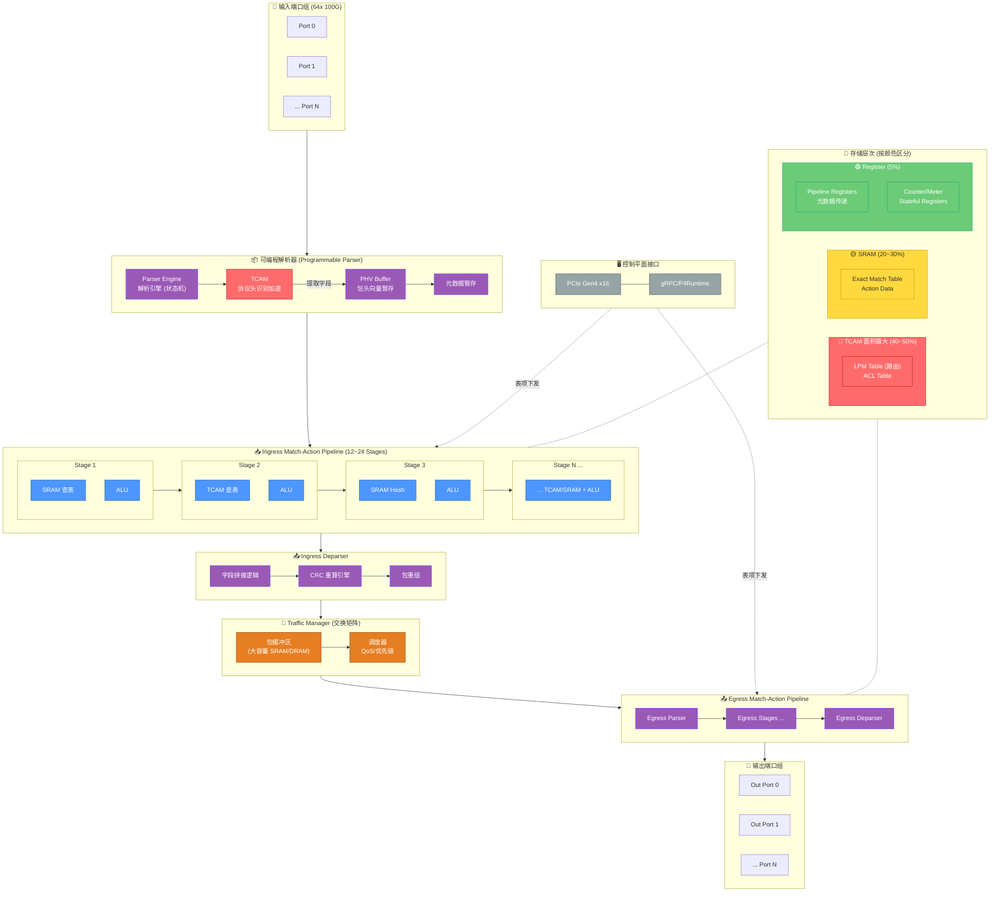
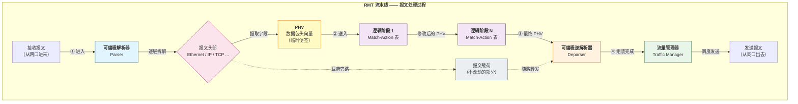
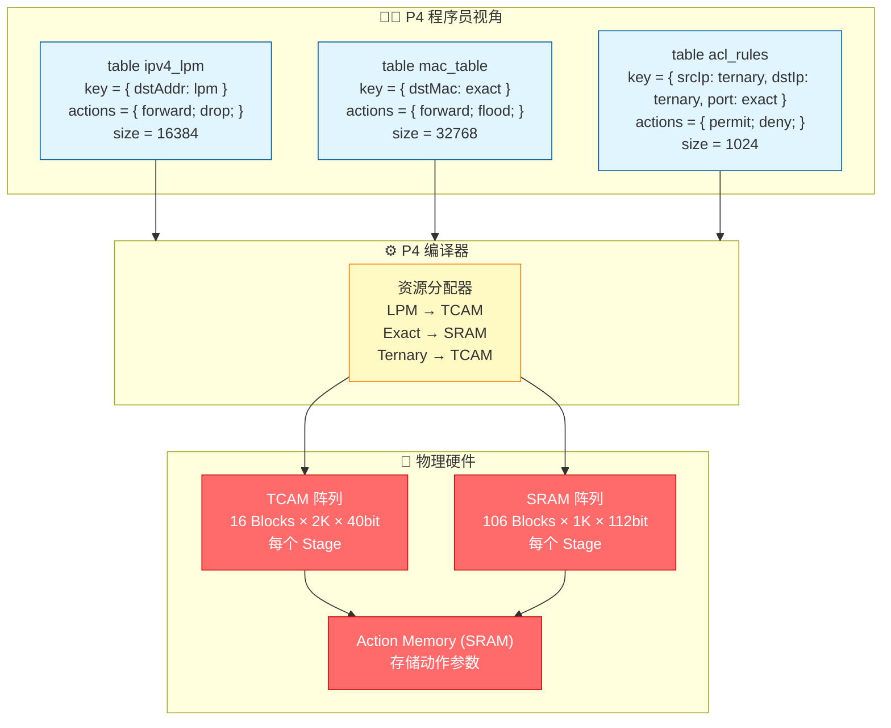
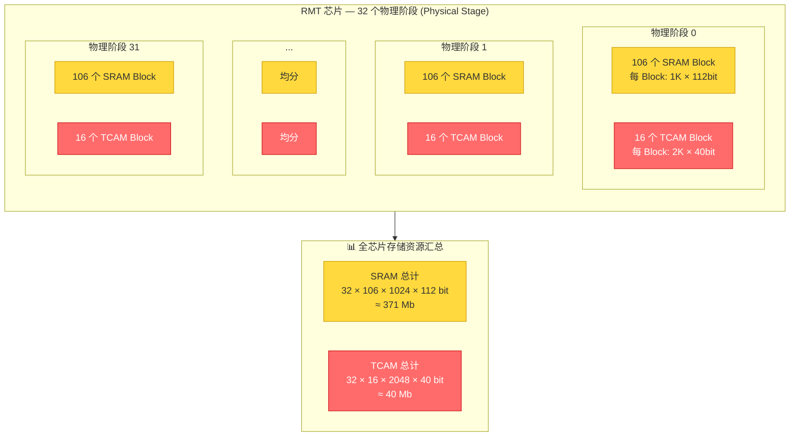
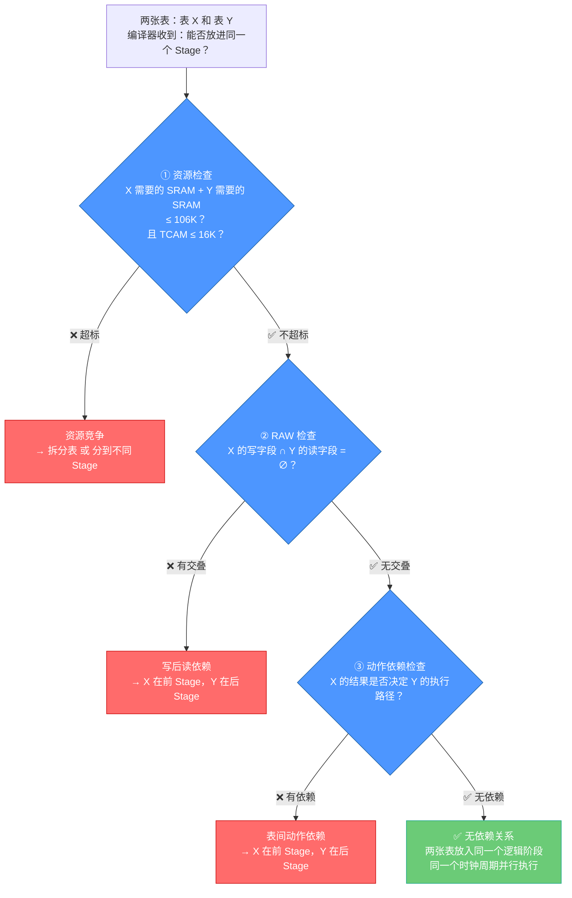
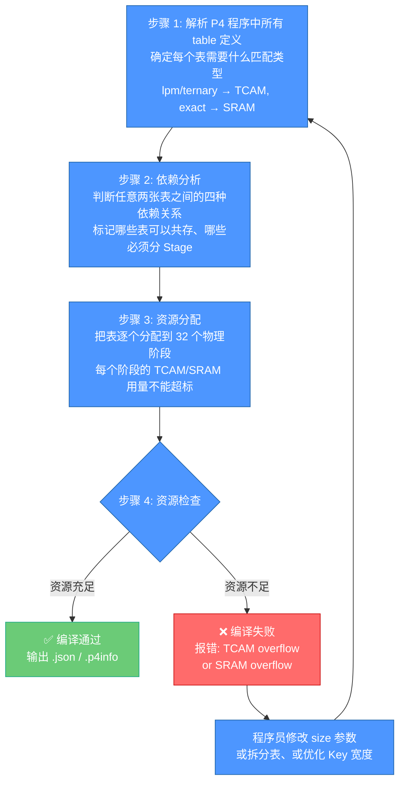
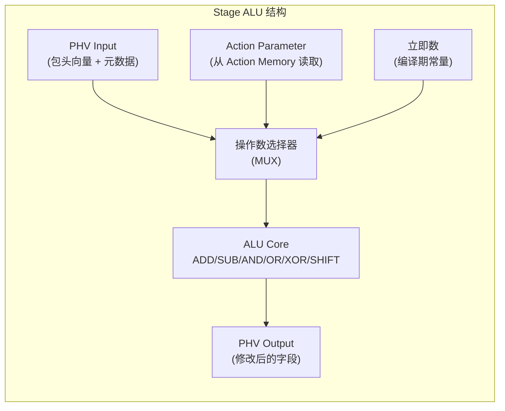
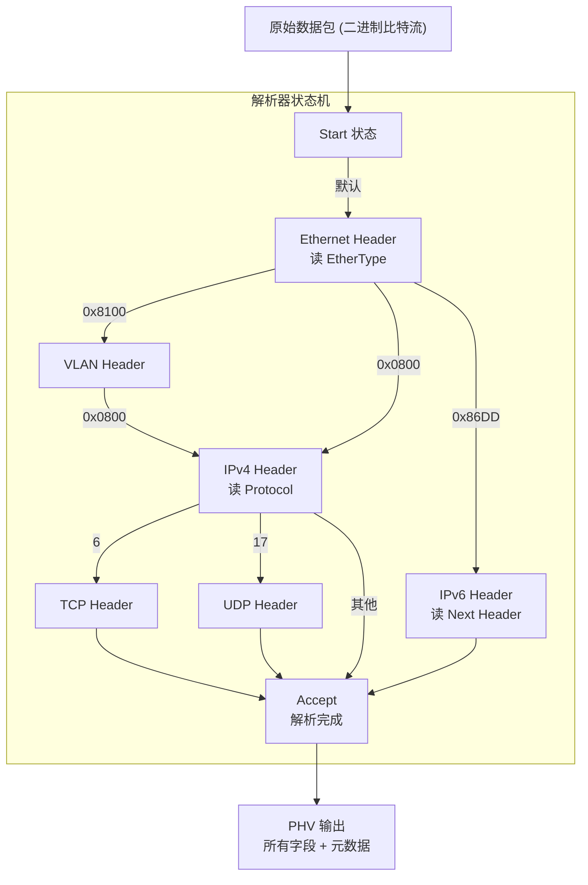
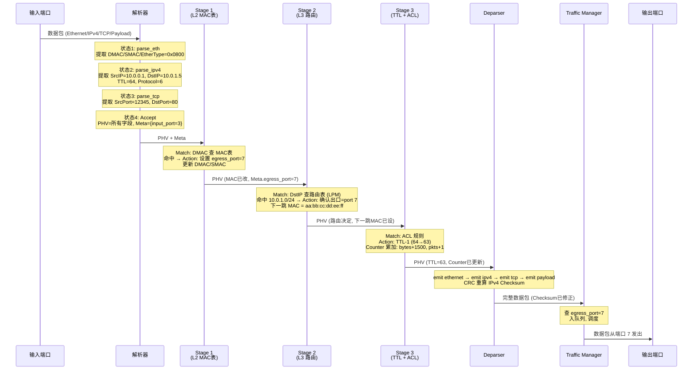

# 可编程交换芯片 RMT 架构深度解析

> **作者视角**：一位参与过可编程交换芯片架构讨论的资深芯片架构师
>
> **读者定位**：有计算机网络基础、知道 P4 语言，但对芯片微架构和硬件实现细节不熟的工程师
>
> **核心比喻**：全文贯穿「智能快递分拣流水线」比喻

---

## 全景架构图（顶置）



> **图例**：🔴红 = TCAM（最大最贵）、🟡黄 = SRAM、🟢绿 = Register、🔵蓝 = 计算单元、🟣紫 = 解析器、🟠橙 = 流量管理器

---

## 1 基础概念 — 什么是 RMT？为什么需要它？

### 1.1 传统交换芯片（ASIC）的痛点

想象一座快递分拣中心。

20 年前的分拣中心只有三种包裹：「文件」「普货」「冷链」。传送带跑得飞快，每个工位的工人只看包裹上贴的**固定标签**（比如「文件→北京口」「普货→上海口」），标签种类和判断规则在传送带安装时就焊在工位上。

这就是传统 ASIC 交换芯片。它的处理流水线在**芯片设计阶段**就敲死了：

- 你能处理的协议 = 设计时支持的协议
- 你能做的操作 = 设计时定义的操作
- 你想加个新标签？= 换下一代芯片（等 3~5 年）

**具体痛点**：

| 痛点       | 行业例子                                                     |
| ---------- | ------------------------------------------------------------ |
| 协议固定   | Broadcom Trident 出厂时认识 Ethernet/IPv4/IPv6/TCP，但 VXLAN？下一版再说 |
| 功能固化   | ACL 规则数量、QoS 队列数、VLAN 表大小 — 出厂时焊死，没法调   |
| 新协议滞后 | VXLAN 标准 2014 年发布，支持它的芯片 2016 年才量产 — 两年空窗期 |
| 厂商锁定   | 华为芯片和 Cisco 芯片行为细节不同，网管软件必须各写一套适配层 |

### 1.2 SDN 带来的新需求

2010 年后，云计算和 SDN 的浪潮改变了网络行业：

- 「我们想自己定义包处理逻辑」— 就像 App 开发者不想等苹果更新系统才能加功能
- 「新协议要快速上线」— SRv6 草案写完，希望半年内能部署，不是三年
- 「一套代码跑在所有交换机上」— 别让我为每个芯片单独写适配层

SDN 解决了「谁来计算路由」的问题（集中控制器），但数据平面（芯片怎么处理包）依然是固定的。**控制面的解放，不等于数据面的解放。**

### 1.3 RMT 的核心思想

2013 年，Bosshart 等人在 SIGCOMM 上提出了 **RMT（Reconfigurable Match Table，可重构匹配表）** 架构。

核心思想：

> **把芯片里写死的「匹配→动作」引擎，变成一排可重新配置的硬件工位。P4 编译器在编译时决定：每个工位查什么表、匹配什么字段、执行什么动作。**

类比快递分拣中心：

- **传统分拣中心（固定 ASIC）**：工位1只看「目的地」标签→只能做路由；工位2只看「是否易碎」→只能做分类；工位建设和标签都焊死
- **RMT 分拣中心（可重构硬件）**：所有工位长得一模一样，功能由「小程序」决定。工位1今天做路由，明天可以改成 VLAN 检查

**关键区别 — RMT 不是 FPGA**：

|           | RMT                                  | FPGA                                    |
| --------- | ------------------------------------ | --------------------------------------- |
| 重构方式  | **编译时**配置硬件流水线行为         | **运行时**重新烧写门级逻辑              |
| 重构粒度  | 粗粒度（表大小、匹配类型、动作选择） | 细粒度（任意门级逻辑）                  |
| 性能      | 线速转发（Tbps 级）                  | 较低（Gbps 级，需大规模并行才勉强跟上） |
| 功耗/面积 | 优化过的大块可配置逻辑，效率高       | 门级可编程，效率低                      |
| 一句话    | 「给每个工位换一本新的操作手册」     | 「把整个工位拆了重搭」                  |

> ⚠️ **重要澄清**：RMT 不是运行时动态重配置。P4 程序编译后生成的配置（表大小、匹配类型、动作组合）在加载芯片时就固定了，之后**你只能改表项的内容，不能改表的类型和大小**。要改？重新编译、重新加载。

### 1.4 全文比喻对照表

| 芯片模块                   | 快递分拣中心比喻                                            |
| -------------------------- | ----------------------------------------------------------- |
| 数据包                     | 包裹                                                        |
| 包头字段                   | 包裹面单（收件人、重量、易碎标志、VIP 等级）                |
| 解析器 (Parser)            | 入口扫码枪 — 识别面单上的所有字段                           |
| PHV（包头向量）            | 贴在包裹上的临时便签 — 记录解析出的所有字段                 |
| 元数据 (Metadata)          | 便签上的手写备注 — 「这个包裹走了哪个入口」「优先级是多少」 |
| Match-Action Stage         | 一个分拣工位 — 看一眼便签 → 查规则本 → 操作包裹             |
| TCAM                       | 工位的「万能规则本」— 同时翻到所有页比对，找到匹配的那条    |
| SRAM                       | 工位的「索引卡片盒」— 按编号找卡片，精确匹配                |
| ALU                        | 工位工人的双手 — 改面单、贴新标签、计算校验和               |
| 逆解析器 (Deparser)        | 出口打包机 — 把修改过的面单和包裹重新包好                   |
| 交换矩阵 (Traffic Manager) | 传送带分叉口 — 把包裹送到正确出口                           |

---


## 2 RMT 整体流水线设计 — 一个包的一生

在深入每个模块之前，你必须先从宏观上理解：**一个包从进到出，到底经历了什么**。

### 2.1 一张图看懂全流程



> **图例**：🔵 解析器、🟡 PHV（临时便签）、🟣 Match-Action 逻辑阶段、🟠 逆解析器、🟢 流量管理器、🩷 报文头部、⬜ 载荷

### 2.2 逐步骤拆解：跟着五个标注节点走

上图中我标了 ① ② ③ ④ 四个关键转移，以及一条虚线载荷旁路。下面逐一拆解，用快递分拣中心的比喻贯穿始终。

---

#### 步骤 ①：报文进入 — 站在分拣中心大门口

```
一个包裹（数据包）通过网口进入芯片。
```

这个包裹目前是一串**连续的二进制比特流**。它还不知道自己是什么——就像一个没有拆封的包裹，外面只有一张快递单。

紧接着，它被送入 **Parser（解析器）**。Parser 的工作就一件事：**搞清楚这张快递单上写了什么。**

---

#### 步骤 ①→②：Parser 拆包，生成 PHV

```
Parser 的工作流程：
  Ethernet 头 → VLAN 头 → IP 头 → TCP/UDP 头 → ...
       ↓           ↓         ↓         ↓
  [提取字段]  [提取字段]  [提取字段]  [提取字段]
       ↓           ↓         ↓         ↓
          全部塞进 PHV（数据包头向量）
```

**Parser 做了什么**：

Parser 是一个**可配置的有限状态机**。它按照 P4 程序定义的协议图，一层一层地「读面单」：

1. 先读 Ethernet 头（14 字节），提取 DMAC、SMAC、EtherType
2. EtherType=0x0800 → 说明里面是 IPv4，继续读 IPv4 头（20 字节），提取 SrcIP、DstIP、TTL、Protocol
3. Protocol=6 → 说明里面是 TCP，继续读 TCP 头（20 字节），提取 SrcPort、DstPort、Flags
4. 读完了，Parser 工作结束 → 输出 **Accept**

**关键产物：PHV（Packet Header Vector，数据包头向量）**

PHV 可以理解为一张**贴在包裹上的临时便签**：

```
┌──────────────────────────────────────────────┐
│              PHV（包头向量）                   │
├──────────────────────────────────────────────┤
│ 以太网字段：DMAC SMAC EtherType                │   ← 从包头提取
│ IPv4 字段：SrcIP DstIP TTL Protocol           │   ← 从包头提取
│ TCP 字段：SrcPort DstPort Flags SEQ ACK       │   ← 从包头提取
├──────────────────────────────────────────────┤
│ 元数据字段：input_port packet_length timestamp │   ← 芯片自己加的
└──────────────────────────────────────────────┘
```

PHV 的宽度在设计时固定（Tofino 约 1024 bit），它包含了**本次包处理需要用到的所有信息**。从这一刻起，Match-Action 流水线**不再读原始包数据**——它只读 PHV 上的便签。

---

#### 载荷旁路（虚线箭头）：为什么包头和载荷分开走？

注意图中有一条虚线：`报文头部 → 报文载荷 → 随路转发 → Deparser`。

这意味着：**Parser 只处理包头，包的载荷（Payload，比如网页内容、邮件正文）完全不管，直接旁路发送到 Deparser 等待。**

为什么这样设计？

- **效率**：一个 1500 字节的包，包头可能只有 50 字节。如果你让所有 Match-Action Stage 都搬运 1500 字节，带宽浪费 97%
- **PHV 只存字段**：载荷里没有「需要查表的字段」，所以不需要进入 PHV
- **Deparser 再拼回来**：包头被 Parser 拆开、被流水线修改后，Deparser 再把它和一直等在旁边的载荷拼回去

类比快递分拣：工人只看面单（= 包头），不看包裹里面的东西（= 载荷）。包裹本身直接从入口传送带送到出口打包区等着，不经过分拣工位。

---

#### 步骤 ②：PHV 在 Match-Action 流水线中流动

```
PHV → Stage 1 → Stage 2 → Stage 3 → ... → Stage N → 修改后 PHV
```

这是 RMT 芯片的核心——**一连串完全相同的硬件工位**。

每个 Stage 的内部结构：

```
┌────────────────────────────────────────┐
│             Stage K                     │
│                                         │
│  输入：前一个 Stage 的 PHV                 │
│          ↓                              │
│  ┌──────────────┐  ┌──────────────┐     │
│  │ 查表（Match） │  │ 查表（Match） │      │
│  │  TCAM/SRAM   │  │  TCAM/SRAM   │     │
│  └──────┬───────┘  └──────┬───────┘     │
│         │                 │             │
│         ▼                 ▼             │
│  ┌──────────────────────────────┐       │
│  │  执行动作（ALU）               │       │
│  │  PHV 字段被修改                │       │
│  └──────────────┬───────────────┘       │
│                 │                       │
│  输出：修改后的 PHV → 下一个 Stage          │
└────────────────────────────────────────┘
```

**Stage 1 到 Stage N 的差异**：

- **硬件上完全一样**：每个 Stage 都有一模一样的 TCAM/SRAM/ALU
- **逻辑上可以不同**：P4 编译器在编译时为每个 Stage 分配不同的「任务」。Stage 1 做 L2 转发，Stage 2 做 L3 路由，Stage 3 做 ACL，Stage 4 做 QoS……
- **顺序排好不能跳**：包必须按 Stage 1→2→3→...→N 的顺序走完，不能跳过某个 Stage

**一个 Stage = 一个时钟周期**：

Tofino 运行在 ~1GHz 时钟频率下，每个 Stage 的工作必须在 **1 纳秒** 内完成。这包括：从 PHV 读字段 → 查 TCAM/SRAM → 执行 ALU 运算 → 写回 PHV → 送入流水线寄存器。

---

#### 步骤 ③：PHV 进入 Deparser（逆解析器）

经过 N 个 Stage 后，PHV 上的很多字段可能被修改了：

- `TTL` 减了 1
- `DMAC` 被替换为下一跳的 MAC 地址
- `SMAC` 被替换为出接口的 MAC 地址
- 可能新增了一个 `VXLAN` 头

现在 Deparser 要做的事：**把 PHV 上的字段 + 旁路过来的载荷，重新拼成一个完整的数据包**。

```
Deparser 工作流程：
  PHV 字段列表 → 按 P4 的 emit 顺序拼接 → CRC 重算 → 完整数据包
```

---

#### 步骤 ④：经过 Traffic Manager，发出

**入口流水线决定“这个包要去哪个端口”，出口流水线决定“这个包以什么样子离开”。**

重新组装好的包进入 **Traffic Manager（流量管理器）**，它要做三件事：

1. **缓冲（Buffering）**：出端口可能正忙，包先存到片内 SRAM 缓冲区里排队
2. **调度（Scheduling）**：按 QoS 优先级决定哪个包先发
3. **多播/复制（Multicast）**：如果需要把同一个包发到多个端口，在这里复制

最后，包从目标端口发出。

---

#### 睁开眼睛看全貌：不只是单流水线，是双流水线

前面用一条简化流水线讲清楚了 Parser → Stages → Deparser → TM 的单向流程。但**真实的 RMT 芯片有两条完整的流水线**——一个包穿越 Traffic Manager 后，还要再走一遍：

```mermaid
graph LR
    subgraph RMT["<b>RMT 双流水线报文处理架构</b>"]
        direction LR

        A["接收报文"] --> B["<b>入口解析器</b><br/>Ingress Parser"]

        B -->|PHV| C["<b>逻辑阶段 1 ~ N</b><br/>Match-Action 表<br/>Ingress MA Pipeline"]

        C -->|PHV| D["<b>入口逆解析器</b><br/>Ingress Deparser"]

        D -->|完整报文| E["<b>流量管理</b><br/>Traffic Manager<br/>交换矩阵"]

        E -->|转发至出口| F["<b>出口解析器</b><br/>Egress Parser"]

        F -->|PHV| G["<b>逻辑阶段 1 ~ N</b><br/>Match-Action 表<br/>Egress MA Pipeline"]

        G -->|PHV| H["<b>出口逆解析器</b><br/>Egress Deparser"]

        H -->|完整报文| I["发送报文"]

        style B fill:#e1f5fe,stroke:#01579b
        style D fill:#e1f5fe,stroke:#01579b
        style F fill:#e1f5fe,stroke:#01579b
        style H fill:#e1f5fe,stroke:#01579b
        style C fill:#f3e5f5,stroke:#4a148c
        style G fill:#f3e5f5,stroke:#4a148c
        style E fill:#e8f5e9,stroke:#1b5e20
    end
```



> **图例**：🔵 解析器、🟣 Match-Action 流水线、🟢 流量管理器 / 交换矩阵

**为什么需要两条？两条有什么区别？**

|                    | **入口流水线（Ingress）**                  | **出口流水线（Egress）**                           |
| :----------------- | :----------------------------------------- | :------------------------------------------------- |
| **处理时机**       | 包刚进入交换机，**还没决定去哪**           | 包已经确定要去哪个端口，**准备发出去**             |
| **核心任务**       | **查表找路**                               | **修改格式**                                       |
| **做什么**         | 查MAC表、查路由表、ACL过滤、决定输出端口号 | 重写MAC地址、重新计算校验和、加隧道头、QoS排队     |
| **能不能跳过**     | 不能。包必须查表才能知道往哪送             | 不一定。如果出口不需要改任何东西，可以跳过或浅处理 |
| **在芯片里的位置** | 在**交换矩阵之前**                         | 在**交换矩阵之后**                                 |
| **对包的操作**     | 修改的是**转发元数据**（输出端口号）       | 修改的是**包本身的字段**（源MAC、TTL、VXLAN头）    |


**回到快递分拣中心。一个包裹的处理可以分成两阶段：**

|                          | Ingress 流水线                                       | Egress 流水线                                 |
| ------------------------ | ---------------------------------------------------- | --------------------------------------------- |
| **时间段**               | 包裹刚进分拣中心时                                   | 包裹已经确定出哪个口、在出口传送带上          |
| **做的事**               | 决定「往哪走」：L2 转发、L3 路由、ACL 过滤、封装隧道 | 决定「怎么走」：L3 路由、ACL 过滤、封装隧道   |
| **比喻**                 | 入口大厅的检查和分拣                                 | 出口装车前的最后的确认                        |
| **能改什么**             | 包头（加/删/改字段）、决定出口                       | 包头（QoS 标记、追加 Egress ACL）、更新计数器 |
| **Qos 标记、Egress ACL** | 添加/修改隧道封装（如 VXLAN）                        | 剥离隧道封装、外层 VLAN 标记                  |


**用一张表看清“入口改什么，出口改什么”**

| 操作                   | 在哪条流水线做？ | 为什么？                                   |
| :--------------------- | :--------------- | :----------------------------------------- |
| 查路由表确定下一跳     | **入口**         | 不知道去哪个端口，包没法转发               |
| 修改TTL减1             | **入口**         | 每个包都要减，入口顺手做了                 |
| 修改目的MAC为下一跳MAC | **出口**         | 因为只有到了出口才知道具体的下一跳MAC      |
| 加VXLAN隧道头          | **出口**         | 只在发往隧道对端时才需要加                 |
| 剥VXLAN隧道头          | **出口**         | 只在发往普通服务器时才需要剥               |
| ACL访问控制            | **入口**         | 尽早拦截非法包，节省资源                   |
| QoS流量整形/限速       | **出口**         | 每个端口的限速策略不同，出口按端口配置执行 |
| 镜像复制一份给监控端口 | **入口或出口**   | 取决于镜像点配置，但通常在出口做           |


**两条流水线共享什么？不共享什么？**

**整个芯片里只有一套Match-Action硬件（比如32个Stage），但它在时间上被分成了两半：**

- 前一半时间/前一半Stage → 跑入口流水线的程序
- 后一半时间/后一半Stage → 跑出口流水线的程序

| 问题                   | 答案                                                         |
| :--------------------- | :----------------------------------------------------------- |
| **硬件有几套？**       | **1套**。就是那32个物理Stage（在Tofino里）。                 |
| **入口怎么用？**       | 编译器把入口程序的Match-Action逻辑，**映射到前16个Stage**。  |
| **出口怎么用？**       | 编译器把出口程序的Match-Action逻辑，**映射到后16个Stage**。  |
| **运行时能切换吗？**   | 不能动态切换。芯片启动时加载配置，入口占前16级、出口占后16级，**固定死**。 |
| **入口能用后16级吗？** | 不能。入口的逻辑**只能放在前16级**，因为包先经过入口流水线，再经过交换矩阵，然后才到出口流水线——**物理顺序决定了前后关系**。 |

> **所以，入口和出口“共享”的是同一套物理Stage芯片，但“不共享”的是各自占用的Stage编号范围。**

------


**❌ 不共享的：Parser（解析器）和 Deparser（逆解析器）**

| 问题                     | 答案                                                         |
| :----------------------- | :----------------------------------------------------------- |
| **硬件有几套？**         | **2套**。入口有一整套Parser + Deparser，出口也有一整套Parser + Deparser。 |
| **为什么不能共享？**     | 因为它们在物理位置上**分处交换矩阵的两侧**。入口Parser在芯片入口，出口Parser在芯片出口，地理位置就不同，没法共用。 |
| **入口Deparser做什么？** | 把入口处理完的PHV和载荷重组，输出一个**完整报文**给交换矩阵。 |
| **出口Parser做什么？**   | 把交换矩阵送来的完整报文**重新拆开**，生成新的PHV给出口流水线处理。 |
| **为什么要重新拆？**     | 因为包经过入口流水线后，可能已经变了（TTL减了、VLAN标签剥了、隧道头解了），出口不能拿旧的PHV来用，必须重新解析新包。 |

> **所以，Parser和Deparser完全不共享——入口有自己的，出口有自己的，各管各的。**

------


**❌ 不共享的：PHV（包头向量）**

| 问题                                  | 答案                                                         |
| :------------------------------------ | :----------------------------------------------------------- |
| **入口PHV**                           | 入口Parser从原始包生成的PHV，经过入口流水线处理，送到入口Deparser时**就不再是PHV了**——它已经被组装回完整报文里了。 |
| **出口PHV**                           | 出口Parser从收到的完整报文**重新生成**一个全新的PHV，这个PHV跟入口的那个PHV**没有任何关系**。 |
| **入口PHV穿过交换矩阵吗？**           | **不穿**。穿过交换矩阵的是**完整报文**（包含载荷），不是PHV。入口Deparser已经把PHV和载荷组装成完整包了。 |
| **那之前说的“PHV跟着走”是什么意思？** | 是指在入口流水线内部（Parser → Stage1 → Stage2 → ... → Deparser），PHV在每个Stage之间传递。但到了Deparser之后，PHV就没了，被组装成包了。 |

> **所以，入口PHV和出口PHV是两套完全独立的临时数据，互不相干。**

|                     | 入口                                                        | 出口                                                      |
| :------------------ | :---------------------------------------------------------- | :-------------------------------------------------------- |
| **匹配-动作表硬件** | 用同一套物理Stage（比如Tofino的32级），但逻辑上**独立配置** | 同一套硬件，但配置的程序不同                              |
| **PHV（包头向量）** | 入口生成一个PHV，包经过交换矩阵时PHV也跟着走                | 出口**重新解析**包生成新的PHV（因为入口可能已经改过包了） |
| **解析器/逆解析器** | 各有一套独立的Parser和Deparser                              | 各有一套独立的Parser和Deparser                            |


**Traffic Manager 是两条流水线之间的「传送带岔路口」**：

```
Ingress 流水线处理完 → 包进入 Traffic Manager
                         │
                         ├─ 决定从哪个出端口走
                         ├─ 决定 QoS 队列优先级
                         ├─ 如果需要多播，在这里复制 N 份
                         └─ 送入对应出口的 Egress 流水线
```

**为什么不在 Ingress 一条流水线里干完所有事？**

两个原因：

1. **多播复制**：一个包从 Ingress 出来要发给 3 个出口 → 需要 3 份拷贝 → 每份拷贝可能在不同出口走不同的 Egress 处理（出口 A 的 VLAN tag 是 100，出口 B 的是 200）
2. **资源隔离**：把 Ingress 的「入方向决策」和 Egress 的「出方向修饰」物理隔离，编译器可以独立优化两条流水线

**Tofino 的物理实现**：Ingress 和 Egress 各 12~16 个 Stage，**共用同一块硅片**，但逻辑上完全独立。就像一个分拣中心有两个大车间：入口车间和出口车间，中间由传送带连接。

### 2.3 流水线设计理念：为什么必须这样做？

核心原则：**每个工位只干一件事，干完马上传给下一个工位。**

```
时钟周期 T0：包 A 在 Stage 1，包 B 未到达
时钟周期 T1：包 A 在 Stage 2，包 B 在 Stage 1
时钟周期 T2：包 A 在 Stage 3，包 B 在 Stage 2，包 C 在 Stage 1
...

包 A 一共走了 N 个周期（N 个 Stage），但
从外界看，每个时钟周期都有一个包从流水线出来
→ 实现了「一个周期处理一个包」的线速吞吐
```

**关键：流水线深度 ≠ 单包延迟。**

| 概念                   | 解释                   | 比喻                                                     |
| ---------------------- | ---------------------- | -------------------------------------------------------- |
| **吞吐（Throughput）** | 每秒处理多少包         | 流水线每小时出多少包裹                                   |
| **延迟（Latency）**    | 一个包从进到出花了多久 | 一个包裹从进门到装车花了多久                             |
| 流水线深度增加         | 吞吐不变、延迟增加     | 加更多工位：每条包裹在流水线上待更久，但每小时总产出不变 |

### 2.4 深度与宽度的权衡

| 设计决策                         | 带来的好处                                   | 付出的代价                            |
| -------------------------------- | -------------------------------------------- | ------------------------------------- |
| Stage 更多（更深）               | 能做更长的动作链（VXLAN+VLAN+QinQ 多级封装） | 芯片面积↑、单包延迟↑                  |
| Stage 更少（更浅）               | 面积小、功耗低                               | 复杂操作可能放不下——一个 Stage 做不完 |
| 每个 Stage 更宽（更多 ALU/存储） | 查更大表、执行更复杂动作                     | 功耗和面积急剧增长                    |
| 每个 Stage 更窄（紧凑型）        | 省面积                                       | 编译器可能报「装不下」                |

**Tofino 的取舍**：12 个 Ingress + 12 个 Egress Stage，每个 Stage 可容纳约 32K SRAM 条目或 1K TCAM 条目。这是经过大量真实 P4 程序统计后确定的「最优点」。

### 2.5 流水线中的「气泡」与 Stall

完美流水线的假设是「每个 Stage 正好 1 周期完成」。但现实可能出问题：

| 场景          | 比喻                         | 硬件原因                       | 后果                   |
| ------------- | ---------------------------- | ------------------------------ | ---------------------- |
| **哈希冲突**  | 两个包裹要同时查同一本登记本 | 同一 SRAM 模块命中相同 Hash 桶 | 一个包等一周期         |
| **资源竞争**  | 两条分流同时涌向一个工位     | Traffic Manager 输出调度冲突   | 缓冲排队               |
| **TCAM 延迟** | 规则本太厚翻页来不及         | TCAM 输出需多周期稳定          | 已通过 Pipeline 化解决 |

设计目标：**99.99% 情况下无 Stall**。停顿就意味着丢包或线下限速——对一台标称"线速 6.4Tbps"的交换机来说，哪怕 0.01% 的停顿都是不可接受的。

---


## 3 存储模块设计 — RMT 的「记忆系统」

这是 RMT 芯片**硬件成本的最大头**。一个 Tofino 芯片，存储部分占硅片面积的 70%~80%。理解存储就是理解 RMT 的成本、性能和编程约束。

### 3.1 设计哲学：把硬件资源抽象成「表」

RMT 的存储设计有一个核心思想——**归一化抽象**：

> 把底层异构的硬件存储（TCAM、SRAM），向上层 P4 程序员统一暴露为**与协议无关的 Match-Action 表**。表的匹配字段、动作、容量都可以由程序指定，程序员不需要知道「这张表用的是 TCAM 还是 SRAM」。

**两种核心存储的分工**：

| 存储类型 | 芯片中的角色     | 支持的匹配类型                               | 容量                       | 典型用途                     |
| -------- | ---------------- | -------------------------------------------- | -------------------------- | ---------------------------- |
| **TCAM** | 稀缺的「万能表」 | 最长前缀匹配（LPM）、三元通配匹配（Ternary） | 少（仅 16 个 Block/Stage） | 路由表、ACL 表               |
| **SRAM** | 充足的「精确表」 | 精确匹配（Exact）、范围匹配（Range）         | 大（106 个 Block/Stage）   | MAC 表、ARP 表、动作参数存储 |



> **关键点**：P4 程序写 `lpm` 匹配 → 编译器自动分配 TCAM；写 `exact` 匹配 → 编译器自动分配 SRAM。但如果你不小心把 `size` 写太大了，编译器会直接报错——芯片上没有「无限的」存储。

### 3.2 物理存储资源：精确到 Block 级别

RMT 芯片的存储资源是**严格分配到每个物理 Stage** 的。这是一个真实的 RMT 参考实现参数：



**逐项解读这些数字**：

| 参数                             | 数值            | 含义                                                        |
| -------------------------------- | --------------- | ----------------------------------------------------------- |
| **物理阶段数**                   | 32 个           | 整个芯片的 Match-Action 流水线分为 32 个物理位置            |
| **每个物理阶段的 SRAM Block 数** | 106 个          | 每个 Block 是一个独立的 SRAM 存储单元，可单独分配给一张表   |
| **每个 SRAM Block 容量**         | 1K 条 × 112 bit | 可存 1024 条精确匹配表项 + 动作索引                         |
| **每个物理阶段的 TCAM Block 数** | 16 个           | TCAM 是稀缺资源，每个 Stage 只有 16 个 Block                |
| **每个 TCAM Block 容量**         | 2K 条 × 40 bit  | 可存 2048 条 LPM/Ternary 表项                               |
| **全芯片 SRAM 总容量**           | ~371 Mb         | 32 × 106 × 1024 × 112 ≈ 371 Mb                              |
| **全芯片 TCAM 总容量**           | ~40 Mb          | 32 × 16 × 2048 × 40 ≈ 40 Mb                                 |
| **存储分配方式**                 | **平均分配**    | 存储资源均匀分布在 32 个 Stage 上，不存在「资源池集中分配」 |

**用快递分拣中心理解**：

- **物理阶段** = 传送带上的 32 号工位位置。空位就在那里，寸土寸金，不能移动
- **TCAM Block** = 工位的「万能规则本」，只有 16 个柜子，每个柜子 2000 页
- **SRAM Block** = 工位的「索引卡片盒」，有 106 个盒子，每个盒子 1000 张卡片
- 所有工位的资源总量在**建传送带时就固定了**。P4 编译器不能「把 33 号工位的柜子搬到 5 号」，只能在你选的工位上找空位放规则

### 3.3 三层抽象：物理阶段 → 逻辑阶段 → Match-Action 表

RMT 的存储管理引入了**三层抽象**，这是理解编译器行为的关键：

```
┌────────────────────────────────────────────────┐
│              P4 程序员看见的                      │
│  ┌──────────┐  ┌──────────┐  ┌──────────┐      │
│  │  表 1    │  │  表 2    │  │  表 3    │      │
│  │ Match:   │  │ Match:   │  │ Match:   │      │
│  │ Action:  │  │ Action:  │  │ Action:  │      │
│  │ Size:1K  │  │ Size:2K  │  │ Size:4K  │      │
│  └──────────┘  └──────────┘  └──────────┘      │
├────────────────────────────────────────────────┤
│              逻辑阶段的抽象                      │
│         ┌──────────────────────┐                │
│         │    逻辑阶段 K         │               │
│         │  ┌──────┐ ┌──────┐   │               │
│         │  │表 1  │ │表 2  │   │               │
│         │  └──────┘ └──────┘   │               │
│         └──────────────────────┘                │
├────────────────────────────────────────────────┤
│              物理硬件的限制                      │
│  ┌────────────────────────────────────┐        │
│  │        物理阶段 K                    │       │
│  │  16 TCAM Blocks + 106 SRAM Blocks  │        │
│  └────────────────────────────────────┘        │
└────────────────────────────────────────────────┘
```

**物理阶段（Physical Stage）**：硬件位置。32 个物理位置，每个有固定的存储资源。

**逻辑阶段（Logical Stage）**：P4 编译器对物理阶段的**虚拟化包装**。编译器的目标是把 P4 表**映射到**逻辑阶段，逻辑阶段再**绑定到**物理阶段。一个物理阶段只能承载一个逻辑阶段，但一个逻辑阶段可以容纳**多张彼此没有依赖的独立表**。

**Match-Action 表**：P4 程序定义的 `table { key = ...; actions = ...; size = ...; }`。这是程序员接触的最小单元。

### 3.4 表的摆放规则：四种依赖关系决定能否共存

### 3.4 表的摆放规则：四种依赖关系决定能否共存

两张表能不能放进**同一个逻辑阶段**，取决于它们之间有没有**依赖关系**。RMT 架构定义了 4 种依赖关系，下面逐一深入剖析。

---

#### 关系一：无依赖（Independent Match Dependencies）

**定义**：两张表的 Key 字段和 Action 操作字段完全不相交——互不干扰。

**P4 代码示例**：

```python
// 表 A 只看 MAC 地址
table l2_forward {
    key = { hdr.ethernet.dstAddr: exact; }
    actions = { forward; flood; }
}

// 表 B 只看 VLAN
table vlan_filter {
    key = { hdr.vlan.vid: exact; }
    actions = { permit; drop; }
}
```

表 A 的 Key 是 `hdr.ethernet.dstAddr`，表 B 的 Key 是 `hdr.vlan.vid`——两个字段互不相关。它们的 Action 也不修改对方 Key 依赖的字段。

**硬件上的行为**：

```text
同一个 Stage 内：
  PHV 到来
    ├── 同时读取 dstAddr ──→ TCAM/SRAM ──→ Action: forward
    └── 同时读取 vlan.vid ──→ TCAM/SRAM ──→ Action: permit
  两组查表并行执行，互不阻塞
```

**判定条件**（编译器如何判断无依赖）：

- 表 A 的 key 字段集合 ∩ 表 B 的 action 写字段集合 = ∅
- 表 B 的 key 字段集合 ∩ 表 A 的 action 写字段集合 = ∅
- 两张表使用的存储资源之和 ≤ 当前 Stage 的资源上限

**快递分拣中心比喻**：一个工位上站着两个工人，工人 A 只看包裹面单上的「收件人」字段，工人 B 只看「易碎标签」。两人各自看各自的、各自改各自的，谁也不用等谁。

---

#### 关系二：写后读依赖（RAW — Read After Write）

**定义**：表 A 的 Action **修改了** PHV 中的某个字段，表 B 的 Key **要使用这个修改后的字段**进行匹配。

**这是四种依赖中最常见、也最容易踩坑的一种。**

**P4 代码示例**：

```python
// 表 A：根据入端口 + VLAN 决定要不要剥 VLAN
table vlan_processing {
    key = {
        meta.ingress_port: exact;  // 入口
        hdr.vlan.vid: exact;       // VLAN ID
    }
    actions = {
        strip_vlan;   // 删除 VLAN 头
        keep_vlan;    // 保留 VLAN 头
    }
}

// 表 B：用"是否还有 VLAN 头"做路由决策
table ipv4_route {
    key = {
        hdr.ipv4.dstAddr: lpm;
        meta.vlan_stripped: exact;  // ← 这个字段是表 A 的 Action 写入的！
    }
    actions = { route_vlan; route_no_vlan; }
}
```

**为什么不能放同一个 Stage**：

```text
如果强行放同一个 Stage：

  时钟周期 T：
    PHV 进入 Stage K
    ├── 表 A 的 Key 查 hdr.vlan.vid → Action: strip_vlan
    │   此时 meta.vlan_stripped 尚未被写入！（硬件还要几个纳秒才能写完）
    │
    └── 表 B 的 Key 查 meta.vlan_stripped → 读到的是旧值！❌
  
  结果是：表 B 用了错误的 Key 去匹配，导致路由决策错误。
```

**正确的摆放**：

```
Stage K：   [表 A] 读 vlan.vid → Action strip_vlan → 写入 meta.vlan_stripped
  ↓ PHV 传递（流水线寄存器）
Stage K+1： [表 B] 读 meta.vlan_stripped（此时已经是新值了）→ Action route_vlan
```

**RAW 的最常见场景**：

| 场景       | 前表 Action                           | 后表 Key/依赖                           |
| ---------- | ------------------------------------- | --------------------------------------- |
| TTL 处理   | 前表`hdr.ipv4.ttl = hdr.ipv4.ttl - 1` | 后表 Key 用`hdr.ipv4.ttl` 做 match      |
| 端口设置   | 前表 Action`set_egress_port(3)`       | 后表 Action 用`meta.egress_port` 做决策 |
| VLAN 编辑  | 前表 Action`add_vlan(100)`            | 后表 Key 用`hdr.vlan.vid` 匹配          |
| VXLAN 封装 | 前表 Action`encap_vxlan(...)`         | 后表 Key 用`hdr.outer_ip.dstAddr` 路由  |
| NAT        | 前表 Action`nat(srcIP=新IP)`          | 后表 Key 用修改后的 SrcIP 做 ACL        |

**快递分拣中心比喻**：工人 1 拿起笔把面单上的城市从「上海」划掉，改成「北京」。工人 2 的工作是根据面单上的城市决定走哪个出口——但他必须等工人 1 把字写完才能看，不然他看到的是改之前的「上海」。所以两人不能站在同一个工位上。

---

#### 关系三：表间动作依赖（Action Dependency / Table Invocation Dependency）

**定义**：表 A 的**匹配结果**（命中了哪条表项）会直接决定表 B 的**行为**——表 B 需要表 A 的输出才能工作。

这和 RAW 不同：RAW 是字段值依赖（「读」依赖「写」），而动作依赖是**控制流依赖**（「表 B 是否执行」依赖「表 A 匹配了什么」）。

**P4 代码示例**：

```python
// 表 A 的结果决定表 B 的行为
apply {
    switch (l3_classify.apply().action_run) {
        ipv4_unicast: { ipv4_route.apply(); }       // 走了 IPv4 路由分支
        ipv4_multicast: { multicast_group.apply(); } // 走了组播分支
        mpls: { mpls_swap.apply(); }                 // 走了 MPLS 分支
        default: { drop(); }
    }
}
```

**为什么不能放同一个 Stage**：

同一 Stage 内的所有表是**并行硬件执行**的。硬件在同一时钟周期内同时做：

- 查表 A 的 Key → 等待结果
- 查表 B 的 Key → 等待结果

但表 B 是否应该被执行，取决于表 A 的结果。硬件无法在同一个周期内先拿到表 A 结果再决定要不要执行表 B——**这一拍已经过去了**。

**编译器处理**：

```
编译器看到 switch(table_A.apply().action_run) 时：
  → 标记表 A 和后续所有被 switch 引用的表之间存在「动作依赖」
  → 强制将表 A 放在 Stage K
  → 将所有依赖表 B [的所有可能分支表] 放在 Stage K+1
  → 确保表 A 的结果在流水线寄存器中稳定后，下一周期才被使用
```

**关键细节**：即使你用了 `if` 而不是 `switch`，效果一样——P4 的 `if` 在硬件上不是真正的运行时分支，编译器必须把所有可能路径都分配好 Stage：

```python
// 这段代码，编译器会把 ipv4_route 和 mpls_swap 都放在后续 Stage
if (hdr.ipv4.isValid()) {
    ipv4_route.apply();          // ← 分支 A：放到 Stage K+1
} else if (hdr.mpls.isValid()) {
    mpls_swap.apply();           // ← 分支 B：也放到 Stage K+1
}
```

**快递分拣中心比喻**：工人 1 看完面单后喊了一句「这是易碎品」，工人 2 听到后才决定要垫泡沫还是直接装箱。工人 2 必须等工人 1 喊完才能行动——不能同时干活。两个工人必须站在不同工位上。

---

#### 关系四：资源竞争（Resource Conflict）

**定义**：两张或多张表需要的存储资源总量超过单个物理阶段的上限。

**这和前面三种不同**——前面三种是逻辑上的约束，这个是物理上的硬限制。

**具体场景**：

```
假设你定义了这些表：

表 A：l2_forward  — match: exact, size: 80000 条  → 需要 80K SRAM entries
表 B：acl_rules   — match: ternary, size: 3000 条  → 需要 3K TCAM entries
表 C：arp_table   — match: exact, size: 40000 条  → 需要 40K SRAM entries

单 Stage 资源上限：106K SRAM + 16K TCAM

编译器尝试把这些表放进 Stage K：
  SRAM 需求：表 A (80K) + 表 C (40K) = 120K > 106K ❌ 超标！
  TCAM 需求：表 B (3K) < 16K ✅ 够用

编译器报错或尝试拆分：
  → 把表 A 放在 Stage K (80K SRAM)
  → 把表 C 放进 Stage K+1 (40K SRAM) 或拆成两半分到两个 Stage
```

**编译器能做的优化**（自动拆表）：

```
编译器发现表 C 太大，自动拆分为：

Stage K：   c1 = 表 C[0..19999]  占用 20K SRAM
Stage K+1： c2 = 表 C[20000..39999]  占用 20K SRAM

前提：表 C 必须是无依赖的（exact match 可以拆分，LPM 也可以拆分）
但 Ternary match 和 Range match 不能机械拆分，因为匹配结果可能不一一致。
```

**资源竞争导致的 bad case**：

```p4
table huge_lpm {
    key = { hdr.ipv6.dstAddr: lpm; }  // IPv6 LPM — 需要 TCAM
    size = 100000;                     // 10 万条 TCAM 条目！
}

// 全芯片 TCAM 总量：32 Stages × 16 Blocks × 2K = 1024K = 约 100 万条
// 但你一个表就要 10 万条 → 10% 的 TCAM 被一张表吃掉了
// 编译器还能装上，但如果再定义其他 TCAM 表可能就放不下了
```

**快递分拣中心比喻**：两个工人的规则本加起来有 120 本，但工位上总共只有 106 个柜子。放不下就是放不下，要么减规则本厚度（减小 size），要么分到两个工位（拆表）。

---

#### 四种依赖总结对比表

| 关系         | 判定依据                                       | 本质           | 能否同 Stage | 编译器策略                   | 最常出现场景            |
| ------------ | ---------------------------------------------- | -------------- | ------------ | ---------------------------- | ----------------------- |
| **无依赖**   | Key/写字段完全不交叠                           | 并行无关       | ✅ 可以       | 打包同 Stage，并行执行       | L2 转发 + VLAN 过滤     |
| **RAW**      | 表A写了字段F，表B读了字段F                     | 数据流先后顺序 | ❌ 不可以     | 表A在Stage K，表B在Stage K+1 | TTL修改后路由、NAT后ACL |
| **动作依赖** | 表A的结果决定表B是否/如何执行                  | 控制流先后顺序 | ❌ 不可以     | Switch分支全部放后续Stage    | 按协议类型分流水线      |
| **资源竞争** | 存储需求 > 单Stage上限（106K SRAM / 16K TCAM） | 物理容量限制   | ❌ 不可以     | 拆表vs报错                   | 大容量IPv6路由表        |

**编译器决策流程图**：



### 3.5 入口/出口流水线共享存储

存储资源由**入口（Ingress）流水线**和**出口（Egress）流水线**共同使用。

RMT 为每张表都增加一个**归属标识**，用于标记该表是被 Ingress 还是 Egress 使用。编译器在分配资源时，会把 Ingress 表和 Egress 表分别映射到各自流水线的 Stage 上，互不干扰：

```
Ingress 流水线：  Ingress Parser → MA Stage 0~11 → Ingress Deparser
                                         ↑
                                  使用物理阶段 0~11 的存储

                       Traffic Manager (无 MA 处理)

Egress 流水线：   Egress Parser  → MA Stage 12~23 → Egress Deparser
                                         ↑
                                  使用物理阶段 12~23 的存储
```

> 物理阶段 0~11 的存储资源归 Ingress 用，物理阶段 12~23 归 Egress 用。编译器通过归属标识确保二者不会互相抢占。

### 3.6 P4 编译器如何管理存储

有了上面这些约束，编译器的工作流程可以总结为：



**Tofino 编译器常见报错**：

```
Error: Table 'ipv4_lpm' requires 16384 TCAM entries per stage,
but only 1024 are available in Stage 3.
```

```
Error: Raw dependency detected: Table 'set_port' modifies 'egress_port',
but Table 'encap_vxlan' reads 'egress_port'.
Tables cannot be placed in the same logical stage.
```

**这就是为什么 P4 不是「随便写」的语言**——你定义了多少张表、每张表的 size 多大、表之间有无依赖，直接决定了你的程序能不能在芯片上跑。这和 Python 随便分配内存有本质区别。

---

## 4 计算模块设计 — RMT 的「肌肉」

### 4.1 匹配（Match）引擎

每个 Stage 的匹配引擎是高度并行化的硬件查找单元。

**TCAM 匹配流程**：

1. 提取搜索 Key（如 hdr.ipv4.dstAddr + metadata.input_port）
2. 将 Key 同时喂给该 Stage 的所有 TCAM 条目
3. 所有条目并行比较，命中者输出匹配地址
4. 如果多条命中（LPM/TERNARY），优先级编码器选优先级最高的
5. 用匹配地址查 Action Memory，取出动作参数

**SRAM 哈希匹配流程**：

1. 提取搜索 Key
2. 通过硬件 Hash 函数（CRC/Toeplitz）算 Hash 值
3. Hash 值索引 SRAM 桶
4. 取出桶内条目，逐个比较 Key（解决哈希冲突）

**多表并行**：一个 Stage 可以同时配多个独立的查找表（比如同时查 MAC 表和 VLAN 表），Key 来自 PHV 的不同字段，并行执行互不干扰。

### 4.2 动作（Action）执行单元

每个 Stage 的 ALU 是一组精简的硬件运算器：



**典型硬件原语**：

| 操作类型 | 指令         | 用途                 |
| -------- | ------------ | -------------------- |
| 算术     | add, sub     | TTL-1、计数器累加    |
| 逻辑     | and, or, xor | 掩码操作、标志位设置 |
| 位移     | shl, shr     | 字段对齐、提取       |
| 位赋值   | assign_field | 修改包头字段         |
| 哈希     | hash         | ECMP hash、Checksum  |

### 4.3 VLIW（超长指令字）

**dRMT（数据流 RMT）** 引入了 VLIW 思想：一个 Stage 内可以并行执行多条动作指令。

```
传统 RMT：Stage N → 执行 1 条动作 → 传给 Stage N+1
dRMT：    Stage N → 同时执行 TTL-1 + 更新 Counter + 修改 MAC → 传给 Stage N+1
```

类比：传统工位一个工人做一件事，VLIW 工位多个工人**同时**对同一个包裹操作。代价：更宽的 ALU、更大的面积和功耗。

### 4.4 计算模块的资源约束

| 约束项          | 典型限制                         | 原因                     |
| --------------- | -------------------------------- | ------------------------ |
| 每 Stage 动作数 | 1~8 条                           | ALU 数量有限             |
| 每动作参数数    | 4~8 个                           | 动作存储带宽限制         |
| Hash 函数       | 预设 2~4 种（CRC16/32/Toeplitz） | 硬件 Hash 单元是固定电路 |
| 复杂计算        | 乘法受限，除法不支持             | 面积代价太大             |

> **为什么没有除法？** 一个 32 位硬件除法器占几千个门电路 ≈ 几十个加法器的面积。网络数据平面极少数场景需要除法，这就是为什么 P4 不强制支持除法。

---

## 5 可编程解析器（Parser）设计

### 5.1 解析器的作用

包裹进入分拣中心，第一件事：扫码枪扫描面单。

芯片解析器做同样的事：从数据包最开头，按协议层次一层一层「读面单」，把有用字段提取到 **PHV（Packet Header Vector，包头向量）** 中。



### 5.2 硬件实现

解析器硬件本质是**可配置有限状态机（Configurable FSM）**：

- **状态转移表**（存于 SRAM）：每一行 = `{当前状态, 匹配条件, 下一状态}`。P4 编译器把 Parser 图翻译成这个表
- **字段提取表**（存于 SRAM）：每一行 = `{状态, 字段名, 偏移量, 长度}`。告诉硬件在这个状态该从包数据中提取哪些字段
- **TCAM 加速**：对于 TLV（Type-Length-Value）变长协议头，用小型 TCAM 加速匹配

硬件每个时钟周期执行一次状态转移 + 一次字段提取，最大解析深度由芯片设计时固定（Tofino 典型值：可解析最多约 10~12 层嵌套协议）。

### 5.3 解析器的可重构性

- **字段提取配置**：P4 程序指定要提取哪些字段，硬件按配置提取
- **协议扩展支持**：新增协议头只需更新 Parser Graph 配置，无需改硬件
- **解析器深度限制**：芯片设计时固定最大解析深度，超过则标记为 Parser Error 并丢弃/上报

---

## 6 逆解析器（Deparser）设计

### 6.1 逆解析器的作用

解析器把包裹拆开了，流水线可能改了面单上的字，现在需要**重新包回去**。

Deparser 要做的事：把 PHV 中所有字段（有些被 ALU 修改过），按照程序指定的顺序，逐个拼接成一个完整的数据包，发往出端口。

### 6.2 硬件实现

```
Deparser 工作流程：
PHV 中的字段列表 → 字段拼接器 (MUX/移位器) → CRC 重算引擎 → 完整数据包
```

- **字段拼接逻辑**：硬件按 P4 的 `emit` 语句定义的顺序依次拼接字段。哪个 Header 有效就输出哪个，无效的跳过。顺序由 P4 编译器生成，运行时不可变
- **CRC 更新**：改了 IP 头字段后 Checksum 要重算，Deparser 里配了专用 CRC 硬件引擎做这件事

### 6.3 常见陷阱

- 如果你在 P4 代码中 `emit` 了 `hdr.ipv4`，但 Deparser 认为 `hdr.ipv4.isValid() == false`——> 包发出去**缺了 IP 头**，接收方直接丢弃
- 如果你忘了 `emit` 某个包在流水线中新加的头（比如 VXLAN 封装）——> VXLAN 头没了，对面不认识

**Deparser 不负责判断「该不该发这个头」，它只按配置好的顺序逐字段拼接。** 数据是否正确由 Parser + 流水线保证。

---

## 7 完整数据流示例 — 跟一个包走完流水线

以下是一个 **IPv4 路由转发** 数据包的完...过程中通过每一级的详细操作。



---

## 8 RMT 芯片的实现成本评估（架构师视角）

### 8.1 芯片面积成本

| 模块            | 占芯片面积比例 | 说明                                               |
| --------------- | -------------- | -------------------------------------------------- |
| **TCAM**        | 40%~50%        | 面积最大 — 每个单元 10~30 个晶体管 vs SRAM 的 6 个 |
| **SRAM**        | 20%~30%        | 存储表条目和动作参数                               |
| **ALU/逻辑**    | 10%~15%        | 计算单元 + 控制逻辑                                |
| 片上网络/互联   | 10%~15%        | 数据在 Stage 间传输的走线开销                      |
| Parser/Deparser | 5%~10%         | 相对较小                                           |

### 8.2 功耗成本

| 功耗来源      | 说明                                                 |
| ------------- | ---------------------------------------------------- |
| TCAM 动态功耗 | **极高** — 每次查表全部条目并行比较，功耗远大于 SRAM |
| 时钟树        | 高频时钟（Tofino ~1GHz）驱动大面积芯片的时钟分布网络 |
| SRAM 读写     | 中等                                                 |
| I/O           | 64×100G SerDes 功耗占芯片的 20%~30%                  |

**典型总功耗**：100W~300W，需要主动散热（风扇/液冷）。

### 8.3 制造成本

- 采用最先进制程（7nm/5nm）制造
- **流片费用（Mask Cost）**：数千万美元
- TCAM 和 SRAM 大阵列影响良率（Yield），进一步推高单颗成本
- **Tofino 系列单颗售价**：数千至数万美元

### 8.4 开发成本

- P4 编译器 + 芯片 SDK 开发投入巨大（Intel P4 Studio 是多年研发成果）
- 网络运营商学习 P4 编程和流水线优化的人力成本
- 不同芯片的编译器不通用（Tofino 编译器和 Broadcom 编译器完全独立）

---

## 9 RMT 架构的意义 — 为什么它改变了网络行业

### 9.1 技术意义

- **网络民主化**：运营商不再受芯片厂商协议支持周期的束缚，可以自己定义包处理逻辑
- **加速协议创新**：VXLAN、SRv6、INT（带内遥测）等新技术能在几个月内上线，不必等 3 年
- **软硬件协同设计**：P4 + RMT 建立了从高级语言到硬件实现的完整工具链

### 9.2 产业意义

- 打破了 Broadcom 等传统 ASIC 厂商的垄断，Intel（收购 Barefoot）、Marvell 等新玩家入场
- 推动了**白盒交换机**生态：运营商可以自主选择「芯片 + 操作系统 + 软件」组合
- 催生了新的商业模式：芯片厂商卖芯片 + SDK，网络软件公司卖 P4 程序

### 9.3 局限性与未来演进

**RMT 的局限**：

- 编译时重配置，无法应对需要运行时动态改变处理逻辑的场景（需配合 FPGA 或 NPU）
- 对复杂控制流（循环、多条件分支）支持差 — 所有执行路径必须是固定的流水线
- 表资源必须在编译时静态分配，「动态增长表」不可能

**演进方向 — dRMT（数据流 RMT）**：

- 引入数据流计算思想，支持流水线内并行处理不同逻辑，减少资源浪费
- 增加更多 ALU 实现 VLIW，支持一个 Stage 内执行多条动作
- 更灵活的存储分配：允许相邻 Stage 共享 SRAM/TCAM 池

---

## 10 总结 + 灵魂拷问

### 10.1 一张表总结 RMT 核心参数

| 参数            | 典型值（以 Tofino 为例）     | 说明                              |
| --------------- | ---------------------------- | --------------------------------- |
| 流水线 Stage 数 | 32（Ingress 16 + Egress 16） | 每个 Stage 一个 Match-Action 单元 |
| 每 Stage SRAM   | 可配置至 32K 条              | P4 编译器按需分配                 |
| 每 Stage TCAM   | 可配置至 1K~2K 条            | 最稀缺资源                        |
| 总 TCAM 容量    | ~100 Mb                      | 芯片上最昂贵的地产                |
| 总 SRAM 容量    | ~200 Mb                      | 存储表条目 + 动作参数             |
| 吞吐量          | 6.4 Tbps（Tofino 2）         | 64 × 100G 端口线速                |
| 功耗            | ~150W                        | 需主动散热                        |
| PHV 宽度        | ~1024 bit                    | 决定了单包能携带的元数据上限      |
| Parser 最大深度 | 约 10~12 层                  | 决定了能解析多少层嵌套协议        |

### 10.2 三个灵魂拷问（自测是否真懂了）

**问题 1：为什么 RMT 芯片不能像 CPU 一样支持复杂的循环和条件分支？**

**答案**：RMT 的核心理设是**每个数据包每个时钟周期流过一个 Stage**。循环意味着数据包要在某个 Stage 停留多个周期等待循环结束——这会**阻塞后续所有数据包**。CPU 可以为个别任务「暂停」因为他有缓存、乱序执行、超线程等多种机制来处理指令级的不确定性，硬件开销极大。交换芯片追求的是确定性吞吐，所有执行路径必须在编译时展开为确定的流水线序列。所以 P4 语言的死循环是编译错误，parser 里的状态循环也必须能展开为确定深度的展开。

**问题 2：如果我的 P4 程序需要查一张 5 万条规则的路由表，但物理上整个芯片的 TCAM 只有 2 万条容量，编译时会发生什么？**

**答案**：编译器会报资源不足的错误（`Resource allocation failed: TCAM overflow`）。这不是编译器的问题，是物理限制。可能的解决方案：

- **减小表 size 声明**：如果你的表实际运行时不超过 2 万条，把 P4 中的 `size` 参数调小
- **换更小的匹配粒度**：比如用 LPM 前缀聚合而不是精确匹配
- **分层查找**：Stage N 做粗粒度匹配（如查 /16 前缀），Stage N+1 做细粒度匹配（查 /24），把一张大表拆成多级小表
- **把表跨多个 Stage 拆分**：编译器会自动尝试，但如果总容量仍然不够，只能换更大的芯片

**问题 3：RMT 的「可重构」和 FPGA 的「可重构」本质区别是什么？**

**答案**：

|                                  | RMT                                               | FPGA                                             |
| -------------------------------- | ------------------------------------------------- | ------------------------------------------------ |
| **粒度**                         | 粗粒度 — 只能改「表大小」「匹配类型」「动作选择」 | 细粒度 — 可以改写每一个逻辑门                    |
| **时机**                         | 编译时 — P4 程序编译 → 配置加载 → 运行时只改表项  | 运行时 — 可以随时重新烧写比特流                  |
| **面积效率**                     | 高 — 大块优化的硬件单元，接近固定 ASIC 的性能密度 | 低 — LUT/FF 电路有大量冗余，面积大 10~20 倍      |
| **类比喻**                       | 把每个工位的「操作手册」换成新版本，工位本身不变  | 把整个工位拆了，用乐高积木重新搭建               |
| **为什么网络用 RMT 不用 FPGA？** | FPGA 无法在几百瓦功耗下达到几十 Tbps 的吞吐       | 成本、功耗、性能三者中 FPGA 在网络场景中没有优势 |

---

## 附录：参考资源

| 资源                                         | 链接                                                         |
| -------------------------------------------- | ------------------------------------------------------------ |
| RMT 原始论文 (Bosshart et al., SIGCOMM 2013) | 搜索 "Forwarding Metamorphosis: Fast Programmable Match-Action Processing in Hardware for SDN" |
| dRMT 论文 (SIGCOMM 2017)                     | 搜索 "dRMT: Disaggregated Programmable Switching"            |
| Tofino 白皮书 (Barefoot)                     | Intel 官网搜索 "Tofino Architecture"                         |
| P4_16 语言规范                               | https://p4.org/specifications/                               |
| PSA 架构规范                                 | https://p4.org/specifications/                               |
| P4c 编译器源码                               | https://github.com/p4lang/p4c                                |
| BMv2 Simple Switch 文档                      | https://github.com/p4lang/behavioral-model/blob/master/docs/simple_switch.md |

---

> **最后更新**：2026 年 7 月
>
> 本文从芯片架构师视角拆解了 RMT 架构的每一个硬件模块，从存储层次（TCAM/SRAM/Register）到计算引擎（Match+Action+ALU），从解析器状态机到 Deparser 字段拼接，最后评估了实际芯片的成本。全文贯穿「快递分拣流水线」比喻，便于建立硬件直觉。
>
> 如果你能回答文末三个灵魂拷问，说明你已经真正理解了 RMT 架构的精髓。